# BaseStar signal manifests and discovery queries

Generated from the model's runtime manifests and query sets. Do not edit directly.

## AverageRotationalSpeed


```

### Query-DWIS.DAQBridge.BaseStar.Model.MechanicalSubOutputData-AverageRotationalSpeed-000

```sparql
PREFIX rdf:<http://www.w3.org/1999/02/22-rdf-syntax-ns#>
PREFIX ddhub:<http://ddhub.no/>
PREFIX quantity:<http://ddhub.no/UnitAndQuantity/>

SELECT ?BaseStarAverageRotationalSpeed
WHERE {
	?BaseStarAverageRotationalSpeed_01 rdf:type ddhub:DerivedMeasurement .
	?BaseStarAverageRotationalSpeed_01 rdf:type ddhub:ContinuousDataType .
	?BaseStarAverageRotationalSpeed_01 ddhub:HasDynamicValue ?BaseStarAverageRotationalSpeed .
	?BaseStarAverageRotationalSpeed_01 ddhub:IsOfMeasurableQuantity quantity:angularVelocityDrilling .
	?MovingAverageBaseStarAverageRotationalSpeed rdf:type ddhub:MovingAverage .
	?BaseStarAverageRotationalSpeed_01 ddhub:IsTransformationOutput ?MovingAverageBaseStarAverageRotationalSpeed .
	?BaseStarRotationalSpeed_01 rdf:type ddhub:DerivedMeasurement .
	?BaseStarRotationalSpeed_01 rdf:type ddhub:ContinuousDataType .
	?BaseStarRotationalSpeed_01 ddhub:HasDynamicValue ?BaseStarRotationalSpeed .
	?BaseStarRotationalSpeed_01 ddhub:IsOfMeasurableQuantity quantity:angularVelocityDrilling .
	?BaseStarRotationalSpeed_01 ddhub:IsTransformationInput ?MovingAverageBaseStarAverageRotationalSpeed .
	?GaussianUncertaintyBaseStarAverageRotationalSpeed_01 rdf:type ddhub:GaussianUncertainty .
	?BaseStarAverageRotationalSpeed_01 ddhub:HasUncertainty ?GaussianUncertaintyBaseStarAverageRotationalSpeed_01 .
	?GaussianUncertaintyBaseStarAverageRotationalSpeed_01 ddhub:HasUncertaintyMean ?BaseStarAverageRotationalSpeed_01 .
	?mudPulseTelemetry rdf:type ddhub:MudPulseTelemetry .
	?wiredPipeTelemetry rdf:type ddhub:WiredPipeTelemetry .
	?BaseStarAverageRotationalSpeed_01 ddhub:IsTransmittedBy ?mudPulseTelemetry .
	?BHA_01 rdf:type ddhub:BHAMechanicalLogicalElement .
	?BaseStarAverageRotationalSpeed_01 ddhub:IsMechanicallyLocatedAt ?BHA_01 .
	?BaseStarRotationalSpeed_01 ddhub:IsMechanicallyLocatedAt ?BHA_01 .
	?Halliburton_01 rdf:type ddhub:InstrumentationCompany .
	?BaseStarAverageRotationalSpeed_01 ddhub:IsProvidedBy ?Halliburton_01 .
	?BaseStarRotationalSpeed_01 ddhub:IsProvidedBy ?Halliburton_01 .
	?baseStarModel rdf:type ddhub:InstrumentModel .
	?baseStarModel ddhub:ModelIdentifier "Halliburton/BaseStar"^^<http://www.w3.org/2001/XMLSchema#string> .
	?baseStarModel ddhub:ModelName "BaseStar"^^<http://www.w3.org/2001/XMLSchema#string> .
	?halliburton rdf:type ddhub:DrillingDataEcosystemOrganization .
	?baseStarModel ddhub:HasManufacturer ?halliburton .
	?baseStarUnit rdf:type ddhub:InstrumentInstance .
	?baseStarUnit rdf:type ddhub:InstrumentedSub .
	?baseStarUnit ddhub:IsOfInstrumentModel ?baseStarModel .
	?baseStarUnit ddhub:SupportsTelemetry ?mudPulseTelemetry .
	?baseStarUnit ddhub:SupportsTelemetry ?wiredPipeTelemetry .
	?BaseStarAverageRotationalSpeed_01 ddhub:IsLocatedAtEquipment ?baseStarUnit .
}
```

## MaxRotationalSpeed


```

### Query-DWIS.DAQBridge.BaseStar.Model.MechanicalSubOutputData-MaxRotationalSpeed-000

```sparql
PREFIX rdf:<http://www.w3.org/1999/02/22-rdf-syntax-ns#>
PREFIX ddhub:<http://ddhub.no/>
PREFIX quantity:<http://ddhub.no/UnitAndQuantity/>

SELECT ?BaseStarPeakRotationalSpeed
WHERE {
	?BaseStarPeakRotationalSpeed_01 rdf:type ddhub:DerivedMeasurement .
	?BaseStarPeakRotationalSpeed_01 rdf:type ddhub:ContinuousDataType .
	?BaseStarPeakRotationalSpeed_01 ddhub:HasDynamicValue ?BaseStarPeakRotationalSpeed .
	?BaseStarPeakRotationalSpeed_01 ddhub:IsOfMeasurableQuantity quantity:angularVelocityDrilling .
	?MovingMaxBaseStarPeakRotationalSpeed rdf:type ddhub:MovingMax .
	?BaseStarPeakRotationalSpeed_01 ddhub:IsTransformationOutput ?MovingMaxBaseStarPeakRotationalSpeed .
	?BaseStarRotationalSpeed_01 rdf:type ddhub:DerivedMeasurement .
	?BaseStarRotationalSpeed_01 rdf:type ddhub:ContinuousDataType .
	?BaseStarRotationalSpeed_01 ddhub:HasDynamicValue ?BaseStarRotationalSpeed .
	?BaseStarRotationalSpeed_01 ddhub:IsOfMeasurableQuantity quantity:angularVelocityDrilling .
	?BaseStarRotationalSpeed_01 ddhub:IsTransformationInput ?MovingMaxBaseStarPeakRotationalSpeed .
	?GaussianUncertaintyBaseStarPeakRotationalSpeed_01 rdf:type ddhub:GaussianUncertainty .
	?BaseStarPeakRotationalSpeed_01 ddhub:HasUncertainty ?GaussianUncertaintyBaseStarPeakRotationalSpeed_01 .
	?GaussianUncertaintyBaseStarPeakRotationalSpeed_01 ddhub:HasUncertaintyMean ?BaseStarPeakRotationalSpeed_01 .
	?mudPulseTelemetry rdf:type ddhub:MudPulseTelemetry .
	?wiredPipeTelemetry rdf:type ddhub:WiredPipeTelemetry .
	?BaseStarPeakRotationalSpeed_01 ddhub:IsTransmittedBy ?mudPulseTelemetry .
	?BHA_01 rdf:type ddhub:BHAMechanicalLogicalElement .
	?BaseStarPeakRotationalSpeed_01 ddhub:IsMechanicallyLocatedAt ?BHA_01 .
	?BaseStarRotationalSpeed_01 ddhub:IsMechanicallyLocatedAt ?BHA_01 .
	?Halliburton_01 rdf:type ddhub:InstrumentationCompany .
	?BaseStarPeakRotationalSpeed_01 ddhub:IsProvidedBy ?Halliburton_01 .
	?BaseStarRotationalSpeed_01 ddhub:IsProvidedBy ?Halliburton_01 .
	?baseStarModel rdf:type ddhub:InstrumentModel .
	?baseStarModel ddhub:ModelIdentifier "Halliburton/BaseStar"^^<http://www.w3.org/2001/XMLSchema#string> .
	?baseStarModel ddhub:ModelName "BaseStar"^^<http://www.w3.org/2001/XMLSchema#string> .
	?halliburton rdf:type ddhub:DrillingDataEcosystemOrganization .
	?baseStarModel ddhub:HasManufacturer ?halliburton .
	?baseStarUnit rdf:type ddhub:InstrumentInstance .
	?baseStarUnit rdf:type ddhub:InstrumentedSub .
	?baseStarUnit ddhub:IsOfInstrumentModel ?baseStarModel .
	?baseStarUnit ddhub:SupportsTelemetry ?mudPulseTelemetry .
	?baseStarUnit ddhub:SupportsTelemetry ?wiredPipeTelemetry .
	?BaseStarPeakRotationalSpeed_01 ddhub:IsLocatedAtEquipment ?baseStarUnit .
}
```

## StickSlipIndicator

```mermaid
```mermaid
flowchart TD
	 classDef typeClass fill:#f96;
	 classDef classClass fill:#9dd0ff;
	 classDef opcClass fill:#ff9dd0;
	 classDef quantityClass fill:#d0ff9d;
	BaseStarStickSlipIndicator([BaseStarStickSlipIndicator]) --> opc:double([opc:double]):::opcClass
	BaseStarStickSlipIndicator_01([BaseStarStickSlipIndicator_01]) --> ComputedData([ComputedData]):::typeClass
	StickSlipIndicatorComputation([StickSlipIndicatorComputation]) --> Estimator([Estimator]):::typeClass
	BaseStarRotationalSpeed([BaseStarRotationalSpeed]) --> DynamicDrillingSignal([DynamicDrillingSignal]):::typeClass
	BaseStarRotationalSpeed_01([BaseStarRotationalSpeed_01]) --> DerivedMeasurement([DerivedMeasurement]):::typeClass
	GaussianUncertaintyBaseStarStickSlipIndicator_01([GaussianUncertaintyBaseStarStickSlipIndicator_01]) --> GaussianUncertainty([GaussianUncertainty]):::typeClass
	mudPulseTelemetry([mudPulseTelemetry]) --> MudPulseTelemetry([MudPulseTelemetry]):::typeClass
	wiredPipeTelemetry([wiredPipeTelemetry]) --> WiredPipeTelemetry([WiredPipeTelemetry]):::typeClass
	stickSlipIncident([stickSlipIncident]) --> StickSlip([StickSlip]):::typeClass
	BHA_01([BHA_01]) --> BHAMechanicalLogicalElement([BHAMechanicalLogicalElement]):::typeClass
	Halliburton_01([Halliburton_01]) --> InstrumentationCompany([InstrumentationCompany]):::typeClass
	baseStarModel([baseStarModel]) --> InstrumentModel([InstrumentModel]):::typeClass
	halliburton([halliburton]) --> DrillingDataEcosystemOrganization([DrillingDataEcosystemOrganization]):::typeClass
	baseStarUnit([baseStarUnit]) --> InstrumentInstance([InstrumentInstance]):::typeClass
	BaseStarStickSlipIndicator_01([BaseStarStickSlipIndicator_01]) -- http://ddhub.no/BelongsToClass --> ContinuousDataType([ContinuousDataType]):::classClass
	BaseStarRotationalSpeed_01([BaseStarRotationalSpeed_01]) -- http://ddhub.no/BelongsToClass --> ContinuousDataType([ContinuousDataType]):::classClass
	baseStarUnit([baseStarUnit]) -- http://ddhub.no/BelongsToClass --> InstrumentedSub([InstrumentedSub]):::classClass
	BaseStarStickSlipIndicator_01([BaseStarStickSlipIndicator_01]) -- http://ddhub.no/HasDynamicValue --> BaseStarStickSlipIndicator([BaseStarStickSlipIndicator]):::classClass
	BaseStarStickSlipIndicator_01([BaseStarStickSlipIndicator_01]) -- http://ddhub.no/IsOfMeasurableQuantity --> dimensionLessStandard([dimensionLessStandard]):::classClass
	BaseStarStickSlipIndicator_01([BaseStarStickSlipIndicator_01]) -- http://ddhub.no/IsTransformationOutput --> StickSlipIndicatorComputation([StickSlipIndicatorComputation]):::classClass
	BaseStarRotationalSpeed_01([BaseStarRotationalSpeed_01]) -- http://ddhub.no/HasDynamicValue --> BaseStarRotationalSpeed([BaseStarRotationalSpeed]):::classClass
	BaseStarRotationalSpeed_01([BaseStarRotationalSpeed_01]) -- http://ddhub.no/IsOfMeasurableQuantity --> angularVelocityDrilling([angularVelocityDrilling]):::classClass
	BaseStarRotationalSpeed_01([BaseStarRotationalSpeed_01]) -- http://ddhub.no/IsTransformationInput --> StickSlipIndicatorComputation([StickSlipIndicatorComputation]):::classClass
	BaseStarStickSlipIndicator_01([BaseStarStickSlipIndicator_01]) -- http://ddhub.no/HasUncertainty --> GaussianUncertaintyBaseStarStickSlipIndicator_01([GaussianUncertaintyBaseStarStickSlipIndicator_01]):::classClass
	GaussianUncertaintyBaseStarStickSlipIndicator_01([GaussianUncertaintyBaseStarStickSlipIndicator_01]) -- http://ddhub.no/HasUncertaintyMean --> BaseStarStickSlipIndicator_01([BaseStarStickSlipIndicator_01]):::classClass
	BaseStarStickSlipIndicator_01([BaseStarStickSlipIndicator_01]) -- http://ddhub.no/IsTransmittedBy --> mudPulseTelemetry([mudPulseTelemetry]):::classClass
	BaseStarStickSlipIndicator_01([BaseStarStickSlipIndicator_01]) -- http://ddhub.no/IsRelatedToDrillingIncident --> stickSlipIncident([stickSlipIncident]):::classClass
	BaseStarStickSlipIndicator_01([BaseStarStickSlipIndicator_01]) -- http://ddhub.no/IsMechanicallyLocatedAt --> BHA_01([BHA_01]):::classClass
	BaseStarRotationalSpeed_01([BaseStarRotationalSpeed_01]) -- http://ddhub.no/IsMechanicallyLocatedAt --> BHA_01([BHA_01]):::classClass
	BaseStarStickSlipIndicator_01([BaseStarStickSlipIndicator_01]) -- http://ddhub.no/IsProvidedBy --> Halliburton_01([Halliburton_01]):::classClass
	BaseStarRotationalSpeed_01([BaseStarRotationalSpeed_01]) -- http://ddhub.no/IsProvidedBy --> Halliburton_01([Halliburton_01]):::classClass
	baseStarModel([baseStarModel]) -- http://ddhub.no/HasManufacturer --> halliburton([halliburton]):::classClass
	baseStarUnit([baseStarUnit]) -- http://ddhub.no/IsOfInstrumentModel --> baseStarModel([baseStarModel]):::classClass
	baseStarUnit([baseStarUnit]) -- http://ddhub.no/SupportsTelemetry --> mudPulseTelemetry([mudPulseTelemetry]):::classClass
	baseStarUnit([baseStarUnit]) -- http://ddhub.no/SupportsTelemetry --> wiredPipeTelemetry([wiredPipeTelemetry]):::classClass
	BaseStarStickSlipIndicator_01([BaseStarStickSlipIndicator_01]) -- http://ddhub.no/IsLocatedAtEquipment --> baseStarUnit([baseStarUnit]):::classClass
```

```

### Query-DWIS.DAQBridge.BaseStar.Model.MechanicalSubOutputData-StickSlipIndicator-000

```sparql
PREFIX rdf:<http://www.w3.org/1999/02/22-rdf-syntax-ns#>
PREFIX ddhub:<http://ddhub.no/>
PREFIX quantity:<http://ddhub.no/UnitAndQuantity/>

SELECT ?BaseStarStickSlipIndicator
WHERE {
	?BaseStarStickSlipIndicator_01 rdf:type ddhub:ComputedData .
	?BaseStarStickSlipIndicator_01 rdf:type ddhub:ContinuousDataType .
	?BaseStarStickSlipIndicator_01 ddhub:HasDynamicValue ?BaseStarStickSlipIndicator .
	?BaseStarStickSlipIndicator_01 ddhub:IsOfMeasurableQuantity quantity:dimensionLessStandard .
	?StickSlipIndicatorComputation rdf:type ddhub:Estimator .
	?BaseStarStickSlipIndicator_01 ddhub:IsTransformationOutput ?StickSlipIndicatorComputation .
	?BaseStarRotationalSpeed_01 rdf:type ddhub:DerivedMeasurement .
	?BaseStarRotationalSpeed_01 rdf:type ddhub:ContinuousDataType .
	?BaseStarRotationalSpeed_01 ddhub:HasDynamicValue ?BaseStarRotationalSpeed .
	?BaseStarRotationalSpeed_01 ddhub:IsOfMeasurableQuantity quantity:angularVelocityDrilling .
	?BaseStarRotationalSpeed_01 ddhub:IsTransformationInput ?StickSlipIndicatorComputation .
	?GaussianUncertaintyBaseStarStickSlipIndicator_01 rdf:type ddhub:GaussianUncertainty .
	?BaseStarStickSlipIndicator_01 ddhub:HasUncertainty ?GaussianUncertaintyBaseStarStickSlipIndicator_01 .
	?GaussianUncertaintyBaseStarStickSlipIndicator_01 ddhub:HasUncertaintyMean ?BaseStarStickSlipIndicator_01 .
	?mudPulseTelemetry rdf:type ddhub:MudPulseTelemetry .
	?wiredPipeTelemetry rdf:type ddhub:WiredPipeTelemetry .
	?BaseStarStickSlipIndicator_01 ddhub:IsTransmittedBy ?mudPulseTelemetry .
	?stickSlipIncident rdf:type ddhub:StickSlip .
	?BaseStarStickSlipIndicator_01 ddhub:IsRelatedToDrillingIncident ?stickSlipIncident .
	?BHA_01 rdf:type ddhub:BHAMechanicalLogicalElement .
	?BaseStarStickSlipIndicator_01 ddhub:IsMechanicallyLocatedAt ?BHA_01 .
	?BaseStarRotationalSpeed_01 ddhub:IsMechanicallyLocatedAt ?BHA_01 .
	?Halliburton_01 rdf:type ddhub:InstrumentationCompany .
	?BaseStarStickSlipIndicator_01 ddhub:IsProvidedBy ?Halliburton_01 .
	?BaseStarRotationalSpeed_01 ddhub:IsProvidedBy ?Halliburton_01 .
	?baseStarModel rdf:type ddhub:InstrumentModel .
	?baseStarModel ddhub:ModelIdentifier "Halliburton/BaseStar"^^<http://www.w3.org/2001/XMLSchema#string> .
	?baseStarModel ddhub:ModelName "BaseStar"^^<http://www.w3.org/2001/XMLSchema#string> .
	?halliburton rdf:type ddhub:DrillingDataEcosystemOrganization .
	?baseStarModel ddhub:HasManufacturer ?halliburton .
	?baseStarUnit rdf:type ddhub:InstrumentInstance .
	?baseStarUnit rdf:type ddhub:InstrumentedSub .
	?baseStarUnit ddhub:IsOfInstrumentModel ?baseStarModel .
	?baseStarUnit ddhub:SupportsTelemetry ?mudPulseTelemetry .
	?baseStarUnit ddhub:SupportsTelemetry ?wiredPipeTelemetry .
	?BaseStarStickSlipIndicator_01 ddhub:IsLocatedAtEquipment ?baseStarUnit .
}
```

## PeakRadialAcceleration

```mermaid
```mermaid
flowchart TD
	 classDef typeClass fill:#f96;
	 classDef classClass fill:#9dd0ff;
	 classDef opcClass fill:#ff9dd0;
	 classDef quantityClass fill:#d0ff9d;
	BaseStarMeasuredPeakRadialAcceleration([BaseStarMeasuredPeakRadialAcceleration]) --> opc:double([opc:double]):::opcClass
	BaseStarMeasuredPeakRadialAcceleration_01([BaseStarMeasuredPeakRadialAcceleration_01]) --> DerivedMeasurement([DerivedMeasurement]):::typeClass
	MovingMaxBaseStarMeasuredPeakRadialAcceleration([MovingMaxBaseStarMeasuredPeakRadialAcceleration]) --> MovingMax([MovingMax]):::typeClass
	BaseStarMeasuredRadialAcceleration([BaseStarMeasuredRadialAcceleration]) --> DynamicDrillingSignal([DynamicDrillingSignal]):::typeClass
	BaseStarMeasuredRadialAcceleration_01([BaseStarMeasuredRadialAcceleration_01]) --> DerivedMeasurement([DerivedMeasurement]):::typeClass
	GaussianUncertaintyBaseStarMeasuredPeakRadialAcceleration_01([GaussianUncertaintyBaseStarMeasuredPeakRadialAcceleration_01]) --> GaussianUncertainty([GaussianUncertainty]):::typeClass
	mudPulseTelemetry([mudPulseTelemetry]) --> MudPulseTelemetry([MudPulseTelemetry]):::typeClass
	wiredPipeTelemetry([wiredPipeTelemetry]) --> WiredPipeTelemetry([WiredPipeTelemetry]):::typeClass
	pipeSection_01([pipeSection_01]) --> PipeSectionMechanicalLogicalElement([PipeSectionMechanicalLogicalElement]):::typeClass
	RadialReferenceFrame_01([RadialReferenceFrame_01]) --> RadialReferenceFrame([RadialReferenceFrame]):::typeClass
	Halliburton_01([Halliburton_01]) --> InstrumentationCompany([InstrumentationCompany]):::typeClass
	baseStarModel([baseStarModel]) --> InstrumentModel([InstrumentModel]):::typeClass
	halliburton([halliburton]) --> DrillingDataEcosystemOrganization([DrillingDataEcosystemOrganization]):::typeClass
	baseStarUnit([baseStarUnit]) --> InstrumentInstance([InstrumentInstance]):::typeClass
	BaseStarMeasuredPeakRadialAcceleration_01([BaseStarMeasuredPeakRadialAcceleration_01]) -- http://ddhub.no/BelongsToClass --> ContinuousDataType([ContinuousDataType]):::classClass
	BaseStarMeasuredRadialAcceleration_01([BaseStarMeasuredRadialAcceleration_01]) -- http://ddhub.no/BelongsToClass --> ContinuousDataType([ContinuousDataType]):::classClass
	baseStarUnit([baseStarUnit]) -- http://ddhub.no/BelongsToClass --> InstrumentedSub([InstrumentedSub]):::classClass
	BaseStarMeasuredPeakRadialAcceleration_01([BaseStarMeasuredPeakRadialAcceleration_01]) -- http://ddhub.no/HasDynamicValue --> BaseStarMeasuredPeakRadialAcceleration([BaseStarMeasuredPeakRadialAcceleration]):::classClass
	BaseStarMeasuredPeakRadialAcceleration_01([BaseStarMeasuredPeakRadialAcceleration_01]) -- http://ddhub.no/IsOfMeasurableQuantity --> accelerationDrilling([accelerationDrilling]):::classClass
	BaseStarMeasuredPeakRadialAcceleration_01([BaseStarMeasuredPeakRadialAcceleration_01]) -- http://ddhub.no/IsTransformationOutput --> MovingMaxBaseStarMeasuredPeakRadialAcceleration([MovingMaxBaseStarMeasuredPeakRadialAcceleration]):::classClass
	BaseStarMeasuredRadialAcceleration_01([BaseStarMeasuredRadialAcceleration_01]) -- http://ddhub.no/HasDynamicValue --> BaseStarMeasuredRadialAcceleration([BaseStarMeasuredRadialAcceleration]):::classClass
	BaseStarMeasuredRadialAcceleration_01([BaseStarMeasuredRadialAcceleration_01]) -- http://ddhub.no/IsOfMeasurableQuantity --> accelerationDrilling([accelerationDrilling]):::classClass
	BaseStarMeasuredRadialAcceleration_01([BaseStarMeasuredRadialAcceleration_01]) -- http://ddhub.no/IsTransformationInput --> MovingMaxBaseStarMeasuredPeakRadialAcceleration([MovingMaxBaseStarMeasuredPeakRadialAcceleration]):::classClass
	BaseStarMeasuredPeakRadialAcceleration_01([BaseStarMeasuredPeakRadialAcceleration_01]) -- http://ddhub.no/HasUncertainty --> GaussianUncertaintyBaseStarMeasuredPeakRadialAcceleration_01([GaussianUncertaintyBaseStarMeasuredPeakRadialAcceleration_01]):::classClass
	GaussianUncertaintyBaseStarMeasuredPeakRadialAcceleration_01([GaussianUncertaintyBaseStarMeasuredPeakRadialAcceleration_01]) -- http://ddhub.no/HasUncertaintyMean --> BaseStarMeasuredPeakRadialAcceleration_01([BaseStarMeasuredPeakRadialAcceleration_01]):::classClass
	BaseStarMeasuredPeakRadialAcceleration_01([BaseStarMeasuredPeakRadialAcceleration_01]) -- http://ddhub.no/IsTransmittedBy --> mudPulseTelemetry([mudPulseTelemetry]):::classClass
	BaseStarMeasuredPeakRadialAcceleration_01([BaseStarMeasuredPeakRadialAcceleration_01]) -- http://ddhub.no/IsMechanicallyLocatedAt --> pipeSection_01([pipeSection_01]):::classClass
	BaseStarMeasuredRadialAcceleration_01([BaseStarMeasuredRadialAcceleration_01]) -- http://ddhub.no/IsMechanicallyLocatedAt --> pipeSection_01([pipeSection_01]):::classClass
	BaseStarMeasuredPeakRadialAcceleration_01([BaseStarMeasuredPeakRadialAcceleration_01]) -- http://ddhub.no/HasReferenceFrame --> RadialReferenceFrame_01([RadialReferenceFrame_01]):::classClass
	BaseStarMeasuredRadialAcceleration_01([BaseStarMeasuredRadialAcceleration_01]) -- http://ddhub.no/HasReferenceFrame --> RadialReferenceFrame_01([RadialReferenceFrame_01]):::classClass
	BaseStarMeasuredPeakRadialAcceleration_01([BaseStarMeasuredPeakRadialAcceleration_01]) -- http://ddhub.no/IsProvidedBy --> Halliburton_01([Halliburton_01]):::classClass
	BaseStarMeasuredRadialAcceleration_01([BaseStarMeasuredRadialAcceleration_01]) -- http://ddhub.no/IsProvidedBy --> Halliburton_01([Halliburton_01]):::classClass
	baseStarModel([baseStarModel]) -- http://ddhub.no/HasManufacturer --> halliburton([halliburton]):::classClass
	baseStarUnit([baseStarUnit]) -- http://ddhub.no/IsOfInstrumentModel --> baseStarModel([baseStarModel]):::classClass
	baseStarUnit([baseStarUnit]) -- http://ddhub.no/SupportsTelemetry --> mudPulseTelemetry([mudPulseTelemetry]):::classClass
	baseStarUnit([baseStarUnit]) -- http://ddhub.no/SupportsTelemetry --> wiredPipeTelemetry([wiredPipeTelemetry]):::classClass
	BaseStarMeasuredPeakRadialAcceleration_01([BaseStarMeasuredPeakRadialAcceleration_01]) -- http://ddhub.no/IsLocatedAtEquipment --> baseStarUnit([baseStarUnit]):::classClass
```

```

### Query-DWIS.DAQBridge.BaseStar.Model.MechanicalSubOutputData-PeakRadialAcceleration-000

```sparql
PREFIX rdf:<http://www.w3.org/1999/02/22-rdf-syntax-ns#>
PREFIX ddhub:<http://ddhub.no/>
PREFIX quantity:<http://ddhub.no/UnitAndQuantity/>

SELECT ?BaseStarMeasuredPeakRadialAcceleration
WHERE {
	?BaseStarMeasuredPeakRadialAcceleration_01 rdf:type ddhub:DerivedMeasurement .
	?BaseStarMeasuredPeakRadialAcceleration_01 rdf:type ddhub:ContinuousDataType .
	?BaseStarMeasuredPeakRadialAcceleration_01 ddhub:HasDynamicValue ?BaseStarMeasuredPeakRadialAcceleration .
	?BaseStarMeasuredPeakRadialAcceleration_01 ddhub:IsOfMeasurableQuantity quantity:accelerationDrilling .
	?MovingMaxBaseStarMeasuredPeakRadialAcceleration rdf:type ddhub:MovingMax .
	?BaseStarMeasuredPeakRadialAcceleration_01 ddhub:IsTransformationOutput ?MovingMaxBaseStarMeasuredPeakRadialAcceleration .
	?BaseStarMeasuredRadialAcceleration_01 rdf:type ddhub:DerivedMeasurement .
	?BaseStarMeasuredRadialAcceleration_01 rdf:type ddhub:ContinuousDataType .
	?BaseStarMeasuredRadialAcceleration_01 ddhub:HasDynamicValue ?BaseStarMeasuredRadialAcceleration .
	?BaseStarMeasuredRadialAcceleration_01 ddhub:IsOfMeasurableQuantity quantity:accelerationDrilling .
	?BaseStarMeasuredRadialAcceleration_01 ddhub:IsTransformationInput ?MovingMaxBaseStarMeasuredPeakRadialAcceleration .
	?GaussianUncertaintyBaseStarMeasuredPeakRadialAcceleration_01 rdf:type ddhub:GaussianUncertainty .
	?BaseStarMeasuredPeakRadialAcceleration_01 ddhub:HasUncertainty ?GaussianUncertaintyBaseStarMeasuredPeakRadialAcceleration_01 .
	?GaussianUncertaintyBaseStarMeasuredPeakRadialAcceleration_01 ddhub:HasUncertaintyMean ?BaseStarMeasuredPeakRadialAcceleration_01 .
	?mudPulseTelemetry rdf:type ddhub:MudPulseTelemetry .
	?wiredPipeTelemetry rdf:type ddhub:WiredPipeTelemetry .
	?BaseStarMeasuredPeakRadialAcceleration_01 ddhub:IsTransmittedBy ?mudPulseTelemetry .
	?pipeSection_01 rdf:type ddhub:PipeSectionMechanicalLogicalElement .
	?BaseStarMeasuredPeakRadialAcceleration_01 ddhub:IsMechanicallyLocatedAt ?pipeSection_01 .
	?BaseStarMeasuredRadialAcceleration_01 ddhub:IsMechanicallyLocatedAt ?pipeSection_01 .
	?RadialReferenceFrame_01 rdf:type ddhub:RadialReferenceFrame .
	?BaseStarMeasuredPeakRadialAcceleration_01 ddhub:HasReferenceFrame ?RadialReferenceFrame_01 .
	?BaseStarMeasuredRadialAcceleration_01 ddhub:HasReferenceFrame ?RadialReferenceFrame_01 .
	?Halliburton_01 rdf:type ddhub:InstrumentationCompany .
	?BaseStarMeasuredPeakRadialAcceleration_01 ddhub:IsProvidedBy ?Halliburton_01 .
	?BaseStarMeasuredRadialAcceleration_01 ddhub:IsProvidedBy ?Halliburton_01 .
	?baseStarModel rdf:type ddhub:InstrumentModel .
	?baseStarModel ddhub:ModelIdentifier "Halliburton/BaseStar"^^<http://www.w3.org/2001/XMLSchema#string> .
	?baseStarModel ddhub:ModelName "BaseStar"^^<http://www.w3.org/2001/XMLSchema#string> .
	?halliburton rdf:type ddhub:DrillingDataEcosystemOrganization .
	?baseStarModel ddhub:HasManufacturer ?halliburton .
	?baseStarUnit rdf:type ddhub:InstrumentInstance .
	?baseStarUnit rdf:type ddhub:InstrumentedSub .
	?baseStarUnit ddhub:IsOfInstrumentModel ?baseStarModel .
	?baseStarUnit ddhub:SupportsTelemetry ?mudPulseTelemetry .
	?baseStarUnit ddhub:SupportsTelemetry ?wiredPipeTelemetry .
	?BaseStarMeasuredPeakRadialAcceleration_01 ddhub:IsLocatedAtEquipment ?baseStarUnit .
}
```

## AverageRadialAcceleration

```mermaid
```mermaid
flowchart TD
	 classDef typeClass fill:#f96;
	 classDef classClass fill:#9dd0ff;
	 classDef opcClass fill:#ff9dd0;
	 classDef quantityClass fill:#d0ff9d;
	BaseStarMeasuredAverageRadialAcceleration([BaseStarMeasuredAverageRadialAcceleration]) --> opc:double([opc:double]):::opcClass
	BaseStarMeasuredAverageRadialAcceleration_01([BaseStarMeasuredAverageRadialAcceleration_01]) --> DerivedMeasurement([DerivedMeasurement]):::typeClass
	MovingAverageBaseStarMeasuredAverageRadialAcceleration([MovingAverageBaseStarMeasuredAverageRadialAcceleration]) --> MovingAverage([MovingAverage]):::typeClass
	BaseStarMeasuredRadialAcceleration([BaseStarMeasuredRadialAcceleration]) --> DynamicDrillingSignal([DynamicDrillingSignal]):::typeClass
	BaseStarMeasuredRadialAcceleration_01([BaseStarMeasuredRadialAcceleration_01]) --> DerivedMeasurement([DerivedMeasurement]):::typeClass
	GaussianUncertaintyBaseStarMeasuredAverageRadialAcceleration_01([GaussianUncertaintyBaseStarMeasuredAverageRadialAcceleration_01]) --> GaussianUncertainty([GaussianUncertainty]):::typeClass
	mudPulseTelemetry([mudPulseTelemetry]) --> MudPulseTelemetry([MudPulseTelemetry]):::typeClass
	wiredPipeTelemetry([wiredPipeTelemetry]) --> WiredPipeTelemetry([WiredPipeTelemetry]):::typeClass
	pipeSection_01([pipeSection_01]) --> PipeSectionMechanicalLogicalElement([PipeSectionMechanicalLogicalElement]):::typeClass
	RadialReferenceFrame_01([RadialReferenceFrame_01]) --> RadialReferenceFrame([RadialReferenceFrame]):::typeClass
	Halliburton_01([Halliburton_01]) --> InstrumentationCompany([InstrumentationCompany]):::typeClass
	baseStarModel([baseStarModel]) --> InstrumentModel([InstrumentModel]):::typeClass
	halliburton([halliburton]) --> DrillingDataEcosystemOrganization([DrillingDataEcosystemOrganization]):::typeClass
	baseStarUnit([baseStarUnit]) --> InstrumentInstance([InstrumentInstance]):::typeClass
	BaseStarMeasuredAverageRadialAcceleration_01([BaseStarMeasuredAverageRadialAcceleration_01]) -- http://ddhub.no/BelongsToClass --> ContinuousDataType([ContinuousDataType]):::classClass
	BaseStarMeasuredRadialAcceleration_01([BaseStarMeasuredRadialAcceleration_01]) -- http://ddhub.no/BelongsToClass --> ContinuousDataType([ContinuousDataType]):::classClass
	baseStarUnit([baseStarUnit]) -- http://ddhub.no/BelongsToClass --> InstrumentedSub([InstrumentedSub]):::classClass
	BaseStarMeasuredAverageRadialAcceleration_01([BaseStarMeasuredAverageRadialAcceleration_01]) -- http://ddhub.no/HasDynamicValue --> BaseStarMeasuredAverageRadialAcceleration([BaseStarMeasuredAverageRadialAcceleration]):::classClass
	BaseStarMeasuredAverageRadialAcceleration_01([BaseStarMeasuredAverageRadialAcceleration_01]) -- http://ddhub.no/IsOfMeasurableQuantity --> accelerationDrilling([accelerationDrilling]):::classClass
	BaseStarMeasuredAverageRadialAcceleration_01([BaseStarMeasuredAverageRadialAcceleration_01]) -- http://ddhub.no/IsTransformationOutput --> MovingAverageBaseStarMeasuredAverageRadialAcceleration([MovingAverageBaseStarMeasuredAverageRadialAcceleration]):::classClass
	BaseStarMeasuredRadialAcceleration_01([BaseStarMeasuredRadialAcceleration_01]) -- http://ddhub.no/HasDynamicValue --> BaseStarMeasuredRadialAcceleration([BaseStarMeasuredRadialAcceleration]):::classClass
	BaseStarMeasuredRadialAcceleration_01([BaseStarMeasuredRadialAcceleration_01]) -- http://ddhub.no/IsOfMeasurableQuantity --> accelerationDrilling([accelerationDrilling]):::classClass
	BaseStarMeasuredRadialAcceleration_01([BaseStarMeasuredRadialAcceleration_01]) -- http://ddhub.no/IsTransformationInput --> MovingAverageBaseStarMeasuredAverageRadialAcceleration([MovingAverageBaseStarMeasuredAverageRadialAcceleration]):::classClass
	BaseStarMeasuredAverageRadialAcceleration_01([BaseStarMeasuredAverageRadialAcceleration_01]) -- http://ddhub.no/HasUncertainty --> GaussianUncertaintyBaseStarMeasuredAverageRadialAcceleration_01([GaussianUncertaintyBaseStarMeasuredAverageRadialAcceleration_01]):::classClass
	GaussianUncertaintyBaseStarMeasuredAverageRadialAcceleration_01([GaussianUncertaintyBaseStarMeasuredAverageRadialAcceleration_01]) -- http://ddhub.no/HasUncertaintyMean --> BaseStarMeasuredAverageRadialAcceleration_01([BaseStarMeasuredAverageRadialAcceleration_01]):::classClass
	BaseStarMeasuredAverageRadialAcceleration_01([BaseStarMeasuredAverageRadialAcceleration_01]) -- http://ddhub.no/IsTransmittedBy --> mudPulseTelemetry([mudPulseTelemetry]):::classClass
	BaseStarMeasuredAverageRadialAcceleration_01([BaseStarMeasuredAverageRadialAcceleration_01]) -- http://ddhub.no/IsMechanicallyLocatedAt --> pipeSection_01([pipeSection_01]):::classClass
	BaseStarMeasuredRadialAcceleration_01([BaseStarMeasuredRadialAcceleration_01]) -- http://ddhub.no/IsMechanicallyLocatedAt --> pipeSection_01([pipeSection_01]):::classClass
	BaseStarMeasuredAverageRadialAcceleration_01([BaseStarMeasuredAverageRadialAcceleration_01]) -- http://ddhub.no/HasReferenceFrame --> RadialReferenceFrame_01([RadialReferenceFrame_01]):::classClass
	BaseStarMeasuredRadialAcceleration_01([BaseStarMeasuredRadialAcceleration_01]) -- http://ddhub.no/HasReferenceFrame --> RadialReferenceFrame_01([RadialReferenceFrame_01]):::classClass
	BaseStarMeasuredAverageRadialAcceleration_01([BaseStarMeasuredAverageRadialAcceleration_01]) -- http://ddhub.no/IsProvidedBy --> Halliburton_01([Halliburton_01]):::classClass
	BaseStarMeasuredRadialAcceleration_01([BaseStarMeasuredRadialAcceleration_01]) -- http://ddhub.no/IsProvidedBy --> Halliburton_01([Halliburton_01]):::classClass
	baseStarModel([baseStarModel]) -- http://ddhub.no/HasManufacturer --> halliburton([halliburton]):::classClass
	baseStarUnit([baseStarUnit]) -- http://ddhub.no/IsOfInstrumentModel --> baseStarModel([baseStarModel]):::classClass
	baseStarUnit([baseStarUnit]) -- http://ddhub.no/SupportsTelemetry --> mudPulseTelemetry([mudPulseTelemetry]):::classClass
	baseStarUnit([baseStarUnit]) -- http://ddhub.no/SupportsTelemetry --> wiredPipeTelemetry([wiredPipeTelemetry]):::classClass
	BaseStarMeasuredAverageRadialAcceleration_01([BaseStarMeasuredAverageRadialAcceleration_01]) -- http://ddhub.no/IsLocatedAtEquipment --> baseStarUnit([baseStarUnit]):::classClass
```

```

### Query-DWIS.DAQBridge.BaseStar.Model.MechanicalSubOutputData-AverageRadialAcceleration-000

```sparql
PREFIX rdf:<http://www.w3.org/1999/02/22-rdf-syntax-ns#>
PREFIX ddhub:<http://ddhub.no/>
PREFIX quantity:<http://ddhub.no/UnitAndQuantity/>

SELECT ?BaseStarMeasuredAverageRadialAcceleration
WHERE {
	?BaseStarMeasuredAverageRadialAcceleration_01 rdf:type ddhub:DerivedMeasurement .
	?BaseStarMeasuredAverageRadialAcceleration_01 rdf:type ddhub:ContinuousDataType .
	?BaseStarMeasuredAverageRadialAcceleration_01 ddhub:HasDynamicValue ?BaseStarMeasuredAverageRadialAcceleration .
	?BaseStarMeasuredAverageRadialAcceleration_01 ddhub:IsOfMeasurableQuantity quantity:accelerationDrilling .
	?MovingAverageBaseStarMeasuredAverageRadialAcceleration rdf:type ddhub:MovingAverage .
	?BaseStarMeasuredAverageRadialAcceleration_01 ddhub:IsTransformationOutput ?MovingAverageBaseStarMeasuredAverageRadialAcceleration .
	?BaseStarMeasuredRadialAcceleration_01 rdf:type ddhub:DerivedMeasurement .
	?BaseStarMeasuredRadialAcceleration_01 rdf:type ddhub:ContinuousDataType .
	?BaseStarMeasuredRadialAcceleration_01 ddhub:HasDynamicValue ?BaseStarMeasuredRadialAcceleration .
	?BaseStarMeasuredRadialAcceleration_01 ddhub:IsOfMeasurableQuantity quantity:accelerationDrilling .
	?BaseStarMeasuredRadialAcceleration_01 ddhub:IsTransformationInput ?MovingAverageBaseStarMeasuredAverageRadialAcceleration .
	?GaussianUncertaintyBaseStarMeasuredAverageRadialAcceleration_01 rdf:type ddhub:GaussianUncertainty .
	?BaseStarMeasuredAverageRadialAcceleration_01 ddhub:HasUncertainty ?GaussianUncertaintyBaseStarMeasuredAverageRadialAcceleration_01 .
	?GaussianUncertaintyBaseStarMeasuredAverageRadialAcceleration_01 ddhub:HasUncertaintyMean ?BaseStarMeasuredAverageRadialAcceleration_01 .
	?mudPulseTelemetry rdf:type ddhub:MudPulseTelemetry .
	?wiredPipeTelemetry rdf:type ddhub:WiredPipeTelemetry .
	?BaseStarMeasuredAverageRadialAcceleration_01 ddhub:IsTransmittedBy ?mudPulseTelemetry .
	?pipeSection_01 rdf:type ddhub:PipeSectionMechanicalLogicalElement .
	?BaseStarMeasuredAverageRadialAcceleration_01 ddhub:IsMechanicallyLocatedAt ?pipeSection_01 .
	?BaseStarMeasuredRadialAcceleration_01 ddhub:IsMechanicallyLocatedAt ?pipeSection_01 .
	?RadialReferenceFrame_01 rdf:type ddhub:RadialReferenceFrame .
	?BaseStarMeasuredAverageRadialAcceleration_01 ddhub:HasReferenceFrame ?RadialReferenceFrame_01 .
	?BaseStarMeasuredRadialAcceleration_01 ddhub:HasReferenceFrame ?RadialReferenceFrame_01 .
	?Halliburton_01 rdf:type ddhub:InstrumentationCompany .
	?BaseStarMeasuredAverageRadialAcceleration_01 ddhub:IsProvidedBy ?Halliburton_01 .
	?BaseStarMeasuredRadialAcceleration_01 ddhub:IsProvidedBy ?Halliburton_01 .
	?baseStarModel rdf:type ddhub:InstrumentModel .
	?baseStarModel ddhub:ModelIdentifier "Halliburton/BaseStar"^^<http://www.w3.org/2001/XMLSchema#string> .
	?baseStarModel ddhub:ModelName "BaseStar"^^<http://www.w3.org/2001/XMLSchema#string> .
	?halliburton rdf:type ddhub:DrillingDataEcosystemOrganization .
	?baseStarModel ddhub:HasManufacturer ?halliburton .
	?baseStarUnit rdf:type ddhub:InstrumentInstance .
	?baseStarUnit rdf:type ddhub:InstrumentedSub .
	?baseStarUnit ddhub:IsOfInstrumentModel ?baseStarModel .
	?baseStarUnit ddhub:SupportsTelemetry ?mudPulseTelemetry .
	?baseStarUnit ddhub:SupportsTelemetry ?wiredPipeTelemetry .
	?BaseStarMeasuredAverageRadialAcceleration_01 ddhub:IsLocatedAtEquipment ?baseStarUnit .
}
```

## PeakAxialAcceleration

```mermaid
```mermaid
flowchart TD
	 classDef typeClass fill:#f96;
	 classDef classClass fill:#9dd0ff;
	 classDef opcClass fill:#ff9dd0;
	 classDef quantityClass fill:#d0ff9d;
	BaseStarMeasuredPeakAxialAcceleration([BaseStarMeasuredPeakAxialAcceleration]) --> opc:double([opc:double]):::opcClass
	BaseStarMeasuredPeakAxialAcceleration_01([BaseStarMeasuredPeakAxialAcceleration_01]) --> DerivedMeasurement([DerivedMeasurement]):::typeClass
	MovingMaxBaseStarMeasuredPeakAxialAcceleration([MovingMaxBaseStarMeasuredPeakAxialAcceleration]) --> MovingMax([MovingMax]):::typeClass
	BaseStarMeasuredAxialAcceleration([BaseStarMeasuredAxialAcceleration]) --> DynamicDrillingSignal([DynamicDrillingSignal]):::typeClass
	BaseStarMeasuredAxialAcceleration_01([BaseStarMeasuredAxialAcceleration_01]) --> DerivedMeasurement([DerivedMeasurement]):::typeClass
	GaussianUncertaintyBaseStarMeasuredPeakAxialAcceleration_01([GaussianUncertaintyBaseStarMeasuredPeakAxialAcceleration_01]) --> GaussianUncertainty([GaussianUncertainty]):::typeClass
	mudPulseTelemetry([mudPulseTelemetry]) --> MudPulseTelemetry([MudPulseTelemetry]):::typeClass
	wiredPipeTelemetry([wiredPipeTelemetry]) --> WiredPipeTelemetry([WiredPipeTelemetry]):::typeClass
	BHA_01([BHA_01]) --> BHAMechanicalLogicalElement([BHAMechanicalLogicalElement]):::typeClass
	AxialReferenceFrame_01([AxialReferenceFrame_01]) --> AxialReferenceFrame([AxialReferenceFrame]):::typeClass
	Halliburton_01([Halliburton_01]) --> InstrumentationCompany([InstrumentationCompany]):::typeClass
	baseStarModel([baseStarModel]) --> InstrumentModel([InstrumentModel]):::typeClass
	halliburton([halliburton]) --> DrillingDataEcosystemOrganization([DrillingDataEcosystemOrganization]):::typeClass
	baseStarUnit([baseStarUnit]) --> InstrumentInstance([InstrumentInstance]):::typeClass
	BaseStarMeasuredPeakAxialAcceleration_01([BaseStarMeasuredPeakAxialAcceleration_01]) -- http://ddhub.no/BelongsToClass --> ContinuousDataType([ContinuousDataType]):::classClass
	BaseStarMeasuredAxialAcceleration_01([BaseStarMeasuredAxialAcceleration_01]) -- http://ddhub.no/BelongsToClass --> ContinuousDataType([ContinuousDataType]):::classClass
	baseStarUnit([baseStarUnit]) -- http://ddhub.no/BelongsToClass --> InstrumentedSub([InstrumentedSub]):::classClass
	BaseStarMeasuredPeakAxialAcceleration_01([BaseStarMeasuredPeakAxialAcceleration_01]) -- http://ddhub.no/HasDynamicValue --> BaseStarMeasuredPeakAxialAcceleration([BaseStarMeasuredPeakAxialAcceleration]):::classClass
	BaseStarMeasuredPeakAxialAcceleration_01([BaseStarMeasuredPeakAxialAcceleration_01]) -- http://ddhub.no/IsOfMeasurableQuantity --> accelerationDrilling([accelerationDrilling]):::classClass
	BaseStarMeasuredPeakAxialAcceleration_01([BaseStarMeasuredPeakAxialAcceleration_01]) -- http://ddhub.no/IsTransformationOutput --> MovingMaxBaseStarMeasuredPeakAxialAcceleration([MovingMaxBaseStarMeasuredPeakAxialAcceleration]):::classClass
	BaseStarMeasuredAxialAcceleration_01([BaseStarMeasuredAxialAcceleration_01]) -- http://ddhub.no/HasDynamicValue --> BaseStarMeasuredAxialAcceleration([BaseStarMeasuredAxialAcceleration]):::classClass
	BaseStarMeasuredAxialAcceleration_01([BaseStarMeasuredAxialAcceleration_01]) -- http://ddhub.no/IsOfMeasurableQuantity --> accelerationDrilling([accelerationDrilling]):::classClass
	BaseStarMeasuredAxialAcceleration_01([BaseStarMeasuredAxialAcceleration_01]) -- http://ddhub.no/IsTransformationInput --> MovingMaxBaseStarMeasuredPeakAxialAcceleration([MovingMaxBaseStarMeasuredPeakAxialAcceleration]):::classClass
	BaseStarMeasuredPeakAxialAcceleration_01([BaseStarMeasuredPeakAxialAcceleration_01]) -- http://ddhub.no/HasUncertainty --> GaussianUncertaintyBaseStarMeasuredPeakAxialAcceleration_01([GaussianUncertaintyBaseStarMeasuredPeakAxialAcceleration_01]):::classClass
	GaussianUncertaintyBaseStarMeasuredPeakAxialAcceleration_01([GaussianUncertaintyBaseStarMeasuredPeakAxialAcceleration_01]) -- http://ddhub.no/HasUncertaintyMean --> BaseStarMeasuredPeakAxialAcceleration_01([BaseStarMeasuredPeakAxialAcceleration_01]):::classClass
	BaseStarMeasuredPeakAxialAcceleration_01([BaseStarMeasuredPeakAxialAcceleration_01]) -- http://ddhub.no/IsTransmittedBy --> mudPulseTelemetry([mudPulseTelemetry]):::classClass
	BaseStarMeasuredPeakAxialAcceleration_01([BaseStarMeasuredPeakAxialAcceleration_01]) -- http://ddhub.no/IsMechanicallyLocatedAt --> BHA_01([BHA_01]):::classClass
	BaseStarMeasuredAxialAcceleration_01([BaseStarMeasuredAxialAcceleration_01]) -- http://ddhub.no/IsMechanicallyLocatedAt --> BHA_01([BHA_01]):::classClass
	BaseStarMeasuredPeakAxialAcceleration_01([BaseStarMeasuredPeakAxialAcceleration_01]) -- http://ddhub.no/HasReferenceFrame --> AxialReferenceFrame_01([AxialReferenceFrame_01]):::classClass
	BaseStarMeasuredAxialAcceleration_01([BaseStarMeasuredAxialAcceleration_01]) -- http://ddhub.no/HasReferenceFrame --> AxialReferenceFrame_01([AxialReferenceFrame_01]):::classClass
	BaseStarMeasuredPeakAxialAcceleration_01([BaseStarMeasuredPeakAxialAcceleration_01]) -- http://ddhub.no/IsProvidedBy --> Halliburton_01([Halliburton_01]):::classClass
	BaseStarMeasuredAxialAcceleration_01([BaseStarMeasuredAxialAcceleration_01]) -- http://ddhub.no/IsProvidedBy --> Halliburton_01([Halliburton_01]):::classClass
	baseStarModel([baseStarModel]) -- http://ddhub.no/HasManufacturer --> halliburton([halliburton]):::classClass
	baseStarUnit([baseStarUnit]) -- http://ddhub.no/IsOfInstrumentModel --> baseStarModel([baseStarModel]):::classClass
	baseStarUnit([baseStarUnit]) -- http://ddhub.no/SupportsTelemetry --> mudPulseTelemetry([mudPulseTelemetry]):::classClass
	baseStarUnit([baseStarUnit]) -- http://ddhub.no/SupportsTelemetry --> wiredPipeTelemetry([wiredPipeTelemetry]):::classClass
	BaseStarMeasuredPeakAxialAcceleration_01([BaseStarMeasuredPeakAxialAcceleration_01]) -- http://ddhub.no/IsLocatedAtEquipment --> baseStarUnit([baseStarUnit]):::classClass
```

```

### Query-DWIS.DAQBridge.BaseStar.Model.MechanicalSubOutputData-PeakAxialAcceleration-000

```sparql
PREFIX rdf:<http://www.w3.org/1999/02/22-rdf-syntax-ns#>
PREFIX ddhub:<http://ddhub.no/>
PREFIX quantity:<http://ddhub.no/UnitAndQuantity/>

SELECT ?BaseStarMeasuredPeakAxialAcceleration
WHERE {
	?BaseStarMeasuredPeakAxialAcceleration_01 rdf:type ddhub:DerivedMeasurement .
	?BaseStarMeasuredPeakAxialAcceleration_01 rdf:type ddhub:ContinuousDataType .
	?BaseStarMeasuredPeakAxialAcceleration_01 ddhub:HasDynamicValue ?BaseStarMeasuredPeakAxialAcceleration .
	?BaseStarMeasuredPeakAxialAcceleration_01 ddhub:IsOfMeasurableQuantity quantity:accelerationDrilling .
	?MovingMaxBaseStarMeasuredPeakAxialAcceleration rdf:type ddhub:MovingMax .
	?BaseStarMeasuredPeakAxialAcceleration_01 ddhub:IsTransformationOutput ?MovingMaxBaseStarMeasuredPeakAxialAcceleration .
	?BaseStarMeasuredAxialAcceleration_01 rdf:type ddhub:DerivedMeasurement .
	?BaseStarMeasuredAxialAcceleration_01 rdf:type ddhub:ContinuousDataType .
	?BaseStarMeasuredAxialAcceleration_01 ddhub:HasDynamicValue ?BaseStarMeasuredAxialAcceleration .
	?BaseStarMeasuredAxialAcceleration_01 ddhub:IsOfMeasurableQuantity quantity:accelerationDrilling .
	?BaseStarMeasuredAxialAcceleration_01 ddhub:IsTransformationInput ?MovingMaxBaseStarMeasuredPeakAxialAcceleration .
	?GaussianUncertaintyBaseStarMeasuredPeakAxialAcceleration_01 rdf:type ddhub:GaussianUncertainty .
	?BaseStarMeasuredPeakAxialAcceleration_01 ddhub:HasUncertainty ?GaussianUncertaintyBaseStarMeasuredPeakAxialAcceleration_01 .
	?GaussianUncertaintyBaseStarMeasuredPeakAxialAcceleration_01 ddhub:HasUncertaintyMean ?BaseStarMeasuredPeakAxialAcceleration_01 .
	?mudPulseTelemetry rdf:type ddhub:MudPulseTelemetry .
	?wiredPipeTelemetry rdf:type ddhub:WiredPipeTelemetry .
	?BaseStarMeasuredPeakAxialAcceleration_01 ddhub:IsTransmittedBy ?mudPulseTelemetry .
	?BHA_01 rdf:type ddhub:BHAMechanicalLogicalElement .
	?BaseStarMeasuredPeakAxialAcceleration_01 ddhub:IsMechanicallyLocatedAt ?BHA_01 .
	?BaseStarMeasuredAxialAcceleration_01 ddhub:IsMechanicallyLocatedAt ?BHA_01 .
	?AxialReferenceFrame_01 rdf:type ddhub:AxialReferenceFrame .
	?BaseStarMeasuredPeakAxialAcceleration_01 ddhub:HasReferenceFrame ?AxialReferenceFrame_01 .
	?BaseStarMeasuredAxialAcceleration_01 ddhub:HasReferenceFrame ?AxialReferenceFrame_01 .
	?Halliburton_01 rdf:type ddhub:InstrumentationCompany .
	?BaseStarMeasuredPeakAxialAcceleration_01 ddhub:IsProvidedBy ?Halliburton_01 .
	?BaseStarMeasuredAxialAcceleration_01 ddhub:IsProvidedBy ?Halliburton_01 .
	?baseStarModel rdf:type ddhub:InstrumentModel .
	?baseStarModel ddhub:ModelIdentifier "Halliburton/BaseStar"^^<http://www.w3.org/2001/XMLSchema#string> .
	?baseStarModel ddhub:ModelName "BaseStar"^^<http://www.w3.org/2001/XMLSchema#string> .
	?halliburton rdf:type ddhub:DrillingDataEcosystemOrganization .
	?baseStarModel ddhub:HasManufacturer ?halliburton .
	?baseStarUnit rdf:type ddhub:InstrumentInstance .
	?baseStarUnit rdf:type ddhub:InstrumentedSub .
	?baseStarUnit ddhub:IsOfInstrumentModel ?baseStarModel .
	?baseStarUnit ddhub:SupportsTelemetry ?mudPulseTelemetry .
	?baseStarUnit ddhub:SupportsTelemetry ?wiredPipeTelemetry .
	?BaseStarMeasuredPeakAxialAcceleration_01 ddhub:IsLocatedAtEquipment ?baseStarUnit .
}
```

## AverageRawWeight


```

### Query-DWIS.DAQBridge.BaseStar.Model.MechanicalSubOutputData-AverageRawWeight-000

```sparql
PREFIX rdf:<http://www.w3.org/1999/02/22-rdf-syntax-ns#>
PREFIX ddhub:<http://ddhub.no/>
PREFIX quantity:<http://ddhub.no/UnitAndQuantity/>

SELECT ?BaseStarMeasuredAverageRawWeight
WHERE {
	?BaseStarMeasuredAverageRawWeight_01 rdf:type ddhub:DerivedMeasurement .
	?BaseStarMeasuredAverageRawWeight_01 rdf:type ddhub:ContinuousDataType .
	?BaseStarMeasuredAverageRawWeight_01 ddhub:HasDynamicValue ?BaseStarMeasuredAverageRawWeight .
	?BaseStarMeasuredAverageRawWeight_01 ddhub:IsOfMeasurableQuantity quantity:weightOnBitDrilling .
	?MovingAverageBaseStarMeasuredAverageRawWeight rdf:type ddhub:MovingAverage .
	?BaseStarMeasuredAverageRawWeight_01 ddhub:IsTransformationOutput ?MovingAverageBaseStarMeasuredAverageRawWeight .
	?BaseStarMeasuredRawWeight_01 rdf:type ddhub:DerivedMeasurement .
	?BaseStarMeasuredRawWeight_01 rdf:type ddhub:ContinuousDataType .
	?BaseStarMeasuredRawWeight_01 ddhub:HasDynamicValue ?BaseStarMeasuredRawWeight .
	?BaseStarMeasuredRawWeight_01 ddhub:IsOfMeasurableQuantity quantity:weightOnBitDrilling .
	?BaseStarMeasuredRawWeight_01 ddhub:IsTransformationInput ?MovingAverageBaseStarMeasuredAverageRawWeight .
	?GaussianUncertaintyBaseStarMeasuredAverageRawWeight_01 rdf:type ddhub:GaussianUncertainty .
	?BaseStarMeasuredAverageRawWeight_01 ddhub:HasUncertainty ?GaussianUncertaintyBaseStarMeasuredAverageRawWeight_01 .
	?GaussianUncertaintyBaseStarMeasuredAverageRawWeight_01 ddhub:HasUncertaintyMean ?BaseStarMeasuredAverageRawWeight_01 .
	?mudPulseTelemetry rdf:type ddhub:MudPulseTelemetry .
	?wiredPipeTelemetry rdf:type ddhub:WiredPipeTelemetry .
	?BaseStarMeasuredAverageRawWeight_01 ddhub:IsTransmittedBy ?mudPulseTelemetry .
	?BHA_01 rdf:type ddhub:BHAMechanicalLogicalElement .
	?BaseStarMeasuredAverageRawWeight_01 ddhub:IsMechanicallyLocatedAt ?BHA_01 .
	?BaseStarMeasuredRawWeight_01 ddhub:IsMechanicallyLocatedAt ?BHA_01 .
	?Halliburton_01 rdf:type ddhub:InstrumentationCompany .
	?BaseStarMeasuredAverageRawWeight_01 ddhub:IsProvidedBy ?Halliburton_01 .
	?BaseStarMeasuredRawWeight_01 ddhub:IsProvidedBy ?Halliburton_01 .
	?baseStarModel rdf:type ddhub:InstrumentModel .
	?baseStarModel ddhub:ModelIdentifier "Halliburton/BaseStar"^^<http://www.w3.org/2001/XMLSchema#string> .
	?baseStarModel ddhub:ModelName "BaseStar"^^<http://www.w3.org/2001/XMLSchema#string> .
	?halliburton rdf:type ddhub:DrillingDataEcosystemOrganization .
	?baseStarModel ddhub:HasManufacturer ?halliburton .
	?baseStarUnit rdf:type ddhub:InstrumentInstance .
	?baseStarUnit rdf:type ddhub:InstrumentedSub .
	?baseStarUnit ddhub:IsOfInstrumentModel ?baseStarModel .
	?baseStarUnit ddhub:SupportsTelemetry ?mudPulseTelemetry .
	?baseStarUnit ddhub:SupportsTelemetry ?wiredPipeTelemetry .
	?BaseStarMeasuredAverageRawWeight_01 ddhub:IsLocatedAtEquipment ?baseStarUnit .
}
```

## MinRawWeight

```mermaid
```mermaid
flowchart TD
	 classDef typeClass fill:#f96;
	 classDef classClass fill:#9dd0ff;
	 classDef opcClass fill:#ff9dd0;
	 classDef quantityClass fill:#d0ff9d;
	BaseStarMeasuredMinRawWeight([BaseStarMeasuredMinRawWeight]) --> opc:double([opc:double]):::opcClass
	BaseStarMeasuredMinRawWeight_01([BaseStarMeasuredMinRawWeight_01]) --> DerivedMeasurement([DerivedMeasurement]):::typeClass
	MovingMinBaseStarMeasuredMinRawWeight([MovingMinBaseStarMeasuredMinRawWeight]) --> MovingMin([MovingMin]):::typeClass
	BaseStarMeasuredRawWeight([BaseStarMeasuredRawWeight]) --> DynamicDrillingSignal([DynamicDrillingSignal]):::typeClass
	BaseStarMeasuredRawWeight_01([BaseStarMeasuredRawWeight_01]) --> DerivedMeasurement([DerivedMeasurement]):::typeClass
	GaussianUncertaintyBaseStarMeasuredMinRawWeight_01([GaussianUncertaintyBaseStarMeasuredMinRawWeight_01]) --> GaussianUncertainty([GaussianUncertainty]):::typeClass
	mudPulseTelemetry([mudPulseTelemetry]) --> MudPulseTelemetry([MudPulseTelemetry]):::typeClass
	wiredPipeTelemetry([wiredPipeTelemetry]) --> WiredPipeTelemetry([WiredPipeTelemetry]):::typeClass
	BHA_01([BHA_01]) --> BHAMechanicalLogicalElement([BHAMechanicalLogicalElement]):::typeClass
	Halliburton_01([Halliburton_01]) --> InstrumentationCompany([InstrumentationCompany]):::typeClass
	baseStarModel([baseStarModel]) --> InstrumentModel([InstrumentModel]):::typeClass
	halliburton([halliburton]) --> DrillingDataEcosystemOrganization([DrillingDataEcosystemOrganization]):::typeClass
	baseStarUnit([baseStarUnit]) --> InstrumentInstance([InstrumentInstance]):::typeClass
	BaseStarMeasuredMinRawWeight_01([BaseStarMeasuredMinRawWeight_01]) -- http://ddhub.no/BelongsToClass --> ContinuousDataType([ContinuousDataType]):::classClass
	BaseStarMeasuredRawWeight_01([BaseStarMeasuredRawWeight_01]) -- http://ddhub.no/BelongsToClass --> ContinuousDataType([ContinuousDataType]):::classClass
	baseStarUnit([baseStarUnit]) -- http://ddhub.no/BelongsToClass --> InstrumentedSub([InstrumentedSub]):::classClass
	BaseStarMeasuredMinRawWeight_01([BaseStarMeasuredMinRawWeight_01]) -- http://ddhub.no/HasDynamicValue --> BaseStarMeasuredMinRawWeight([BaseStarMeasuredMinRawWeight]):::classClass
	BaseStarMeasuredMinRawWeight_01([BaseStarMeasuredMinRawWeight_01]) -- http://ddhub.no/IsOfMeasurableQuantity --> weightOnBitDrilling([weightOnBitDrilling]):::classClass
	BaseStarMeasuredMinRawWeight_01([BaseStarMeasuredMinRawWeight_01]) -- http://ddhub.no/IsTransformationOutput --> MovingMinBaseStarMeasuredMinRawWeight([MovingMinBaseStarMeasuredMinRawWeight]):::classClass
	BaseStarMeasuredRawWeight_01([BaseStarMeasuredRawWeight_01]) -- http://ddhub.no/HasDynamicValue --> BaseStarMeasuredRawWeight([BaseStarMeasuredRawWeight]):::classClass
	BaseStarMeasuredRawWeight_01([BaseStarMeasuredRawWeight_01]) -- http://ddhub.no/IsOfMeasurableQuantity --> weightOnBitDrilling([weightOnBitDrilling]):::classClass
	BaseStarMeasuredRawWeight_01([BaseStarMeasuredRawWeight_01]) -- http://ddhub.no/IsTransformationInput --> MovingMinBaseStarMeasuredMinRawWeight([MovingMinBaseStarMeasuredMinRawWeight]):::classClass
	BaseStarMeasuredMinRawWeight_01([BaseStarMeasuredMinRawWeight_01]) -- http://ddhub.no/HasUncertainty --> GaussianUncertaintyBaseStarMeasuredMinRawWeight_01([GaussianUncertaintyBaseStarMeasuredMinRawWeight_01]):::classClass
	GaussianUncertaintyBaseStarMeasuredMinRawWeight_01([GaussianUncertaintyBaseStarMeasuredMinRawWeight_01]) -- http://ddhub.no/HasUncertaintyMean --> BaseStarMeasuredMinRawWeight_01([BaseStarMeasuredMinRawWeight_01]):::classClass
	BaseStarMeasuredMinRawWeight_01([BaseStarMeasuredMinRawWeight_01]) -- http://ddhub.no/IsTransmittedBy --> mudPulseTelemetry([mudPulseTelemetry]):::classClass
	BaseStarMeasuredMinRawWeight_01([BaseStarMeasuredMinRawWeight_01]) -- http://ddhub.no/IsMechanicallyLocatedAt --> BHA_01([BHA_01]):::classClass
	BaseStarMeasuredRawWeight_01([BaseStarMeasuredRawWeight_01]) -- http://ddhub.no/IsMechanicallyLocatedAt --> BHA_01([BHA_01]):::classClass
	BaseStarMeasuredMinRawWeight_01([BaseStarMeasuredMinRawWeight_01]) -- http://ddhub.no/IsProvidedBy --> Halliburton_01([Halliburton_01]):::classClass
	BaseStarMeasuredRawWeight_01([BaseStarMeasuredRawWeight_01]) -- http://ddhub.no/IsProvidedBy --> Halliburton_01([Halliburton_01]):::classClass
	baseStarModel([baseStarModel]) -- http://ddhub.no/HasManufacturer --> halliburton([halliburton]):::classClass
	baseStarUnit([baseStarUnit]) -- http://ddhub.no/IsOfInstrumentModel --> baseStarModel([baseStarModel]):::classClass
	baseStarUnit([baseStarUnit]) -- http://ddhub.no/SupportsTelemetry --> mudPulseTelemetry([mudPulseTelemetry]):::classClass
	baseStarUnit([baseStarUnit]) -- http://ddhub.no/SupportsTelemetry --> wiredPipeTelemetry([wiredPipeTelemetry]):::classClass
	BaseStarMeasuredMinRawWeight_01([BaseStarMeasuredMinRawWeight_01]) -- http://ddhub.no/IsLocatedAtEquipment --> baseStarUnit([baseStarUnit]):::classClass
```

```

### Query-DWIS.DAQBridge.BaseStar.Model.MechanicalSubOutputData-MinRawWeight-000

```sparql
PREFIX rdf:<http://www.w3.org/1999/02/22-rdf-syntax-ns#>
PREFIX ddhub:<http://ddhub.no/>
PREFIX quantity:<http://ddhub.no/UnitAndQuantity/>

SELECT ?BaseStarMeasuredMinRawWeight
WHERE {
	?BaseStarMeasuredMinRawWeight_01 rdf:type ddhub:DerivedMeasurement .
	?BaseStarMeasuredMinRawWeight_01 rdf:type ddhub:ContinuousDataType .
	?BaseStarMeasuredMinRawWeight_01 ddhub:HasDynamicValue ?BaseStarMeasuredMinRawWeight .
	?BaseStarMeasuredMinRawWeight_01 ddhub:IsOfMeasurableQuantity quantity:weightOnBitDrilling .
	?MovingMinBaseStarMeasuredMinRawWeight rdf:type ddhub:MovingMin .
	?BaseStarMeasuredMinRawWeight_01 ddhub:IsTransformationOutput ?MovingMinBaseStarMeasuredMinRawWeight .
	?BaseStarMeasuredRawWeight_01 rdf:type ddhub:DerivedMeasurement .
	?BaseStarMeasuredRawWeight_01 rdf:type ddhub:ContinuousDataType .
	?BaseStarMeasuredRawWeight_01 ddhub:HasDynamicValue ?BaseStarMeasuredRawWeight .
	?BaseStarMeasuredRawWeight_01 ddhub:IsOfMeasurableQuantity quantity:weightOnBitDrilling .
	?BaseStarMeasuredRawWeight_01 ddhub:IsTransformationInput ?MovingMinBaseStarMeasuredMinRawWeight .
	?GaussianUncertaintyBaseStarMeasuredMinRawWeight_01 rdf:type ddhub:GaussianUncertainty .
	?BaseStarMeasuredMinRawWeight_01 ddhub:HasUncertainty ?GaussianUncertaintyBaseStarMeasuredMinRawWeight_01 .
	?GaussianUncertaintyBaseStarMeasuredMinRawWeight_01 ddhub:HasUncertaintyMean ?BaseStarMeasuredMinRawWeight_01 .
	?mudPulseTelemetry rdf:type ddhub:MudPulseTelemetry .
	?wiredPipeTelemetry rdf:type ddhub:WiredPipeTelemetry .
	?BaseStarMeasuredMinRawWeight_01 ddhub:IsTransmittedBy ?mudPulseTelemetry .
	?BHA_01 rdf:type ddhub:BHAMechanicalLogicalElement .
	?BaseStarMeasuredMinRawWeight_01 ddhub:IsMechanicallyLocatedAt ?BHA_01 .
	?BaseStarMeasuredRawWeight_01 ddhub:IsMechanicallyLocatedAt ?BHA_01 .
	?Halliburton_01 rdf:type ddhub:InstrumentationCompany .
	?BaseStarMeasuredMinRawWeight_01 ddhub:IsProvidedBy ?Halliburton_01 .
	?BaseStarMeasuredRawWeight_01 ddhub:IsProvidedBy ?Halliburton_01 .
	?baseStarModel rdf:type ddhub:InstrumentModel .
	?baseStarModel ddhub:ModelIdentifier "Halliburton/BaseStar"^^<http://www.w3.org/2001/XMLSchema#string> .
	?baseStarModel ddhub:ModelName "BaseStar"^^<http://www.w3.org/2001/XMLSchema#string> .
	?halliburton rdf:type ddhub:DrillingDataEcosystemOrganization .
	?baseStarModel ddhub:HasManufacturer ?halliburton .
	?baseStarUnit rdf:type ddhub:InstrumentInstance .
	?baseStarUnit rdf:type ddhub:InstrumentedSub .
	?baseStarUnit ddhub:IsOfInstrumentModel ?baseStarModel .
	?baseStarUnit ddhub:SupportsTelemetry ?mudPulseTelemetry .
	?baseStarUnit ddhub:SupportsTelemetry ?wiredPipeTelemetry .
	?BaseStarMeasuredMinRawWeight_01 ddhub:IsLocatedAtEquipment ?baseStarUnit .
}
```

## MaxRawWeight


```

### Query-DWIS.DAQBridge.BaseStar.Model.MechanicalSubOutputData-MaxRawWeight-000

```sparql
PREFIX rdf:<http://www.w3.org/1999/02/22-rdf-syntax-ns#>
PREFIX ddhub:<http://ddhub.no/>
PREFIX quantity:<http://ddhub.no/UnitAndQuantity/>

SELECT ?BaseStarMeasuredMaxRawWeight
WHERE {
	?BaseStarMeasuredMaxRawWeight_01 rdf:type ddhub:DerivedMeasurement .
	?BaseStarMeasuredMaxRawWeight_01 rdf:type ddhub:ContinuousDataType .
	?BaseStarMeasuredMaxRawWeight_01 ddhub:HasDynamicValue ?BaseStarMeasuredMaxRawWeight .
	?BaseStarMeasuredMaxRawWeight_01 ddhub:IsOfMeasurableQuantity quantity:weightOnBitDrilling .
	?MovingMaxBaseStarMeasuredMaxRawWeight rdf:type ddhub:MovingMax .
	?BaseStarMeasuredMaxRawWeight_01 ddhub:IsTransformationOutput ?MovingMaxBaseStarMeasuredMaxRawWeight .
	?BaseStarMeasuredRawWeight_01 rdf:type ddhub:DerivedMeasurement .
	?BaseStarMeasuredRawWeight_01 rdf:type ddhub:ContinuousDataType .
	?BaseStarMeasuredRawWeight_01 ddhub:HasDynamicValue ?BaseStarMeasuredRawWeight .
	?BaseStarMeasuredRawWeight_01 ddhub:IsOfMeasurableQuantity quantity:weightOnBitDrilling .
	?BaseStarMeasuredRawWeight_01 ddhub:IsTransformationInput ?MovingMaxBaseStarMeasuredMaxRawWeight .
	?GaussianUncertaintyBaseStarMeasuredMaxRawWeight_01 rdf:type ddhub:GaussianUncertainty .
	?BaseStarMeasuredMaxRawWeight_01 ddhub:HasUncertainty ?GaussianUncertaintyBaseStarMeasuredMaxRawWeight_01 .
	?GaussianUncertaintyBaseStarMeasuredMaxRawWeight_01 ddhub:HasUncertaintyMean ?BaseStarMeasuredMaxRawWeight_01 .
	?mudPulseTelemetry rdf:type ddhub:MudPulseTelemetry .
	?wiredPipeTelemetry rdf:type ddhub:WiredPipeTelemetry .
	?BaseStarMeasuredMaxRawWeight_01 ddhub:IsTransmittedBy ?mudPulseTelemetry .
	?BHA_01 rdf:type ddhub:BHAMechanicalLogicalElement .
	?BaseStarMeasuredMaxRawWeight_01 ddhub:IsMechanicallyLocatedAt ?BHA_01 .
	?BaseStarMeasuredRawWeight_01 ddhub:IsMechanicallyLocatedAt ?BHA_01 .
	?Halliburton_01 rdf:type ddhub:InstrumentationCompany .
	?BaseStarMeasuredMaxRawWeight_01 ddhub:IsProvidedBy ?Halliburton_01 .
	?BaseStarMeasuredRawWeight_01 ddhub:IsProvidedBy ?Halliburton_01 .
	?baseStarModel rdf:type ddhub:InstrumentModel .
	?baseStarModel ddhub:ModelIdentifier "Halliburton/BaseStar"^^<http://www.w3.org/2001/XMLSchema#string> .
	?baseStarModel ddhub:ModelName "BaseStar"^^<http://www.w3.org/2001/XMLSchema#string> .
	?halliburton rdf:type ddhub:DrillingDataEcosystemOrganization .
	?baseStarModel ddhub:HasManufacturer ?halliburton .
	?baseStarUnit rdf:type ddhub:InstrumentInstance .
	?baseStarUnit rdf:type ddhub:InstrumentedSub .
	?baseStarUnit ddhub:IsOfInstrumentModel ?baseStarModel .
	?baseStarUnit ddhub:SupportsTelemetry ?mudPulseTelemetry .
	?baseStarUnit ddhub:SupportsTelemetry ?wiredPipeTelemetry .
	?BaseStarMeasuredMaxRawWeight_01 ddhub:IsLocatedAtEquipment ?baseStarUnit .
}
```

## TareBitWeight

```mermaid
```mermaid
flowchart TD
	 classDef typeClass fill:#f96;
	 classDef classClass fill:#9dd0ff;
	 classDef opcClass fill:#ff9dd0;
	 classDef quantityClass fill:#d0ff9d;
	TareBitWeightForWiredPipeTelemetry([TareBitWeightForWiredPipeTelemetry]) --> opc:double([opc:double]):::opcClass
	TareBitWeightForWiredPipeTelemetry_01([TareBitWeightForWiredPipeTelemetry_01]) --> ProcessData([ProcessData]):::typeClass
	mudPulseTelemetry([mudPulseTelemetry]) --> MudPulseTelemetry([MudPulseTelemetry]):::typeClass
	wiredPipeTelemetry([wiredPipeTelemetry]) --> WiredPipeTelemetry([WiredPipeTelemetry]):::typeClass
	BHA_01([BHA_01]) --> BHAMechanicalLogicalElement([BHAMechanicalLogicalElement]):::typeClass
	Halliburton_01([Halliburton_01]) --> InstrumentationCompany([InstrumentationCompany]):::typeClass
	baseStarModel([baseStarModel]) --> InstrumentModel([InstrumentModel]):::typeClass
	halliburton([halliburton]) --> DrillingDataEcosystemOrganization([DrillingDataEcosystemOrganization]):::typeClass
	baseStarUnit([baseStarUnit]) --> InstrumentInstance([InstrumentInstance]):::typeClass
	TareBitWeightForWiredPipeTelemetry_01([TareBitWeightForWiredPipeTelemetry_01]) -- http://ddhub.no/BelongsToClass --> ContinuousDataType([ContinuousDataType]):::classClass
	baseStarUnit([baseStarUnit]) -- http://ddhub.no/BelongsToClass --> InstrumentedSub([InstrumentedSub]):::classClass
	TareBitWeightForWiredPipeTelemetry_01([TareBitWeightForWiredPipeTelemetry_01]) -- http://ddhub.no/HasDynamicValue --> TareBitWeightForWiredPipeTelemetry([TareBitWeightForWiredPipeTelemetry]):::classClass
	TareBitWeightForWiredPipeTelemetry_01([TareBitWeightForWiredPipeTelemetry_01]) -- http://ddhub.no/IsOfMeasurableQuantity --> weightOnBitDrilling([weightOnBitDrilling]):::classClass
	TareBitWeightForMudPulseTelemetry_01([TareBitWeightForMudPulseTelemetry_01]) -- http://ddhub.no/IsTransmittedBy --> mudPulseTelemetry([mudPulseTelemetry]):::classClass
	TareBitWeightForMudPulseTelemetry_01([TareBitWeightForMudPulseTelemetry_01]) -- http://ddhub.no/IsMechanicallyLocatedAt --> BHA_01([BHA_01]):::classClass
	TareBitWeightForMudPulseTelemetry_01([TareBitWeightForMudPulseTelemetry_01]) -- http://ddhub.no/IsProvidedBy --> Halliburton_01([Halliburton_01]):::classClass
	baseStarModel([baseStarModel]) -- http://ddhub.no/HasManufacturer --> halliburton([halliburton]):::classClass
	baseStarUnit([baseStarUnit]) -- http://ddhub.no/IsOfInstrumentModel --> baseStarModel([baseStarModel]):::classClass
	baseStarUnit([baseStarUnit]) -- http://ddhub.no/SupportsTelemetry --> mudPulseTelemetry([mudPulseTelemetry]):::classClass
	baseStarUnit([baseStarUnit]) -- http://ddhub.no/SupportsTelemetry --> wiredPipeTelemetry([wiredPipeTelemetry]):::classClass
	TareBitWeightForMudPulseTelemetry_01([TareBitWeightForMudPulseTelemetry_01]) -- http://ddhub.no/IsLocatedAtEquipment --> baseStarUnit([baseStarUnit]):::classClass
```

```

### Query-DWIS.DAQBridge.BaseStar.Model.MechanicalSubOutputData-TareBitWeight-000

```sparql
PREFIX rdf:<http://www.w3.org/1999/02/22-rdf-syntax-ns#>
PREFIX ddhub:<http://ddhub.no/>
PREFIX quantity:<http://ddhub.no/UnitAndQuantity/>

SELECT ?TareBitWeightForWiredPipeTelemetry
WHERE {
	?TareBitWeightForWiredPipeTelemetry_01 rdf:type ddhub:ProcessData .
	?TareBitWeightForWiredPipeTelemetry_01 rdf:type ddhub:ContinuousDataType .
	?TareBitWeightForWiredPipeTelemetry_01 ddhub:HasDynamicValue ?TareBitWeightForWiredPipeTelemetry .
	?TareBitWeightForWiredPipeTelemetry_01 ddhub:IsOfMeasurableQuantity quantity:weightOnBitDrilling .
	?mudPulseTelemetry rdf:type ddhub:MudPulseTelemetry .
	?wiredPipeTelemetry rdf:type ddhub:WiredPipeTelemetry .
	?TareBitWeightForMudPulseTelemetry_01 ddhub:IsTransmittedBy ?mudPulseTelemetry .
	?BHA_01 rdf:type ddhub:BHAMechanicalLogicalElement .
	?TareBitWeightForMudPulseTelemetry_01 ddhub:IsMechanicallyLocatedAt ?BHA_01 .
	?Halliburton_01 rdf:type ddhub:InstrumentationCompany .
	?TareBitWeightForMudPulseTelemetry_01 ddhub:IsProvidedBy ?Halliburton_01 .
	?baseStarModel rdf:type ddhub:InstrumentModel .
	?baseStarModel ddhub:ModelIdentifier "Halliburton/BaseStar"^^<http://www.w3.org/2001/XMLSchema#string> .
	?baseStarModel ddhub:ModelName "BaseStar"^^<http://www.w3.org/2001/XMLSchema#string> .
	?halliburton rdf:type ddhub:DrillingDataEcosystemOrganization .
	?baseStarModel ddhub:HasManufacturer ?halliburton .
	?baseStarUnit rdf:type ddhub:InstrumentInstance .
	?baseStarUnit rdf:type ddhub:InstrumentedSub .
	?baseStarUnit ddhub:IsOfInstrumentModel ?baseStarModel .
	?baseStarUnit ddhub:SupportsTelemetry ?mudPulseTelemetry .
	?baseStarUnit ddhub:SupportsTelemetry ?wiredPipeTelemetry .
	?TareBitWeightForMudPulseTelemetry_01 ddhub:IsLocatedAtEquipment ?baseStarUnit .
}
```

## AverageBitWeight

```mermaid
```mermaid
flowchart TD
	 classDef typeClass fill:#f96;
	 classDef classClass fill:#9dd0ff;
	 classDef opcClass fill:#ff9dd0;
	 classDef quantityClass fill:#d0ff9d;
	BaseStarMeasuredAverageBitWeight([BaseStarMeasuredAverageBitWeight]) --> opc:double([opc:double]):::opcClass
	BaseStarMeasuredAverageBitWeight_01([BaseStarMeasuredAverageBitWeight_01]) --> DerivedMeasurement([DerivedMeasurement]):::typeClass
	MovingAverageBaseStarMeasuredAverageBitWeight([MovingAverageBaseStarMeasuredAverageBitWeight]) --> MovingAverage([MovingAverage]):::typeClass
	taringTransformationAverageWOB([taringTransformationAverageWOB]) --> SummationTransformation([SummationTransformation]):::typeClass
	BaseStarMeasuredAverageRawWeight_01([BaseStarMeasuredAverageRawWeight_01]) --> DerivedMeasurement([DerivedMeasurement]):::typeClass
	TareBitWeightForMudPulseTelemetry_01([TareBitWeightForMudPulseTelemetry_01]) --> ProcessData([ProcessData]):::typeClass
	GaussianUncertaintyBaseStarMeasuredAverageBitWeight_01([GaussianUncertaintyBaseStarMeasuredAverageBitWeight_01]) --> GaussianUncertainty([GaussianUncertainty]):::typeClass
	mudPulseTelemetry([mudPulseTelemetry]) --> MudPulseTelemetry([MudPulseTelemetry]):::typeClass
	wiredPipeTelemetry([wiredPipeTelemetry]) --> WiredPipeTelemetry([WiredPipeTelemetry]):::typeClass
	Bit_01([Bit_01]) --> EndOfStringMechanicalLogicalElement([EndOfStringMechanicalLogicalElement]):::typeClass
	Halliburton_01([Halliburton_01]) --> InstrumentationCompany([InstrumentationCompany]):::typeClass
	baseStarModel([baseStarModel]) --> InstrumentModel([InstrumentModel]):::typeClass
	halliburton([halliburton]) --> DrillingDataEcosystemOrganization([DrillingDataEcosystemOrganization]):::typeClass
	baseStarUnit([baseStarUnit]) --> InstrumentInstance([InstrumentInstance]):::typeClass
	BaseStarMeasuredAverageBitWeight_01([BaseStarMeasuredAverageBitWeight_01]) -- http://ddhub.no/BelongsToClass --> ContinuousDataType([ContinuousDataType]):::classClass
	BaseStarMeasuredAverageRawWeight_01([BaseStarMeasuredAverageRawWeight_01]) -- http://ddhub.no/BelongsToClass --> ContinuousDataType([ContinuousDataType]):::classClass
	TareBitWeightForMudPulseTelemetry_01([TareBitWeightForMudPulseTelemetry_01]) -- http://ddhub.no/BelongsToClass --> ContinuousDataType([ContinuousDataType]):::classClass
	baseStarUnit([baseStarUnit]) -- http://ddhub.no/BelongsToClass --> InstrumentedSub([InstrumentedSub]):::classClass
	BaseStarMeasuredAverageBitWeight_01([BaseStarMeasuredAverageBitWeight_01]) -- http://ddhub.no/HasDynamicValue --> BaseStarMeasuredAverageBitWeight([BaseStarMeasuredAverageBitWeight]):::classClass
	BaseStarMeasuredAverageBitWeight_01([BaseStarMeasuredAverageBitWeight_01]) -- http://ddhub.no/IsOfMeasurableQuantity --> weightOnBitDrilling([weightOnBitDrilling]):::classClass
	BaseStarMeasuredAverageBitWeight_01([BaseStarMeasuredAverageBitWeight_01]) -- http://ddhub.no/IsTransformationOutput --> MovingAverageBaseStarMeasuredAverageBitWeight([MovingAverageBaseStarMeasuredAverageBitWeight]):::classClass
	BaseStarMeasuredAverageRawWeight_01([BaseStarMeasuredAverageRawWeight_01]) -- http://ddhub.no/IsOfMeasurableQuantity --> weightOnBitDrilling([weightOnBitDrilling]):::classClass
	BaseStarMeasuredAverageRawWeight_01([BaseStarMeasuredAverageRawWeight_01]) -- http://ddhub.no/IsTransformationInput --> taringTransformationAverageWOB([taringTransformationAverageWOB]):::classClass
	TareBitWeightForMudPulseTelemetry_01([TareBitWeightForMudPulseTelemetry_01]) -- http://ddhub.no/IsOfMeasurableQuantity --> weightOnBitDrilling([weightOnBitDrilling]):::classClass
	TareBitWeightForMudPulseTelemetry_01([TareBitWeightForMudPulseTelemetry_01]) -- http://ddhub.no/IsTransformationInput --> taringTransformationAverageWOB([taringTransformationAverageWOB]):::classClass
	BaseStarMeasuredAverageBitWeight_01([BaseStarMeasuredAverageBitWeight_01]) -- http://ddhub.no/IsTransformationOutput --> taringTransformationAverageWOB([taringTransformationAverageWOB]):::classClass
	BaseStarMeasuredAverageBitWeight_01([BaseStarMeasuredAverageBitWeight_01]) -- http://ddhub.no/HasUncertainty --> GaussianUncertaintyBaseStarMeasuredAverageBitWeight_01([GaussianUncertaintyBaseStarMeasuredAverageBitWeight_01]):::classClass
	GaussianUncertaintyBaseStarMeasuredAverageBitWeight_01([GaussianUncertaintyBaseStarMeasuredAverageBitWeight_01]) -- http://ddhub.no/HasUncertaintyMean --> BaseStarMeasuredAverageBitWeight_01([BaseStarMeasuredAverageBitWeight_01]):::classClass
	BaseStarMeasuredAverageBitWeight_01([BaseStarMeasuredAverageBitWeight_01]) -- http://ddhub.no/IsTransmittedBy --> mudPulseTelemetry([mudPulseTelemetry]):::classClass
	BaseStarMeasuredAverageBitWeight_01([BaseStarMeasuredAverageBitWeight_01]) -- http://ddhub.no/IsMechanicallyLocatedAt --> Bit_01([Bit_01]):::classClass
	BaseStarMeasuredAverageBitWeight_01([BaseStarMeasuredAverageBitWeight_01]) -- http://ddhub.no/IsProvidedBy --> Halliburton_01([Halliburton_01]):::classClass
	baseStarModel([baseStarModel]) -- http://ddhub.no/HasManufacturer --> halliburton([halliburton]):::classClass
	baseStarUnit([baseStarUnit]) -- http://ddhub.no/IsOfInstrumentModel --> baseStarModel([baseStarModel]):::classClass
	baseStarUnit([baseStarUnit]) -- http://ddhub.no/SupportsTelemetry --> mudPulseTelemetry([mudPulseTelemetry]):::classClass
	baseStarUnit([baseStarUnit]) -- http://ddhub.no/SupportsTelemetry --> wiredPipeTelemetry([wiredPipeTelemetry]):::classClass
	BaseStarMeasuredAverageBitWeight_01([BaseStarMeasuredAverageBitWeight_01]) -- http://ddhub.no/IsLocatedAtEquipment --> baseStarUnit([baseStarUnit]):::classClass
```

```

### Query-DWIS.DAQBridge.BaseStar.Model.MechanicalSubOutputData-AverageBitWeight-000

```sparql
PREFIX rdf:<http://www.w3.org/1999/02/22-rdf-syntax-ns#>
PREFIX ddhub:<http://ddhub.no/>
PREFIX quantity:<http://ddhub.no/UnitAndQuantity/>

SELECT ?BaseStarMeasuredAverageBitWeight
WHERE {
	?BaseStarMeasuredAverageBitWeight_01 rdf:type ddhub:DerivedMeasurement .
	?BaseStarMeasuredAverageBitWeight_01 rdf:type ddhub:ContinuousDataType .
	?BaseStarMeasuredAverageBitWeight_01 ddhub:HasDynamicValue ?BaseStarMeasuredAverageBitWeight .
	?BaseStarMeasuredAverageBitWeight_01 ddhub:IsOfMeasurableQuantity quantity:weightOnBitDrilling .
	?MovingAverageBaseStarMeasuredAverageBitWeight rdf:type ddhub:MovingAverage .
	?BaseStarMeasuredAverageBitWeight_01 ddhub:IsTransformationOutput ?MovingAverageBaseStarMeasuredAverageBitWeight .
	?taringTransformationAverageWOB rdf:type ddhub:SummationTransformation .
	?BaseStarMeasuredAverageRawWeight_01 rdf:type ddhub:DerivedMeasurement .
	?BaseStarMeasuredAverageRawWeight_01 rdf:type ddhub:ContinuousDataType .
	?BaseStarMeasuredAverageRawWeight_01 ddhub:IsOfMeasurableQuantity quantity:weightOnBitDrilling .
	?BaseStarMeasuredAverageRawWeight_01 ddhub:IsTransformationInput ?taringTransformationAverageWOB .
	?TareBitWeightForMudPulseTelemetry_01 rdf:type ddhub:ProcessData .
	?TareBitWeightForMudPulseTelemetry_01 rdf:type ddhub:ContinuousDataType .
	?TareBitWeightForMudPulseTelemetry_01 ddhub:IsOfMeasurableQuantity quantity:weightOnBitDrilling .
	?TareBitWeightForMudPulseTelemetry_01 ddhub:IsTransformationInput ?taringTransformationAverageWOB .
	?BaseStarMeasuredAverageBitWeight_01 ddhub:IsTransformationOutput ?taringTransformationAverageWOB .
	?GaussianUncertaintyBaseStarMeasuredAverageBitWeight_01 rdf:type ddhub:GaussianUncertainty .
	?BaseStarMeasuredAverageBitWeight_01 ddhub:HasUncertainty ?GaussianUncertaintyBaseStarMeasuredAverageBitWeight_01 .
	?GaussianUncertaintyBaseStarMeasuredAverageBitWeight_01 ddhub:HasUncertaintyMean ?BaseStarMeasuredAverageBitWeight_01 .
	?mudPulseTelemetry rdf:type ddhub:MudPulseTelemetry .
	?wiredPipeTelemetry rdf:type ddhub:WiredPipeTelemetry .
	?BaseStarMeasuredAverageBitWeight_01 ddhub:IsTransmittedBy ?mudPulseTelemetry .
	?Bit_01 rdf:type ddhub:EndOfStringMechanicalLogicalElement .
	?BaseStarMeasuredAverageBitWeight_01 ddhub:IsMechanicallyLocatedAt ?Bit_01 .
	?Halliburton_01 rdf:type ddhub:InstrumentationCompany .
	?BaseStarMeasuredAverageBitWeight_01 ddhub:IsProvidedBy ?Halliburton_01 .
	?baseStarModel rdf:type ddhub:InstrumentModel .
	?baseStarModel ddhub:ModelIdentifier "Halliburton/BaseStar"^^<http://www.w3.org/2001/XMLSchema#string> .
	?baseStarModel ddhub:ModelName "BaseStar"^^<http://www.w3.org/2001/XMLSchema#string> .
	?halliburton rdf:type ddhub:DrillingDataEcosystemOrganization .
	?baseStarModel ddhub:HasManufacturer ?halliburton .
	?baseStarUnit rdf:type ddhub:InstrumentInstance .
	?baseStarUnit rdf:type ddhub:InstrumentedSub .
	?baseStarUnit ddhub:IsOfInstrumentModel ?baseStarModel .
	?baseStarUnit ddhub:SupportsTelemetry ?mudPulseTelemetry .
	?baseStarUnit ddhub:SupportsTelemetry ?wiredPipeTelemetry .
	?BaseStarMeasuredAverageBitWeight_01 ddhub:IsLocatedAtEquipment ?baseStarUnit .
}
```

## MinBitWeight


```

### Query-DWIS.DAQBridge.BaseStar.Model.MechanicalSubOutputData-MinBitWeight-000

```sparql
PREFIX rdf:<http://www.w3.org/1999/02/22-rdf-syntax-ns#>
PREFIX ddhub:<http://ddhub.no/>
PREFIX quantity:<http://ddhub.no/UnitAndQuantity/>

SELECT ?BaseStarMeasuredMinBitWeight
WHERE {
	?BaseStarMeasuredMinBitWeight_01 rdf:type ddhub:DerivedMeasurement .
	?BaseStarMeasuredMinBitWeight_01 rdf:type ddhub:ContinuousDataType .
	?BaseStarMeasuredMinBitWeight_01 ddhub:HasDynamicValue ?BaseStarMeasuredMinBitWeight .
	?BaseStarMeasuredMinBitWeight_01 ddhub:IsOfMeasurableQuantity quantity:weightOnBitDrilling .
	?MovingMinBaseStarMeasuredMinBitWeight rdf:type ddhub:MovingMin .
	?BaseStarMeasuredMinBitWeight_01 ddhub:IsTransformationOutput ?MovingMinBaseStarMeasuredMinBitWeight .
	?taringTransformationMinWOB rdf:type ddhub:SummationTransformation .
	?BaseStarMeasuredMinRawWeight_01 rdf:type ddhub:DerivedMeasurement .
	?BaseStarMeasuredMinRawWeight_01 rdf:type ddhub:ContinuousDataType .
	?BaseStarMeasuredMinRawWeight_01 ddhub:IsOfMeasurableQuantity quantity:weightOnBitDrilling .
	?BaseStarMeasuredMinRawWeight_01 ddhub:IsTransformationInput ?taringTransformationMinWOB .
	?TareBitWeightForMudPulseTelemetry_01 rdf:type ddhub:ProcessData .
	?TareBitWeightForMudPulseTelemetry_01 rdf:type ddhub:ContinuousDataType .
	?TareBitWeightForMudPulseTelemetry_01 ddhub:IsOfMeasurableQuantity quantity:weightOnBitDrilling .
	?TareBitWeightForMudPulseTelemetry_01 ddhub:IsTransformationInput ?taringTransformationMinWOB .
	?BaseStarMeasuredMinBitWeight_01 ddhub:IsTransformationOutput ?taringTransformationMinWOB .
	?GaussianUncertaintyBaseStarMeasuredMinBitWeight_01 rdf:type ddhub:GaussianUncertainty .
	?BaseStarMeasuredMinBitWeight_01 ddhub:HasUncertainty ?GaussianUncertaintyBaseStarMeasuredMinBitWeight_01 .
	?GaussianUncertaintyBaseStarMeasuredMinBitWeight_01 ddhub:HasUncertaintyMean ?BaseStarMeasuredMinBitWeight_01 .
	?mudPulseTelemetry rdf:type ddhub:MudPulseTelemetry .
	?wiredPipeTelemetry rdf:type ddhub:WiredPipeTelemetry .
	?BaseStarMeasuredMinBitWeight_01 ddhub:IsTransmittedBy ?mudPulseTelemetry .
	?Bit_01 rdf:type ddhub:EndOfStringMechanicalLogicalElement .
	?BaseStarMeasuredMinBitWeight_01 ddhub:IsMechanicallyLocatedAt ?Bit_01 .
	?Halliburton_01 rdf:type ddhub:InstrumentationCompany .
	?BaseStarMeasuredMinBitWeight_01 ddhub:IsProvidedBy ?Halliburton_01 .
	?baseStarModel rdf:type ddhub:InstrumentModel .
	?baseStarModel ddhub:ModelIdentifier "Halliburton/BaseStar"^^<http://www.w3.org/2001/XMLSchema#string> .
	?baseStarModel ddhub:ModelName "BaseStar"^^<http://www.w3.org/2001/XMLSchema#string> .
	?halliburton rdf:type ddhub:DrillingDataEcosystemOrganization .
	?baseStarModel ddhub:HasManufacturer ?halliburton .
	?baseStarUnit rdf:type ddhub:InstrumentInstance .
	?baseStarUnit rdf:type ddhub:InstrumentedSub .
	?baseStarUnit ddhub:IsOfInstrumentModel ?baseStarModel .
	?baseStarUnit ddhub:SupportsTelemetry ?mudPulseTelemetry .
	?baseStarUnit ddhub:SupportsTelemetry ?wiredPipeTelemetry .
	?BaseStarMeasuredMinBitWeight_01 ddhub:IsLocatedAtEquipment ?baseStarUnit .
}
```

## MaxBitWeight

```mermaid
```mermaid
flowchart TD
	 classDef typeClass fill:#f96;
	 classDef classClass fill:#9dd0ff;
	 classDef opcClass fill:#ff9dd0;
	 classDef quantityClass fill:#d0ff9d;
	BaseStarMeasuredMaxBitWeight([BaseStarMeasuredMaxBitWeight]) --> opc:double([opc:double]):::opcClass
	BaseStarMeasuredMaxBitWeight_01([BaseStarMeasuredMaxBitWeight_01]) --> DerivedMeasurement([DerivedMeasurement]):::typeClass
	MovingMaxBaseStarMeasuredMaxBitWeight([MovingMaxBaseStarMeasuredMaxBitWeight]) --> MovingMax([MovingMax]):::typeClass
	taringTransformationMaxWOB([taringTransformationMaxWOB]) --> SummationTransformation([SummationTransformation]):::typeClass
	BaseStarMeasuredMaxRawWeight_01([BaseStarMeasuredMaxRawWeight_01]) --> DerivedMeasurement([DerivedMeasurement]):::typeClass
	TareBitWeightForMudPulseTelemetry_01([TareBitWeightForMudPulseTelemetry_01]) --> ProcessData([ProcessData]):::typeClass
	GaussianUncertaintyBaseStarMeasuredMaxBitWeight_01([GaussianUncertaintyBaseStarMeasuredMaxBitWeight_01]) --> GaussianUncertainty([GaussianUncertainty]):::typeClass
	mudPulseTelemetry([mudPulseTelemetry]) --> MudPulseTelemetry([MudPulseTelemetry]):::typeClass
	wiredPipeTelemetry([wiredPipeTelemetry]) --> WiredPipeTelemetry([WiredPipeTelemetry]):::typeClass
	Bit_01([Bit_01]) --> EndOfStringMechanicalLogicalElement([EndOfStringMechanicalLogicalElement]):::typeClass
	Halliburton_01([Halliburton_01]) --> InstrumentationCompany([InstrumentationCompany]):::typeClass
	baseStarModel([baseStarModel]) --> InstrumentModel([InstrumentModel]):::typeClass
	halliburton([halliburton]) --> DrillingDataEcosystemOrganization([DrillingDataEcosystemOrganization]):::typeClass
	baseStarUnit([baseStarUnit]) --> InstrumentInstance([InstrumentInstance]):::typeClass
	BaseStarMeasuredMaxBitWeight_01([BaseStarMeasuredMaxBitWeight_01]) -- http://ddhub.no/BelongsToClass --> ContinuousDataType([ContinuousDataType]):::classClass
	BaseStarMeasuredMaxRawWeight_01([BaseStarMeasuredMaxRawWeight_01]) -- http://ddhub.no/BelongsToClass --> ContinuousDataType([ContinuousDataType]):::classClass
	TareBitWeightForMudPulseTelemetry_01([TareBitWeightForMudPulseTelemetry_01]) -- http://ddhub.no/BelongsToClass --> ContinuousDataType([ContinuousDataType]):::classClass
	baseStarUnit([baseStarUnit]) -- http://ddhub.no/BelongsToClass --> InstrumentedSub([InstrumentedSub]):::classClass
	BaseStarMeasuredMaxBitWeight_01([BaseStarMeasuredMaxBitWeight_01]) -- http://ddhub.no/HasDynamicValue --> BaseStarMeasuredMaxBitWeight([BaseStarMeasuredMaxBitWeight]):::classClass
	BaseStarMeasuredMaxBitWeight_01([BaseStarMeasuredMaxBitWeight_01]) -- http://ddhub.no/IsOfMeasurableQuantity --> weightOnBitDrilling([weightOnBitDrilling]):::classClass
	BaseStarMeasuredMaxBitWeight_01([BaseStarMeasuredMaxBitWeight_01]) -- http://ddhub.no/IsTransformationOutput --> MovingMaxBaseStarMeasuredMaxBitWeight([MovingMaxBaseStarMeasuredMaxBitWeight]):::classClass
	BaseStarMeasuredMaxRawWeight_01([BaseStarMeasuredMaxRawWeight_01]) -- http://ddhub.no/IsOfMeasurableQuantity --> weightOnBitDrilling([weightOnBitDrilling]):::classClass
	BaseStarMeasuredMaxRawWeight_01([BaseStarMeasuredMaxRawWeight_01]) -- http://ddhub.no/IsTransformationInput --> taringTransformationMaxWOB([taringTransformationMaxWOB]):::classClass
	TareBitWeightForMudPulseTelemetry_01([TareBitWeightForMudPulseTelemetry_01]) -- http://ddhub.no/IsOfMeasurableQuantity --> weightOnBitDrilling([weightOnBitDrilling]):::classClass
	TareBitWeightForMudPulseTelemetry_01([TareBitWeightForMudPulseTelemetry_01]) -- http://ddhub.no/IsTransformationInput --> taringTransformationMaxWOB([taringTransformationMaxWOB]):::classClass
	BaseStarMeasuredMaxBitWeight_01([BaseStarMeasuredMaxBitWeight_01]) -- http://ddhub.no/IsTransformationOutput --> taringTransformationMaxWOB([taringTransformationMaxWOB]):::classClass
	BaseStarMeasuredMaxBitWeight_01([BaseStarMeasuredMaxBitWeight_01]) -- http://ddhub.no/HasUncertainty --> GaussianUncertaintyBaseStarMeasuredMaxBitWeight_01([GaussianUncertaintyBaseStarMeasuredMaxBitWeight_01]):::classClass
	GaussianUncertaintyBaseStarMeasuredMaxBitWeight_01([GaussianUncertaintyBaseStarMeasuredMaxBitWeight_01]) -- http://ddhub.no/HasUncertaintyMean --> BaseStarMeasuredMaxBitWeight_01([BaseStarMeasuredMaxBitWeight_01]):::classClass
	BaseStarMeasuredMaxBitWeight_01([BaseStarMeasuredMaxBitWeight_01]) -- http://ddhub.no/IsTransmittedBy --> mudPulseTelemetry([mudPulseTelemetry]):::classClass
	BaseStarMeasuredMaxBitWeight_01([BaseStarMeasuredMaxBitWeight_01]) -- http://ddhub.no/IsMechanicallyLocatedAt --> Bit_01([Bit_01]):::classClass
	BaseStarMeasuredMaxBitWeight_01([BaseStarMeasuredMaxBitWeight_01]) -- http://ddhub.no/IsProvidedBy --> Halliburton_01([Halliburton_01]):::classClass
	baseStarModel([baseStarModel]) -- http://ddhub.no/HasManufacturer --> halliburton([halliburton]):::classClass
	baseStarUnit([baseStarUnit]) -- http://ddhub.no/IsOfInstrumentModel --> baseStarModel([baseStarModel]):::classClass
	baseStarUnit([baseStarUnit]) -- http://ddhub.no/SupportsTelemetry --> mudPulseTelemetry([mudPulseTelemetry]):::classClass
	baseStarUnit([baseStarUnit]) -- http://ddhub.no/SupportsTelemetry --> wiredPipeTelemetry([wiredPipeTelemetry]):::classClass
	BaseStarMeasuredMaxBitWeight_01([BaseStarMeasuredMaxBitWeight_01]) -- http://ddhub.no/IsLocatedAtEquipment --> baseStarUnit([baseStarUnit]):::classClass
```

```

### Query-DWIS.DAQBridge.BaseStar.Model.MechanicalSubOutputData-MaxBitWeight-000

```sparql
PREFIX rdf:<http://www.w3.org/1999/02/22-rdf-syntax-ns#>
PREFIX ddhub:<http://ddhub.no/>
PREFIX quantity:<http://ddhub.no/UnitAndQuantity/>

SELECT ?BaseStarMeasuredMaxBitWeight
WHERE {
	?BaseStarMeasuredMaxBitWeight_01 rdf:type ddhub:DerivedMeasurement .
	?BaseStarMeasuredMaxBitWeight_01 rdf:type ddhub:ContinuousDataType .
	?BaseStarMeasuredMaxBitWeight_01 ddhub:HasDynamicValue ?BaseStarMeasuredMaxBitWeight .
	?BaseStarMeasuredMaxBitWeight_01 ddhub:IsOfMeasurableQuantity quantity:weightOnBitDrilling .
	?MovingMaxBaseStarMeasuredMaxBitWeight rdf:type ddhub:MovingMax .
	?BaseStarMeasuredMaxBitWeight_01 ddhub:IsTransformationOutput ?MovingMaxBaseStarMeasuredMaxBitWeight .
	?taringTransformationMaxWOB rdf:type ddhub:SummationTransformation .
	?BaseStarMeasuredMaxRawWeight_01 rdf:type ddhub:DerivedMeasurement .
	?BaseStarMeasuredMaxRawWeight_01 rdf:type ddhub:ContinuousDataType .
	?BaseStarMeasuredMaxRawWeight_01 ddhub:IsOfMeasurableQuantity quantity:weightOnBitDrilling .
	?BaseStarMeasuredMaxRawWeight_01 ddhub:IsTransformationInput ?taringTransformationMaxWOB .
	?TareBitWeightForMudPulseTelemetry_01 rdf:type ddhub:ProcessData .
	?TareBitWeightForMudPulseTelemetry_01 rdf:type ddhub:ContinuousDataType .
	?TareBitWeightForMudPulseTelemetry_01 ddhub:IsOfMeasurableQuantity quantity:weightOnBitDrilling .
	?TareBitWeightForMudPulseTelemetry_01 ddhub:IsTransformationInput ?taringTransformationMaxWOB .
	?BaseStarMeasuredMaxBitWeight_01 ddhub:IsTransformationOutput ?taringTransformationMaxWOB .
	?GaussianUncertaintyBaseStarMeasuredMaxBitWeight_01 rdf:type ddhub:GaussianUncertainty .
	?BaseStarMeasuredMaxBitWeight_01 ddhub:HasUncertainty ?GaussianUncertaintyBaseStarMeasuredMaxBitWeight_01 .
	?GaussianUncertaintyBaseStarMeasuredMaxBitWeight_01 ddhub:HasUncertaintyMean ?BaseStarMeasuredMaxBitWeight_01 .
	?mudPulseTelemetry rdf:type ddhub:MudPulseTelemetry .
	?wiredPipeTelemetry rdf:type ddhub:WiredPipeTelemetry .
	?BaseStarMeasuredMaxBitWeight_01 ddhub:IsTransmittedBy ?mudPulseTelemetry .
	?Bit_01 rdf:type ddhub:EndOfStringMechanicalLogicalElement .
	?BaseStarMeasuredMaxBitWeight_01 ddhub:IsMechanicallyLocatedAt ?Bit_01 .
	?Halliburton_01 rdf:type ddhub:InstrumentationCompany .
	?BaseStarMeasuredMaxBitWeight_01 ddhub:IsProvidedBy ?Halliburton_01 .
	?baseStarModel rdf:type ddhub:InstrumentModel .
	?baseStarModel ddhub:ModelIdentifier "Halliburton/BaseStar"^^<http://www.w3.org/2001/XMLSchema#string> .
	?baseStarModel ddhub:ModelName "BaseStar"^^<http://www.w3.org/2001/XMLSchema#string> .
	?halliburton rdf:type ddhub:DrillingDataEcosystemOrganization .
	?baseStarModel ddhub:HasManufacturer ?halliburton .
	?baseStarUnit rdf:type ddhub:InstrumentInstance .
	?baseStarUnit rdf:type ddhub:InstrumentedSub .
	?baseStarUnit ddhub:IsOfInstrumentModel ?baseStarModel .
	?baseStarUnit ddhub:SupportsTelemetry ?mudPulseTelemetry .
	?baseStarUnit ddhub:SupportsTelemetry ?wiredPipeTelemetry .
	?BaseStarMeasuredMaxBitWeight_01 ddhub:IsLocatedAtEquipment ?baseStarUnit .
}
```

## AverageRawTorque


```

### Query-DWIS.DAQBridge.BaseStar.Model.MechanicalSubOutputData-AverageRawTorque-000

```sparql
PREFIX rdf:<http://www.w3.org/1999/02/22-rdf-syntax-ns#>
PREFIX ddhub:<http://ddhub.no/>
PREFIX quantity:<http://ddhub.no/UnitAndQuantity/>

SELECT ?BaseStarMeasuredAverageRawTorque
WHERE {
	?BaseStarMeasuredAverageRawTorque_01 rdf:type ddhub:DerivedMeasurement .
	?BaseStarMeasuredAverageRawTorque_01 rdf:type ddhub:ContinuousDataType .
	?BaseStarMeasuredAverageRawTorque_01 ddhub:HasDynamicValue ?BaseStarMeasuredAverageRawTorque .
	?BaseStarMeasuredAverageRawTorque_01 ddhub:IsOfMeasurableQuantity quantity:torqueDrilling .
	?MovingAverageBaseStarMeasuredAverageRawTorque rdf:type ddhub:MovingAverage .
	?BaseStarMeasuredAverageRawTorque_01 ddhub:IsTransformationOutput ?MovingAverageBaseStarMeasuredAverageRawTorque .
	?BaseStarMeasuredRawTorque_01 rdf:type ddhub:DerivedMeasurement .
	?BaseStarMeasuredRawTorque_01 rdf:type ddhub:ContinuousDataType .
	?BaseStarMeasuredRawTorque_01 ddhub:HasDynamicValue ?BaseStarMeasuredRawTorque .
	?BaseStarMeasuredRawTorque_01 ddhub:IsOfMeasurableQuantity quantity:torqueDrilling .
	?BaseStarMeasuredRawTorque_01 ddhub:IsTransformationInput ?MovingAverageBaseStarMeasuredAverageRawTorque .
	?GaussianUncertaintyBaseStarMeasuredAverageRawTorque_01 rdf:type ddhub:GaussianUncertainty .
	?BaseStarMeasuredAverageRawTorque_01 ddhub:HasUncertainty ?GaussianUncertaintyBaseStarMeasuredAverageRawTorque_01 .
	?GaussianUncertaintyBaseStarMeasuredAverageRawTorque_01 ddhub:HasUncertaintyMean ?BaseStarMeasuredAverageRawTorque_01 .
	?mudPulseTelemetry rdf:type ddhub:MudPulseTelemetry .
	?wiredPipeTelemetry rdf:type ddhub:WiredPipeTelemetry .
	?BaseStarMeasuredAverageRawTorque_01 ddhub:IsTransmittedBy ?mudPulseTelemetry .
	?BHA_01 rdf:type ddhub:BHAMechanicalLogicalElement .
	?BaseStarMeasuredAverageRawTorque_01 ddhub:IsMechanicallyLocatedAt ?BHA_01 .
	?BaseStarMeasuredRawTorque_01 ddhub:IsMechanicallyLocatedAt ?BHA_01 .
	?Halliburton_01 rdf:type ddhub:InstrumentationCompany .
	?BaseStarMeasuredAverageRawTorque_01 ddhub:IsProvidedBy ?Halliburton_01 .
	?BaseStarMeasuredRawTorque_01 ddhub:IsProvidedBy ?Halliburton_01 .
	?baseStarModel rdf:type ddhub:InstrumentModel .
	?baseStarModel ddhub:ModelIdentifier "Halliburton/BaseStar"^^<http://www.w3.org/2001/XMLSchema#string> .
	?baseStarModel ddhub:ModelName "BaseStar"^^<http://www.w3.org/2001/XMLSchema#string> .
	?halliburton rdf:type ddhub:DrillingDataEcosystemOrganization .
	?baseStarModel ddhub:HasManufacturer ?halliburton .
	?baseStarUnit rdf:type ddhub:InstrumentInstance .
	?baseStarUnit rdf:type ddhub:InstrumentedSub .
	?baseStarUnit ddhub:IsOfInstrumentModel ?baseStarModel .
	?baseStarUnit ddhub:SupportsTelemetry ?mudPulseTelemetry .
	?baseStarUnit ddhub:SupportsTelemetry ?wiredPipeTelemetry .
	?BaseStarMeasuredAverageRawTorque_01 ddhub:IsLocatedAtEquipment ?baseStarUnit .
}
```

## MinRawTorque


```

### Query-DWIS.DAQBridge.BaseStar.Model.MechanicalSubOutputData-MinRawTorque-000

```sparql
PREFIX rdf:<http://www.w3.org/1999/02/22-rdf-syntax-ns#>
PREFIX ddhub:<http://ddhub.no/>
PREFIX quantity:<http://ddhub.no/UnitAndQuantity/>

SELECT ?BaseStarMeasuredMinRawTorque
WHERE {
	?BaseStarMeasuredMinRawTorque_01 rdf:type ddhub:DerivedMeasurement .
	?BaseStarMeasuredMinRawTorque_01 rdf:type ddhub:ContinuousDataType .
	?BaseStarMeasuredMinRawTorque_01 ddhub:HasDynamicValue ?BaseStarMeasuredMinRawTorque .
	?BaseStarMeasuredMinRawTorque_01 ddhub:IsOfMeasurableQuantity quantity:torqueDrilling .
	?MovingMinBaseStarMeasuredMinRawTorque rdf:type ddhub:MovingMin .
	?BaseStarMeasuredMinRawTorque_01 ddhub:IsTransformationOutput ?MovingMinBaseStarMeasuredMinRawTorque .
	?BaseStarMeasuredRawTorque_01 rdf:type ddhub:DerivedMeasurement .
	?BaseStarMeasuredRawTorque_01 rdf:type ddhub:ContinuousDataType .
	?BaseStarMeasuredRawTorque_01 ddhub:HasDynamicValue ?BaseStarMeasuredRawTorque .
	?BaseStarMeasuredRawTorque_01 ddhub:IsOfMeasurableQuantity quantity:torqueDrilling .
	?BaseStarMeasuredRawTorque_01 ddhub:IsTransformationInput ?MovingMinBaseStarMeasuredMinRawTorque .
	?GaussianUncertaintyBaseStarMeasuredMinRawTorque_01 rdf:type ddhub:GaussianUncertainty .
	?BaseStarMeasuredMinRawTorque_01 ddhub:HasUncertainty ?GaussianUncertaintyBaseStarMeasuredMinRawTorque_01 .
	?GaussianUncertaintyBaseStarMeasuredMinRawTorque_01 ddhub:HasUncertaintyMean ?BaseStarMeasuredMinRawTorque_01 .
	?mudPulseTelemetry rdf:type ddhub:MudPulseTelemetry .
	?wiredPipeTelemetry rdf:type ddhub:WiredPipeTelemetry .
	?BaseStarMeasuredMinRawTorque_01 ddhub:IsTransmittedBy ?mudPulseTelemetry .
	?BHA_01 rdf:type ddhub:BHAMechanicalLogicalElement .
	?BaseStarMeasuredMinRawTorque_01 ddhub:IsMechanicallyLocatedAt ?BHA_01 .
	?BaseStarMeasuredRawTorque_01 ddhub:IsMechanicallyLocatedAt ?BHA_01 .
	?Halliburton_01 rdf:type ddhub:InstrumentationCompany .
	?BaseStarMeasuredMinRawTorque_01 ddhub:IsProvidedBy ?Halliburton_01 .
	?BaseStarMeasuredRawTorque_01 ddhub:IsProvidedBy ?Halliburton_01 .
	?baseStarModel rdf:type ddhub:InstrumentModel .
	?baseStarModel ddhub:ModelIdentifier "Halliburton/BaseStar"^^<http://www.w3.org/2001/XMLSchema#string> .
	?baseStarModel ddhub:ModelName "BaseStar"^^<http://www.w3.org/2001/XMLSchema#string> .
	?halliburton rdf:type ddhub:DrillingDataEcosystemOrganization .
	?baseStarModel ddhub:HasManufacturer ?halliburton .
	?baseStarUnit rdf:type ddhub:InstrumentInstance .
	?baseStarUnit rdf:type ddhub:InstrumentedSub .
	?baseStarUnit ddhub:IsOfInstrumentModel ?baseStarModel .
	?baseStarUnit ddhub:SupportsTelemetry ?mudPulseTelemetry .
	?baseStarUnit ddhub:SupportsTelemetry ?wiredPipeTelemetry .
	?BaseStarMeasuredMinRawTorque_01 ddhub:IsLocatedAtEquipment ?baseStarUnit .
}
```

## MaxRawTorque

```mermaid
```mermaid
flowchart TD
	 classDef typeClass fill:#f96;
	 classDef classClass fill:#9dd0ff;
	 classDef opcClass fill:#ff9dd0;
	 classDef quantityClass fill:#d0ff9d;
	BaseStarMeasuredMaxRawTorque([BaseStarMeasuredMaxRawTorque]) --> opc:double([opc:double]):::opcClass
	BaseStarMeasuredMaxRawTorque_01([BaseStarMeasuredMaxRawTorque_01]) --> DerivedMeasurement([DerivedMeasurement]):::typeClass
	MovingMaxBaseStarMeasuredMaxRawTorque([MovingMaxBaseStarMeasuredMaxRawTorque]) --> MovingMax([MovingMax]):::typeClass
	BaseStarMeasuredRawTorque([BaseStarMeasuredRawTorque]) --> DynamicDrillingSignal([DynamicDrillingSignal]):::typeClass
	BaseStarMeasuredRawTorque_01([BaseStarMeasuredRawTorque_01]) --> DerivedMeasurement([DerivedMeasurement]):::typeClass
	GaussianUncertaintyBaseStarMeasuredMaxRawTorque_01([GaussianUncertaintyBaseStarMeasuredMaxRawTorque_01]) --> GaussianUncertainty([GaussianUncertainty]):::typeClass
	mudPulseTelemetry([mudPulseTelemetry]) --> MudPulseTelemetry([MudPulseTelemetry]):::typeClass
	wiredPipeTelemetry([wiredPipeTelemetry]) --> WiredPipeTelemetry([WiredPipeTelemetry]):::typeClass
	BHA_01([BHA_01]) --> BHAMechanicalLogicalElement([BHAMechanicalLogicalElement]):::typeClass
	Halliburton_01([Halliburton_01]) --> InstrumentationCompany([InstrumentationCompany]):::typeClass
	baseStarModel([baseStarModel]) --> InstrumentModel([InstrumentModel]):::typeClass
	halliburton([halliburton]) --> DrillingDataEcosystemOrganization([DrillingDataEcosystemOrganization]):::typeClass
	baseStarUnit([baseStarUnit]) --> InstrumentInstance([InstrumentInstance]):::typeClass
	BaseStarMeasuredMaxRawTorque_01([BaseStarMeasuredMaxRawTorque_01]) -- http://ddhub.no/BelongsToClass --> ContinuousDataType([ContinuousDataType]):::classClass
	BaseStarMeasuredRawTorque_01([BaseStarMeasuredRawTorque_01]) -- http://ddhub.no/BelongsToClass --> ContinuousDataType([ContinuousDataType]):::classClass
	baseStarUnit([baseStarUnit]) -- http://ddhub.no/BelongsToClass --> InstrumentedSub([InstrumentedSub]):::classClass
	BaseStarMeasuredMaxRawTorque_01([BaseStarMeasuredMaxRawTorque_01]) -- http://ddhub.no/HasDynamicValue --> BaseStarMeasuredMaxRawTorque([BaseStarMeasuredMaxRawTorque]):::classClass
	BaseStarMeasuredMaxRawTorque_01([BaseStarMeasuredMaxRawTorque_01]) -- http://ddhub.no/IsOfMeasurableQuantity --> torqueDrilling([torqueDrilling]):::classClass
	BaseStarMeasuredMaxRawTorque_01([BaseStarMeasuredMaxRawTorque_01]) -- http://ddhub.no/IsTransformationOutput --> MovingMaxBaseStarMeasuredMaxRawTorque([MovingMaxBaseStarMeasuredMaxRawTorque]):::classClass
	BaseStarMeasuredRawTorque_01([BaseStarMeasuredRawTorque_01]) -- http://ddhub.no/HasDynamicValue --> BaseStarMeasuredRawTorque([BaseStarMeasuredRawTorque]):::classClass
	BaseStarMeasuredRawTorque_01([BaseStarMeasuredRawTorque_01]) -- http://ddhub.no/IsOfMeasurableQuantity --> torqueDrilling([torqueDrilling]):::classClass
	BaseStarMeasuredRawTorque_01([BaseStarMeasuredRawTorque_01]) -- http://ddhub.no/IsTransformationInput --> MovingMaxBaseStarMeasuredMaxRawTorque([MovingMaxBaseStarMeasuredMaxRawTorque]):::classClass
	BaseStarMeasuredMaxRawTorque_01([BaseStarMeasuredMaxRawTorque_01]) -- http://ddhub.no/HasUncertainty --> GaussianUncertaintyBaseStarMeasuredMaxRawTorque_01([GaussianUncertaintyBaseStarMeasuredMaxRawTorque_01]):::classClass
	GaussianUncertaintyBaseStarMeasuredMaxRawTorque_01([GaussianUncertaintyBaseStarMeasuredMaxRawTorque_01]) -- http://ddhub.no/HasUncertaintyMean --> BaseStarMeasuredMaxRawTorque_01([BaseStarMeasuredMaxRawTorque_01]):::classClass
	BaseStarMeasuredMaxRawTorque_01([BaseStarMeasuredMaxRawTorque_01]) -- http://ddhub.no/IsTransmittedBy --> mudPulseTelemetry([mudPulseTelemetry]):::classClass
	BaseStarMeasuredMaxRawTorque_01([BaseStarMeasuredMaxRawTorque_01]) -- http://ddhub.no/IsMechanicallyLocatedAt --> BHA_01([BHA_01]):::classClass
	BaseStarMeasuredRawTorque_01([BaseStarMeasuredRawTorque_01]) -- http://ddhub.no/IsMechanicallyLocatedAt --> BHA_01([BHA_01]):::classClass
	BaseStarMeasuredMaxRawTorque_01([BaseStarMeasuredMaxRawTorque_01]) -- http://ddhub.no/IsProvidedBy --> Halliburton_01([Halliburton_01]):::classClass
	BaseStarMeasuredRawTorque_01([BaseStarMeasuredRawTorque_01]) -- http://ddhub.no/IsProvidedBy --> Halliburton_01([Halliburton_01]):::classClass
	baseStarModel([baseStarModel]) -- http://ddhub.no/HasManufacturer --> halliburton([halliburton]):::classClass
	baseStarUnit([baseStarUnit]) -- http://ddhub.no/IsOfInstrumentModel --> baseStarModel([baseStarModel]):::classClass
	baseStarUnit([baseStarUnit]) -- http://ddhub.no/SupportsTelemetry --> mudPulseTelemetry([mudPulseTelemetry]):::classClass
	baseStarUnit([baseStarUnit]) -- http://ddhub.no/SupportsTelemetry --> wiredPipeTelemetry([wiredPipeTelemetry]):::classClass
	BaseStarMeasuredMaxRawTorque_01([BaseStarMeasuredMaxRawTorque_01]) -- http://ddhub.no/IsLocatedAtEquipment --> baseStarUnit([baseStarUnit]):::classClass
```

```

### Query-DWIS.DAQBridge.BaseStar.Model.MechanicalSubOutputData-MaxRawTorque-000

```sparql
PREFIX rdf:<http://www.w3.org/1999/02/22-rdf-syntax-ns#>
PREFIX ddhub:<http://ddhub.no/>
PREFIX quantity:<http://ddhub.no/UnitAndQuantity/>

SELECT ?BaseStarMeasuredMaxRawTorque
WHERE {
	?BaseStarMeasuredMaxRawTorque_01 rdf:type ddhub:DerivedMeasurement .
	?BaseStarMeasuredMaxRawTorque_01 rdf:type ddhub:ContinuousDataType .
	?BaseStarMeasuredMaxRawTorque_01 ddhub:HasDynamicValue ?BaseStarMeasuredMaxRawTorque .
	?BaseStarMeasuredMaxRawTorque_01 ddhub:IsOfMeasurableQuantity quantity:torqueDrilling .
	?MovingMaxBaseStarMeasuredMaxRawTorque rdf:type ddhub:MovingMax .
	?BaseStarMeasuredMaxRawTorque_01 ddhub:IsTransformationOutput ?MovingMaxBaseStarMeasuredMaxRawTorque .
	?BaseStarMeasuredRawTorque_01 rdf:type ddhub:DerivedMeasurement .
	?BaseStarMeasuredRawTorque_01 rdf:type ddhub:ContinuousDataType .
	?BaseStarMeasuredRawTorque_01 ddhub:HasDynamicValue ?BaseStarMeasuredRawTorque .
	?BaseStarMeasuredRawTorque_01 ddhub:IsOfMeasurableQuantity quantity:torqueDrilling .
	?BaseStarMeasuredRawTorque_01 ddhub:IsTransformationInput ?MovingMaxBaseStarMeasuredMaxRawTorque .
	?GaussianUncertaintyBaseStarMeasuredMaxRawTorque_01 rdf:type ddhub:GaussianUncertainty .
	?BaseStarMeasuredMaxRawTorque_01 ddhub:HasUncertainty ?GaussianUncertaintyBaseStarMeasuredMaxRawTorque_01 .
	?GaussianUncertaintyBaseStarMeasuredMaxRawTorque_01 ddhub:HasUncertaintyMean ?BaseStarMeasuredMaxRawTorque_01 .
	?mudPulseTelemetry rdf:type ddhub:MudPulseTelemetry .
	?wiredPipeTelemetry rdf:type ddhub:WiredPipeTelemetry .
	?BaseStarMeasuredMaxRawTorque_01 ddhub:IsTransmittedBy ?mudPulseTelemetry .
	?BHA_01 rdf:type ddhub:BHAMechanicalLogicalElement .
	?BaseStarMeasuredMaxRawTorque_01 ddhub:IsMechanicallyLocatedAt ?BHA_01 .
	?BaseStarMeasuredRawTorque_01 ddhub:IsMechanicallyLocatedAt ?BHA_01 .
	?Halliburton_01 rdf:type ddhub:InstrumentationCompany .
	?BaseStarMeasuredMaxRawTorque_01 ddhub:IsProvidedBy ?Halliburton_01 .
	?BaseStarMeasuredRawTorque_01 ddhub:IsProvidedBy ?Halliburton_01 .
	?baseStarModel rdf:type ddhub:InstrumentModel .
	?baseStarModel ddhub:ModelIdentifier "Halliburton/BaseStar"^^<http://www.w3.org/2001/XMLSchema#string> .
	?baseStarModel ddhub:ModelName "BaseStar"^^<http://www.w3.org/2001/XMLSchema#string> .
	?halliburton rdf:type ddhub:DrillingDataEcosystemOrganization .
	?baseStarModel ddhub:HasManufacturer ?halliburton .
	?baseStarUnit rdf:type ddhub:InstrumentInstance .
	?baseStarUnit rdf:type ddhub:InstrumentedSub .
	?baseStarUnit ddhub:IsOfInstrumentModel ?baseStarModel .
	?baseStarUnit ddhub:SupportsTelemetry ?mudPulseTelemetry .
	?baseStarUnit ddhub:SupportsTelemetry ?wiredPipeTelemetry .
	?BaseStarMeasuredMaxRawTorque_01 ddhub:IsLocatedAtEquipment ?baseStarUnit .
}
```

## TorqueBias

```mermaid
```mermaid
flowchart TD
	 classDef typeClass fill:#f96;
	 classDef classClass fill:#9dd0ff;
	 classDef opcClass fill:#ff9dd0;
	 classDef quantityClass fill:#d0ff9d;
	TorqueBiasForMudPulseTelemetry([TorqueBiasForMudPulseTelemetry]) --> opc:double([opc:double]):::opcClass
	TorqueBiasForMudPulseTelemetry_01([TorqueBiasForMudPulseTelemetry_01]) --> ProcessData([ProcessData]):::typeClass
	mudPulseTelemetry([mudPulseTelemetry]) --> MudPulseTelemetry([MudPulseTelemetry]):::typeClass
	wiredPipeTelemetry([wiredPipeTelemetry]) --> WiredPipeTelemetry([WiredPipeTelemetry]):::typeClass
	BHA_01([BHA_01]) --> BHAMechanicalLogicalElement([BHAMechanicalLogicalElement]):::typeClass
	Halliburton_01([Halliburton_01]) --> InstrumentationCompany([InstrumentationCompany]):::typeClass
	baseStarModel([baseStarModel]) --> InstrumentModel([InstrumentModel]):::typeClass
	halliburton([halliburton]) --> DrillingDataEcosystemOrganization([DrillingDataEcosystemOrganization]):::typeClass
	baseStarUnit([baseStarUnit]) --> InstrumentInstance([InstrumentInstance]):::typeClass
	TorqueBiasForMudPulseTelemetry_01([TorqueBiasForMudPulseTelemetry_01]) -- http://ddhub.no/BelongsToClass --> ContinuousDataType([ContinuousDataType]):::classClass
	baseStarUnit([baseStarUnit]) -- http://ddhub.no/BelongsToClass --> InstrumentedSub([InstrumentedSub]):::classClass
	TorqueBiasForMudPulseTelemetry_01([TorqueBiasForMudPulseTelemetry_01]) -- http://ddhub.no/HasDynamicValue --> TorqueBiasForMudPulseTelemetry([TorqueBiasForMudPulseTelemetry]):::classClass
	TorqueBiasForMudPulseTelemetry_01([TorqueBiasForMudPulseTelemetry_01]) -- http://ddhub.no/IsOfMeasurableQuantity --> torqueDrilling([torqueDrilling]):::classClass
	TorqueBiasForMudPulseTelemetry_01([TorqueBiasForMudPulseTelemetry_01]) -- http://ddhub.no/IsTransmittedBy --> mudPulseTelemetry([mudPulseTelemetry]):::classClass
	TorqueBiasForMudPulseTelemetry_01([TorqueBiasForMudPulseTelemetry_01]) -- http://ddhub.no/IsMechanicallyLocatedAt --> BHA_01([BHA_01]):::classClass
	TorqueBiasForMudPulseTelemetry_01([TorqueBiasForMudPulseTelemetry_01]) -- http://ddhub.no/IsProvidedBy --> Halliburton_01([Halliburton_01]):::classClass
	baseStarModel([baseStarModel]) -- http://ddhub.no/HasManufacturer --> halliburton([halliburton]):::classClass
	baseStarUnit([baseStarUnit]) -- http://ddhub.no/IsOfInstrumentModel --> baseStarModel([baseStarModel]):::classClass
	baseStarUnit([baseStarUnit]) -- http://ddhub.no/SupportsTelemetry --> mudPulseTelemetry([mudPulseTelemetry]):::classClass
	baseStarUnit([baseStarUnit]) -- http://ddhub.no/SupportsTelemetry --> wiredPipeTelemetry([wiredPipeTelemetry]):::classClass
	TorqueBiasForMudPulseTelemetry_01([TorqueBiasForMudPulseTelemetry_01]) -- http://ddhub.no/IsLocatedAtEquipment --> baseStarUnit([baseStarUnit]):::classClass
```

```

### Query-DWIS.DAQBridge.BaseStar.Model.MechanicalSubOutputData-TorqueBias-000

```sparql
PREFIX rdf:<http://www.w3.org/1999/02/22-rdf-syntax-ns#>
PREFIX ddhub:<http://ddhub.no/>
PREFIX quantity:<http://ddhub.no/UnitAndQuantity/>

SELECT ?TorqueBiasForMudPulseTelemetry
WHERE {
	?TorqueBiasForMudPulseTelemetry_01 rdf:type ddhub:ProcessData .
	?TorqueBiasForMudPulseTelemetry_01 rdf:type ddhub:ContinuousDataType .
	?TorqueBiasForMudPulseTelemetry_01 ddhub:HasDynamicValue ?TorqueBiasForMudPulseTelemetry .
	?TorqueBiasForMudPulseTelemetry_01 ddhub:IsOfMeasurableQuantity quantity:torqueDrilling .
	?mudPulseTelemetry rdf:type ddhub:MudPulseTelemetry .
	?wiredPipeTelemetry rdf:type ddhub:WiredPipeTelemetry .
	?TorqueBiasForMudPulseTelemetry_01 ddhub:IsTransmittedBy ?mudPulseTelemetry .
	?BHA_01 rdf:type ddhub:BHAMechanicalLogicalElement .
	?TorqueBiasForMudPulseTelemetry_01 ddhub:IsMechanicallyLocatedAt ?BHA_01 .
	?Halliburton_01 rdf:type ddhub:InstrumentationCompany .
	?TorqueBiasForMudPulseTelemetry_01 ddhub:IsProvidedBy ?Halliburton_01 .
	?baseStarModel rdf:type ddhub:InstrumentModel .
	?baseStarModel ddhub:ModelIdentifier "Halliburton/BaseStar"^^<http://www.w3.org/2001/XMLSchema#string> .
	?baseStarModel ddhub:ModelName "BaseStar"^^<http://www.w3.org/2001/XMLSchema#string> .
	?halliburton rdf:type ddhub:DrillingDataEcosystemOrganization .
	?baseStarModel ddhub:HasManufacturer ?halliburton .
	?baseStarUnit rdf:type ddhub:InstrumentInstance .
	?baseStarUnit rdf:type ddhub:InstrumentedSub .
	?baseStarUnit ddhub:IsOfInstrumentModel ?baseStarModel .
	?baseStarUnit ddhub:SupportsTelemetry ?mudPulseTelemetry .
	?baseStarUnit ddhub:SupportsTelemetry ?wiredPipeTelemetry .
	?TorqueBiasForMudPulseTelemetry_01 ddhub:IsLocatedAtEquipment ?baseStarUnit .
}
```

## AverageCorrectedTorque

```mermaid
```mermaid
flowchart TD
	 classDef typeClass fill:#f96;
	 classDef classClass fill:#9dd0ff;
	 classDef opcClass fill:#ff9dd0;
	 classDef quantityClass fill:#d0ff9d;
	BaseStarMeasuredAverageCorrectedTorque([BaseStarMeasuredAverageCorrectedTorque]) --> opc:double([opc:double]):::opcClass
	BaseStarMeasuredAverageCorrectedTorque_01([BaseStarMeasuredAverageCorrectedTorque_01]) --> CorrectedMeasurement([CorrectedMeasurement]):::typeClass
	MovingAverageBaseStarMeasuredAverageCorrectedTorque([MovingAverageBaseStarMeasuredAverageCorrectedTorque]) --> MovingAverage([MovingAverage]):::typeClass
	taringTransformationAverageTorque([taringTransformationAverageTorque]) --> SummationTransformation([SummationTransformation]):::typeClass
	BaseStarMeasuredAverageRawTorque_01([BaseStarMeasuredAverageRawTorque_01]) --> DerivedMeasurement([DerivedMeasurement]):::typeClass
	TorqueBiasForMudPulseTelemetry_01([TorqueBiasForMudPulseTelemetry_01]) --> ProcessData([ProcessData]):::typeClass
	GaussianUncertaintyBaseStarMeasuredAverageCorrectedTorque_01([GaussianUncertaintyBaseStarMeasuredAverageCorrectedTorque_01]) --> GaussianUncertainty([GaussianUncertainty]):::typeClass
	mudPulseTelemetry([mudPulseTelemetry]) --> MudPulseTelemetry([MudPulseTelemetry]):::typeClass
	wiredPipeTelemetry([wiredPipeTelemetry]) --> WiredPipeTelemetry([WiredPipeTelemetry]):::typeClass
	BHA_01([BHA_01]) --> BHAMechanicalLogicalElement([BHAMechanicalLogicalElement]):::typeClass
	Halliburton_01([Halliburton_01]) --> InstrumentationCompany([InstrumentationCompany]):::typeClass
	baseStarModel([baseStarModel]) --> InstrumentModel([InstrumentModel]):::typeClass
	halliburton([halliburton]) --> DrillingDataEcosystemOrganization([DrillingDataEcosystemOrganization]):::typeClass
	baseStarUnit([baseStarUnit]) --> InstrumentInstance([InstrumentInstance]):::typeClass
	BaseStarMeasuredAverageCorrectedTorque_01([BaseStarMeasuredAverageCorrectedTorque_01]) -- http://ddhub.no/BelongsToClass --> ContinuousDataType([ContinuousDataType]):::classClass
	BaseStarMeasuredAverageRawTorque_01([BaseStarMeasuredAverageRawTorque_01]) -- http://ddhub.no/BelongsToClass --> ContinuousDataType([ContinuousDataType]):::classClass
	TorqueBiasForMudPulseTelemetry_01([TorqueBiasForMudPulseTelemetry_01]) -- http://ddhub.no/BelongsToClass --> ContinuousDataType([ContinuousDataType]):::classClass
	baseStarUnit([baseStarUnit]) -- http://ddhub.no/BelongsToClass --> InstrumentedSub([InstrumentedSub]):::classClass
	BaseStarMeasuredAverageCorrectedTorque_01([BaseStarMeasuredAverageCorrectedTorque_01]) -- http://ddhub.no/HasDynamicValue --> BaseStarMeasuredAverageCorrectedTorque([BaseStarMeasuredAverageCorrectedTorque]):::classClass
	BaseStarMeasuredAverageCorrectedTorque_01([BaseStarMeasuredAverageCorrectedTorque_01]) -- http://ddhub.no/IsOfMeasurableQuantity --> torqueDrilling([torqueDrilling]):::classClass
	BaseStarMeasuredAverageCorrectedTorque_01([BaseStarMeasuredAverageCorrectedTorque_01]) -- http://ddhub.no/IsTransformationOutput --> MovingAverageBaseStarMeasuredAverageCorrectedTorque([MovingAverageBaseStarMeasuredAverageCorrectedTorque]):::classClass
	BaseStarMeasuredAverageRawTorque_01([BaseStarMeasuredAverageRawTorque_01]) -- http://ddhub.no/IsOfMeasurableQuantity --> torqueDrilling([torqueDrilling]):::classClass
	BaseStarMeasuredAverageRawTorque_01([BaseStarMeasuredAverageRawTorque_01]) -- http://ddhub.no/IsTransformationInput --> taringTransformationAverageTorque([taringTransformationAverageTorque]):::classClass
	TorqueBiasForMudPulseTelemetry_01([TorqueBiasForMudPulseTelemetry_01]) -- http://ddhub.no/IsOfMeasurableQuantity --> torqueDrilling([torqueDrilling]):::classClass
	TorqueBiasForMudPulseTelemetry_01([TorqueBiasForMudPulseTelemetry_01]) -- http://ddhub.no/IsTransformationInput --> taringTransformationAverageTorque([taringTransformationAverageTorque]):::classClass
	BaseStarMeasuredAverageCorrectedTorque_01([BaseStarMeasuredAverageCorrectedTorque_01]) -- http://ddhub.no/IsTransformationOutput --> taringTransformationAverageTorque([taringTransformationAverageTorque]):::classClass
	BaseStarMeasuredAverageCorrectedTorque_01([BaseStarMeasuredAverageCorrectedTorque_01]) -- http://ddhub.no/HasUncertainty --> GaussianUncertaintyBaseStarMeasuredAverageCorrectedTorque_01([GaussianUncertaintyBaseStarMeasuredAverageCorrectedTorque_01]):::classClass
	GaussianUncertaintyBaseStarMeasuredAverageCorrectedTorque_01([GaussianUncertaintyBaseStarMeasuredAverageCorrectedTorque_01]) -- http://ddhub.no/HasUncertaintyMean --> BaseStarMeasuredAverageCorrectedTorque_01([BaseStarMeasuredAverageCorrectedTorque_01]):::classClass
	BaseStarMeasuredAverageCorrectedTorque_01([BaseStarMeasuredAverageCorrectedTorque_01]) -- http://ddhub.no/IsTransmittedBy --> mudPulseTelemetry([mudPulseTelemetry]):::classClass
	BaseStarMeasuredAverageCorrectedTorque_01([BaseStarMeasuredAverageCorrectedTorque_01]) -- http://ddhub.no/IsMechanicallyLocatedAt --> BHA_01([BHA_01]):::classClass
	BaseStarMeasuredAverageCorrectedTorque_01([BaseStarMeasuredAverageCorrectedTorque_01]) -- http://ddhub.no/IsProvidedBy --> Halliburton_01([Halliburton_01]):::classClass
	baseStarModel([baseStarModel]) -- http://ddhub.no/HasManufacturer --> halliburton([halliburton]):::classClass
	baseStarUnit([baseStarUnit]) -- http://ddhub.no/IsOfInstrumentModel --> baseStarModel([baseStarModel]):::classClass
	baseStarUnit([baseStarUnit]) -- http://ddhub.no/SupportsTelemetry --> mudPulseTelemetry([mudPulseTelemetry]):::classClass
	baseStarUnit([baseStarUnit]) -- http://ddhub.no/SupportsTelemetry --> wiredPipeTelemetry([wiredPipeTelemetry]):::classClass
	BaseStarMeasuredAverageCorrectedTorque_01([BaseStarMeasuredAverageCorrectedTorque_01]) -- http://ddhub.no/IsLocatedAtEquipment --> baseStarUnit([baseStarUnit]):::classClass
```

```

### Query-DWIS.DAQBridge.BaseStar.Model.MechanicalSubOutputData-AverageCorrectedTorque-000

```sparql
PREFIX rdf:<http://www.w3.org/1999/02/22-rdf-syntax-ns#>
PREFIX ddhub:<http://ddhub.no/>
PREFIX quantity:<http://ddhub.no/UnitAndQuantity/>

SELECT ?BaseStarMeasuredAverageCorrectedTorque
WHERE {
	?BaseStarMeasuredAverageCorrectedTorque_01 rdf:type ddhub:CorrectedMeasurement .
	?BaseStarMeasuredAverageCorrectedTorque_01 rdf:type ddhub:ContinuousDataType .
	?BaseStarMeasuredAverageCorrectedTorque_01 ddhub:HasDynamicValue ?BaseStarMeasuredAverageCorrectedTorque .
	?BaseStarMeasuredAverageCorrectedTorque_01 ddhub:IsOfMeasurableQuantity quantity:torqueDrilling .
	?MovingAverageBaseStarMeasuredAverageCorrectedTorque rdf:type ddhub:MovingAverage .
	?BaseStarMeasuredAverageCorrectedTorque_01 ddhub:IsTransformationOutput ?MovingAverageBaseStarMeasuredAverageCorrectedTorque .
	?taringTransformationAverageTorque rdf:type ddhub:SummationTransformation .
	?BaseStarMeasuredAverageRawTorque_01 rdf:type ddhub:DerivedMeasurement .
	?BaseStarMeasuredAverageRawTorque_01 rdf:type ddhub:ContinuousDataType .
	?BaseStarMeasuredAverageRawTorque_01 ddhub:IsOfMeasurableQuantity quantity:torqueDrilling .
	?BaseStarMeasuredAverageRawTorque_01 ddhub:IsTransformationInput ?taringTransformationAverageTorque .
	?TorqueBiasForMudPulseTelemetry_01 rdf:type ddhub:ProcessData .
	?TorqueBiasForMudPulseTelemetry_01 rdf:type ddhub:ContinuousDataType .
	?TorqueBiasForMudPulseTelemetry_01 ddhub:IsOfMeasurableQuantity quantity:torqueDrilling .
	?TorqueBiasForMudPulseTelemetry_01 ddhub:IsTransformationInput ?taringTransformationAverageTorque .
	?BaseStarMeasuredAverageCorrectedTorque_01 ddhub:IsTransformationOutput ?taringTransformationAverageTorque .
	?GaussianUncertaintyBaseStarMeasuredAverageCorrectedTorque_01 rdf:type ddhub:GaussianUncertainty .
	?BaseStarMeasuredAverageCorrectedTorque_01 ddhub:HasUncertainty ?GaussianUncertaintyBaseStarMeasuredAverageCorrectedTorque_01 .
	?GaussianUncertaintyBaseStarMeasuredAverageCorrectedTorque_01 ddhub:HasUncertaintyMean ?BaseStarMeasuredAverageCorrectedTorque_01 .
	?mudPulseTelemetry rdf:type ddhub:MudPulseTelemetry .
	?wiredPipeTelemetry rdf:type ddhub:WiredPipeTelemetry .
	?BaseStarMeasuredAverageCorrectedTorque_01 ddhub:IsTransmittedBy ?mudPulseTelemetry .
	?BHA_01 rdf:type ddhub:BHAMechanicalLogicalElement .
	?BaseStarMeasuredAverageCorrectedTorque_01 ddhub:IsMechanicallyLocatedAt ?BHA_01 .
	?Halliburton_01 rdf:type ddhub:InstrumentationCompany .
	?BaseStarMeasuredAverageCorrectedTorque_01 ddhub:IsProvidedBy ?Halliburton_01 .
	?baseStarModel rdf:type ddhub:InstrumentModel .
	?baseStarModel ddhub:ModelIdentifier "Halliburton/BaseStar"^^<http://www.w3.org/2001/XMLSchema#string> .
	?baseStarModel ddhub:ModelName "BaseStar"^^<http://www.w3.org/2001/XMLSchema#string> .
	?halliburton rdf:type ddhub:DrillingDataEcosystemOrganization .
	?baseStarModel ddhub:HasManufacturer ?halliburton .
	?baseStarUnit rdf:type ddhub:InstrumentInstance .
	?baseStarUnit rdf:type ddhub:InstrumentedSub .
	?baseStarUnit ddhub:IsOfInstrumentModel ?baseStarModel .
	?baseStarUnit ddhub:SupportsTelemetry ?mudPulseTelemetry .
	?baseStarUnit ddhub:SupportsTelemetry ?wiredPipeTelemetry .
	?BaseStarMeasuredAverageCorrectedTorque_01 ddhub:IsLocatedAtEquipment ?baseStarUnit .
}
```

## MinCorrectedTorque

```mermaid
```mermaid
flowchart TD
	 classDef typeClass fill:#f96;
	 classDef classClass fill:#9dd0ff;
	 classDef opcClass fill:#ff9dd0;
	 classDef quantityClass fill:#d0ff9d;
	BaseStarMeasuredMinCorrectedTorque([BaseStarMeasuredMinCorrectedTorque]) --> opc:double([opc:double]):::opcClass
	BaseStarMeasuredMinCorrectedTorque_01([BaseStarMeasuredMinCorrectedTorque_01]) --> CorrectedMeasurement([CorrectedMeasurement]):::typeClass
	MovingMinBaseStarMeasuredMinCorrectedTorque([MovingMinBaseStarMeasuredMinCorrectedTorque]) --> MovingMin([MovingMin]):::typeClass
	taringTransformationMinTorque([taringTransformationMinTorque]) --> SummationTransformation([SummationTransformation]):::typeClass
	BaseStarMeasuredMinRawTorque_01([BaseStarMeasuredMinRawTorque_01]) --> DerivedMeasurement([DerivedMeasurement]):::typeClass
	TorqueBiasForMudPulseTelemetry_01([TorqueBiasForMudPulseTelemetry_01]) --> ProcessData([ProcessData]):::typeClass
	GaussianUncertaintyBaseStarMeasuredMinCorrectedTorque_01([GaussianUncertaintyBaseStarMeasuredMinCorrectedTorque_01]) --> GaussianUncertainty([GaussianUncertainty]):::typeClass
	mudPulseTelemetry([mudPulseTelemetry]) --> MudPulseTelemetry([MudPulseTelemetry]):::typeClass
	wiredPipeTelemetry([wiredPipeTelemetry]) --> WiredPipeTelemetry([WiredPipeTelemetry]):::typeClass
	BHA_01([BHA_01]) --> BHAMechanicalLogicalElement([BHAMechanicalLogicalElement]):::typeClass
	Halliburton_01([Halliburton_01]) --> InstrumentationCompany([InstrumentationCompany]):::typeClass
	baseStarModel([baseStarModel]) --> InstrumentModel([InstrumentModel]):::typeClass
	halliburton([halliburton]) --> DrillingDataEcosystemOrganization([DrillingDataEcosystemOrganization]):::typeClass
	baseStarUnit([baseStarUnit]) --> InstrumentInstance([InstrumentInstance]):::typeClass
	BaseStarMeasuredMinCorrectedTorque_01([BaseStarMeasuredMinCorrectedTorque_01]) -- http://ddhub.no/BelongsToClass --> ContinuousDataType([ContinuousDataType]):::classClass
	BaseStarMeasuredMinRawTorque_01([BaseStarMeasuredMinRawTorque_01]) -- http://ddhub.no/BelongsToClass --> ContinuousDataType([ContinuousDataType]):::classClass
	TorqueBiasForMudPulseTelemetry_01([TorqueBiasForMudPulseTelemetry_01]) -- http://ddhub.no/BelongsToClass --> ContinuousDataType([ContinuousDataType]):::classClass
	baseStarUnit([baseStarUnit]) -- http://ddhub.no/BelongsToClass --> InstrumentedSub([InstrumentedSub]):::classClass
	BaseStarMeasuredMinCorrectedTorque_01([BaseStarMeasuredMinCorrectedTorque_01]) -- http://ddhub.no/HasDynamicValue --> BaseStarMeasuredMinCorrectedTorque([BaseStarMeasuredMinCorrectedTorque]):::classClass
	BaseStarMeasuredMinCorrectedTorque_01([BaseStarMeasuredMinCorrectedTorque_01]) -- http://ddhub.no/IsOfMeasurableQuantity --> torqueDrilling([torqueDrilling]):::classClass
	BaseStarMeasuredMinCorrectedTorque_01([BaseStarMeasuredMinCorrectedTorque_01]) -- http://ddhub.no/IsTransformationOutput --> MovingMinBaseStarMeasuredMinCorrectedTorque([MovingMinBaseStarMeasuredMinCorrectedTorque]):::classClass
	BaseStarMeasuredMinRawTorque_01([BaseStarMeasuredMinRawTorque_01]) -- http://ddhub.no/IsOfMeasurableQuantity --> torqueDrilling([torqueDrilling]):::classClass
	BaseStarMeasuredMinRawTorque_01([BaseStarMeasuredMinRawTorque_01]) -- http://ddhub.no/IsTransformationInput --> taringTransformationMinTorque([taringTransformationMinTorque]):::classClass
	TorqueBiasForMudPulseTelemetry_01([TorqueBiasForMudPulseTelemetry_01]) -- http://ddhub.no/IsOfMeasurableQuantity --> torqueDrilling([torqueDrilling]):::classClass
	TorqueBiasForMudPulseTelemetry_01([TorqueBiasForMudPulseTelemetry_01]) -- http://ddhub.no/IsTransformationInput --> taringTransformationMinTorque([taringTransformationMinTorque]):::classClass
	BaseStarMeasuredMinCorrectedTorque_01([BaseStarMeasuredMinCorrectedTorque_01]) -- http://ddhub.no/IsTransformationOutput --> taringTransformationMinTorque([taringTransformationMinTorque]):::classClass
	BaseStarMeasuredMinCorrectedTorque_01([BaseStarMeasuredMinCorrectedTorque_01]) -- http://ddhub.no/HasUncertainty --> GaussianUncertaintyBaseStarMeasuredMinCorrectedTorque_01([GaussianUncertaintyBaseStarMeasuredMinCorrectedTorque_01]):::classClass
	GaussianUncertaintyBaseStarMeasuredMinCorrectedTorque_01([GaussianUncertaintyBaseStarMeasuredMinCorrectedTorque_01]) -- http://ddhub.no/HasUncertaintyMean --> BaseStarMeasuredMinCorrectedTorque_01([BaseStarMeasuredMinCorrectedTorque_01]):::classClass
	BaseStarMeasuredMinCorrectedTorque_01([BaseStarMeasuredMinCorrectedTorque_01]) -- http://ddhub.no/IsTransmittedBy --> mudPulseTelemetry([mudPulseTelemetry]):::classClass
	BaseStarMeasuredMinCorrectedTorque_01([BaseStarMeasuredMinCorrectedTorque_01]) -- http://ddhub.no/IsMechanicallyLocatedAt --> BHA_01([BHA_01]):::classClass
	BaseStarMeasuredMinCorrectedTorque_01([BaseStarMeasuredMinCorrectedTorque_01]) -- http://ddhub.no/IsProvidedBy --> Halliburton_01([Halliburton_01]):::classClass
	baseStarModel([baseStarModel]) -- http://ddhub.no/HasManufacturer --> halliburton([halliburton]):::classClass
	baseStarUnit([baseStarUnit]) -- http://ddhub.no/IsOfInstrumentModel --> baseStarModel([baseStarModel]):::classClass
	baseStarUnit([baseStarUnit]) -- http://ddhub.no/SupportsTelemetry --> mudPulseTelemetry([mudPulseTelemetry]):::classClass
	baseStarUnit([baseStarUnit]) -- http://ddhub.no/SupportsTelemetry --> wiredPipeTelemetry([wiredPipeTelemetry]):::classClass
	BaseStarMeasuredMinCorrectedTorque_01([BaseStarMeasuredMinCorrectedTorque_01]) -- http://ddhub.no/IsLocatedAtEquipment --> baseStarUnit([baseStarUnit]):::classClass
```

```

### Query-DWIS.DAQBridge.BaseStar.Model.MechanicalSubOutputData-MinCorrectedTorque-000

```sparql
PREFIX rdf:<http://www.w3.org/1999/02/22-rdf-syntax-ns#>
PREFIX ddhub:<http://ddhub.no/>
PREFIX quantity:<http://ddhub.no/UnitAndQuantity/>

SELECT ?BaseStarMeasuredMinCorrectedTorque
WHERE {
	?BaseStarMeasuredMinCorrectedTorque_01 rdf:type ddhub:CorrectedMeasurement .
	?BaseStarMeasuredMinCorrectedTorque_01 rdf:type ddhub:ContinuousDataType .
	?BaseStarMeasuredMinCorrectedTorque_01 ddhub:HasDynamicValue ?BaseStarMeasuredMinCorrectedTorque .
	?BaseStarMeasuredMinCorrectedTorque_01 ddhub:IsOfMeasurableQuantity quantity:torqueDrilling .
	?MovingMinBaseStarMeasuredMinCorrectedTorque rdf:type ddhub:MovingMin .
	?BaseStarMeasuredMinCorrectedTorque_01 ddhub:IsTransformationOutput ?MovingMinBaseStarMeasuredMinCorrectedTorque .
	?taringTransformationMinTorque rdf:type ddhub:SummationTransformation .
	?BaseStarMeasuredMinRawTorque_01 rdf:type ddhub:DerivedMeasurement .
	?BaseStarMeasuredMinRawTorque_01 rdf:type ddhub:ContinuousDataType .
	?BaseStarMeasuredMinRawTorque_01 ddhub:IsOfMeasurableQuantity quantity:torqueDrilling .
	?BaseStarMeasuredMinRawTorque_01 ddhub:IsTransformationInput ?taringTransformationMinTorque .
	?TorqueBiasForMudPulseTelemetry_01 rdf:type ddhub:ProcessData .
	?TorqueBiasForMudPulseTelemetry_01 rdf:type ddhub:ContinuousDataType .
	?TorqueBiasForMudPulseTelemetry_01 ddhub:IsOfMeasurableQuantity quantity:torqueDrilling .
	?TorqueBiasForMudPulseTelemetry_01 ddhub:IsTransformationInput ?taringTransformationMinTorque .
	?BaseStarMeasuredMinCorrectedTorque_01 ddhub:IsTransformationOutput ?taringTransformationMinTorque .
	?GaussianUncertaintyBaseStarMeasuredMinCorrectedTorque_01 rdf:type ddhub:GaussianUncertainty .
	?BaseStarMeasuredMinCorrectedTorque_01 ddhub:HasUncertainty ?GaussianUncertaintyBaseStarMeasuredMinCorrectedTorque_01 .
	?GaussianUncertaintyBaseStarMeasuredMinCorrectedTorque_01 ddhub:HasUncertaintyMean ?BaseStarMeasuredMinCorrectedTorque_01 .
	?mudPulseTelemetry rdf:type ddhub:MudPulseTelemetry .
	?wiredPipeTelemetry rdf:type ddhub:WiredPipeTelemetry .
	?BaseStarMeasuredMinCorrectedTorque_01 ddhub:IsTransmittedBy ?mudPulseTelemetry .
	?BHA_01 rdf:type ddhub:BHAMechanicalLogicalElement .
	?BaseStarMeasuredMinCorrectedTorque_01 ddhub:IsMechanicallyLocatedAt ?BHA_01 .
	?Halliburton_01 rdf:type ddhub:InstrumentationCompany .
	?BaseStarMeasuredMinCorrectedTorque_01 ddhub:IsProvidedBy ?Halliburton_01 .
	?baseStarModel rdf:type ddhub:InstrumentModel .
	?baseStarModel ddhub:ModelIdentifier "Halliburton/BaseStar"^^<http://www.w3.org/2001/XMLSchema#string> .
	?baseStarModel ddhub:ModelName "BaseStar"^^<http://www.w3.org/2001/XMLSchema#string> .
	?halliburton rdf:type ddhub:DrillingDataEcosystemOrganization .
	?baseStarModel ddhub:HasManufacturer ?halliburton .
	?baseStarUnit rdf:type ddhub:InstrumentInstance .
	?baseStarUnit rdf:type ddhub:InstrumentedSub .
	?baseStarUnit ddhub:IsOfInstrumentModel ?baseStarModel .
	?baseStarUnit ddhub:SupportsTelemetry ?mudPulseTelemetry .
	?baseStarUnit ddhub:SupportsTelemetry ?wiredPipeTelemetry .
	?BaseStarMeasuredMinCorrectedTorque_01 ddhub:IsLocatedAtEquipment ?baseStarUnit .
}
```

## MaxCorrectedTorque

```mermaid
```mermaid
flowchart TD
	 classDef typeClass fill:#f96;
	 classDef classClass fill:#9dd0ff;
	 classDef opcClass fill:#ff9dd0;
	 classDef quantityClass fill:#d0ff9d;
	BaseStarMeasuredMaxCorrectedTorque([BaseStarMeasuredMaxCorrectedTorque]) --> opc:double([opc:double]):::opcClass
	BaseStarMeasuredMaxCorrectedTorque_01([BaseStarMeasuredMaxCorrectedTorque_01]) --> CorrectedMeasurement([CorrectedMeasurement]):::typeClass
	MovingMaxBaseStarMeasuredMaxCorrectedTorque([MovingMaxBaseStarMeasuredMaxCorrectedTorque]) --> MovingMax([MovingMax]):::typeClass
	taringTransformationMaxTorque([taringTransformationMaxTorque]) --> SummationTransformation([SummationTransformation]):::typeClass
	BaseStarMeasuredMaxRawTorque_01([BaseStarMeasuredMaxRawTorque_01]) --> DerivedMeasurement([DerivedMeasurement]):::typeClass
	TorqueBiasForMudPulseTelemetry_01([TorqueBiasForMudPulseTelemetry_01]) --> ProcessData([ProcessData]):::typeClass
	GaussianUncertaintyBaseStarMeasuredMaxCorrectedTorque_01([GaussianUncertaintyBaseStarMeasuredMaxCorrectedTorque_01]) --> GaussianUncertainty([GaussianUncertainty]):::typeClass
	mudPulseTelemetry([mudPulseTelemetry]) --> MudPulseTelemetry([MudPulseTelemetry]):::typeClass
	wiredPipeTelemetry([wiredPipeTelemetry]) --> WiredPipeTelemetry([WiredPipeTelemetry]):::typeClass
	BHA_01([BHA_01]) --> BHAMechanicalLogicalElement([BHAMechanicalLogicalElement]):::typeClass
	Halliburton_01([Halliburton_01]) --> InstrumentationCompany([InstrumentationCompany]):::typeClass
	baseStarModel([baseStarModel]) --> InstrumentModel([InstrumentModel]):::typeClass
	halliburton([halliburton]) --> DrillingDataEcosystemOrganization([DrillingDataEcosystemOrganization]):::typeClass
	baseStarUnit([baseStarUnit]) --> InstrumentInstance([InstrumentInstance]):::typeClass
	BaseStarMeasuredMaxCorrectedTorque_01([BaseStarMeasuredMaxCorrectedTorque_01]) -- http://ddhub.no/BelongsToClass --> ContinuousDataType([ContinuousDataType]):::classClass
	BaseStarMeasuredMaxRawTorque_01([BaseStarMeasuredMaxRawTorque_01]) -- http://ddhub.no/BelongsToClass --> ContinuousDataType([ContinuousDataType]):::classClass
	TorqueBiasForMudPulseTelemetry_01([TorqueBiasForMudPulseTelemetry_01]) -- http://ddhub.no/BelongsToClass --> ContinuousDataType([ContinuousDataType]):::classClass
	baseStarUnit([baseStarUnit]) -- http://ddhub.no/BelongsToClass --> InstrumentedSub([InstrumentedSub]):::classClass
	BaseStarMeasuredMaxCorrectedTorque_01([BaseStarMeasuredMaxCorrectedTorque_01]) -- http://ddhub.no/HasDynamicValue --> BaseStarMeasuredMaxCorrectedTorque([BaseStarMeasuredMaxCorrectedTorque]):::classClass
	BaseStarMeasuredMaxCorrectedTorque_01([BaseStarMeasuredMaxCorrectedTorque_01]) -- http://ddhub.no/IsOfMeasurableQuantity --> torqueDrilling([torqueDrilling]):::classClass
	BaseStarMeasuredMaxCorrectedTorque_01([BaseStarMeasuredMaxCorrectedTorque_01]) -- http://ddhub.no/IsTransformationOutput --> MovingMaxBaseStarMeasuredMaxCorrectedTorque([MovingMaxBaseStarMeasuredMaxCorrectedTorque]):::classClass
	BaseStarMeasuredMaxRawTorque_01([BaseStarMeasuredMaxRawTorque_01]) -- http://ddhub.no/IsOfMeasurableQuantity --> torqueDrilling([torqueDrilling]):::classClass
	BaseStarMeasuredMaxRawTorque_01([BaseStarMeasuredMaxRawTorque_01]) -- http://ddhub.no/IsTransformationInput --> taringTransformationMaxTorque([taringTransformationMaxTorque]):::classClass
	TorqueBiasForMudPulseTelemetry_01([TorqueBiasForMudPulseTelemetry_01]) -- http://ddhub.no/IsOfMeasurableQuantity --> torqueDrilling([torqueDrilling]):::classClass
	TorqueBiasForMudPulseTelemetry_01([TorqueBiasForMudPulseTelemetry_01]) -- http://ddhub.no/IsTransformationInput --> taringTransformationMaxTorque([taringTransformationMaxTorque]):::classClass
	BaseStarMeasuredMaxCorrectedTorque_01([BaseStarMeasuredMaxCorrectedTorque_01]) -- http://ddhub.no/IsTransformationOutput --> taringTransformationMaxTorque([taringTransformationMaxTorque]):::classClass
	BaseStarMeasuredMaxCorrectedTorque_01([BaseStarMeasuredMaxCorrectedTorque_01]) -- http://ddhub.no/HasUncertainty --> GaussianUncertaintyBaseStarMeasuredMaxCorrectedTorque_01([GaussianUncertaintyBaseStarMeasuredMaxCorrectedTorque_01]):::classClass
	GaussianUncertaintyBaseStarMeasuredMaxCorrectedTorque_01([GaussianUncertaintyBaseStarMeasuredMaxCorrectedTorque_01]) -- http://ddhub.no/HasUncertaintyMean --> BaseStarMeasuredMaxCorrectedTorque_01([BaseStarMeasuredMaxCorrectedTorque_01]):::classClass
	BaseStarMeasuredMaxCorrectedTorque_01([BaseStarMeasuredMaxCorrectedTorque_01]) -- http://ddhub.no/IsTransmittedBy --> mudPulseTelemetry([mudPulseTelemetry]):::classClass
	BaseStarMeasuredMaxCorrectedTorque_01([BaseStarMeasuredMaxCorrectedTorque_01]) -- http://ddhub.no/IsMechanicallyLocatedAt --> BHA_01([BHA_01]):::classClass
	BaseStarMeasuredMaxCorrectedTorque_01([BaseStarMeasuredMaxCorrectedTorque_01]) -- http://ddhub.no/IsProvidedBy --> Halliburton_01([Halliburton_01]):::classClass
	baseStarModel([baseStarModel]) -- http://ddhub.no/HasManufacturer --> halliburton([halliburton]):::classClass
	baseStarUnit([baseStarUnit]) -- http://ddhub.no/IsOfInstrumentModel --> baseStarModel([baseStarModel]):::classClass
	baseStarUnit([baseStarUnit]) -- http://ddhub.no/SupportsTelemetry --> mudPulseTelemetry([mudPulseTelemetry]):::classClass
	baseStarUnit([baseStarUnit]) -- http://ddhub.no/SupportsTelemetry --> wiredPipeTelemetry([wiredPipeTelemetry]):::classClass
	BaseStarMeasuredMaxCorrectedTorque_01([BaseStarMeasuredMaxCorrectedTorque_01]) -- http://ddhub.no/IsLocatedAtEquipment --> baseStarUnit([baseStarUnit]):::classClass
```

```

### Query-DWIS.DAQBridge.BaseStar.Model.MechanicalSubOutputData-MaxCorrectedTorque-000

```sparql
PREFIX rdf:<http://www.w3.org/1999/02/22-rdf-syntax-ns#>
PREFIX ddhub:<http://ddhub.no/>
PREFIX quantity:<http://ddhub.no/UnitAndQuantity/>

SELECT ?BaseStarMeasuredMaxCorrectedTorque
WHERE {
	?BaseStarMeasuredMaxCorrectedTorque_01 rdf:type ddhub:CorrectedMeasurement .
	?BaseStarMeasuredMaxCorrectedTorque_01 rdf:type ddhub:ContinuousDataType .
	?BaseStarMeasuredMaxCorrectedTorque_01 ddhub:HasDynamicValue ?BaseStarMeasuredMaxCorrectedTorque .
	?BaseStarMeasuredMaxCorrectedTorque_01 ddhub:IsOfMeasurableQuantity quantity:torqueDrilling .
	?MovingMaxBaseStarMeasuredMaxCorrectedTorque rdf:type ddhub:MovingMax .
	?BaseStarMeasuredMaxCorrectedTorque_01 ddhub:IsTransformationOutput ?MovingMaxBaseStarMeasuredMaxCorrectedTorque .
	?taringTransformationMaxTorque rdf:type ddhub:SummationTransformation .
	?BaseStarMeasuredMaxRawTorque_01 rdf:type ddhub:DerivedMeasurement .
	?BaseStarMeasuredMaxRawTorque_01 rdf:type ddhub:ContinuousDataType .
	?BaseStarMeasuredMaxRawTorque_01 ddhub:IsOfMeasurableQuantity quantity:torqueDrilling .
	?BaseStarMeasuredMaxRawTorque_01 ddhub:IsTransformationInput ?taringTransformationMaxTorque .
	?TorqueBiasForMudPulseTelemetry_01 rdf:type ddhub:ProcessData .
	?TorqueBiasForMudPulseTelemetry_01 rdf:type ddhub:ContinuousDataType .
	?TorqueBiasForMudPulseTelemetry_01 ddhub:IsOfMeasurableQuantity quantity:torqueDrilling .
	?TorqueBiasForMudPulseTelemetry_01 ddhub:IsTransformationInput ?taringTransformationMaxTorque .
	?BaseStarMeasuredMaxCorrectedTorque_01 ddhub:IsTransformationOutput ?taringTransformationMaxTorque .
	?GaussianUncertaintyBaseStarMeasuredMaxCorrectedTorque_01 rdf:type ddhub:GaussianUncertainty .
	?BaseStarMeasuredMaxCorrectedTorque_01 ddhub:HasUncertainty ?GaussianUncertaintyBaseStarMeasuredMaxCorrectedTorque_01 .
	?GaussianUncertaintyBaseStarMeasuredMaxCorrectedTorque_01 ddhub:HasUncertaintyMean ?BaseStarMeasuredMaxCorrectedTorque_01 .
	?mudPulseTelemetry rdf:type ddhub:MudPulseTelemetry .
	?wiredPipeTelemetry rdf:type ddhub:WiredPipeTelemetry .
	?BaseStarMeasuredMaxCorrectedTorque_01 ddhub:IsTransmittedBy ?mudPulseTelemetry .
	?BHA_01 rdf:type ddhub:BHAMechanicalLogicalElement .
	?BaseStarMeasuredMaxCorrectedTorque_01 ddhub:IsMechanicallyLocatedAt ?BHA_01 .
	?Halliburton_01 rdf:type ddhub:InstrumentationCompany .
	?BaseStarMeasuredMaxCorrectedTorque_01 ddhub:IsProvidedBy ?Halliburton_01 .
	?baseStarModel rdf:type ddhub:InstrumentModel .
	?baseStarModel ddhub:ModelIdentifier "Halliburton/BaseStar"^^<http://www.w3.org/2001/XMLSchema#string> .
	?baseStarModel ddhub:ModelName "BaseStar"^^<http://www.w3.org/2001/XMLSchema#string> .
	?halliburton rdf:type ddhub:DrillingDataEcosystemOrganization .
	?baseStarModel ddhub:HasManufacturer ?halliburton .
	?baseStarUnit rdf:type ddhub:InstrumentInstance .
	?baseStarUnit rdf:type ddhub:InstrumentedSub .
	?baseStarUnit ddhub:IsOfInstrumentModel ?baseStarModel .
	?baseStarUnit ddhub:SupportsTelemetry ?mudPulseTelemetry .
	?baseStarUnit ddhub:SupportsTelemetry ?wiredPipeTelemetry .
	?BaseStarMeasuredMaxCorrectedTorque_01 ddhub:IsLocatedAtEquipment ?baseStarUnit .
}
```

## AverageBitTorque

```mermaid
```mermaid
flowchart TD
	 classDef typeClass fill:#f96;
	 classDef classClass fill:#9dd0ff;
	 classDef opcClass fill:#ff9dd0;
	 classDef quantityClass fill:#d0ff9d;
	BaseStarMeasuredAverageBitTorque([BaseStarMeasuredAverageBitTorque]) --> opc:double([opc:double]):::opcClass
	BaseStarMeasuredAverageBitTorque_01([BaseStarMeasuredAverageBitTorque_01]) --> DerivedMeasurement([DerivedMeasurement]):::typeClass
	MovingAverageBaseStarMeasuredAverageBitTorque([MovingAverageBaseStarMeasuredAverageBitTorque]) --> MovingAverage([MovingAverage]):::typeClass
	taringTransformationAverageBitTorque([taringTransformationAverageBitTorque]) --> SummationTransformation([SummationTransformation]):::typeClass
	BaseStarMeasuredAverageRawTorque_01([BaseStarMeasuredAverageRawTorque_01]) --> DerivedMeasurement([DerivedMeasurement]):::typeClass
	TorqueBiasForMudPulseTelemetry_01([TorqueBiasForMudPulseTelemetry_01]) --> ProcessData([ProcessData]):::typeClass
	GaussianUncertaintyBaseStarMeasuredAverageBitTorque_01([GaussianUncertaintyBaseStarMeasuredAverageBitTorque_01]) --> GaussianUncertainty([GaussianUncertainty]):::typeClass
	mudPulseTelemetry([mudPulseTelemetry]) --> MudPulseTelemetry([MudPulseTelemetry]):::typeClass
	wiredPipeTelemetry([wiredPipeTelemetry]) --> WiredPipeTelemetry([WiredPipeTelemetry]):::typeClass
	Bit_01([Bit_01]) --> EndOfStringMechanicalLogicalElement([EndOfStringMechanicalLogicalElement]):::typeClass
	Halliburton_01([Halliburton_01]) --> InstrumentationCompany([InstrumentationCompany]):::typeClass
	baseStarModel([baseStarModel]) --> InstrumentModel([InstrumentModel]):::typeClass
	halliburton([halliburton]) --> DrillingDataEcosystemOrganization([DrillingDataEcosystemOrganization]):::typeClass
	baseStarUnit([baseStarUnit]) --> InstrumentInstance([InstrumentInstance]):::typeClass
	BaseStarMeasuredAverageBitTorque_01([BaseStarMeasuredAverageBitTorque_01]) -- http://ddhub.no/BelongsToClass --> ContinuousDataType([ContinuousDataType]):::classClass
	BaseStarMeasuredAverageRawTorque_01([BaseStarMeasuredAverageRawTorque_01]) -- http://ddhub.no/BelongsToClass --> ContinuousDataType([ContinuousDataType]):::classClass
	TorqueBiasForMudPulseTelemetry_01([TorqueBiasForMudPulseTelemetry_01]) -- http://ddhub.no/BelongsToClass --> ContinuousDataType([ContinuousDataType]):::classClass
	baseStarUnit([baseStarUnit]) -- http://ddhub.no/BelongsToClass --> InstrumentedSub([InstrumentedSub]):::classClass
	BaseStarMeasuredAverageBitTorque_01([BaseStarMeasuredAverageBitTorque_01]) -- http://ddhub.no/HasDynamicValue --> BaseStarMeasuredAverageBitTorque([BaseStarMeasuredAverageBitTorque]):::classClass
	BaseStarMeasuredAverageBitTorque_01([BaseStarMeasuredAverageBitTorque_01]) -- http://ddhub.no/IsOfMeasurableQuantity --> torqueDrilling([torqueDrilling]):::classClass
	BaseStarMeasuredAverageBitTorque_01([BaseStarMeasuredAverageBitTorque_01]) -- http://ddhub.no/IsTransformationOutput --> MovingAverageBaseStarMeasuredAverageBitTorque([MovingAverageBaseStarMeasuredAverageBitTorque]):::classClass
	BaseStarMeasuredAverageRawTorque_01([BaseStarMeasuredAverageRawTorque_01]) -- http://ddhub.no/IsOfMeasurableQuantity --> torqueDrilling([torqueDrilling]):::classClass
	BaseStarMeasuredAverageRawTorque_01([BaseStarMeasuredAverageRawTorque_01]) -- http://ddhub.no/IsTransformationInput --> taringTransformationAverageBitTorque([taringTransformationAverageBitTorque]):::classClass
	TorqueBiasForMudPulseTelemetry_01([TorqueBiasForMudPulseTelemetry_01]) -- http://ddhub.no/IsOfMeasurableQuantity --> torqueDrilling([torqueDrilling]):::classClass
	TorqueBiasForMudPulseTelemetry_01([TorqueBiasForMudPulseTelemetry_01]) -- http://ddhub.no/IsTransformationInput --> taringTransformationAverageBitTorque([taringTransformationAverageBitTorque]):::classClass
	BaseStarMeasuredAverageBitTorque_01([BaseStarMeasuredAverageBitTorque_01]) -- http://ddhub.no/IsTransformationOutput --> taringTransformationAverageBitTorque([taringTransformationAverageBitTorque]):::classClass
	BaseStarMeasuredAverageBitTorque_01([BaseStarMeasuredAverageBitTorque_01]) -- http://ddhub.no/HasUncertainty --> GaussianUncertaintyBaseStarMeasuredAverageBitTorque_01([GaussianUncertaintyBaseStarMeasuredAverageBitTorque_01]):::classClass
	GaussianUncertaintyBaseStarMeasuredAverageBitTorque_01([GaussianUncertaintyBaseStarMeasuredAverageBitTorque_01]) -- http://ddhub.no/HasUncertaintyMean --> BaseStarMeasuredAverageBitTorque_01([BaseStarMeasuredAverageBitTorque_01]):::classClass
	BaseStarMeasuredAverageBitTorque_01([BaseStarMeasuredAverageBitTorque_01]) -- http://ddhub.no/IsTransmittedBy --> mudPulseTelemetry([mudPulseTelemetry]):::classClass
	BaseStarMeasuredAverageBitTorque_01([BaseStarMeasuredAverageBitTorque_01]) -- http://ddhub.no/IsMechanicallyLocatedAt --> Bit_01([Bit_01]):::classClass
	BaseStarMeasuredAverageBitTorque_01([BaseStarMeasuredAverageBitTorque_01]) -- http://ddhub.no/IsProvidedBy --> Halliburton_01([Halliburton_01]):::classClass
	baseStarModel([baseStarModel]) -- http://ddhub.no/HasManufacturer --> halliburton([halliburton]):::classClass
	baseStarUnit([baseStarUnit]) -- http://ddhub.no/IsOfInstrumentModel --> baseStarModel([baseStarModel]):::classClass
	baseStarUnit([baseStarUnit]) -- http://ddhub.no/SupportsTelemetry --> mudPulseTelemetry([mudPulseTelemetry]):::classClass
	baseStarUnit([baseStarUnit]) -- http://ddhub.no/SupportsTelemetry --> wiredPipeTelemetry([wiredPipeTelemetry]):::classClass
	BaseStarMeasuredAverageBitTorque_01([BaseStarMeasuredAverageBitTorque_01]) -- http://ddhub.no/IsLocatedAtEquipment --> baseStarUnit([baseStarUnit]):::classClass
```

```

### Query-DWIS.DAQBridge.BaseStar.Model.MechanicalSubOutputData-AverageBitTorque-000

```sparql
PREFIX rdf:<http://www.w3.org/1999/02/22-rdf-syntax-ns#>
PREFIX ddhub:<http://ddhub.no/>
PREFIX quantity:<http://ddhub.no/UnitAndQuantity/>

SELECT ?BaseStarMeasuredAverageBitTorque
WHERE {
	?BaseStarMeasuredAverageBitTorque_01 rdf:type ddhub:DerivedMeasurement .
	?BaseStarMeasuredAverageBitTorque_01 rdf:type ddhub:ContinuousDataType .
	?BaseStarMeasuredAverageBitTorque_01 ddhub:HasDynamicValue ?BaseStarMeasuredAverageBitTorque .
	?BaseStarMeasuredAverageBitTorque_01 ddhub:IsOfMeasurableQuantity quantity:torqueDrilling .
	?MovingAverageBaseStarMeasuredAverageBitTorque rdf:type ddhub:MovingAverage .
	?BaseStarMeasuredAverageBitTorque_01 ddhub:IsTransformationOutput ?MovingAverageBaseStarMeasuredAverageBitTorque .
	?taringTransformationAverageBitTorque rdf:type ddhub:SummationTransformation .
	?BaseStarMeasuredAverageRawTorque_01 rdf:type ddhub:DerivedMeasurement .
	?BaseStarMeasuredAverageRawTorque_01 rdf:type ddhub:ContinuousDataType .
	?BaseStarMeasuredAverageRawTorque_01 ddhub:IsOfMeasurableQuantity quantity:torqueDrilling .
	?BaseStarMeasuredAverageRawTorque_01 ddhub:IsTransformationInput ?taringTransformationAverageBitTorque .
	?TorqueBiasForMudPulseTelemetry_01 rdf:type ddhub:ProcessData .
	?TorqueBiasForMudPulseTelemetry_01 rdf:type ddhub:ContinuousDataType .
	?TorqueBiasForMudPulseTelemetry_01 ddhub:IsOfMeasurableQuantity quantity:torqueDrilling .
	?TorqueBiasForMudPulseTelemetry_01 ddhub:IsTransformationInput ?taringTransformationAverageBitTorque .
	?BaseStarMeasuredAverageBitTorque_01 ddhub:IsTransformationOutput ?taringTransformationAverageBitTorque .
	?GaussianUncertaintyBaseStarMeasuredAverageBitTorque_01 rdf:type ddhub:GaussianUncertainty .
	?BaseStarMeasuredAverageBitTorque_01 ddhub:HasUncertainty ?GaussianUncertaintyBaseStarMeasuredAverageBitTorque_01 .
	?GaussianUncertaintyBaseStarMeasuredAverageBitTorque_01 ddhub:HasUncertaintyMean ?BaseStarMeasuredAverageBitTorque_01 .
	?mudPulseTelemetry rdf:type ddhub:MudPulseTelemetry .
	?wiredPipeTelemetry rdf:type ddhub:WiredPipeTelemetry .
	?BaseStarMeasuredAverageBitTorque_01 ddhub:IsTransmittedBy ?mudPulseTelemetry .
	?Bit_01 rdf:type ddhub:EndOfStringMechanicalLogicalElement .
	?BaseStarMeasuredAverageBitTorque_01 ddhub:IsMechanicallyLocatedAt ?Bit_01 .
	?Halliburton_01 rdf:type ddhub:InstrumentationCompany .
	?BaseStarMeasuredAverageBitTorque_01 ddhub:IsProvidedBy ?Halliburton_01 .
	?baseStarModel rdf:type ddhub:InstrumentModel .
	?baseStarModel ddhub:ModelIdentifier "Halliburton/BaseStar"^^<http://www.w3.org/2001/XMLSchema#string> .
	?baseStarModel ddhub:ModelName "BaseStar"^^<http://www.w3.org/2001/XMLSchema#string> .
	?halliburton rdf:type ddhub:DrillingDataEcosystemOrganization .
	?baseStarModel ddhub:HasManufacturer ?halliburton .
	?baseStarUnit rdf:type ddhub:InstrumentInstance .
	?baseStarUnit rdf:type ddhub:InstrumentedSub .
	?baseStarUnit ddhub:IsOfInstrumentModel ?baseStarModel .
	?baseStarUnit ddhub:SupportsTelemetry ?mudPulseTelemetry .
	?baseStarUnit ddhub:SupportsTelemetry ?wiredPipeTelemetry .
	?BaseStarMeasuredAverageBitTorque_01 ddhub:IsLocatedAtEquipment ?baseStarUnit .
}
```

## MinBitTorque

```mermaid
```mermaid
flowchart TD
	 classDef typeClass fill:#f96;
	 classDef classClass fill:#9dd0ff;
	 classDef opcClass fill:#ff9dd0;
	 classDef quantityClass fill:#d0ff9d;
	BaseStarMeasuredMinBitTorque([BaseStarMeasuredMinBitTorque]) --> opc:double([opc:double]):::opcClass
	BaseStarMeasuredMinBitTorque_01([BaseStarMeasuredMinBitTorque_01]) --> DerivedMeasurement([DerivedMeasurement]):::typeClass
	MovingMinBaseStarMeasuredMinBitTorque([MovingMinBaseStarMeasuredMinBitTorque]) --> MovingMin([MovingMin]):::typeClass
	taringTransformationMinBitTorque([taringTransformationMinBitTorque]) --> SummationTransformation([SummationTransformation]):::typeClass
	BaseStarMeasuredMinRawTorque_01([BaseStarMeasuredMinRawTorque_01]) --> DerivedMeasurement([DerivedMeasurement]):::typeClass
	TorqueBiasForMudPulseTelemetry_01([TorqueBiasForMudPulseTelemetry_01]) --> ProcessData([ProcessData]):::typeClass
	GaussianUncertaintyBaseStarMeasuredMinBitTorque_01([GaussianUncertaintyBaseStarMeasuredMinBitTorque_01]) --> GaussianUncertainty([GaussianUncertainty]):::typeClass
	mudPulseTelemetry([mudPulseTelemetry]) --> MudPulseTelemetry([MudPulseTelemetry]):::typeClass
	wiredPipeTelemetry([wiredPipeTelemetry]) --> WiredPipeTelemetry([WiredPipeTelemetry]):::typeClass
	Bit_01([Bit_01]) --> EndOfStringMechanicalLogicalElement([EndOfStringMechanicalLogicalElement]):::typeClass
	Halliburton_01([Halliburton_01]) --> InstrumentationCompany([InstrumentationCompany]):::typeClass
	baseStarModel([baseStarModel]) --> InstrumentModel([InstrumentModel]):::typeClass
	halliburton([halliburton]) --> DrillingDataEcosystemOrganization([DrillingDataEcosystemOrganization]):::typeClass
	baseStarUnit([baseStarUnit]) --> InstrumentInstance([InstrumentInstance]):::typeClass
	BaseStarMeasuredMinBitTorque_01([BaseStarMeasuredMinBitTorque_01]) -- http://ddhub.no/BelongsToClass --> ContinuousDataType([ContinuousDataType]):::classClass
	BaseStarMeasuredMinRawTorque_01([BaseStarMeasuredMinRawTorque_01]) -- http://ddhub.no/BelongsToClass --> ContinuousDataType([ContinuousDataType]):::classClass
	TorqueBiasForMudPulseTelemetry_01([TorqueBiasForMudPulseTelemetry_01]) -- http://ddhub.no/BelongsToClass --> ContinuousDataType([ContinuousDataType]):::classClass
	baseStarUnit([baseStarUnit]) -- http://ddhub.no/BelongsToClass --> InstrumentedSub([InstrumentedSub]):::classClass
	BaseStarMeasuredMinBitTorque_01([BaseStarMeasuredMinBitTorque_01]) -- http://ddhub.no/HasDynamicValue --> BaseStarMeasuredMinBitTorque([BaseStarMeasuredMinBitTorque]):::classClass
	BaseStarMeasuredMinBitTorque_01([BaseStarMeasuredMinBitTorque_01]) -- http://ddhub.no/IsOfMeasurableQuantity --> torqueDrilling([torqueDrilling]):::classClass
	BaseStarMeasuredMinBitTorque_01([BaseStarMeasuredMinBitTorque_01]) -- http://ddhub.no/IsTransformationOutput --> MovingMinBaseStarMeasuredMinBitTorque([MovingMinBaseStarMeasuredMinBitTorque]):::classClass
	BaseStarMeasuredMinRawTorque_01([BaseStarMeasuredMinRawTorque_01]) -- http://ddhub.no/IsOfMeasurableQuantity --> torqueDrilling([torqueDrilling]):::classClass
	BaseStarMeasuredMinRawTorque_01([BaseStarMeasuredMinRawTorque_01]) -- http://ddhub.no/IsTransformationInput --> taringTransformationMinBitTorque([taringTransformationMinBitTorque]):::classClass
	TorqueBiasForMudPulseTelemetry_01([TorqueBiasForMudPulseTelemetry_01]) -- http://ddhub.no/IsOfMeasurableQuantity --> torqueDrilling([torqueDrilling]):::classClass
	TorqueBiasForMudPulseTelemetry_01([TorqueBiasForMudPulseTelemetry_01]) -- http://ddhub.no/IsTransformationInput --> taringTransformationMinBitTorque([taringTransformationMinBitTorque]):::classClass
	BaseStarMeasuredMinBitTorque_01([BaseStarMeasuredMinBitTorque_01]) -- http://ddhub.no/IsTransformationOutput --> taringTransformationMinBitTorque([taringTransformationMinBitTorque]):::classClass
	BaseStarMeasuredMinBitTorque_01([BaseStarMeasuredMinBitTorque_01]) -- http://ddhub.no/HasUncertainty --> GaussianUncertaintyBaseStarMeasuredMinBitTorque_01([GaussianUncertaintyBaseStarMeasuredMinBitTorque_01]):::classClass
	GaussianUncertaintyBaseStarMeasuredMinBitTorque_01([GaussianUncertaintyBaseStarMeasuredMinBitTorque_01]) -- http://ddhub.no/HasUncertaintyMean --> BaseStarMeasuredMinBitTorque_01([BaseStarMeasuredMinBitTorque_01]):::classClass
	BaseStarMeasuredMinBitTorque_01([BaseStarMeasuredMinBitTorque_01]) -- http://ddhub.no/IsTransmittedBy --> mudPulseTelemetry([mudPulseTelemetry]):::classClass
	BaseStarMeasuredMinBitTorque_01([BaseStarMeasuredMinBitTorque_01]) -- http://ddhub.no/IsMechanicallyLocatedAt --> Bit_01([Bit_01]):::classClass
	BaseStarMeasuredMinBitTorque_01([BaseStarMeasuredMinBitTorque_01]) -- http://ddhub.no/IsProvidedBy --> Halliburton_01([Halliburton_01]):::classClass
	baseStarModel([baseStarModel]) -- http://ddhub.no/HasManufacturer --> halliburton([halliburton]):::classClass
	baseStarUnit([baseStarUnit]) -- http://ddhub.no/IsOfInstrumentModel --> baseStarModel([baseStarModel]):::classClass
	baseStarUnit([baseStarUnit]) -- http://ddhub.no/SupportsTelemetry --> mudPulseTelemetry([mudPulseTelemetry]):::classClass
	baseStarUnit([baseStarUnit]) -- http://ddhub.no/SupportsTelemetry --> wiredPipeTelemetry([wiredPipeTelemetry]):::classClass
	BaseStarMeasuredMinBitTorque_01([BaseStarMeasuredMinBitTorque_01]) -- http://ddhub.no/IsLocatedAtEquipment --> baseStarUnit([baseStarUnit]):::classClass
```

```

### Query-DWIS.DAQBridge.BaseStar.Model.MechanicalSubOutputData-MinBitTorque-000

```sparql
PREFIX rdf:<http://www.w3.org/1999/02/22-rdf-syntax-ns#>
PREFIX ddhub:<http://ddhub.no/>
PREFIX quantity:<http://ddhub.no/UnitAndQuantity/>

SELECT ?BaseStarMeasuredMinBitTorque
WHERE {
	?BaseStarMeasuredMinBitTorque_01 rdf:type ddhub:DerivedMeasurement .
	?BaseStarMeasuredMinBitTorque_01 rdf:type ddhub:ContinuousDataType .
	?BaseStarMeasuredMinBitTorque_01 ddhub:HasDynamicValue ?BaseStarMeasuredMinBitTorque .
	?BaseStarMeasuredMinBitTorque_01 ddhub:IsOfMeasurableQuantity quantity:torqueDrilling .
	?MovingMinBaseStarMeasuredMinBitTorque rdf:type ddhub:MovingMin .
	?BaseStarMeasuredMinBitTorque_01 ddhub:IsTransformationOutput ?MovingMinBaseStarMeasuredMinBitTorque .
	?taringTransformationMinBitTorque rdf:type ddhub:SummationTransformation .
	?BaseStarMeasuredMinRawTorque_01 rdf:type ddhub:DerivedMeasurement .
	?BaseStarMeasuredMinRawTorque_01 rdf:type ddhub:ContinuousDataType .
	?BaseStarMeasuredMinRawTorque_01 ddhub:IsOfMeasurableQuantity quantity:torqueDrilling .
	?BaseStarMeasuredMinRawTorque_01 ddhub:IsTransformationInput ?taringTransformationMinBitTorque .
	?TorqueBiasForMudPulseTelemetry_01 rdf:type ddhub:ProcessData .
	?TorqueBiasForMudPulseTelemetry_01 rdf:type ddhub:ContinuousDataType .
	?TorqueBiasForMudPulseTelemetry_01 ddhub:IsOfMeasurableQuantity quantity:torqueDrilling .
	?TorqueBiasForMudPulseTelemetry_01 ddhub:IsTransformationInput ?taringTransformationMinBitTorque .
	?BaseStarMeasuredMinBitTorque_01 ddhub:IsTransformationOutput ?taringTransformationMinBitTorque .
	?GaussianUncertaintyBaseStarMeasuredMinBitTorque_01 rdf:type ddhub:GaussianUncertainty .
	?BaseStarMeasuredMinBitTorque_01 ddhub:HasUncertainty ?GaussianUncertaintyBaseStarMeasuredMinBitTorque_01 .
	?GaussianUncertaintyBaseStarMeasuredMinBitTorque_01 ddhub:HasUncertaintyMean ?BaseStarMeasuredMinBitTorque_01 .
	?mudPulseTelemetry rdf:type ddhub:MudPulseTelemetry .
	?wiredPipeTelemetry rdf:type ddhub:WiredPipeTelemetry .
	?BaseStarMeasuredMinBitTorque_01 ddhub:IsTransmittedBy ?mudPulseTelemetry .
	?Bit_01 rdf:type ddhub:EndOfStringMechanicalLogicalElement .
	?BaseStarMeasuredMinBitTorque_01 ddhub:IsMechanicallyLocatedAt ?Bit_01 .
	?Halliburton_01 rdf:type ddhub:InstrumentationCompany .
	?BaseStarMeasuredMinBitTorque_01 ddhub:IsProvidedBy ?Halliburton_01 .
	?baseStarModel rdf:type ddhub:InstrumentModel .
	?baseStarModel ddhub:ModelIdentifier "Halliburton/BaseStar"^^<http://www.w3.org/2001/XMLSchema#string> .
	?baseStarModel ddhub:ModelName "BaseStar"^^<http://www.w3.org/2001/XMLSchema#string> .
	?halliburton rdf:type ddhub:DrillingDataEcosystemOrganization .
	?baseStarModel ddhub:HasManufacturer ?halliburton .
	?baseStarUnit rdf:type ddhub:InstrumentInstance .
	?baseStarUnit rdf:type ddhub:InstrumentedSub .
	?baseStarUnit ddhub:IsOfInstrumentModel ?baseStarModel .
	?baseStarUnit ddhub:SupportsTelemetry ?mudPulseTelemetry .
	?baseStarUnit ddhub:SupportsTelemetry ?wiredPipeTelemetry .
	?BaseStarMeasuredMinBitTorque_01 ddhub:IsLocatedAtEquipment ?baseStarUnit .
}
```

## MaxBitTorque

```mermaid
```mermaid
flowchart TD
	 classDef typeClass fill:#f96;
	 classDef classClass fill:#9dd0ff;
	 classDef opcClass fill:#ff9dd0;
	 classDef quantityClass fill:#d0ff9d;
	BaseStarMeasuredMaxBitTorque([BaseStarMeasuredMaxBitTorque]) --> opc:double([opc:double]):::opcClass
	BaseStarMeasuredMaxBitTorque_01([BaseStarMeasuredMaxBitTorque_01]) --> DerivedMeasurement([DerivedMeasurement]):::typeClass
	MovingMaxBaseStarMeasuredMaxBitTorque([MovingMaxBaseStarMeasuredMaxBitTorque]) --> MovingMax([MovingMax]):::typeClass
	taringTransformationMaxBitTorque([taringTransformationMaxBitTorque]) --> SummationTransformation([SummationTransformation]):::typeClass
	BaseStarMeasuredMaxRawTorque_01([BaseStarMeasuredMaxRawTorque_01]) --> DerivedMeasurement([DerivedMeasurement]):::typeClass
	TorqueBiasForMudPulseTelemetry_01([TorqueBiasForMudPulseTelemetry_01]) --> ProcessData([ProcessData]):::typeClass
	GaussianUncertaintyBaseStarMeasuredMaxBitTorque_01([GaussianUncertaintyBaseStarMeasuredMaxBitTorque_01]) --> GaussianUncertainty([GaussianUncertainty]):::typeClass
	mudPulseTelemetry([mudPulseTelemetry]) --> MudPulseTelemetry([MudPulseTelemetry]):::typeClass
	wiredPipeTelemetry([wiredPipeTelemetry]) --> WiredPipeTelemetry([WiredPipeTelemetry]):::typeClass
	Bit_01([Bit_01]) --> EndOfStringMechanicalLogicalElement([EndOfStringMechanicalLogicalElement]):::typeClass
	Halliburton_01([Halliburton_01]) --> InstrumentationCompany([InstrumentationCompany]):::typeClass
	baseStarModel([baseStarModel]) --> InstrumentModel([InstrumentModel]):::typeClass
	halliburton([halliburton]) --> DrillingDataEcosystemOrganization([DrillingDataEcosystemOrganization]):::typeClass
	baseStarUnit([baseStarUnit]) --> InstrumentInstance([InstrumentInstance]):::typeClass
	BaseStarMeasuredMaxBitTorque_01([BaseStarMeasuredMaxBitTorque_01]) -- http://ddhub.no/BelongsToClass --> ContinuousDataType([ContinuousDataType]):::classClass
	BaseStarMeasuredMaxRawTorque_01([BaseStarMeasuredMaxRawTorque_01]) -- http://ddhub.no/BelongsToClass --> ContinuousDataType([ContinuousDataType]):::classClass
	TorqueBiasForMudPulseTelemetry_01([TorqueBiasForMudPulseTelemetry_01]) -- http://ddhub.no/BelongsToClass --> ContinuousDataType([ContinuousDataType]):::classClass
	baseStarUnit([baseStarUnit]) -- http://ddhub.no/BelongsToClass --> InstrumentedSub([InstrumentedSub]):::classClass
	BaseStarMeasuredMaxBitTorque_01([BaseStarMeasuredMaxBitTorque_01]) -- http://ddhub.no/HasDynamicValue --> BaseStarMeasuredMaxBitTorque([BaseStarMeasuredMaxBitTorque]):::classClass
	BaseStarMeasuredMaxBitTorque_01([BaseStarMeasuredMaxBitTorque_01]) -- http://ddhub.no/IsOfMeasurableQuantity --> torqueDrilling([torqueDrilling]):::classClass
	BaseStarMeasuredMaxBitTorque_01([BaseStarMeasuredMaxBitTorque_01]) -- http://ddhub.no/IsTransformationOutput --> MovingMaxBaseStarMeasuredMaxBitTorque([MovingMaxBaseStarMeasuredMaxBitTorque]):::classClass
	BaseStarMeasuredMaxRawTorque_01([BaseStarMeasuredMaxRawTorque_01]) -- http://ddhub.no/IsOfMeasurableQuantity --> torqueDrilling([torqueDrilling]):::classClass
	BaseStarMeasuredMaxRawTorque_01([BaseStarMeasuredMaxRawTorque_01]) -- http://ddhub.no/IsTransformationInput --> taringTransformationMaxBitTorque([taringTransformationMaxBitTorque]):::classClass
	TorqueBiasForMudPulseTelemetry_01([TorqueBiasForMudPulseTelemetry_01]) -- http://ddhub.no/IsOfMeasurableQuantity --> torqueDrilling([torqueDrilling]):::classClass
	TorqueBiasForMudPulseTelemetry_01([TorqueBiasForMudPulseTelemetry_01]) -- http://ddhub.no/IsTransformationInput --> taringTransformationMaxBitTorque([taringTransformationMaxBitTorque]):::classClass
	BaseStarMeasuredMaxBitTorque_01([BaseStarMeasuredMaxBitTorque_01]) -- http://ddhub.no/IsTransformationOutput --> taringTransformationMaxBitTorque([taringTransformationMaxBitTorque]):::classClass
	BaseStarMeasuredMaxBitTorque_01([BaseStarMeasuredMaxBitTorque_01]) -- http://ddhub.no/HasUncertainty --> GaussianUncertaintyBaseStarMeasuredMaxBitTorque_01([GaussianUncertaintyBaseStarMeasuredMaxBitTorque_01]):::classClass
	GaussianUncertaintyBaseStarMeasuredMaxBitTorque_01([GaussianUncertaintyBaseStarMeasuredMaxBitTorque_01]) -- http://ddhub.no/HasUncertaintyMean --> BaseStarMeasuredMaxBitTorque_01([BaseStarMeasuredMaxBitTorque_01]):::classClass
	BaseStarMeasuredMaxBitTorque_01([BaseStarMeasuredMaxBitTorque_01]) -- http://ddhub.no/IsTransmittedBy --> mudPulseTelemetry([mudPulseTelemetry]):::classClass
	BaseStarMeasuredMaxBitTorque_01([BaseStarMeasuredMaxBitTorque_01]) -- http://ddhub.no/IsMechanicallyLocatedAt --> Bit_01([Bit_01]):::classClass
	BaseStarMeasuredMaxBitTorque_01([BaseStarMeasuredMaxBitTorque_01]) -- http://ddhub.no/IsProvidedBy --> Halliburton_01([Halliburton_01]):::classClass
	baseStarModel([baseStarModel]) -- http://ddhub.no/HasManufacturer --> halliburton([halliburton]):::classClass
	baseStarUnit([baseStarUnit]) -- http://ddhub.no/IsOfInstrumentModel --> baseStarModel([baseStarModel]):::classClass
	baseStarUnit([baseStarUnit]) -- http://ddhub.no/SupportsTelemetry --> mudPulseTelemetry([mudPulseTelemetry]):::classClass
	baseStarUnit([baseStarUnit]) -- http://ddhub.no/SupportsTelemetry --> wiredPipeTelemetry([wiredPipeTelemetry]):::classClass
	BaseStarMeasuredMaxBitTorque_01([BaseStarMeasuredMaxBitTorque_01]) -- http://ddhub.no/IsLocatedAtEquipment --> baseStarUnit([baseStarUnit]):::classClass
```

```

### Query-DWIS.DAQBridge.BaseStar.Model.MechanicalSubOutputData-MaxBitTorque-000

```sparql
PREFIX rdf:<http://www.w3.org/1999/02/22-rdf-syntax-ns#>
PREFIX ddhub:<http://ddhub.no/>
PREFIX quantity:<http://ddhub.no/UnitAndQuantity/>

SELECT ?BaseStarMeasuredMaxBitTorque
WHERE {
	?BaseStarMeasuredMaxBitTorque_01 rdf:type ddhub:DerivedMeasurement .
	?BaseStarMeasuredMaxBitTorque_01 rdf:type ddhub:ContinuousDataType .
	?BaseStarMeasuredMaxBitTorque_01 ddhub:HasDynamicValue ?BaseStarMeasuredMaxBitTorque .
	?BaseStarMeasuredMaxBitTorque_01 ddhub:IsOfMeasurableQuantity quantity:torqueDrilling .
	?MovingMaxBaseStarMeasuredMaxBitTorque rdf:type ddhub:MovingMax .
	?BaseStarMeasuredMaxBitTorque_01 ddhub:IsTransformationOutput ?MovingMaxBaseStarMeasuredMaxBitTorque .
	?taringTransformationMaxBitTorque rdf:type ddhub:SummationTransformation .
	?BaseStarMeasuredMaxRawTorque_01 rdf:type ddhub:DerivedMeasurement .
	?BaseStarMeasuredMaxRawTorque_01 rdf:type ddhub:ContinuousDataType .
	?BaseStarMeasuredMaxRawTorque_01 ddhub:IsOfMeasurableQuantity quantity:torqueDrilling .
	?BaseStarMeasuredMaxRawTorque_01 ddhub:IsTransformationInput ?taringTransformationMaxBitTorque .
	?TorqueBiasForMudPulseTelemetry_01 rdf:type ddhub:ProcessData .
	?TorqueBiasForMudPulseTelemetry_01 rdf:type ddhub:ContinuousDataType .
	?TorqueBiasForMudPulseTelemetry_01 ddhub:IsOfMeasurableQuantity quantity:torqueDrilling .
	?TorqueBiasForMudPulseTelemetry_01 ddhub:IsTransformationInput ?taringTransformationMaxBitTorque .
	?BaseStarMeasuredMaxBitTorque_01 ddhub:IsTransformationOutput ?taringTransformationMaxBitTorque .
	?GaussianUncertaintyBaseStarMeasuredMaxBitTorque_01 rdf:type ddhub:GaussianUncertainty .
	?BaseStarMeasuredMaxBitTorque_01 ddhub:HasUncertainty ?GaussianUncertaintyBaseStarMeasuredMaxBitTorque_01 .
	?GaussianUncertaintyBaseStarMeasuredMaxBitTorque_01 ddhub:HasUncertaintyMean ?BaseStarMeasuredMaxBitTorque_01 .
	?mudPulseTelemetry rdf:type ddhub:MudPulseTelemetry .
	?wiredPipeTelemetry rdf:type ddhub:WiredPipeTelemetry .
	?BaseStarMeasuredMaxBitTorque_01 ddhub:IsTransmittedBy ?mudPulseTelemetry .
	?Bit_01 rdf:type ddhub:EndOfStringMechanicalLogicalElement .
	?BaseStarMeasuredMaxBitTorque_01 ddhub:IsMechanicallyLocatedAt ?Bit_01 .
	?Halliburton_01 rdf:type ddhub:InstrumentationCompany .
	?BaseStarMeasuredMaxBitTorque_01 ddhub:IsProvidedBy ?Halliburton_01 .
	?baseStarModel rdf:type ddhub:InstrumentModel .
	?baseStarModel ddhub:ModelIdentifier "Halliburton/BaseStar"^^<http://www.w3.org/2001/XMLSchema#string> .
	?baseStarModel ddhub:ModelName "BaseStar"^^<http://www.w3.org/2001/XMLSchema#string> .
	?halliburton rdf:type ddhub:DrillingDataEcosystemOrganization .
	?baseStarModel ddhub:HasManufacturer ?halliburton .
	?baseStarUnit rdf:type ddhub:InstrumentInstance .
	?baseStarUnit rdf:type ddhub:InstrumentedSub .
	?baseStarUnit ddhub:IsOfInstrumentModel ?baseStarModel .
	?baseStarUnit ddhub:SupportsTelemetry ?mudPulseTelemetry .
	?baseStarUnit ddhub:SupportsTelemetry ?wiredPipeTelemetry .
	?BaseStarMeasuredMaxBitTorque_01 ddhub:IsLocatedAtEquipment ?baseStarUnit .
}
```

## ElectronicTemperature

```mermaid
```mermaid
flowchart TD
	 classDef typeClass fill:#f96;
	 classDef classClass fill:#9dd0ff;
	 classDef opcClass fill:#ff9dd0;
	 classDef quantityClass fill:#d0ff9d;
	BaseStarMeasuredElectronicTemperature([BaseStarMeasuredElectronicTemperature]) --> opc:double([opc:double]):::opcClass
	BaseStarMeasuredElectronicTemperature_01([BaseStarMeasuredElectronicTemperature_01]) --> DerivedMeasurement([DerivedMeasurement]):::typeClass
	MovingAverageBaseStarMeasuredElectronicTemperature([MovingAverageBaseStarMeasuredElectronicTemperature]) --> MovingAverage([MovingAverage]):::typeClass
	GaussianUncertaintyBaseStarMeasuredElectronicTemperature_01([GaussianUncertaintyBaseStarMeasuredElectronicTemperature_01]) --> GaussianUncertainty([GaussianUncertainty]):::typeClass
	mudPulseTelemetry([mudPulseTelemetry]) --> MudPulseTelemetry([MudPulseTelemetry]):::typeClass
	wiredPipeTelemetry([wiredPipeTelemetry]) --> WiredPipeTelemetry([WiredPipeTelemetry]):::typeClass
	topOfStringJunction_01([topOfStringJunction_01]) --> TopOfStringJunction([TopOfStringJunction]):::typeClass
	stringHydraulicBranch_01([stringHydraulicBranch_01]) --> HydraulicBranch([HydraulicBranch]):::typeClass
	annulusOutletJunction_01([annulusOutletJunction_01]) --> AnnulusOutletJunction([AnnulusOutletJunction]):::typeClass
	outletHydraulicBranch_01([outletHydraulicBranch_01]) --> HydraulicBranch([HydraulicBranch]):::typeClass
	BHA_01([BHA_01]) --> BHAMechanicalLogicalElement([BHAMechanicalLogicalElement]):::typeClass
	Halliburton_01([Halliburton_01]) --> InstrumentationCompany([InstrumentationCompany]):::typeClass
	baseStarModel([baseStarModel]) --> InstrumentModel([InstrumentModel]):::typeClass
	halliburton([halliburton]) --> DrillingDataEcosystemOrganization([DrillingDataEcosystemOrganization]):::typeClass
	baseStarUnit([baseStarUnit]) --> InstrumentInstance([InstrumentInstance]):::typeClass
	BaseStarMeasuredElectronicTemperature_01([BaseStarMeasuredElectronicTemperature_01]) -- http://ddhub.no/BelongsToClass --> ContinuousDataType([ContinuousDataType]):::classClass
	baseStarUnit([baseStarUnit]) -- http://ddhub.no/BelongsToClass --> InstrumentedSub([InstrumentedSub]):::classClass
	BaseStarMeasuredElectronicTemperature_01([BaseStarMeasuredElectronicTemperature_01]) -- http://ddhub.no/HasDynamicValue --> BaseStarMeasuredElectronicTemperature([BaseStarMeasuredElectronicTemperature]):::classClass
	BaseStarMeasuredElectronicTemperature_01([BaseStarMeasuredElectronicTemperature_01]) -- http://ddhub.no/IsOfMeasurableQuantity --> temperatureDrilling([temperatureDrilling]):::classClass
	BaseStarMeasuredElectronicTemperature_01([BaseStarMeasuredElectronicTemperature_01]) -- http://ddhub.no/IsTransformationOutput --> MovingAverageBaseStarMeasuredElectronicTemperature([MovingAverageBaseStarMeasuredElectronicTemperature]):::classClass
	BaseStarMeasuredElectronicTemperature_01([BaseStarMeasuredElectronicTemperature_01]) -- http://ddhub.no/HasUncertainty --> GaussianUncertaintyBaseStarMeasuredElectronicTemperature_01([GaussianUncertaintyBaseStarMeasuredElectronicTemperature_01]):::classClass
	GaussianUncertaintyBaseStarMeasuredElectronicTemperature_01([GaussianUncertaintyBaseStarMeasuredElectronicTemperature_01]) -- http://ddhub.no/HasUncertaintyMean --> BaseStarMeasuredElectronicTemperature_01([BaseStarMeasuredElectronicTemperature_01]):::classClass
	BaseStarMeasuredElectronicTemperature_01([BaseStarMeasuredElectronicTemperature_01]) -- http://ddhub.no/IsTransmittedBy --> mudPulseTelemetry([mudPulseTelemetry]):::classClass
	topOfStringJunction_01([topOfStringJunction_01]) -- http://ddhub.no/HasDownstreamBranch --> stringHydraulicBranch_01([stringHydraulicBranch_01]):::classClass
	BaseStarMeasuredElectronicTemperature_01([BaseStarMeasuredElectronicTemperature_01]) -- http://ddhub.no/IsAssociatedToHydraulicBranch --> stringHydraulicBranch_01([stringHydraulicBranch_01]):::classClass
	annulusOutletJunction_01([annulusOutletJunction_01]) -- http://ddhub.no/HasUpstreamBranch --> outletHydraulicBranch_01([outletHydraulicBranch_01]):::classClass
	BaseStarMeasuredElectronicTemperature_01([BaseStarMeasuredElectronicTemperature_01]) -- http://ddhub.no/IsAssociatedToHydraulicBranch --> outletHydraulicBranch_01([outletHydraulicBranch_01]):::classClass
	BaseStarMeasuredElectronicTemperature_01([BaseStarMeasuredElectronicTemperature_01]) -- http://ddhub.no/IsMechanicallyLocatedAt --> BHA_01([BHA_01]):::classClass
	BaseStarMeasuredElectronicTemperature_01([BaseStarMeasuredElectronicTemperature_01]) -- http://ddhub.no/IsProvidedBy --> Halliburton_01([Halliburton_01]):::classClass
	baseStarModel([baseStarModel]) -- http://ddhub.no/HasManufacturer --> halliburton([halliburton]):::classClass
	baseStarUnit([baseStarUnit]) -- http://ddhub.no/IsOfInstrumentModel --> baseStarModel([baseStarModel]):::classClass
	baseStarUnit([baseStarUnit]) -- http://ddhub.no/SupportsTelemetry --> mudPulseTelemetry([mudPulseTelemetry]):::classClass
	baseStarUnit([baseStarUnit]) -- http://ddhub.no/SupportsTelemetry --> wiredPipeTelemetry([wiredPipeTelemetry]):::classClass
	BaseStarMeasuredElectronicTemperature_01([BaseStarMeasuredElectronicTemperature_01]) -- http://ddhub.no/IsLocatedAtEquipment --> baseStarUnit([baseStarUnit]):::classClass
```

```

### Query-DWIS.DAQBridge.BaseStar.Model.MechanicalSubOutputData-ElectronicTemperature-000

```sparql
PREFIX rdf:<http://www.w3.org/1999/02/22-rdf-syntax-ns#>
PREFIX ddhub:<http://ddhub.no/>
PREFIX quantity:<http://ddhub.no/UnitAndQuantity/>

SELECT ?BaseStarMeasuredElectronicTemperature
WHERE {
	?BaseStarMeasuredElectronicTemperature_01 rdf:type ddhub:DerivedMeasurement .
	?BaseStarMeasuredElectronicTemperature_01 rdf:type ddhub:ContinuousDataType .
	?BaseStarMeasuredElectronicTemperature_01 ddhub:HasDynamicValue ?BaseStarMeasuredElectronicTemperature .
	?BaseStarMeasuredElectronicTemperature_01 ddhub:IsOfMeasurableQuantity quantity:temperatureDrilling .
	?MovingAverageBaseStarMeasuredElectronicTemperature rdf:type ddhub:MovingAverage .
	?BaseStarMeasuredElectronicTemperature_01 ddhub:IsTransformationOutput ?MovingAverageBaseStarMeasuredElectronicTemperature .
	?GaussianUncertaintyBaseStarMeasuredElectronicTemperature_01 rdf:type ddhub:GaussianUncertainty .
	?BaseStarMeasuredElectronicTemperature_01 ddhub:HasUncertainty ?GaussianUncertaintyBaseStarMeasuredElectronicTemperature_01 .
	?GaussianUncertaintyBaseStarMeasuredElectronicTemperature_01 ddhub:HasUncertaintyMean ?BaseStarMeasuredElectronicTemperature_01 .
	?mudPulseTelemetry rdf:type ddhub:MudPulseTelemetry .
	?wiredPipeTelemetry rdf:type ddhub:WiredPipeTelemetry .
	?BaseStarMeasuredElectronicTemperature_01 ddhub:IsTransmittedBy ?mudPulseTelemetry .
	?topOfStringJunction_01 rdf:type ddhub:TopOfStringJunction .
	?stringHydraulicBranch_01 rdf:type ddhub:HydraulicBranch .
	?topOfStringJunction_01 ddhub:HasDownstreamBranch ?stringHydraulicBranch_01 .
	?BaseStarMeasuredElectronicTemperature_01 ddhub:IsAssociatedToHydraulicBranch ?stringHydraulicBranch_01 .
	?annulusOutletJunction_01 rdf:type ddhub:AnnulusOutletJunction .
	?outletHydraulicBranch_01 rdf:type ddhub:HydraulicBranch .
	?annulusOutletJunction_01 ddhub:HasUpstreamBranch ?outletHydraulicBranch_01 .
	?BaseStarMeasuredElectronicTemperature_01 ddhub:IsAssociatedToHydraulicBranch ?outletHydraulicBranch_01 .
	?BHA_01 rdf:type ddhub:BHAMechanicalLogicalElement .
	?BaseStarMeasuredElectronicTemperature_01 ddhub:IsMechanicallyLocatedAt ?BHA_01 .
	?Halliburton_01 rdf:type ddhub:InstrumentationCompany .
	?BaseStarMeasuredElectronicTemperature_01 ddhub:IsProvidedBy ?Halliburton_01 .
	?baseStarModel rdf:type ddhub:InstrumentModel .
	?baseStarModel ddhub:ModelIdentifier "Halliburton/BaseStar"^^<http://www.w3.org/2001/XMLSchema#string> .
	?baseStarModel ddhub:ModelName "BaseStar"^^<http://www.w3.org/2001/XMLSchema#string> .
	?halliburton rdf:type ddhub:DrillingDataEcosystemOrganization .
	?baseStarModel ddhub:HasManufacturer ?halliburton .
	?baseStarUnit rdf:type ddhub:InstrumentInstance .
	?baseStarUnit rdf:type ddhub:InstrumentedSub .
	?baseStarUnit ddhub:IsOfInstrumentModel ?baseStarModel .
	?baseStarUnit ddhub:SupportsTelemetry ?mudPulseTelemetry .
	?baseStarUnit ddhub:SupportsTelemetry ?wiredPipeTelemetry .
	?BaseStarMeasuredElectronicTemperature_01 ddhub:IsLocatedAtEquipment ?baseStarUnit .
}
```

## StringPressure

```mermaid
```mermaid
flowchart TD
	 classDef typeClass fill:#f96;
	 classDef classClass fill:#9dd0ff;
	 classDef opcClass fill:#ff9dd0;
	 classDef quantityClass fill:#d0ff9d;
	BaseStarMeasuredStringPressure([BaseStarMeasuredStringPressure]) --> opc:double([opc:double]):::opcClass
	BaseStarMeasuredStringPressure_01([BaseStarMeasuredStringPressure_01]) --> DerivedMeasurement([DerivedMeasurement]):::typeClass
	MovingAverageBaseStarMeasuredStringPressure([MovingAverageBaseStarMeasuredStringPressure]) --> MovingAverage([MovingAverage]):::typeClass
	GaussianUncertaintyBaseStarMeasuredStringPressure_01([GaussianUncertaintyBaseStarMeasuredStringPressure_01]) --> GaussianUncertainty([GaussianUncertainty]):::typeClass
	mudPulseTelemetry([mudPulseTelemetry]) --> MudPulseTelemetry([MudPulseTelemetry]):::typeClass
	wiredPipeTelemetry([wiredPipeTelemetry]) --> WiredPipeTelemetry([WiredPipeTelemetry]):::typeClass
	topOfStringJunction_01([topOfStringJunction_01]) --> TopOfStringJunction([TopOfStringJunction]):::typeClass
	stringHydraulicBranch_01([stringHydraulicBranch_01]) --> HydraulicBranch([HydraulicBranch]):::typeClass
	BHA_01([BHA_01]) --> BHAMechanicalLogicalElement([BHAMechanicalLogicalElement]):::typeClass
	Halliburton_01([Halliburton_01]) --> InstrumentationCompany([InstrumentationCompany]):::typeClass
	baseStarModel([baseStarModel]) --> InstrumentModel([InstrumentModel]):::typeClass
	halliburton([halliburton]) --> DrillingDataEcosystemOrganization([DrillingDataEcosystemOrganization]):::typeClass
	baseStarUnit([baseStarUnit]) --> InstrumentInstance([InstrumentInstance]):::typeClass
	BaseStarMeasuredStringPressure_01([BaseStarMeasuredStringPressure_01]) -- http://ddhub.no/BelongsToClass --> ContinuousDataType([ContinuousDataType]):::classClass
	baseStarUnit([baseStarUnit]) -- http://ddhub.no/BelongsToClass --> InstrumentedSub([InstrumentedSub]):::classClass
	BaseStarMeasuredStringPressure_01([BaseStarMeasuredStringPressure_01]) -- http://ddhub.no/HasDynamicValue --> BaseStarMeasuredStringPressure([BaseStarMeasuredStringPressure]):::classClass
	BaseStarMeasuredStringPressure_01([BaseStarMeasuredStringPressure_01]) -- http://ddhub.no/IsOfMeasurableQuantity --> pressureDrilling([pressureDrilling]):::classClass
	BaseStarMeasuredStringPressure_01([BaseStarMeasuredStringPressure_01]) -- http://ddhub.no/IsTransformationOutput --> MovingAverageBaseStarMeasuredStringPressure([MovingAverageBaseStarMeasuredStringPressure]):::classClass
	BaseStarMeasuredStringPressure_01([BaseStarMeasuredStringPressure_01]) -- http://ddhub.no/HasUncertainty --> GaussianUncertaintyBaseStarMeasuredStringPressure_01([GaussianUncertaintyBaseStarMeasuredStringPressure_01]):::classClass
	GaussianUncertaintyBaseStarMeasuredStringPressure_01([GaussianUncertaintyBaseStarMeasuredStringPressure_01]) -- http://ddhub.no/HasUncertaintyMean --> BaseStarMeasuredStringPressure_01([BaseStarMeasuredStringPressure_01]):::classClass
	BaseStarMeasuredStringPressure_01([BaseStarMeasuredStringPressure_01]) -- http://ddhub.no/IsTransmittedBy --> mudPulseTelemetry([mudPulseTelemetry]):::classClass
	topOfStringJunction_01([topOfStringJunction_01]) -- http://ddhub.no/HasDownstreamBranch --> stringHydraulicBranch_01([stringHydraulicBranch_01]):::classClass
	BaseStarMeasuredStringPressure_01([BaseStarMeasuredStringPressure_01]) -- http://ddhub.no/IsAssociatedToHydraulicBranch --> stringHydraulicBranch_01([stringHydraulicBranch_01]):::classClass
	BaseStarMeasuredStringPressure_01([BaseStarMeasuredStringPressure_01]) -- http://ddhub.no/IsMechanicallyLocatedAt --> BHA_01([BHA_01]):::classClass
	BaseStarMeasuredStringPressure_01([BaseStarMeasuredStringPressure_01]) -- http://ddhub.no/IsProvidedBy --> Halliburton_01([Halliburton_01]):::classClass
	baseStarModel([baseStarModel]) -- http://ddhub.no/HasManufacturer --> halliburton([halliburton]):::classClass
	baseStarUnit([baseStarUnit]) -- http://ddhub.no/IsOfInstrumentModel --> baseStarModel([baseStarModel]):::classClass
	baseStarUnit([baseStarUnit]) -- http://ddhub.no/SupportsTelemetry --> mudPulseTelemetry([mudPulseTelemetry]):::classClass
	baseStarUnit([baseStarUnit]) -- http://ddhub.no/SupportsTelemetry --> wiredPipeTelemetry([wiredPipeTelemetry]):::classClass
	BaseStarMeasuredStringPressure_01([BaseStarMeasuredStringPressure_01]) -- http://ddhub.no/IsLocatedAtEquipment --> baseStarUnit([baseStarUnit]):::classClass
```

```

### Query-DWIS.DAQBridge.BaseStar.Model.MechanicalSubOutputData-StringPressure-000

```sparql
PREFIX rdf:<http://www.w3.org/1999/02/22-rdf-syntax-ns#>
PREFIX ddhub:<http://ddhub.no/>
PREFIX quantity:<http://ddhub.no/UnitAndQuantity/>

SELECT ?BaseStarMeasuredStringPressure
WHERE {
	?BaseStarMeasuredStringPressure_01 rdf:type ddhub:DerivedMeasurement .
	?BaseStarMeasuredStringPressure_01 rdf:type ddhub:ContinuousDataType .
	?BaseStarMeasuredStringPressure_01 ddhub:HasDynamicValue ?BaseStarMeasuredStringPressure .
	?BaseStarMeasuredStringPressure_01 ddhub:IsOfMeasurableQuantity quantity:pressureDrilling .
	?MovingAverageBaseStarMeasuredStringPressure rdf:type ddhub:MovingAverage .
	?BaseStarMeasuredStringPressure_01 ddhub:IsTransformationOutput ?MovingAverageBaseStarMeasuredStringPressure .
	?GaussianUncertaintyBaseStarMeasuredStringPressure_01 rdf:type ddhub:GaussianUncertainty .
	?BaseStarMeasuredStringPressure_01 ddhub:HasUncertainty ?GaussianUncertaintyBaseStarMeasuredStringPressure_01 .
	?GaussianUncertaintyBaseStarMeasuredStringPressure_01 ddhub:HasUncertaintyMean ?BaseStarMeasuredStringPressure_01 .
	?mudPulseTelemetry rdf:type ddhub:MudPulseTelemetry .
	?wiredPipeTelemetry rdf:type ddhub:WiredPipeTelemetry .
	?BaseStarMeasuredStringPressure_01 ddhub:IsTransmittedBy ?mudPulseTelemetry .
	?topOfStringJunction_01 rdf:type ddhub:TopOfStringJunction .
	?stringHydraulicBranch_01 rdf:type ddhub:HydraulicBranch .
	?topOfStringJunction_01 ddhub:HasDownstreamBranch ?stringHydraulicBranch_01 .
	?BaseStarMeasuredStringPressure_01 ddhub:IsAssociatedToHydraulicBranch ?stringHydraulicBranch_01 .
	?BHA_01 rdf:type ddhub:BHAMechanicalLogicalElement .
	?BaseStarMeasuredStringPressure_01 ddhub:IsMechanicallyLocatedAt ?BHA_01 .
	?Halliburton_01 rdf:type ddhub:InstrumentationCompany .
	?BaseStarMeasuredStringPressure_01 ddhub:IsProvidedBy ?Halliburton_01 .
	?baseStarModel rdf:type ddhub:InstrumentModel .
	?baseStarModel ddhub:ModelIdentifier "Halliburton/BaseStar"^^<http://www.w3.org/2001/XMLSchema#string> .
	?baseStarModel ddhub:ModelName "BaseStar"^^<http://www.w3.org/2001/XMLSchema#string> .
	?halliburton rdf:type ddhub:DrillingDataEcosystemOrganization .
	?baseStarModel ddhub:HasManufacturer ?halliburton .
	?baseStarUnit rdf:type ddhub:InstrumentInstance .
	?baseStarUnit rdf:type ddhub:InstrumentedSub .
	?baseStarUnit ddhub:IsOfInstrumentModel ?baseStarModel .
	?baseStarUnit ddhub:SupportsTelemetry ?mudPulseTelemetry .
	?baseStarUnit ddhub:SupportsTelemetry ?wiredPipeTelemetry .
	?BaseStarMeasuredStringPressure_01 ddhub:IsLocatedAtEquipment ?baseStarUnit .
}
```

## AnnulusPressure

```mermaid
```mermaid
flowchart TD
	 classDef typeClass fill:#f96;
	 classDef classClass fill:#9dd0ff;
	 classDef opcClass fill:#ff9dd0;
	 classDef quantityClass fill:#d0ff9d;
	BaseStarMeasuredAnnulusPressure([BaseStarMeasuredAnnulusPressure]) --> opc:double([opc:double]):::opcClass
	BaseStarMeasuredAnnulusPressure_01([BaseStarMeasuredAnnulusPressure_01]) --> DerivedMeasurement([DerivedMeasurement]):::typeClass
	MovingAverageBaseStarMeasuredAnnulusPressure([MovingAverageBaseStarMeasuredAnnulusPressure]) --> MovingAverage([MovingAverage]):::typeClass
	GaussianUncertaintyBaseStarMeasuredAnnulusPressure_01([GaussianUncertaintyBaseStarMeasuredAnnulusPressure_01]) --> GaussianUncertainty([GaussianUncertainty]):::typeClass
	mudPulseTelemetry([mudPulseTelemetry]) --> MudPulseTelemetry([MudPulseTelemetry]):::typeClass
	wiredPipeTelemetry([wiredPipeTelemetry]) --> WiredPipeTelemetry([WiredPipeTelemetry]):::typeClass
	annulusOutletJunction_01([annulusOutletJunction_01]) --> AnnulusOutletJunction([AnnulusOutletJunction]):::typeClass
	outletHydraulicBranch_01([outletHydraulicBranch_01]) --> HydraulicBranch([HydraulicBranch]):::typeClass
	BHA_01([BHA_01]) --> BHAMechanicalLogicalElement([BHAMechanicalLogicalElement]):::typeClass
	Halliburton_01([Halliburton_01]) --> InstrumentationCompany([InstrumentationCompany]):::typeClass
	baseStarModel([baseStarModel]) --> InstrumentModel([InstrumentModel]):::typeClass
	halliburton([halliburton]) --> DrillingDataEcosystemOrganization([DrillingDataEcosystemOrganization]):::typeClass
	baseStarUnit([baseStarUnit]) --> InstrumentInstance([InstrumentInstance]):::typeClass
	BaseStarMeasuredAnnulusPressure_01([BaseStarMeasuredAnnulusPressure_01]) -- http://ddhub.no/BelongsToClass --> ContinuousDataType([ContinuousDataType]):::classClass
	baseStarUnit([baseStarUnit]) -- http://ddhub.no/BelongsToClass --> InstrumentedSub([InstrumentedSub]):::classClass
	BaseStarMeasuredAnnulusPressure_01([BaseStarMeasuredAnnulusPressure_01]) -- http://ddhub.no/HasDynamicValue --> BaseStarMeasuredAnnulusPressure([BaseStarMeasuredAnnulusPressure]):::classClass
	BaseStarMeasuredAnnulusPressure_01([BaseStarMeasuredAnnulusPressure_01]) -- http://ddhub.no/IsOfMeasurableQuantity --> pressureDrilling([pressureDrilling]):::classClass
	BaseStarMeasuredAnnulusPressure_01([BaseStarMeasuredAnnulusPressure_01]) -- http://ddhub.no/IsTransformationOutput --> MovingAverageBaseStarMeasuredAnnulusPressure([MovingAverageBaseStarMeasuredAnnulusPressure]):::classClass
	BaseStarMeasuredAnnulusPressure_01([BaseStarMeasuredAnnulusPressure_01]) -- http://ddhub.no/HasUncertainty --> GaussianUncertaintyBaseStarMeasuredAnnulusPressure_01([GaussianUncertaintyBaseStarMeasuredAnnulusPressure_01]):::classClass
	GaussianUncertaintyBaseStarMeasuredAnnulusPressure_01([GaussianUncertaintyBaseStarMeasuredAnnulusPressure_01]) -- http://ddhub.no/HasUncertaintyMean --> BaseStarMeasuredAnnulusPressure_01([BaseStarMeasuredAnnulusPressure_01]):::classClass
	BaseStarMeasuredAnnulusPressure_01([BaseStarMeasuredAnnulusPressure_01]) -- http://ddhub.no/IsTransmittedBy --> mudPulseTelemetry([mudPulseTelemetry]):::classClass
	annulusOutletJunction_01([annulusOutletJunction_01]) -- http://ddhub.no/HasUpstreamBranch --> outletHydraulicBranch_01([outletHydraulicBranch_01]):::classClass
	BaseStarMeasuredAnnulusPressure_01([BaseStarMeasuredAnnulusPressure_01]) -- http://ddhub.no/IsAssociatedToHydraulicBranch --> outletHydraulicBranch_01([outletHydraulicBranch_01]):::classClass
	BaseStarMeasuredAnnulusPressure_01([BaseStarMeasuredAnnulusPressure_01]) -- http://ddhub.no/IsMechanicallyLocatedAt --> BHA_01([BHA_01]):::classClass
	BaseStarMeasuredAnnulusPressure_01([BaseStarMeasuredAnnulusPressure_01]) -- http://ddhub.no/IsProvidedBy --> Halliburton_01([Halliburton_01]):::classClass
	baseStarModel([baseStarModel]) -- http://ddhub.no/HasManufacturer --> halliburton([halliburton]):::classClass
	baseStarUnit([baseStarUnit]) -- http://ddhub.no/IsOfInstrumentModel --> baseStarModel([baseStarModel]):::classClass
	baseStarUnit([baseStarUnit]) -- http://ddhub.no/SupportsTelemetry --> mudPulseTelemetry([mudPulseTelemetry]):::classClass
	baseStarUnit([baseStarUnit]) -- http://ddhub.no/SupportsTelemetry --> wiredPipeTelemetry([wiredPipeTelemetry]):::classClass
	BaseStarMeasuredAnnulusPressure_01([BaseStarMeasuredAnnulusPressure_01]) -- http://ddhub.no/IsLocatedAtEquipment --> baseStarUnit([baseStarUnit]):::classClass
```

```

### Query-DWIS.DAQBridge.BaseStar.Model.MechanicalSubOutputData-AnnulusPressure-000

```sparql
PREFIX rdf:<http://www.w3.org/1999/02/22-rdf-syntax-ns#>
PREFIX ddhub:<http://ddhub.no/>
PREFIX quantity:<http://ddhub.no/UnitAndQuantity/>

SELECT ?BaseStarMeasuredAnnulusPressure
WHERE {
	?BaseStarMeasuredAnnulusPressure_01 rdf:type ddhub:DerivedMeasurement .
	?BaseStarMeasuredAnnulusPressure_01 rdf:type ddhub:ContinuousDataType .
	?BaseStarMeasuredAnnulusPressure_01 ddhub:HasDynamicValue ?BaseStarMeasuredAnnulusPressure .
	?BaseStarMeasuredAnnulusPressure_01 ddhub:IsOfMeasurableQuantity quantity:pressureDrilling .
	?MovingAverageBaseStarMeasuredAnnulusPressure rdf:type ddhub:MovingAverage .
	?BaseStarMeasuredAnnulusPressure_01 ddhub:IsTransformationOutput ?MovingAverageBaseStarMeasuredAnnulusPressure .
	?GaussianUncertaintyBaseStarMeasuredAnnulusPressure_01 rdf:type ddhub:GaussianUncertainty .
	?BaseStarMeasuredAnnulusPressure_01 ddhub:HasUncertainty ?GaussianUncertaintyBaseStarMeasuredAnnulusPressure_01 .
	?GaussianUncertaintyBaseStarMeasuredAnnulusPressure_01 ddhub:HasUncertaintyMean ?BaseStarMeasuredAnnulusPressure_01 .
	?mudPulseTelemetry rdf:type ddhub:MudPulseTelemetry .
	?wiredPipeTelemetry rdf:type ddhub:WiredPipeTelemetry .
	?BaseStarMeasuredAnnulusPressure_01 ddhub:IsTransmittedBy ?mudPulseTelemetry .
	?annulusOutletJunction_01 rdf:type ddhub:AnnulusOutletJunction .
	?outletHydraulicBranch_01 rdf:type ddhub:HydraulicBranch .
	?annulusOutletJunction_01 ddhub:HasUpstreamBranch ?outletHydraulicBranch_01 .
	?BaseStarMeasuredAnnulusPressure_01 ddhub:IsAssociatedToHydraulicBranch ?outletHydraulicBranch_01 .
	?BHA_01 rdf:type ddhub:BHAMechanicalLogicalElement .
	?BaseStarMeasuredAnnulusPressure_01 ddhub:IsMechanicallyLocatedAt ?BHA_01 .
	?Halliburton_01 rdf:type ddhub:InstrumentationCompany .
	?BaseStarMeasuredAnnulusPressure_01 ddhub:IsProvidedBy ?Halliburton_01 .
	?baseStarModel rdf:type ddhub:InstrumentModel .
	?baseStarModel ddhub:ModelIdentifier "Halliburton/BaseStar"^^<http://www.w3.org/2001/XMLSchema#string> .
	?baseStarModel ddhub:ModelName "BaseStar"^^<http://www.w3.org/2001/XMLSchema#string> .
	?halliburton rdf:type ddhub:DrillingDataEcosystemOrganization .
	?baseStarModel ddhub:HasManufacturer ?halliburton .
	?baseStarUnit rdf:type ddhub:InstrumentInstance .
	?baseStarUnit rdf:type ddhub:InstrumentedSub .
	?baseStarUnit ddhub:IsOfInstrumentModel ?baseStarModel .
	?baseStarUnit ddhub:SupportsTelemetry ?mudPulseTelemetry .
	?baseStarUnit ddhub:SupportsTelemetry ?wiredPipeTelemetry .
	?BaseStarMeasuredAnnulusPressure_01 ddhub:IsLocatedAtEquipment ?baseStarUnit .
}
```

## AverageRotationalSpeedWiredPipe

```mermaid
```mermaid
flowchart TD
	 classDef typeClass fill:#f96;
	 classDef classClass fill:#9dd0ff;
	 classDef opcClass fill:#ff9dd0;
	 classDef quantityClass fill:#d0ff9d;
	BaseStarAverageRotationalSpeedWiredPipe([BaseStarAverageRotationalSpeedWiredPipe]) --> opc:double([opc:double]):::opcClass
	BaseStarAverageRotationalSpeedWiredPipe_01([BaseStarAverageRotationalSpeedWiredPipe_01]) --> DerivedMeasurement([DerivedMeasurement]):::typeClass
	MovingAverageBaseStarAverageRotationalSpeedWiredPipe([MovingAverageBaseStarAverageRotationalSpeedWiredPipe]) --> MovingAverage([MovingAverage]):::typeClass
	BaseStarRotationalSpeedWiredPipe([BaseStarRotationalSpeedWiredPipe]) --> DynamicDrillingSignal([DynamicDrillingSignal]):::typeClass
	BaseStarRotationalSpeedWiredPipe_01([BaseStarRotationalSpeedWiredPipe_01]) --> DerivedMeasurement([DerivedMeasurement]):::typeClass
	GaussianUncertaintyBaseStarAverageRotationalSpeedWiredPipe_01([GaussianUncertaintyBaseStarAverageRotationalSpeedWiredPipe_01]) --> GaussianUncertainty([GaussianUncertainty]):::typeClass
	mudPulseTelemetry([mudPulseTelemetry]) --> MudPulseTelemetry([MudPulseTelemetry]):::typeClass
	wiredPipeTelemetry([wiredPipeTelemetry]) --> WiredPipeTelemetry([WiredPipeTelemetry]):::typeClass
	BHA_01([BHA_01]) --> BHAMechanicalLogicalElement([BHAMechanicalLogicalElement]):::typeClass
	Halliburton_01([Halliburton_01]) --> InstrumentationCompany([InstrumentationCompany]):::typeClass
	baseStarModel([baseStarModel]) --> InstrumentModel([InstrumentModel]):::typeClass
	halliburton([halliburton]) --> DrillingDataEcosystemOrganization([DrillingDataEcosystemOrganization]):::typeClass
	baseStarUnit([baseStarUnit]) --> InstrumentInstance([InstrumentInstance]):::typeClass
	BaseStarAverageRotationalSpeedWiredPipe_01([BaseStarAverageRotationalSpeedWiredPipe_01]) -- http://ddhub.no/BelongsToClass --> ContinuousDataType([ContinuousDataType]):::classClass
	BaseStarRotationalSpeedWiredPipe_01([BaseStarRotationalSpeedWiredPipe_01]) -- http://ddhub.no/BelongsToClass --> ContinuousDataType([ContinuousDataType]):::classClass
	baseStarUnit([baseStarUnit]) -- http://ddhub.no/BelongsToClass --> InstrumentedSub([InstrumentedSub]):::classClass
	BaseStarAverageRotationalSpeedWiredPipe_01([BaseStarAverageRotationalSpeedWiredPipe_01]) -- http://ddhub.no/HasDynamicValue --> BaseStarAverageRotationalSpeedWiredPipe([BaseStarAverageRotationalSpeedWiredPipe]):::classClass
	BaseStarAverageRotationalSpeedWiredPipe_01([BaseStarAverageRotationalSpeedWiredPipe_01]) -- http://ddhub.no/IsOfMeasurableQuantity --> angularVelocityDrilling([angularVelocityDrilling]):::classClass
	BaseStarAverageRotationalSpeedWiredPipe_01([BaseStarAverageRotationalSpeedWiredPipe_01]) -- http://ddhub.no/IsTransformationOutput --> MovingAverageBaseStarAverageRotationalSpeedWiredPipe([MovingAverageBaseStarAverageRotationalSpeedWiredPipe]):::classClass
	BaseStarRotationalSpeedWiredPipe_01([BaseStarRotationalSpeedWiredPipe_01]) -- http://ddhub.no/HasDynamicValue --> BaseStarRotationalSpeedWiredPipe([BaseStarRotationalSpeedWiredPipe]):::classClass
	BaseStarRotationalSpeedWiredPipe_01([BaseStarRotationalSpeedWiredPipe_01]) -- http://ddhub.no/IsOfMeasurableQuantity --> angularVelocityDrilling([angularVelocityDrilling]):::classClass
	BaseStarRotationalSpeedWiredPipe_01([BaseStarRotationalSpeedWiredPipe_01]) -- http://ddhub.no/IsTransformationInput --> MovingAverageBaseStarAverageRotationalSpeedWiredPipe([MovingAverageBaseStarAverageRotationalSpeedWiredPipe]):::classClass
	BaseStarAverageRotationalSpeedWiredPipe_01([BaseStarAverageRotationalSpeedWiredPipe_01]) -- http://ddhub.no/HasUncertainty --> GaussianUncertaintyBaseStarAverageRotationalSpeedWiredPipe_01([GaussianUncertaintyBaseStarAverageRotationalSpeedWiredPipe_01]):::classClass
	GaussianUncertaintyBaseStarAverageRotationalSpeedWiredPipe_01([GaussianUncertaintyBaseStarAverageRotationalSpeedWiredPipe_01]) -- http://ddhub.no/HasUncertaintyMean --> BaseStarAverageRotationalSpeedWiredPipe_01([BaseStarAverageRotationalSpeedWiredPipe_01]):::classClass
	BaseStarAverageRotationalSpeedWiredPipe_01([BaseStarAverageRotationalSpeedWiredPipe_01]) -- http://ddhub.no/IsTransmittedBy --> wiredPipeTelemetry([wiredPipeTelemetry]):::classClass
	BaseStarAverageRotationalSpeedWiredPipe_01([BaseStarAverageRotationalSpeedWiredPipe_01]) -- http://ddhub.no/IsMechanicallyLocatedAt --> BHA_01([BHA_01]):::classClass
	BaseStarRotationalSpeedWiredPipe_01([BaseStarRotationalSpeedWiredPipe_01]) -- http://ddhub.no/IsMechanicallyLocatedAt --> BHA_01([BHA_01]):::classClass
	BaseStarAverageRotationalSpeedWiredPipe_01([BaseStarAverageRotationalSpeedWiredPipe_01]) -- http://ddhub.no/IsProvidedBy --> Halliburton_01([Halliburton_01]):::classClass
	BaseStarRotationalSpeedWiredPipe_01([BaseStarRotationalSpeedWiredPipe_01]) -- http://ddhub.no/IsProvidedBy --> Halliburton_01([Halliburton_01]):::classClass
	baseStarModel([baseStarModel]) -- http://ddhub.no/HasManufacturer --> halliburton([halliburton]):::classClass
	baseStarUnit([baseStarUnit]) -- http://ddhub.no/IsOfInstrumentModel --> baseStarModel([baseStarModel]):::classClass
	baseStarUnit([baseStarUnit]) -- http://ddhub.no/SupportsTelemetry --> mudPulseTelemetry([mudPulseTelemetry]):::classClass
	baseStarUnit([baseStarUnit]) -- http://ddhub.no/SupportsTelemetry --> wiredPipeTelemetry([wiredPipeTelemetry]):::classClass
	BaseStarAverageRotationalSpeedWiredPipe_01([BaseStarAverageRotationalSpeedWiredPipe_01]) -- http://ddhub.no/IsLocatedAtEquipment --> baseStarUnit([baseStarUnit]):::classClass
```

```

### Query-DWIS.DAQBridge.BaseStar.Model.MechanicalSubOutputData-AverageRotationalSpeedWiredPipe-000

```sparql
PREFIX rdf:<http://www.w3.org/1999/02/22-rdf-syntax-ns#>
PREFIX ddhub:<http://ddhub.no/>
PREFIX quantity:<http://ddhub.no/UnitAndQuantity/>

SELECT ?BaseStarAverageRotationalSpeedWiredPipe
WHERE {
	?BaseStarAverageRotationalSpeedWiredPipe_01 rdf:type ddhub:DerivedMeasurement .
	?BaseStarAverageRotationalSpeedWiredPipe_01 rdf:type ddhub:ContinuousDataType .
	?BaseStarAverageRotationalSpeedWiredPipe_01 ddhub:HasDynamicValue ?BaseStarAverageRotationalSpeedWiredPipe .
	?BaseStarAverageRotationalSpeedWiredPipe_01 ddhub:IsOfMeasurableQuantity quantity:angularVelocityDrilling .
	?MovingAverageBaseStarAverageRotationalSpeedWiredPipe rdf:type ddhub:MovingAverage .
	?BaseStarAverageRotationalSpeedWiredPipe_01 ddhub:IsTransformationOutput ?MovingAverageBaseStarAverageRotationalSpeedWiredPipe .
	?BaseStarRotationalSpeedWiredPipe_01 rdf:type ddhub:DerivedMeasurement .
	?BaseStarRotationalSpeedWiredPipe_01 rdf:type ddhub:ContinuousDataType .
	?BaseStarRotationalSpeedWiredPipe_01 ddhub:HasDynamicValue ?BaseStarRotationalSpeedWiredPipe .
	?BaseStarRotationalSpeedWiredPipe_01 ddhub:IsOfMeasurableQuantity quantity:angularVelocityDrilling .
	?BaseStarRotationalSpeedWiredPipe_01 ddhub:IsTransformationInput ?MovingAverageBaseStarAverageRotationalSpeedWiredPipe .
	?GaussianUncertaintyBaseStarAverageRotationalSpeedWiredPipe_01 rdf:type ddhub:GaussianUncertainty .
	?BaseStarAverageRotationalSpeedWiredPipe_01 ddhub:HasUncertainty ?GaussianUncertaintyBaseStarAverageRotationalSpeedWiredPipe_01 .
	?GaussianUncertaintyBaseStarAverageRotationalSpeedWiredPipe_01 ddhub:HasUncertaintyMean ?BaseStarAverageRotationalSpeedWiredPipe_01 .
	?mudPulseTelemetry rdf:type ddhub:MudPulseTelemetry .
	?wiredPipeTelemetry rdf:type ddhub:WiredPipeTelemetry .
	?BaseStarAverageRotationalSpeedWiredPipe_01 ddhub:IsTransmittedBy ?wiredPipeTelemetry .
	?BHA_01 rdf:type ddhub:BHAMechanicalLogicalElement .
	?BaseStarAverageRotationalSpeedWiredPipe_01 ddhub:IsMechanicallyLocatedAt ?BHA_01 .
	?BaseStarRotationalSpeedWiredPipe_01 ddhub:IsMechanicallyLocatedAt ?BHA_01 .
	?Halliburton_01 rdf:type ddhub:InstrumentationCompany .
	?BaseStarAverageRotationalSpeedWiredPipe_01 ddhub:IsProvidedBy ?Halliburton_01 .
	?BaseStarRotationalSpeedWiredPipe_01 ddhub:IsProvidedBy ?Halliburton_01 .
	?baseStarModel rdf:type ddhub:InstrumentModel .
	?baseStarModel ddhub:ModelIdentifier "Halliburton/BaseStar"^^<http://www.w3.org/2001/XMLSchema#string> .
	?baseStarModel ddhub:ModelName "BaseStar"^^<http://www.w3.org/2001/XMLSchema#string> .
	?halliburton rdf:type ddhub:DrillingDataEcosystemOrganization .
	?baseStarModel ddhub:HasManufacturer ?halliburton .
	?baseStarUnit rdf:type ddhub:InstrumentInstance .
	?baseStarUnit rdf:type ddhub:InstrumentedSub .
	?baseStarUnit ddhub:IsOfInstrumentModel ?baseStarModel .
	?baseStarUnit ddhub:SupportsTelemetry ?mudPulseTelemetry .
	?baseStarUnit ddhub:SupportsTelemetry ?wiredPipeTelemetry .
	?BaseStarAverageRotationalSpeedWiredPipe_01 ddhub:IsLocatedAtEquipment ?baseStarUnit .
}
```

## MaxRotationalSpeedWiredPipe

```mermaid
```mermaid
flowchart TD
	 classDef typeClass fill:#f96;
	 classDef classClass fill:#9dd0ff;
	 classDef opcClass fill:#ff9dd0;
	 classDef quantityClass fill:#d0ff9d;
	BaseStarPeakRotationalSpeedWiredPipe([BaseStarPeakRotationalSpeedWiredPipe]) --> opc:double([opc:double]):::opcClass
	BaseStarPeakRotationalSpeedWiredPipe_01([BaseStarPeakRotationalSpeedWiredPipe_01]) --> DerivedMeasurement([DerivedMeasurement]):::typeClass
	MovingMaxBaseStarPeakRotationalSpeedWiredPipe([MovingMaxBaseStarPeakRotationalSpeedWiredPipe]) --> MovingMax([MovingMax]):::typeClass
	BaseStarRotationalSpeedWiredPipe([BaseStarRotationalSpeedWiredPipe]) --> DynamicDrillingSignal([DynamicDrillingSignal]):::typeClass
	BaseStarRotationalSpeedWiredPipe_01([BaseStarRotationalSpeedWiredPipe_01]) --> DerivedMeasurement([DerivedMeasurement]):::typeClass
	GaussianUncertaintyBaseStarPeakRotationalSpeedWiredPipe_01([GaussianUncertaintyBaseStarPeakRotationalSpeedWiredPipe_01]) --> GaussianUncertainty([GaussianUncertainty]):::typeClass
	mudPulseTelemetry([mudPulseTelemetry]) --> MudPulseTelemetry([MudPulseTelemetry]):::typeClass
	wiredPipeTelemetry([wiredPipeTelemetry]) --> WiredPipeTelemetry([WiredPipeTelemetry]):::typeClass
	BHA_01([BHA_01]) --> BHAMechanicalLogicalElement([BHAMechanicalLogicalElement]):::typeClass
	Halliburton_01([Halliburton_01]) --> InstrumentationCompany([InstrumentationCompany]):::typeClass
	baseStarModel([baseStarModel]) --> InstrumentModel([InstrumentModel]):::typeClass
	halliburton([halliburton]) --> DrillingDataEcosystemOrganization([DrillingDataEcosystemOrganization]):::typeClass
	baseStarUnit([baseStarUnit]) --> InstrumentInstance([InstrumentInstance]):::typeClass
	BaseStarPeakRotationalSpeedWiredPipe_01([BaseStarPeakRotationalSpeedWiredPipe_01]) -- http://ddhub.no/BelongsToClass --> ContinuousDataType([ContinuousDataType]):::classClass
	BaseStarRotationalSpeedWiredPipe_01([BaseStarRotationalSpeedWiredPipe_01]) -- http://ddhub.no/BelongsToClass --> ContinuousDataType([ContinuousDataType]):::classClass
	baseStarUnit([baseStarUnit]) -- http://ddhub.no/BelongsToClass --> InstrumentedSub([InstrumentedSub]):::classClass
	BaseStarPeakRotationalSpeedWiredPipe_01([BaseStarPeakRotationalSpeedWiredPipe_01]) -- http://ddhub.no/HasDynamicValue --> BaseStarPeakRotationalSpeedWiredPipe([BaseStarPeakRotationalSpeedWiredPipe]):::classClass
	BaseStarPeakRotationalSpeedWiredPipe_01([BaseStarPeakRotationalSpeedWiredPipe_01]) -- http://ddhub.no/IsOfMeasurableQuantity --> angularVelocityDrilling([angularVelocityDrilling]):::classClass
	BaseStarPeakRotationalSpeedWiredPipe_01([BaseStarPeakRotationalSpeedWiredPipe_01]) -- http://ddhub.no/IsTransformationOutput --> MovingMaxBaseStarPeakRotationalSpeedWiredPipe([MovingMaxBaseStarPeakRotationalSpeedWiredPipe]):::classClass
	BaseStarRotationalSpeedWiredPipe_01([BaseStarRotationalSpeedWiredPipe_01]) -- http://ddhub.no/HasDynamicValue --> BaseStarRotationalSpeedWiredPipe([BaseStarRotationalSpeedWiredPipe]):::classClass
	BaseStarRotationalSpeedWiredPipe_01([BaseStarRotationalSpeedWiredPipe_01]) -- http://ddhub.no/IsOfMeasurableQuantity --> angularVelocityDrilling([angularVelocityDrilling]):::classClass
	BaseStarRotationalSpeedWiredPipe_01([BaseStarRotationalSpeedWiredPipe_01]) -- http://ddhub.no/IsTransformationInput --> MovingMaxBaseStarPeakRotationalSpeedWiredPipe([MovingMaxBaseStarPeakRotationalSpeedWiredPipe]):::classClass
	BaseStarPeakRotationalSpeedWiredPipe_01([BaseStarPeakRotationalSpeedWiredPipe_01]) -- http://ddhub.no/HasUncertainty --> GaussianUncertaintyBaseStarPeakRotationalSpeedWiredPipe_01([GaussianUncertaintyBaseStarPeakRotationalSpeedWiredPipe_01]):::classClass
	GaussianUncertaintyBaseStarPeakRotationalSpeedWiredPipe_01([GaussianUncertaintyBaseStarPeakRotationalSpeedWiredPipe_01]) -- http://ddhub.no/HasUncertaintyMean --> BaseStarPeakRotationalSpeedWiredPipe_01([BaseStarPeakRotationalSpeedWiredPipe_01]):::classClass
	BaseStarPeakRotationalSpeedWiredPipe_01([BaseStarPeakRotationalSpeedWiredPipe_01]) -- http://ddhub.no/IsTransmittedBy --> wiredPipeTelemetry([wiredPipeTelemetry]):::classClass
	BaseStarPeakRotationalSpeedWiredPipe_01([BaseStarPeakRotationalSpeedWiredPipe_01]) -- http://ddhub.no/IsMechanicallyLocatedAt --> BHA_01([BHA_01]):::classClass
	BaseStarRotationalSpeedWiredPipe_01([BaseStarRotationalSpeedWiredPipe_01]) -- http://ddhub.no/IsMechanicallyLocatedAt --> BHA_01([BHA_01]):::classClass
	BaseStarPeakRotationalSpeedWiredPipe_01([BaseStarPeakRotationalSpeedWiredPipe_01]) -- http://ddhub.no/IsProvidedBy --> Halliburton_01([Halliburton_01]):::classClass
	BaseStarRotationalSpeedWiredPipe_01([BaseStarRotationalSpeedWiredPipe_01]) -- http://ddhub.no/IsProvidedBy --> Halliburton_01([Halliburton_01]):::classClass
	baseStarModel([baseStarModel]) -- http://ddhub.no/HasManufacturer --> halliburton([halliburton]):::classClass
	baseStarUnit([baseStarUnit]) -- http://ddhub.no/IsOfInstrumentModel --> baseStarModel([baseStarModel]):::classClass
	baseStarUnit([baseStarUnit]) -- http://ddhub.no/SupportsTelemetry --> mudPulseTelemetry([mudPulseTelemetry]):::classClass
	baseStarUnit([baseStarUnit]) -- http://ddhub.no/SupportsTelemetry --> wiredPipeTelemetry([wiredPipeTelemetry]):::classClass
	BaseStarPeakRotationalSpeedWiredPipe_01([BaseStarPeakRotationalSpeedWiredPipe_01]) -- http://ddhub.no/IsLocatedAtEquipment --> baseStarUnit([baseStarUnit]):::classClass
```

```

### Query-DWIS.DAQBridge.BaseStar.Model.MechanicalSubOutputData-MaxRotationalSpeedWiredPipe-000

```sparql
PREFIX rdf:<http://www.w3.org/1999/02/22-rdf-syntax-ns#>
PREFIX ddhub:<http://ddhub.no/>
PREFIX quantity:<http://ddhub.no/UnitAndQuantity/>

SELECT ?BaseStarPeakRotationalSpeedWiredPipe
WHERE {
	?BaseStarPeakRotationalSpeedWiredPipe_01 rdf:type ddhub:DerivedMeasurement .
	?BaseStarPeakRotationalSpeedWiredPipe_01 rdf:type ddhub:ContinuousDataType .
	?BaseStarPeakRotationalSpeedWiredPipe_01 ddhub:HasDynamicValue ?BaseStarPeakRotationalSpeedWiredPipe .
	?BaseStarPeakRotationalSpeedWiredPipe_01 ddhub:IsOfMeasurableQuantity quantity:angularVelocityDrilling .
	?MovingMaxBaseStarPeakRotationalSpeedWiredPipe rdf:type ddhub:MovingMax .
	?BaseStarPeakRotationalSpeedWiredPipe_01 ddhub:IsTransformationOutput ?MovingMaxBaseStarPeakRotationalSpeedWiredPipe .
	?BaseStarRotationalSpeedWiredPipe_01 rdf:type ddhub:DerivedMeasurement .
	?BaseStarRotationalSpeedWiredPipe_01 rdf:type ddhub:ContinuousDataType .
	?BaseStarRotationalSpeedWiredPipe_01 ddhub:HasDynamicValue ?BaseStarRotationalSpeedWiredPipe .
	?BaseStarRotationalSpeedWiredPipe_01 ddhub:IsOfMeasurableQuantity quantity:angularVelocityDrilling .
	?BaseStarRotationalSpeedWiredPipe_01 ddhub:IsTransformationInput ?MovingMaxBaseStarPeakRotationalSpeedWiredPipe .
	?GaussianUncertaintyBaseStarPeakRotationalSpeedWiredPipe_01 rdf:type ddhub:GaussianUncertainty .
	?BaseStarPeakRotationalSpeedWiredPipe_01 ddhub:HasUncertainty ?GaussianUncertaintyBaseStarPeakRotationalSpeedWiredPipe_01 .
	?GaussianUncertaintyBaseStarPeakRotationalSpeedWiredPipe_01 ddhub:HasUncertaintyMean ?BaseStarPeakRotationalSpeedWiredPipe_01 .
	?mudPulseTelemetry rdf:type ddhub:MudPulseTelemetry .
	?wiredPipeTelemetry rdf:type ddhub:WiredPipeTelemetry .
	?BaseStarPeakRotationalSpeedWiredPipe_01 ddhub:IsTransmittedBy ?wiredPipeTelemetry .
	?BHA_01 rdf:type ddhub:BHAMechanicalLogicalElement .
	?BaseStarPeakRotationalSpeedWiredPipe_01 ddhub:IsMechanicallyLocatedAt ?BHA_01 .
	?BaseStarRotationalSpeedWiredPipe_01 ddhub:IsMechanicallyLocatedAt ?BHA_01 .
	?Halliburton_01 rdf:type ddhub:InstrumentationCompany .
	?BaseStarPeakRotationalSpeedWiredPipe_01 ddhub:IsProvidedBy ?Halliburton_01 .
	?BaseStarRotationalSpeedWiredPipe_01 ddhub:IsProvidedBy ?Halliburton_01 .
	?baseStarModel rdf:type ddhub:InstrumentModel .
	?baseStarModel ddhub:ModelIdentifier "Halliburton/BaseStar"^^<http://www.w3.org/2001/XMLSchema#string> .
	?baseStarModel ddhub:ModelName "BaseStar"^^<http://www.w3.org/2001/XMLSchema#string> .
	?halliburton rdf:type ddhub:DrillingDataEcosystemOrganization .
	?baseStarModel ddhub:HasManufacturer ?halliburton .
	?baseStarUnit rdf:type ddhub:InstrumentInstance .
	?baseStarUnit rdf:type ddhub:InstrumentedSub .
	?baseStarUnit ddhub:IsOfInstrumentModel ?baseStarModel .
	?baseStarUnit ddhub:SupportsTelemetry ?mudPulseTelemetry .
	?baseStarUnit ddhub:SupportsTelemetry ?wiredPipeTelemetry .
	?BaseStarPeakRotationalSpeedWiredPipe_01 ddhub:IsLocatedAtEquipment ?baseStarUnit .
}
```

## StickSlipIndicatorWiredPipe

```mermaid
```mermaid
flowchart TD
	 classDef typeClass fill:#f96;
	 classDef classClass fill:#9dd0ff;
	 classDef opcClass fill:#ff9dd0;
	 classDef quantityClass fill:#d0ff9d;
	BaseStarStickSlipIndicatorWiredPipe([BaseStarStickSlipIndicatorWiredPipe]) --> opc:double([opc:double]):::opcClass
	BaseStarStickSlipIndicatorWiredPipe_01([BaseStarStickSlipIndicatorWiredPipe_01]) --> ComputedData([ComputedData]):::typeClass
	StickSlipIndicatorComputation([StickSlipIndicatorComputation]) --> Estimator([Estimator]):::typeClass
	BaseStarRotationalSpeedWiredPipe([BaseStarRotationalSpeedWiredPipe]) --> DynamicDrillingSignal([DynamicDrillingSignal]):::typeClass
	BaseStarRotationalSpeedWiredPipe_01([BaseStarRotationalSpeedWiredPipe_01]) --> DerivedMeasurement([DerivedMeasurement]):::typeClass
	GaussianUncertaintyBaseStarStickSlipIndicatorWiredPipe_01([GaussianUncertaintyBaseStarStickSlipIndicatorWiredPipe_01]) --> GaussianUncertainty([GaussianUncertainty]):::typeClass
	mudPulseTelemetry([mudPulseTelemetry]) --> MudPulseTelemetry([MudPulseTelemetry]):::typeClass
	wiredPipeTelemetry([wiredPipeTelemetry]) --> WiredPipeTelemetry([WiredPipeTelemetry]):::typeClass
	stickSlipIncident([stickSlipIncident]) --> StickSlip([StickSlip]):::typeClass
	BHA_01([BHA_01]) --> BHAMechanicalLogicalElement([BHAMechanicalLogicalElement]):::typeClass
	Halliburton_01([Halliburton_01]) --> InstrumentationCompany([InstrumentationCompany]):::typeClass
	baseStarModel([baseStarModel]) --> InstrumentModel([InstrumentModel]):::typeClass
	halliburton([halliburton]) --> DrillingDataEcosystemOrganization([DrillingDataEcosystemOrganization]):::typeClass
	baseStarUnit([baseStarUnit]) --> InstrumentInstance([InstrumentInstance]):::typeClass
	BaseStarStickSlipIndicatorWiredPipe_01([BaseStarStickSlipIndicatorWiredPipe_01]) -- http://ddhub.no/BelongsToClass --> ContinuousDataType([ContinuousDataType]):::classClass
	BaseStarRotationalSpeedWiredPipe_01([BaseStarRotationalSpeedWiredPipe_01]) -- http://ddhub.no/BelongsToClass --> ContinuousDataType([ContinuousDataType]):::classClass
	baseStarUnit([baseStarUnit]) -- http://ddhub.no/BelongsToClass --> InstrumentedSub([InstrumentedSub]):::classClass
	BaseStarStickSlipIndicatorWiredPipe_01([BaseStarStickSlipIndicatorWiredPipe_01]) -- http://ddhub.no/HasDynamicValue --> BaseStarStickSlipIndicatorWiredPipe([BaseStarStickSlipIndicatorWiredPipe]):::classClass
	BaseStarStickSlipIndicatorWiredPipe_01([BaseStarStickSlipIndicatorWiredPipe_01]) -- http://ddhub.no/IsOfMeasurableQuantity --> dimensionLessStandard([dimensionLessStandard]):::classClass
	BaseStarStickSlipIndicatorWiredPipe_01([BaseStarStickSlipIndicatorWiredPipe_01]) -- http://ddhub.no/IsTransformationOutput --> StickSlipIndicatorComputation([StickSlipIndicatorComputation]):::classClass
	BaseStarRotationalSpeedWiredPipe_01([BaseStarRotationalSpeedWiredPipe_01]) -- http://ddhub.no/HasDynamicValue --> BaseStarRotationalSpeedWiredPipe([BaseStarRotationalSpeedWiredPipe]):::classClass
	BaseStarRotationalSpeedWiredPipe_01([BaseStarRotationalSpeedWiredPipe_01]) -- http://ddhub.no/IsOfMeasurableQuantity --> angularVelocityDrilling([angularVelocityDrilling]):::classClass
	BaseStarRotationalSpeedWiredPipe_01([BaseStarRotationalSpeedWiredPipe_01]) -- http://ddhub.no/IsTransformationInput --> StickSlipIndicatorComputation([StickSlipIndicatorComputation]):::classClass
	BaseStarStickSlipIndicatorWiredPipe_01([BaseStarStickSlipIndicatorWiredPipe_01]) -- http://ddhub.no/HasUncertainty --> GaussianUncertaintyBaseStarStickSlipIndicatorWiredPipe_01([GaussianUncertaintyBaseStarStickSlipIndicatorWiredPipe_01]):::classClass
	GaussianUncertaintyBaseStarStickSlipIndicatorWiredPipe_01([GaussianUncertaintyBaseStarStickSlipIndicatorWiredPipe_01]) -- http://ddhub.no/HasUncertaintyMean --> BaseStarStickSlipIndicatorWiredPipe_01([BaseStarStickSlipIndicatorWiredPipe_01]):::classClass
	BaseStarStickSlipIndicatorWiredPipe_01([BaseStarStickSlipIndicatorWiredPipe_01]) -- http://ddhub.no/IsTransmittedBy --> wiredPipeTelemetry([wiredPipeTelemetry]):::classClass
	BaseStarStickSlipIndicatorWiredPipe_01([BaseStarStickSlipIndicatorWiredPipe_01]) -- http://ddhub.no/IsRelatedToDrillingIncident --> stickSlipIncident([stickSlipIncident]):::classClass
	BaseStarStickSlipIndicatorWiredPipe_01([BaseStarStickSlipIndicatorWiredPipe_01]) -- http://ddhub.no/IsMechanicallyLocatedAt --> BHA_01([BHA_01]):::classClass
	BaseStarRotationalSpeedWiredPipe_01([BaseStarRotationalSpeedWiredPipe_01]) -- http://ddhub.no/IsMechanicallyLocatedAt --> BHA_01([BHA_01]):::classClass
	BaseStarStickSlipIndicatorWiredPipe_01([BaseStarStickSlipIndicatorWiredPipe_01]) -- http://ddhub.no/IsProvidedBy --> Halliburton_01([Halliburton_01]):::classClass
	BaseStarRotationalSpeedWiredPipe_01([BaseStarRotationalSpeedWiredPipe_01]) -- http://ddhub.no/IsProvidedBy --> Halliburton_01([Halliburton_01]):::classClass
	baseStarModel([baseStarModel]) -- http://ddhub.no/HasManufacturer --> halliburton([halliburton]):::classClass
	baseStarUnit([baseStarUnit]) -- http://ddhub.no/IsOfInstrumentModel --> baseStarModel([baseStarModel]):::classClass
	baseStarUnit([baseStarUnit]) -- http://ddhub.no/SupportsTelemetry --> mudPulseTelemetry([mudPulseTelemetry]):::classClass
	baseStarUnit([baseStarUnit]) -- http://ddhub.no/SupportsTelemetry --> wiredPipeTelemetry([wiredPipeTelemetry]):::classClass
	BaseStarStickSlipIndicatorWiredPipe_01([BaseStarStickSlipIndicatorWiredPipe_01]) -- http://ddhub.no/IsLocatedAtEquipment --> baseStarUnit([baseStarUnit]):::classClass
```

```

### Query-DWIS.DAQBridge.BaseStar.Model.MechanicalSubOutputData-StickSlipIndicatorWiredPipe-000

```sparql
PREFIX rdf:<http://www.w3.org/1999/02/22-rdf-syntax-ns#>
PREFIX ddhub:<http://ddhub.no/>
PREFIX quantity:<http://ddhub.no/UnitAndQuantity/>

SELECT ?BaseStarStickSlipIndicatorWiredPipe
WHERE {
	?BaseStarStickSlipIndicatorWiredPipe_01 rdf:type ddhub:ComputedData .
	?BaseStarStickSlipIndicatorWiredPipe_01 rdf:type ddhub:ContinuousDataType .
	?BaseStarStickSlipIndicatorWiredPipe_01 ddhub:HasDynamicValue ?BaseStarStickSlipIndicatorWiredPipe .
	?BaseStarStickSlipIndicatorWiredPipe_01 ddhub:IsOfMeasurableQuantity quantity:dimensionLessStandard .
	?StickSlipIndicatorComputation rdf:type ddhub:Estimator .
	?BaseStarStickSlipIndicatorWiredPipe_01 ddhub:IsTransformationOutput ?StickSlipIndicatorComputation .
	?BaseStarRotationalSpeedWiredPipe_01 rdf:type ddhub:DerivedMeasurement .
	?BaseStarRotationalSpeedWiredPipe_01 rdf:type ddhub:ContinuousDataType .
	?BaseStarRotationalSpeedWiredPipe_01 ddhub:HasDynamicValue ?BaseStarRotationalSpeedWiredPipe .
	?BaseStarRotationalSpeedWiredPipe_01 ddhub:IsOfMeasurableQuantity quantity:angularVelocityDrilling .
	?BaseStarRotationalSpeedWiredPipe_01 ddhub:IsTransformationInput ?StickSlipIndicatorComputation .
	?GaussianUncertaintyBaseStarStickSlipIndicatorWiredPipe_01 rdf:type ddhub:GaussianUncertainty .
	?BaseStarStickSlipIndicatorWiredPipe_01 ddhub:HasUncertainty ?GaussianUncertaintyBaseStarStickSlipIndicatorWiredPipe_01 .
	?GaussianUncertaintyBaseStarStickSlipIndicatorWiredPipe_01 ddhub:HasUncertaintyMean ?BaseStarStickSlipIndicatorWiredPipe_01 .
	?mudPulseTelemetry rdf:type ddhub:MudPulseTelemetry .
	?wiredPipeTelemetry rdf:type ddhub:WiredPipeTelemetry .
	?BaseStarStickSlipIndicatorWiredPipe_01 ddhub:IsTransmittedBy ?wiredPipeTelemetry .
	?stickSlipIncident rdf:type ddhub:StickSlip .
	?BaseStarStickSlipIndicatorWiredPipe_01 ddhub:IsRelatedToDrillingIncident ?stickSlipIncident .
	?BHA_01 rdf:type ddhub:BHAMechanicalLogicalElement .
	?BaseStarStickSlipIndicatorWiredPipe_01 ddhub:IsMechanicallyLocatedAt ?BHA_01 .
	?BaseStarRotationalSpeedWiredPipe_01 ddhub:IsMechanicallyLocatedAt ?BHA_01 .
	?Halliburton_01 rdf:type ddhub:InstrumentationCompany .
	?BaseStarStickSlipIndicatorWiredPipe_01 ddhub:IsProvidedBy ?Halliburton_01 .
	?BaseStarRotationalSpeedWiredPipe_01 ddhub:IsProvidedBy ?Halliburton_01 .
	?baseStarModel rdf:type ddhub:InstrumentModel .
	?baseStarModel ddhub:ModelIdentifier "Halliburton/BaseStar"^^<http://www.w3.org/2001/XMLSchema#string> .
	?baseStarModel ddhub:ModelName "BaseStar"^^<http://www.w3.org/2001/XMLSchema#string> .
	?halliburton rdf:type ddhub:DrillingDataEcosystemOrganization .
	?baseStarModel ddhub:HasManufacturer ?halliburton .
	?baseStarUnit rdf:type ddhub:InstrumentInstance .
	?baseStarUnit rdf:type ddhub:InstrumentedSub .
	?baseStarUnit ddhub:IsOfInstrumentModel ?baseStarModel .
	?baseStarUnit ddhub:SupportsTelemetry ?mudPulseTelemetry .
	?baseStarUnit ddhub:SupportsTelemetry ?wiredPipeTelemetry .
	?BaseStarStickSlipIndicatorWiredPipe_01 ddhub:IsLocatedAtEquipment ?baseStarUnit .
}
```

## PeakRadialAccelerationWiredPipe

```mermaid
```mermaid
flowchart TD
	 classDef typeClass fill:#f96;
	 classDef classClass fill:#9dd0ff;
	 classDef opcClass fill:#ff9dd0;
	 classDef quantityClass fill:#d0ff9d;
	BaseStarMeasuredPeakRadialAccelerationWiredPipe([BaseStarMeasuredPeakRadialAccelerationWiredPipe]) --> opc:double([opc:double]):::opcClass
	BaseStarMeasuredPeakRadialAccelerationWiredPipe_01([BaseStarMeasuredPeakRadialAccelerationWiredPipe_01]) --> DerivedMeasurement([DerivedMeasurement]):::typeClass
	MovingMaxBaseStarMeasuredPeakRadialAccelerationWiredPipe([MovingMaxBaseStarMeasuredPeakRadialAccelerationWiredPipe]) --> MovingMax([MovingMax]):::typeClass
	BaseStarMeasuredRadialAccelerationWiredPipe([BaseStarMeasuredRadialAccelerationWiredPipe]) --> DynamicDrillingSignal([DynamicDrillingSignal]):::typeClass
	BaseStarMeasuredRadialAccelerationWiredPipe_01([BaseStarMeasuredRadialAccelerationWiredPipe_01]) --> DerivedMeasurement([DerivedMeasurement]):::typeClass
	GaussianUncertaintyBaseStarMeasuredPeakRadialAccelerationWiredPipe_01([GaussianUncertaintyBaseStarMeasuredPeakRadialAccelerationWiredPipe_01]) --> GaussianUncertainty([GaussianUncertainty]):::typeClass
	mudPulseTelemetry([mudPulseTelemetry]) --> MudPulseTelemetry([MudPulseTelemetry]):::typeClass
	wiredPipeTelemetry([wiredPipeTelemetry]) --> WiredPipeTelemetry([WiredPipeTelemetry]):::typeClass
	pipeSection_01([pipeSection_01]) --> PipeSectionMechanicalLogicalElement([PipeSectionMechanicalLogicalElement]):::typeClass
	RadialReferenceFrame_01([RadialReferenceFrame_01]) --> RadialReferenceFrame([RadialReferenceFrame]):::typeClass
	Halliburton_01([Halliburton_01]) --> InstrumentationCompany([InstrumentationCompany]):::typeClass
	baseStarModel([baseStarModel]) --> InstrumentModel([InstrumentModel]):::typeClass
	halliburton([halliburton]) --> DrillingDataEcosystemOrganization([DrillingDataEcosystemOrganization]):::typeClass
	baseStarUnit([baseStarUnit]) --> InstrumentInstance([InstrumentInstance]):::typeClass
	BaseStarMeasuredPeakRadialAccelerationWiredPipe_01([BaseStarMeasuredPeakRadialAccelerationWiredPipe_01]) -- http://ddhub.no/BelongsToClass --> ContinuousDataType([ContinuousDataType]):::classClass
	BaseStarMeasuredRadialAccelerationWiredPipe_01([BaseStarMeasuredRadialAccelerationWiredPipe_01]) -- http://ddhub.no/BelongsToClass --> ContinuousDataType([ContinuousDataType]):::classClass
	baseStarUnit([baseStarUnit]) -- http://ddhub.no/BelongsToClass --> InstrumentedSub([InstrumentedSub]):::classClass
	BaseStarMeasuredPeakRadialAccelerationWiredPipe_01([BaseStarMeasuredPeakRadialAccelerationWiredPipe_01]) -- http://ddhub.no/HasDynamicValue --> BaseStarMeasuredPeakRadialAccelerationWiredPipe([BaseStarMeasuredPeakRadialAccelerationWiredPipe]):::classClass
	BaseStarMeasuredPeakRadialAccelerationWiredPipe_01([BaseStarMeasuredPeakRadialAccelerationWiredPipe_01]) -- http://ddhub.no/IsOfMeasurableQuantity --> accelerationDrilling([accelerationDrilling]):::classClass
	BaseStarMeasuredPeakRadialAccelerationWiredPipe_01([BaseStarMeasuredPeakRadialAccelerationWiredPipe_01]) -- http://ddhub.no/IsTransformationOutput --> MovingMaxBaseStarMeasuredPeakRadialAccelerationWiredPipe([MovingMaxBaseStarMeasuredPeakRadialAccelerationWiredPipe]):::classClass
	BaseStarMeasuredRadialAccelerationWiredPipe_01([BaseStarMeasuredRadialAccelerationWiredPipe_01]) -- http://ddhub.no/HasDynamicValue --> BaseStarMeasuredRadialAccelerationWiredPipe([BaseStarMeasuredRadialAccelerationWiredPipe]):::classClass
	BaseStarMeasuredRadialAccelerationWiredPipe_01([BaseStarMeasuredRadialAccelerationWiredPipe_01]) -- http://ddhub.no/IsOfMeasurableQuantity --> accelerationDrilling([accelerationDrilling]):::classClass
	BaseStarMeasuredRadialAccelerationWiredPipe_01([BaseStarMeasuredRadialAccelerationWiredPipe_01]) -- http://ddhub.no/IsTransformationInput --> MovingMaxBaseStarMeasuredPeakRadialAccelerationWiredPipe([MovingMaxBaseStarMeasuredPeakRadialAccelerationWiredPipe]):::classClass
	BaseStarMeasuredPeakRadialAccelerationWiredPipe_01([BaseStarMeasuredPeakRadialAccelerationWiredPipe_01]) -- http://ddhub.no/HasUncertainty --> GaussianUncertaintyBaseStarMeasuredPeakRadialAccelerationWiredPipe_01([GaussianUncertaintyBaseStarMeasuredPeakRadialAccelerationWiredPipe_01]):::classClass
	GaussianUncertaintyBaseStarMeasuredPeakRadialAccelerationWiredPipe_01([GaussianUncertaintyBaseStarMeasuredPeakRadialAccelerationWiredPipe_01]) -- http://ddhub.no/HasUncertaintyMean --> BaseStarMeasuredPeakRadialAccelerationWiredPipe_01([BaseStarMeasuredPeakRadialAccelerationWiredPipe_01]):::classClass
	BaseStarMeasuredPeakRadialAccelerationWiredPipe_01([BaseStarMeasuredPeakRadialAccelerationWiredPipe_01]) -- http://ddhub.no/IsTransmittedBy --> wiredPipeTelemetry([wiredPipeTelemetry]):::classClass
	BaseStarMeasuredPeakRadialAccelerationWiredPipe_01([BaseStarMeasuredPeakRadialAccelerationWiredPipe_01]) -- http://ddhub.no/IsMechanicallyLocatedAt --> pipeSection_01([pipeSection_01]):::classClass
	BaseStarMeasuredRadialAccelerationWiredPipe_01([BaseStarMeasuredRadialAccelerationWiredPipe_01]) -- http://ddhub.no/IsMechanicallyLocatedAt --> pipeSection_01([pipeSection_01]):::classClass
	BaseStarMeasuredPeakRadialAccelerationWiredPipe_01([BaseStarMeasuredPeakRadialAccelerationWiredPipe_01]) -- http://ddhub.no/HasReferenceFrame --> RadialReferenceFrame_01([RadialReferenceFrame_01]):::classClass
	BaseStarMeasuredRadialAccelerationWiredPipe_01([BaseStarMeasuredRadialAccelerationWiredPipe_01]) -- http://ddhub.no/HasReferenceFrame --> RadialReferenceFrame_01([RadialReferenceFrame_01]):::classClass
	BaseStarMeasuredPeakRadialAccelerationWiredPipe_01([BaseStarMeasuredPeakRadialAccelerationWiredPipe_01]) -- http://ddhub.no/IsProvidedBy --> Halliburton_01([Halliburton_01]):::classClass
	BaseStarMeasuredRadialAccelerationWiredPipe_01([BaseStarMeasuredRadialAccelerationWiredPipe_01]) -- http://ddhub.no/IsProvidedBy --> Halliburton_01([Halliburton_01]):::classClass
	baseStarModel([baseStarModel]) -- http://ddhub.no/HasManufacturer --> halliburton([halliburton]):::classClass
	baseStarUnit([baseStarUnit]) -- http://ddhub.no/IsOfInstrumentModel --> baseStarModel([baseStarModel]):::classClass
	baseStarUnit([baseStarUnit]) -- http://ddhub.no/SupportsTelemetry --> mudPulseTelemetry([mudPulseTelemetry]):::classClass
	baseStarUnit([baseStarUnit]) -- http://ddhub.no/SupportsTelemetry --> wiredPipeTelemetry([wiredPipeTelemetry]):::classClass
	BaseStarMeasuredPeakRadialAccelerationWiredPipe_01([BaseStarMeasuredPeakRadialAccelerationWiredPipe_01]) -- http://ddhub.no/IsLocatedAtEquipment --> baseStarUnit([baseStarUnit]):::classClass
```

```

### Query-DWIS.DAQBridge.BaseStar.Model.MechanicalSubOutputData-PeakRadialAccelerationWiredPipe-000

```sparql
PREFIX rdf:<http://www.w3.org/1999/02/22-rdf-syntax-ns#>
PREFIX ddhub:<http://ddhub.no/>
PREFIX quantity:<http://ddhub.no/UnitAndQuantity/>

SELECT ?BaseStarMeasuredPeakRadialAccelerationWiredPipe
WHERE {
	?BaseStarMeasuredPeakRadialAccelerationWiredPipe_01 rdf:type ddhub:DerivedMeasurement .
	?BaseStarMeasuredPeakRadialAccelerationWiredPipe_01 rdf:type ddhub:ContinuousDataType .
	?BaseStarMeasuredPeakRadialAccelerationWiredPipe_01 ddhub:HasDynamicValue ?BaseStarMeasuredPeakRadialAccelerationWiredPipe .
	?BaseStarMeasuredPeakRadialAccelerationWiredPipe_01 ddhub:IsOfMeasurableQuantity quantity:accelerationDrilling .
	?MovingMaxBaseStarMeasuredPeakRadialAccelerationWiredPipe rdf:type ddhub:MovingMax .
	?BaseStarMeasuredPeakRadialAccelerationWiredPipe_01 ddhub:IsTransformationOutput ?MovingMaxBaseStarMeasuredPeakRadialAccelerationWiredPipe .
	?BaseStarMeasuredRadialAccelerationWiredPipe_01 rdf:type ddhub:DerivedMeasurement .
	?BaseStarMeasuredRadialAccelerationWiredPipe_01 rdf:type ddhub:ContinuousDataType .
	?BaseStarMeasuredRadialAccelerationWiredPipe_01 ddhub:HasDynamicValue ?BaseStarMeasuredRadialAccelerationWiredPipe .
	?BaseStarMeasuredRadialAccelerationWiredPipe_01 ddhub:IsOfMeasurableQuantity quantity:accelerationDrilling .
	?BaseStarMeasuredRadialAccelerationWiredPipe_01 ddhub:IsTransformationInput ?MovingMaxBaseStarMeasuredPeakRadialAccelerationWiredPipe .
	?GaussianUncertaintyBaseStarMeasuredPeakRadialAccelerationWiredPipe_01 rdf:type ddhub:GaussianUncertainty .
	?BaseStarMeasuredPeakRadialAccelerationWiredPipe_01 ddhub:HasUncertainty ?GaussianUncertaintyBaseStarMeasuredPeakRadialAccelerationWiredPipe_01 .
	?GaussianUncertaintyBaseStarMeasuredPeakRadialAccelerationWiredPipe_01 ddhub:HasUncertaintyMean ?BaseStarMeasuredPeakRadialAccelerationWiredPipe_01 .
	?mudPulseTelemetry rdf:type ddhub:MudPulseTelemetry .
	?wiredPipeTelemetry rdf:type ddhub:WiredPipeTelemetry .
	?BaseStarMeasuredPeakRadialAccelerationWiredPipe_01 ddhub:IsTransmittedBy ?wiredPipeTelemetry .
	?pipeSection_01 rdf:type ddhub:PipeSectionMechanicalLogicalElement .
	?BaseStarMeasuredPeakRadialAccelerationWiredPipe_01 ddhub:IsMechanicallyLocatedAt ?pipeSection_01 .
	?BaseStarMeasuredRadialAccelerationWiredPipe_01 ddhub:IsMechanicallyLocatedAt ?pipeSection_01 .
	?RadialReferenceFrame_01 rdf:type ddhub:RadialReferenceFrame .
	?BaseStarMeasuredPeakRadialAccelerationWiredPipe_01 ddhub:HasReferenceFrame ?RadialReferenceFrame_01 .
	?BaseStarMeasuredRadialAccelerationWiredPipe_01 ddhub:HasReferenceFrame ?RadialReferenceFrame_01 .
	?Halliburton_01 rdf:type ddhub:InstrumentationCompany .
	?BaseStarMeasuredPeakRadialAccelerationWiredPipe_01 ddhub:IsProvidedBy ?Halliburton_01 .
	?BaseStarMeasuredRadialAccelerationWiredPipe_01 ddhub:IsProvidedBy ?Halliburton_01 .
	?baseStarModel rdf:type ddhub:InstrumentModel .
	?baseStarModel ddhub:ModelIdentifier "Halliburton/BaseStar"^^<http://www.w3.org/2001/XMLSchema#string> .
	?baseStarModel ddhub:ModelName "BaseStar"^^<http://www.w3.org/2001/XMLSchema#string> .
	?halliburton rdf:type ddhub:DrillingDataEcosystemOrganization .
	?baseStarModel ddhub:HasManufacturer ?halliburton .
	?baseStarUnit rdf:type ddhub:InstrumentInstance .
	?baseStarUnit rdf:type ddhub:InstrumentedSub .
	?baseStarUnit ddhub:IsOfInstrumentModel ?baseStarModel .
	?baseStarUnit ddhub:SupportsTelemetry ?mudPulseTelemetry .
	?baseStarUnit ddhub:SupportsTelemetry ?wiredPipeTelemetry .
	?BaseStarMeasuredPeakRadialAccelerationWiredPipe_01 ddhub:IsLocatedAtEquipment ?baseStarUnit .
}
```

## AverageRadialAccelerationWiredPipe

```mermaid
```mermaid
flowchart TD
	 classDef typeClass fill:#f96;
	 classDef classClass fill:#9dd0ff;
	 classDef opcClass fill:#ff9dd0;
	 classDef quantityClass fill:#d0ff9d;
	BaseStarMeasuredAverageRadialAccelerationWiredPipe([BaseStarMeasuredAverageRadialAccelerationWiredPipe]) --> opc:double([opc:double]):::opcClass
	BaseStarMeasuredAverageRadialAccelerationWiredPipe_01([BaseStarMeasuredAverageRadialAccelerationWiredPipe_01]) --> DerivedMeasurement([DerivedMeasurement]):::typeClass
	MovingAverageBaseStarMeasuredAverageRadialAccelerationWiredPipe([MovingAverageBaseStarMeasuredAverageRadialAccelerationWiredPipe]) --> MovingAverage([MovingAverage]):::typeClass
	BaseStarMeasuredRadialAccelerationWiredPipe([BaseStarMeasuredRadialAccelerationWiredPipe]) --> DynamicDrillingSignal([DynamicDrillingSignal]):::typeClass
	BaseStarMeasuredRadialAccelerationWiredPipe_01([BaseStarMeasuredRadialAccelerationWiredPipe_01]) --> DerivedMeasurement([DerivedMeasurement]):::typeClass
	GaussianUncertaintyBaseStarMeasuredAverageRadialAccelerationWiredPipe_01([GaussianUncertaintyBaseStarMeasuredAverageRadialAccelerationWiredPipe_01]) --> GaussianUncertainty([GaussianUncertainty]):::typeClass
	mudPulseTelemetry([mudPulseTelemetry]) --> MudPulseTelemetry([MudPulseTelemetry]):::typeClass
	wiredPipeTelemetry([wiredPipeTelemetry]) --> WiredPipeTelemetry([WiredPipeTelemetry]):::typeClass
	pipeSection_01([pipeSection_01]) --> PipeSectionMechanicalLogicalElement([PipeSectionMechanicalLogicalElement]):::typeClass
	RadialReferenceFrame_01([RadialReferenceFrame_01]) --> RadialReferenceFrame([RadialReferenceFrame]):::typeClass
	Halliburton_01([Halliburton_01]) --> InstrumentationCompany([InstrumentationCompany]):::typeClass
	baseStarModel([baseStarModel]) --> InstrumentModel([InstrumentModel]):::typeClass
	halliburton([halliburton]) --> DrillingDataEcosystemOrganization([DrillingDataEcosystemOrganization]):::typeClass
	baseStarUnit([baseStarUnit]) --> InstrumentInstance([InstrumentInstance]):::typeClass
	BaseStarMeasuredAverageRadialAccelerationWiredPipe_01([BaseStarMeasuredAverageRadialAccelerationWiredPipe_01]) -- http://ddhub.no/BelongsToClass --> ContinuousDataType([ContinuousDataType]):::classClass
	BaseStarMeasuredRadialAccelerationWiredPipe_01([BaseStarMeasuredRadialAccelerationWiredPipe_01]) -- http://ddhub.no/BelongsToClass --> ContinuousDataType([ContinuousDataType]):::classClass
	baseStarUnit([baseStarUnit]) -- http://ddhub.no/BelongsToClass --> InstrumentedSub([InstrumentedSub]):::classClass
	BaseStarMeasuredAverageRadialAccelerationWiredPipe_01([BaseStarMeasuredAverageRadialAccelerationWiredPipe_01]) -- http://ddhub.no/HasDynamicValue --> BaseStarMeasuredAverageRadialAccelerationWiredPipe([BaseStarMeasuredAverageRadialAccelerationWiredPipe]):::classClass
	BaseStarMeasuredAverageRadialAccelerationWiredPipe_01([BaseStarMeasuredAverageRadialAccelerationWiredPipe_01]) -- http://ddhub.no/IsOfMeasurableQuantity --> accelerationDrilling([accelerationDrilling]):::classClass
	BaseStarMeasuredAverageRadialAccelerationWiredPipe_01([BaseStarMeasuredAverageRadialAccelerationWiredPipe_01]) -- http://ddhub.no/IsTransformationOutput --> MovingAverageBaseStarMeasuredAverageRadialAccelerationWiredPipe([MovingAverageBaseStarMeasuredAverageRadialAccelerationWiredPipe]):::classClass
	BaseStarMeasuredRadialAccelerationWiredPipe_01([BaseStarMeasuredRadialAccelerationWiredPipe_01]) -- http://ddhub.no/HasDynamicValue --> BaseStarMeasuredRadialAccelerationWiredPipe([BaseStarMeasuredRadialAccelerationWiredPipe]):::classClass
	BaseStarMeasuredRadialAccelerationWiredPipe_01([BaseStarMeasuredRadialAccelerationWiredPipe_01]) -- http://ddhub.no/IsOfMeasurableQuantity --> accelerationDrilling([accelerationDrilling]):::classClass
	BaseStarMeasuredRadialAccelerationWiredPipe_01([BaseStarMeasuredRadialAccelerationWiredPipe_01]) -- http://ddhub.no/IsTransformationInput --> MovingAverageBaseStarMeasuredAverageRadialAccelerationWiredPipe([MovingAverageBaseStarMeasuredAverageRadialAccelerationWiredPipe]):::classClass
	BaseStarMeasuredAverageRadialAccelerationWiredPipe_01([BaseStarMeasuredAverageRadialAccelerationWiredPipe_01]) -- http://ddhub.no/HasUncertainty --> GaussianUncertaintyBaseStarMeasuredAverageRadialAccelerationWiredPipe_01([GaussianUncertaintyBaseStarMeasuredAverageRadialAccelerationWiredPipe_01]):::classClass
	GaussianUncertaintyBaseStarMeasuredAverageRadialAccelerationWiredPipe_01([GaussianUncertaintyBaseStarMeasuredAverageRadialAccelerationWiredPipe_01]) -- http://ddhub.no/HasUncertaintyMean --> BaseStarMeasuredAverageRadialAccelerationWiredPipe_01([BaseStarMeasuredAverageRadialAccelerationWiredPipe_01]):::classClass
	BaseStarMeasuredAverageRadialAccelerationWiredPipe_01([BaseStarMeasuredAverageRadialAccelerationWiredPipe_01]) -- http://ddhub.no/IsTransmittedBy --> wiredPipeTelemetry([wiredPipeTelemetry]):::classClass
	BaseStarMeasuredAverageRadialAccelerationWiredPipe_01([BaseStarMeasuredAverageRadialAccelerationWiredPipe_01]) -- http://ddhub.no/IsMechanicallyLocatedAt --> pipeSection_01([pipeSection_01]):::classClass
	BaseStarMeasuredRadialAccelerationWiredPipe_01([BaseStarMeasuredRadialAccelerationWiredPipe_01]) -- http://ddhub.no/IsMechanicallyLocatedAt --> pipeSection_01([pipeSection_01]):::classClass
	BaseStarMeasuredAverageRadialAccelerationWiredPipe_01([BaseStarMeasuredAverageRadialAccelerationWiredPipe_01]) -- http://ddhub.no/HasReferenceFrame --> RadialReferenceFrame_01([RadialReferenceFrame_01]):::classClass
	BaseStarMeasuredRadialAccelerationWiredPipe_01([BaseStarMeasuredRadialAccelerationWiredPipe_01]) -- http://ddhub.no/HasReferenceFrame --> RadialReferenceFrame_01([RadialReferenceFrame_01]):::classClass
	BaseStarMeasuredAverageRadialAccelerationWiredPipe_01([BaseStarMeasuredAverageRadialAccelerationWiredPipe_01]) -- http://ddhub.no/IsProvidedBy --> Halliburton_01([Halliburton_01]):::classClass
	BaseStarMeasuredRadialAccelerationWiredPipe_01([BaseStarMeasuredRadialAccelerationWiredPipe_01]) -- http://ddhub.no/IsProvidedBy --> Halliburton_01([Halliburton_01]):::classClass
	baseStarModel([baseStarModel]) -- http://ddhub.no/HasManufacturer --> halliburton([halliburton]):::classClass
	baseStarUnit([baseStarUnit]) -- http://ddhub.no/IsOfInstrumentModel --> baseStarModel([baseStarModel]):::classClass
	baseStarUnit([baseStarUnit]) -- http://ddhub.no/SupportsTelemetry --> mudPulseTelemetry([mudPulseTelemetry]):::classClass
	baseStarUnit([baseStarUnit]) -- http://ddhub.no/SupportsTelemetry --> wiredPipeTelemetry([wiredPipeTelemetry]):::classClass
	BaseStarMeasuredAverageRadialAccelerationWiredPipe_01([BaseStarMeasuredAverageRadialAccelerationWiredPipe_01]) -- http://ddhub.no/IsLocatedAtEquipment --> baseStarUnit([baseStarUnit]):::classClass
```

```

### Query-DWIS.DAQBridge.BaseStar.Model.MechanicalSubOutputData-AverageRadialAccelerationWiredPipe-000

```sparql
PREFIX rdf:<http://www.w3.org/1999/02/22-rdf-syntax-ns#>
PREFIX ddhub:<http://ddhub.no/>
PREFIX quantity:<http://ddhub.no/UnitAndQuantity/>

SELECT ?BaseStarMeasuredAverageRadialAccelerationWiredPipe
WHERE {
	?BaseStarMeasuredAverageRadialAccelerationWiredPipe_01 rdf:type ddhub:DerivedMeasurement .
	?BaseStarMeasuredAverageRadialAccelerationWiredPipe_01 rdf:type ddhub:ContinuousDataType .
	?BaseStarMeasuredAverageRadialAccelerationWiredPipe_01 ddhub:HasDynamicValue ?BaseStarMeasuredAverageRadialAccelerationWiredPipe .
	?BaseStarMeasuredAverageRadialAccelerationWiredPipe_01 ddhub:IsOfMeasurableQuantity quantity:accelerationDrilling .
	?MovingAverageBaseStarMeasuredAverageRadialAccelerationWiredPipe rdf:type ddhub:MovingAverage .
	?BaseStarMeasuredAverageRadialAccelerationWiredPipe_01 ddhub:IsTransformationOutput ?MovingAverageBaseStarMeasuredAverageRadialAccelerationWiredPipe .
	?BaseStarMeasuredRadialAccelerationWiredPipe_01 rdf:type ddhub:DerivedMeasurement .
	?BaseStarMeasuredRadialAccelerationWiredPipe_01 rdf:type ddhub:ContinuousDataType .
	?BaseStarMeasuredRadialAccelerationWiredPipe_01 ddhub:HasDynamicValue ?BaseStarMeasuredRadialAccelerationWiredPipe .
	?BaseStarMeasuredRadialAccelerationWiredPipe_01 ddhub:IsOfMeasurableQuantity quantity:accelerationDrilling .
	?BaseStarMeasuredRadialAccelerationWiredPipe_01 ddhub:IsTransformationInput ?MovingAverageBaseStarMeasuredAverageRadialAccelerationWiredPipe .
	?GaussianUncertaintyBaseStarMeasuredAverageRadialAccelerationWiredPipe_01 rdf:type ddhub:GaussianUncertainty .
	?BaseStarMeasuredAverageRadialAccelerationWiredPipe_01 ddhub:HasUncertainty ?GaussianUncertaintyBaseStarMeasuredAverageRadialAccelerationWiredPipe_01 .
	?GaussianUncertaintyBaseStarMeasuredAverageRadialAccelerationWiredPipe_01 ddhub:HasUncertaintyMean ?BaseStarMeasuredAverageRadialAccelerationWiredPipe_01 .
	?mudPulseTelemetry rdf:type ddhub:MudPulseTelemetry .
	?wiredPipeTelemetry rdf:type ddhub:WiredPipeTelemetry .
	?BaseStarMeasuredAverageRadialAccelerationWiredPipe_01 ddhub:IsTransmittedBy ?wiredPipeTelemetry .
	?pipeSection_01 rdf:type ddhub:PipeSectionMechanicalLogicalElement .
	?BaseStarMeasuredAverageRadialAccelerationWiredPipe_01 ddhub:IsMechanicallyLocatedAt ?pipeSection_01 .
	?BaseStarMeasuredRadialAccelerationWiredPipe_01 ddhub:IsMechanicallyLocatedAt ?pipeSection_01 .
	?RadialReferenceFrame_01 rdf:type ddhub:RadialReferenceFrame .
	?BaseStarMeasuredAverageRadialAccelerationWiredPipe_01 ddhub:HasReferenceFrame ?RadialReferenceFrame_01 .
	?BaseStarMeasuredRadialAccelerationWiredPipe_01 ddhub:HasReferenceFrame ?RadialReferenceFrame_01 .
	?Halliburton_01 rdf:type ddhub:InstrumentationCompany .
	?BaseStarMeasuredAverageRadialAccelerationWiredPipe_01 ddhub:IsProvidedBy ?Halliburton_01 .
	?BaseStarMeasuredRadialAccelerationWiredPipe_01 ddhub:IsProvidedBy ?Halliburton_01 .
	?baseStarModel rdf:type ddhub:InstrumentModel .
	?baseStarModel ddhub:ModelIdentifier "Halliburton/BaseStar"^^<http://www.w3.org/2001/XMLSchema#string> .
	?baseStarModel ddhub:ModelName "BaseStar"^^<http://www.w3.org/2001/XMLSchema#string> .
	?halliburton rdf:type ddhub:DrillingDataEcosystemOrganization .
	?baseStarModel ddhub:HasManufacturer ?halliburton .
	?baseStarUnit rdf:type ddhub:InstrumentInstance .
	?baseStarUnit rdf:type ddhub:InstrumentedSub .
	?baseStarUnit ddhub:IsOfInstrumentModel ?baseStarModel .
	?baseStarUnit ddhub:SupportsTelemetry ?mudPulseTelemetry .
	?baseStarUnit ddhub:SupportsTelemetry ?wiredPipeTelemetry .
	?BaseStarMeasuredAverageRadialAccelerationWiredPipe_01 ddhub:IsLocatedAtEquipment ?baseStarUnit .
}
```

## PeakAxialAccelerationWiredPipe

```mermaid
```mermaid
flowchart TD
	 classDef typeClass fill:#f96;
	 classDef classClass fill:#9dd0ff;
	 classDef opcClass fill:#ff9dd0;
	 classDef quantityClass fill:#d0ff9d;
	BaseStarMeasuredPeakAxialAccelerationWiredPipe([BaseStarMeasuredPeakAxialAccelerationWiredPipe]) --> opc:double([opc:double]):::opcClass
	BaseStarMeasuredPeakAxialAccelerationWiredPipe_01([BaseStarMeasuredPeakAxialAccelerationWiredPipe_01]) --> DerivedMeasurement([DerivedMeasurement]):::typeClass
	MovingMaxBaseStarMeasuredPeakAxialAccelerationWiredPipe([MovingMaxBaseStarMeasuredPeakAxialAccelerationWiredPipe]) --> MovingMax([MovingMax]):::typeClass
	BaseStarMeasuredAxialAccelerationWiredPipe([BaseStarMeasuredAxialAccelerationWiredPipe]) --> DynamicDrillingSignal([DynamicDrillingSignal]):::typeClass
	BaseStarMeasuredAxialAccelerationWiredPipe_01([BaseStarMeasuredAxialAccelerationWiredPipe_01]) --> DerivedMeasurement([DerivedMeasurement]):::typeClass
	GaussianUncertaintyBaseStarMeasuredPeakAxialAccelerationWiredPipe_01([GaussianUncertaintyBaseStarMeasuredPeakAxialAccelerationWiredPipe_01]) --> GaussianUncertainty([GaussianUncertainty]):::typeClass
	mudPulseTelemetry([mudPulseTelemetry]) --> MudPulseTelemetry([MudPulseTelemetry]):::typeClass
	wiredPipeTelemetry([wiredPipeTelemetry]) --> WiredPipeTelemetry([WiredPipeTelemetry]):::typeClass
	BHA_01([BHA_01]) --> BHAMechanicalLogicalElement([BHAMechanicalLogicalElement]):::typeClass
	AxialReferenceFrame_01([AxialReferenceFrame_01]) --> AxialReferenceFrame([AxialReferenceFrame]):::typeClass
	Halliburton_01([Halliburton_01]) --> InstrumentationCompany([InstrumentationCompany]):::typeClass
	baseStarModel([baseStarModel]) --> InstrumentModel([InstrumentModel]):::typeClass
	halliburton([halliburton]) --> DrillingDataEcosystemOrganization([DrillingDataEcosystemOrganization]):::typeClass
	baseStarUnit([baseStarUnit]) --> InstrumentInstance([InstrumentInstance]):::typeClass
	BaseStarMeasuredPeakAxialAccelerationWiredPipe_01([BaseStarMeasuredPeakAxialAccelerationWiredPipe_01]) -- http://ddhub.no/BelongsToClass --> ContinuousDataType([ContinuousDataType]):::classClass
	BaseStarMeasuredAxialAccelerationWiredPipe_01([BaseStarMeasuredAxialAccelerationWiredPipe_01]) -- http://ddhub.no/BelongsToClass --> ContinuousDataType([ContinuousDataType]):::classClass
	baseStarUnit([baseStarUnit]) -- http://ddhub.no/BelongsToClass --> InstrumentedSub([InstrumentedSub]):::classClass
	BaseStarMeasuredPeakAxialAccelerationWiredPipe_01([BaseStarMeasuredPeakAxialAccelerationWiredPipe_01]) -- http://ddhub.no/HasDynamicValue --> BaseStarMeasuredPeakAxialAccelerationWiredPipe([BaseStarMeasuredPeakAxialAccelerationWiredPipe]):::classClass
	BaseStarMeasuredPeakAxialAccelerationWiredPipe_01([BaseStarMeasuredPeakAxialAccelerationWiredPipe_01]) -- http://ddhub.no/IsOfMeasurableQuantity --> accelerationDrilling([accelerationDrilling]):::classClass
	BaseStarMeasuredPeakAxialAccelerationWiredPipe_01([BaseStarMeasuredPeakAxialAccelerationWiredPipe_01]) -- http://ddhub.no/IsTransformationOutput --> MovingMaxBaseStarMeasuredPeakAxialAccelerationWiredPipe([MovingMaxBaseStarMeasuredPeakAxialAccelerationWiredPipe]):::classClass
	BaseStarMeasuredAxialAccelerationWiredPipe_01([BaseStarMeasuredAxialAccelerationWiredPipe_01]) -- http://ddhub.no/HasDynamicValue --> BaseStarMeasuredAxialAccelerationWiredPipe([BaseStarMeasuredAxialAccelerationWiredPipe]):::classClass
	BaseStarMeasuredAxialAccelerationWiredPipe_01([BaseStarMeasuredAxialAccelerationWiredPipe_01]) -- http://ddhub.no/IsOfMeasurableQuantity --> accelerationDrilling([accelerationDrilling]):::classClass
	BaseStarMeasuredAxialAccelerationWiredPipe_01([BaseStarMeasuredAxialAccelerationWiredPipe_01]) -- http://ddhub.no/IsTransformationInput --> MovingMaxBaseStarMeasuredPeakAxialAccelerationWiredPipe([MovingMaxBaseStarMeasuredPeakAxialAccelerationWiredPipe]):::classClass
	BaseStarMeasuredPeakAxialAccelerationWiredPipe_01([BaseStarMeasuredPeakAxialAccelerationWiredPipe_01]) -- http://ddhub.no/HasUncertainty --> GaussianUncertaintyBaseStarMeasuredPeakAxialAccelerationWiredPipe_01([GaussianUncertaintyBaseStarMeasuredPeakAxialAccelerationWiredPipe_01]):::classClass
	GaussianUncertaintyBaseStarMeasuredPeakAxialAccelerationWiredPipe_01([GaussianUncertaintyBaseStarMeasuredPeakAxialAccelerationWiredPipe_01]) -- http://ddhub.no/HasUncertaintyMean --> BaseStarMeasuredPeakAxialAccelerationWiredPipe_01([BaseStarMeasuredPeakAxialAccelerationWiredPipe_01]):::classClass
	BaseStarMeasuredPeakAxialAccelerationWiredPipe_01([BaseStarMeasuredPeakAxialAccelerationWiredPipe_01]) -- http://ddhub.no/IsTransmittedBy --> wiredPipeTelemetry([wiredPipeTelemetry]):::classClass
	BaseStarMeasuredPeakAxialAccelerationWiredPipe_01([BaseStarMeasuredPeakAxialAccelerationWiredPipe_01]) -- http://ddhub.no/IsMechanicallyLocatedAt --> BHA_01([BHA_01]):::classClass
	BaseStarMeasuredAxialAccelerationWiredPipe_01([BaseStarMeasuredAxialAccelerationWiredPipe_01]) -- http://ddhub.no/IsMechanicallyLocatedAt --> BHA_01([BHA_01]):::classClass
	BaseStarMeasuredPeakAxialAccelerationWiredPipe_01([BaseStarMeasuredPeakAxialAccelerationWiredPipe_01]) -- http://ddhub.no/HasReferenceFrame --> AxialReferenceFrame_01([AxialReferenceFrame_01]):::classClass
	BaseStarMeasuredAxialAccelerationWiredPipe_01([BaseStarMeasuredAxialAccelerationWiredPipe_01]) -- http://ddhub.no/HasReferenceFrame --> AxialReferenceFrame_01([AxialReferenceFrame_01]):::classClass
	BaseStarMeasuredPeakAxialAccelerationWiredPipe_01([BaseStarMeasuredPeakAxialAccelerationWiredPipe_01]) -- http://ddhub.no/IsProvidedBy --> Halliburton_01([Halliburton_01]):::classClass
	BaseStarMeasuredAxialAccelerationWiredPipe_01([BaseStarMeasuredAxialAccelerationWiredPipe_01]) -- http://ddhub.no/IsProvidedBy --> Halliburton_01([Halliburton_01]):::classClass
	baseStarModel([baseStarModel]) -- http://ddhub.no/HasManufacturer --> halliburton([halliburton]):::classClass
	baseStarUnit([baseStarUnit]) -- http://ddhub.no/IsOfInstrumentModel --> baseStarModel([baseStarModel]):::classClass
	baseStarUnit([baseStarUnit]) -- http://ddhub.no/SupportsTelemetry --> mudPulseTelemetry([mudPulseTelemetry]):::classClass
	baseStarUnit([baseStarUnit]) -- http://ddhub.no/SupportsTelemetry --> wiredPipeTelemetry([wiredPipeTelemetry]):::classClass
	BaseStarMeasuredPeakAxialAccelerationWiredPipe_01([BaseStarMeasuredPeakAxialAccelerationWiredPipe_01]) -- http://ddhub.no/IsLocatedAtEquipment --> baseStarUnit([baseStarUnit]):::classClass
```

```

### Query-DWIS.DAQBridge.BaseStar.Model.MechanicalSubOutputData-PeakAxialAccelerationWiredPipe-000

```sparql
PREFIX rdf:<http://www.w3.org/1999/02/22-rdf-syntax-ns#>
PREFIX ddhub:<http://ddhub.no/>
PREFIX quantity:<http://ddhub.no/UnitAndQuantity/>

SELECT ?BaseStarMeasuredPeakAxialAccelerationWiredPipe
WHERE {
	?BaseStarMeasuredPeakAxialAccelerationWiredPipe_01 rdf:type ddhub:DerivedMeasurement .
	?BaseStarMeasuredPeakAxialAccelerationWiredPipe_01 rdf:type ddhub:ContinuousDataType .
	?BaseStarMeasuredPeakAxialAccelerationWiredPipe_01 ddhub:HasDynamicValue ?BaseStarMeasuredPeakAxialAccelerationWiredPipe .
	?BaseStarMeasuredPeakAxialAccelerationWiredPipe_01 ddhub:IsOfMeasurableQuantity quantity:accelerationDrilling .
	?MovingMaxBaseStarMeasuredPeakAxialAccelerationWiredPipe rdf:type ddhub:MovingMax .
	?BaseStarMeasuredPeakAxialAccelerationWiredPipe_01 ddhub:IsTransformationOutput ?MovingMaxBaseStarMeasuredPeakAxialAccelerationWiredPipe .
	?BaseStarMeasuredAxialAccelerationWiredPipe_01 rdf:type ddhub:DerivedMeasurement .
	?BaseStarMeasuredAxialAccelerationWiredPipe_01 rdf:type ddhub:ContinuousDataType .
	?BaseStarMeasuredAxialAccelerationWiredPipe_01 ddhub:HasDynamicValue ?BaseStarMeasuredAxialAccelerationWiredPipe .
	?BaseStarMeasuredAxialAccelerationWiredPipe_01 ddhub:IsOfMeasurableQuantity quantity:accelerationDrilling .
	?BaseStarMeasuredAxialAccelerationWiredPipe_01 ddhub:IsTransformationInput ?MovingMaxBaseStarMeasuredPeakAxialAccelerationWiredPipe .
	?GaussianUncertaintyBaseStarMeasuredPeakAxialAccelerationWiredPipe_01 rdf:type ddhub:GaussianUncertainty .
	?BaseStarMeasuredPeakAxialAccelerationWiredPipe_01 ddhub:HasUncertainty ?GaussianUncertaintyBaseStarMeasuredPeakAxialAccelerationWiredPipe_01 .
	?GaussianUncertaintyBaseStarMeasuredPeakAxialAccelerationWiredPipe_01 ddhub:HasUncertaintyMean ?BaseStarMeasuredPeakAxialAccelerationWiredPipe_01 .
	?mudPulseTelemetry rdf:type ddhub:MudPulseTelemetry .
	?wiredPipeTelemetry rdf:type ddhub:WiredPipeTelemetry .
	?BaseStarMeasuredPeakAxialAccelerationWiredPipe_01 ddhub:IsTransmittedBy ?wiredPipeTelemetry .
	?BHA_01 rdf:type ddhub:BHAMechanicalLogicalElement .
	?BaseStarMeasuredPeakAxialAccelerationWiredPipe_01 ddhub:IsMechanicallyLocatedAt ?BHA_01 .
	?BaseStarMeasuredAxialAccelerationWiredPipe_01 ddhub:IsMechanicallyLocatedAt ?BHA_01 .
	?AxialReferenceFrame_01 rdf:type ddhub:AxialReferenceFrame .
	?BaseStarMeasuredPeakAxialAccelerationWiredPipe_01 ddhub:HasReferenceFrame ?AxialReferenceFrame_01 .
	?BaseStarMeasuredAxialAccelerationWiredPipe_01 ddhub:HasReferenceFrame ?AxialReferenceFrame_01 .
	?Halliburton_01 rdf:type ddhub:InstrumentationCompany .
	?BaseStarMeasuredPeakAxialAccelerationWiredPipe_01 ddhub:IsProvidedBy ?Halliburton_01 .
	?BaseStarMeasuredAxialAccelerationWiredPipe_01 ddhub:IsProvidedBy ?Halliburton_01 .
	?baseStarModel rdf:type ddhub:InstrumentModel .
	?baseStarModel ddhub:ModelIdentifier "Halliburton/BaseStar"^^<http://www.w3.org/2001/XMLSchema#string> .
	?baseStarModel ddhub:ModelName "BaseStar"^^<http://www.w3.org/2001/XMLSchema#string> .
	?halliburton rdf:type ddhub:DrillingDataEcosystemOrganization .
	?baseStarModel ddhub:HasManufacturer ?halliburton .
	?baseStarUnit rdf:type ddhub:InstrumentInstance .
	?baseStarUnit rdf:type ddhub:InstrumentedSub .
	?baseStarUnit ddhub:IsOfInstrumentModel ?baseStarModel .
	?baseStarUnit ddhub:SupportsTelemetry ?mudPulseTelemetry .
	?baseStarUnit ddhub:SupportsTelemetry ?wiredPipeTelemetry .
	?BaseStarMeasuredPeakAxialAccelerationWiredPipe_01 ddhub:IsLocatedAtEquipment ?baseStarUnit .
}
```

## AverageRawWeightWiredPipe

```mermaid
```mermaid
flowchart TD
	 classDef typeClass fill:#f96;
	 classDef classClass fill:#9dd0ff;
	 classDef opcClass fill:#ff9dd0;
	 classDef quantityClass fill:#d0ff9d;
	BaseStarMeasuredAverageRawWeightWiredPipe([BaseStarMeasuredAverageRawWeightWiredPipe]) --> opc:double([opc:double]):::opcClass
	BaseStarMeasuredAverageRawWeightWiredPipe_01([BaseStarMeasuredAverageRawWeightWiredPipe_01]) --> DerivedMeasurement([DerivedMeasurement]):::typeClass
	MovingAverageBaseStarMeasuredAverageRawWeightWiredPipe([MovingAverageBaseStarMeasuredAverageRawWeightWiredPipe]) --> MovingAverage([MovingAverage]):::typeClass
	BaseStarMeasuredRawWeightWiredPipe([BaseStarMeasuredRawWeightWiredPipe]) --> DynamicDrillingSignal([DynamicDrillingSignal]):::typeClass
	BaseStarMeasuredRawWeightWiredPipe_01([BaseStarMeasuredRawWeightWiredPipe_01]) --> DerivedMeasurement([DerivedMeasurement]):::typeClass
	GaussianUncertaintyBaseStarMeasuredAverageRawWeightWiredPipe_01([GaussianUncertaintyBaseStarMeasuredAverageRawWeightWiredPipe_01]) --> GaussianUncertainty([GaussianUncertainty]):::typeClass
	mudPulseTelemetry([mudPulseTelemetry]) --> MudPulseTelemetry([MudPulseTelemetry]):::typeClass
	wiredPipeTelemetry([wiredPipeTelemetry]) --> WiredPipeTelemetry([WiredPipeTelemetry]):::typeClass
	BHA_01([BHA_01]) --> BHAMechanicalLogicalElement([BHAMechanicalLogicalElement]):::typeClass
	Halliburton_01([Halliburton_01]) --> InstrumentationCompany([InstrumentationCompany]):::typeClass
	baseStarModel([baseStarModel]) --> InstrumentModel([InstrumentModel]):::typeClass
	halliburton([halliburton]) --> DrillingDataEcosystemOrganization([DrillingDataEcosystemOrganization]):::typeClass
	baseStarUnit([baseStarUnit]) --> InstrumentInstance([InstrumentInstance]):::typeClass
	BaseStarMeasuredAverageRawWeightWiredPipe_01([BaseStarMeasuredAverageRawWeightWiredPipe_01]) -- http://ddhub.no/BelongsToClass --> ContinuousDataType([ContinuousDataType]):::classClass
	BaseStarMeasuredRawWeightWiredPipe_01([BaseStarMeasuredRawWeightWiredPipe_01]) -- http://ddhub.no/BelongsToClass --> ContinuousDataType([ContinuousDataType]):::classClass
	baseStarUnit([baseStarUnit]) -- http://ddhub.no/BelongsToClass --> InstrumentedSub([InstrumentedSub]):::classClass
	BaseStarMeasuredAverageRawWeightWiredPipe_01([BaseStarMeasuredAverageRawWeightWiredPipe_01]) -- http://ddhub.no/HasDynamicValue --> BaseStarMeasuredAverageRawWeightWiredPipe([BaseStarMeasuredAverageRawWeightWiredPipe]):::classClass
	BaseStarMeasuredAverageRawWeightWiredPipe_01([BaseStarMeasuredAverageRawWeightWiredPipe_01]) -- http://ddhub.no/IsOfMeasurableQuantity --> weightOnBitDrilling([weightOnBitDrilling]):::classClass
	BaseStarMeasuredAverageRawWeightWiredPipe_01([BaseStarMeasuredAverageRawWeightWiredPipe_01]) -- http://ddhub.no/IsTransformationOutput --> MovingAverageBaseStarMeasuredAverageRawWeightWiredPipe([MovingAverageBaseStarMeasuredAverageRawWeightWiredPipe]):::classClass
	BaseStarMeasuredRawWeightWiredPipe_01([BaseStarMeasuredRawWeightWiredPipe_01]) -- http://ddhub.no/HasDynamicValue --> BaseStarMeasuredRawWeightWiredPipe([BaseStarMeasuredRawWeightWiredPipe]):::classClass
	BaseStarMeasuredRawWeightWiredPipe_01([BaseStarMeasuredRawWeightWiredPipe_01]) -- http://ddhub.no/IsOfMeasurableQuantity --> weightOnBitDrilling([weightOnBitDrilling]):::classClass
	BaseStarMeasuredRawWeightWiredPipe_01([BaseStarMeasuredRawWeightWiredPipe_01]) -- http://ddhub.no/IsTransformationInput --> MovingAverageBaseStarMeasuredAverageRawWeightWiredPipe([MovingAverageBaseStarMeasuredAverageRawWeightWiredPipe]):::classClass
	BaseStarMeasuredAverageRawWeightWiredPipe_01([BaseStarMeasuredAverageRawWeightWiredPipe_01]) -- http://ddhub.no/HasUncertainty --> GaussianUncertaintyBaseStarMeasuredAverageRawWeightWiredPipe_01([GaussianUncertaintyBaseStarMeasuredAverageRawWeightWiredPipe_01]):::classClass
	GaussianUncertaintyBaseStarMeasuredAverageRawWeightWiredPipe_01([GaussianUncertaintyBaseStarMeasuredAverageRawWeightWiredPipe_01]) -- http://ddhub.no/HasUncertaintyMean --> BaseStarMeasuredAverageRawWeightWiredPipe_01([BaseStarMeasuredAverageRawWeightWiredPipe_01]):::classClass
	BaseStarMeasuredAverageRawWeightWiredPipe_01([BaseStarMeasuredAverageRawWeightWiredPipe_01]) -- http://ddhub.no/IsTransmittedBy --> wiredPipeTelemetry([wiredPipeTelemetry]):::classClass
	BaseStarMeasuredAverageRawWeightWiredPipe_01([BaseStarMeasuredAverageRawWeightWiredPipe_01]) -- http://ddhub.no/IsMechanicallyLocatedAt --> BHA_01([BHA_01]):::classClass
	BaseStarMeasuredRawWeightWiredPipe_01([BaseStarMeasuredRawWeightWiredPipe_01]) -- http://ddhub.no/IsMechanicallyLocatedAt --> BHA_01([BHA_01]):::classClass
	BaseStarMeasuredAverageRawWeightWiredPipe_01([BaseStarMeasuredAverageRawWeightWiredPipe_01]) -- http://ddhub.no/IsProvidedBy --> Halliburton_01([Halliburton_01]):::classClass
	BaseStarMeasuredRawWeightWiredPipe_01([BaseStarMeasuredRawWeightWiredPipe_01]) -- http://ddhub.no/IsProvidedBy --> Halliburton_01([Halliburton_01]):::classClass
	baseStarModel([baseStarModel]) -- http://ddhub.no/HasManufacturer --> halliburton([halliburton]):::classClass
	baseStarUnit([baseStarUnit]) -- http://ddhub.no/IsOfInstrumentModel --> baseStarModel([baseStarModel]):::classClass
	baseStarUnit([baseStarUnit]) -- http://ddhub.no/SupportsTelemetry --> mudPulseTelemetry([mudPulseTelemetry]):::classClass
	baseStarUnit([baseStarUnit]) -- http://ddhub.no/SupportsTelemetry --> wiredPipeTelemetry([wiredPipeTelemetry]):::classClass
	BaseStarMeasuredAverageRawWeightWiredPipe_01([BaseStarMeasuredAverageRawWeightWiredPipe_01]) -- http://ddhub.no/IsLocatedAtEquipment --> baseStarUnit([baseStarUnit]):::classClass
```

```

### Query-DWIS.DAQBridge.BaseStar.Model.MechanicalSubOutputData-AverageRawWeightWiredPipe-000

```sparql
PREFIX rdf:<http://www.w3.org/1999/02/22-rdf-syntax-ns#>
PREFIX ddhub:<http://ddhub.no/>
PREFIX quantity:<http://ddhub.no/UnitAndQuantity/>

SELECT ?BaseStarMeasuredAverageRawWeightWiredPipe
WHERE {
	?BaseStarMeasuredAverageRawWeightWiredPipe_01 rdf:type ddhub:DerivedMeasurement .
	?BaseStarMeasuredAverageRawWeightWiredPipe_01 rdf:type ddhub:ContinuousDataType .
	?BaseStarMeasuredAverageRawWeightWiredPipe_01 ddhub:HasDynamicValue ?BaseStarMeasuredAverageRawWeightWiredPipe .
	?BaseStarMeasuredAverageRawWeightWiredPipe_01 ddhub:IsOfMeasurableQuantity quantity:weightOnBitDrilling .
	?MovingAverageBaseStarMeasuredAverageRawWeightWiredPipe rdf:type ddhub:MovingAverage .
	?BaseStarMeasuredAverageRawWeightWiredPipe_01 ddhub:IsTransformationOutput ?MovingAverageBaseStarMeasuredAverageRawWeightWiredPipe .
	?BaseStarMeasuredRawWeightWiredPipe_01 rdf:type ddhub:DerivedMeasurement .
	?BaseStarMeasuredRawWeightWiredPipe_01 rdf:type ddhub:ContinuousDataType .
	?BaseStarMeasuredRawWeightWiredPipe_01 ddhub:HasDynamicValue ?BaseStarMeasuredRawWeightWiredPipe .
	?BaseStarMeasuredRawWeightWiredPipe_01 ddhub:IsOfMeasurableQuantity quantity:weightOnBitDrilling .
	?BaseStarMeasuredRawWeightWiredPipe_01 ddhub:IsTransformationInput ?MovingAverageBaseStarMeasuredAverageRawWeightWiredPipe .
	?GaussianUncertaintyBaseStarMeasuredAverageRawWeightWiredPipe_01 rdf:type ddhub:GaussianUncertainty .
	?BaseStarMeasuredAverageRawWeightWiredPipe_01 ddhub:HasUncertainty ?GaussianUncertaintyBaseStarMeasuredAverageRawWeightWiredPipe_01 .
	?GaussianUncertaintyBaseStarMeasuredAverageRawWeightWiredPipe_01 ddhub:HasUncertaintyMean ?BaseStarMeasuredAverageRawWeightWiredPipe_01 .
	?mudPulseTelemetry rdf:type ddhub:MudPulseTelemetry .
	?wiredPipeTelemetry rdf:type ddhub:WiredPipeTelemetry .
	?BaseStarMeasuredAverageRawWeightWiredPipe_01 ddhub:IsTransmittedBy ?wiredPipeTelemetry .
	?BHA_01 rdf:type ddhub:BHAMechanicalLogicalElement .
	?BaseStarMeasuredAverageRawWeightWiredPipe_01 ddhub:IsMechanicallyLocatedAt ?BHA_01 .
	?BaseStarMeasuredRawWeightWiredPipe_01 ddhub:IsMechanicallyLocatedAt ?BHA_01 .
	?Halliburton_01 rdf:type ddhub:InstrumentationCompany .
	?BaseStarMeasuredAverageRawWeightWiredPipe_01 ddhub:IsProvidedBy ?Halliburton_01 .
	?BaseStarMeasuredRawWeightWiredPipe_01 ddhub:IsProvidedBy ?Halliburton_01 .
	?baseStarModel rdf:type ddhub:InstrumentModel .
	?baseStarModel ddhub:ModelIdentifier "Halliburton/BaseStar"^^<http://www.w3.org/2001/XMLSchema#string> .
	?baseStarModel ddhub:ModelName "BaseStar"^^<http://www.w3.org/2001/XMLSchema#string> .
	?halliburton rdf:type ddhub:DrillingDataEcosystemOrganization .
	?baseStarModel ddhub:HasManufacturer ?halliburton .
	?baseStarUnit rdf:type ddhub:InstrumentInstance .
	?baseStarUnit rdf:type ddhub:InstrumentedSub .
	?baseStarUnit ddhub:IsOfInstrumentModel ?baseStarModel .
	?baseStarUnit ddhub:SupportsTelemetry ?mudPulseTelemetry .
	?baseStarUnit ddhub:SupportsTelemetry ?wiredPipeTelemetry .
	?BaseStarMeasuredAverageRawWeightWiredPipe_01 ddhub:IsLocatedAtEquipment ?baseStarUnit .
}
```

## MinRawWeightWiredPipe

```mermaid
```mermaid
flowchart TD
	 classDef typeClass fill:#f96;
	 classDef classClass fill:#9dd0ff;
	 classDef opcClass fill:#ff9dd0;
	 classDef quantityClass fill:#d0ff9d;
	BaseStarMeasuredMinRawWeightWiredPipe([BaseStarMeasuredMinRawWeightWiredPipe]) --> opc:double([opc:double]):::opcClass
	BaseStarMeasuredMinRawWeightWiredPipe_01([BaseStarMeasuredMinRawWeightWiredPipe_01]) --> DerivedMeasurement([DerivedMeasurement]):::typeClass
	MovingMinBaseStarMeasuredMinRawWeightWiredPipe([MovingMinBaseStarMeasuredMinRawWeightWiredPipe]) --> MovingMin([MovingMin]):::typeClass
	BaseStarMeasuredRawWeightWiredPipe([BaseStarMeasuredRawWeightWiredPipe]) --> DynamicDrillingSignal([DynamicDrillingSignal]):::typeClass
	BaseStarMeasuredRawWeightWiredPipe_01([BaseStarMeasuredRawWeightWiredPipe_01]) --> DerivedMeasurement([DerivedMeasurement]):::typeClass
	GaussianUncertaintyBaseStarMeasuredMinRawWeightWiredPipe_01([GaussianUncertaintyBaseStarMeasuredMinRawWeightWiredPipe_01]) --> GaussianUncertainty([GaussianUncertainty]):::typeClass
	mudPulseTelemetry([mudPulseTelemetry]) --> MudPulseTelemetry([MudPulseTelemetry]):::typeClass
	wiredPipeTelemetry([wiredPipeTelemetry]) --> WiredPipeTelemetry([WiredPipeTelemetry]):::typeClass
	BHA_01([BHA_01]) --> BHAMechanicalLogicalElement([BHAMechanicalLogicalElement]):::typeClass
	Halliburton_01([Halliburton_01]) --> InstrumentationCompany([InstrumentationCompany]):::typeClass
	baseStarModel([baseStarModel]) --> InstrumentModel([InstrumentModel]):::typeClass
	halliburton([halliburton]) --> DrillingDataEcosystemOrganization([DrillingDataEcosystemOrganization]):::typeClass
	baseStarUnit([baseStarUnit]) --> InstrumentInstance([InstrumentInstance]):::typeClass
	BaseStarMeasuredMinRawWeightWiredPipe_01([BaseStarMeasuredMinRawWeightWiredPipe_01]) -- http://ddhub.no/BelongsToClass --> ContinuousDataType([ContinuousDataType]):::classClass
	BaseStarMeasuredRawWeightWiredPipe_01([BaseStarMeasuredRawWeightWiredPipe_01]) -- http://ddhub.no/BelongsToClass --> ContinuousDataType([ContinuousDataType]):::classClass
	baseStarUnit([baseStarUnit]) -- http://ddhub.no/BelongsToClass --> InstrumentedSub([InstrumentedSub]):::classClass
	BaseStarMeasuredMinRawWeightWiredPipe_01([BaseStarMeasuredMinRawWeightWiredPipe_01]) -- http://ddhub.no/HasDynamicValue --> BaseStarMeasuredMinRawWeightWiredPipe([BaseStarMeasuredMinRawWeightWiredPipe]):::classClass
	BaseStarMeasuredMinRawWeightWiredPipe_01([BaseStarMeasuredMinRawWeightWiredPipe_01]) -- http://ddhub.no/IsOfMeasurableQuantity --> weightOnBitDrilling([weightOnBitDrilling]):::classClass
	BaseStarMeasuredMinRawWeightWiredPipe_01([BaseStarMeasuredMinRawWeightWiredPipe_01]) -- http://ddhub.no/IsTransformationOutput --> MovingMinBaseStarMeasuredMinRawWeightWiredPipe([MovingMinBaseStarMeasuredMinRawWeightWiredPipe]):::classClass
	BaseStarMeasuredRawWeightWiredPipe_01([BaseStarMeasuredRawWeightWiredPipe_01]) -- http://ddhub.no/HasDynamicValue --> BaseStarMeasuredRawWeightWiredPipe([BaseStarMeasuredRawWeightWiredPipe]):::classClass
	BaseStarMeasuredRawWeightWiredPipe_01([BaseStarMeasuredRawWeightWiredPipe_01]) -- http://ddhub.no/IsOfMeasurableQuantity --> weightOnBitDrilling([weightOnBitDrilling]):::classClass
	BaseStarMeasuredRawWeightWiredPipe_01([BaseStarMeasuredRawWeightWiredPipe_01]) -- http://ddhub.no/IsTransformationInput --> MovingMinBaseStarMeasuredMinRawWeightWiredPipe([MovingMinBaseStarMeasuredMinRawWeightWiredPipe]):::classClass
	BaseStarMeasuredMinRawWeightWiredPipe_01([BaseStarMeasuredMinRawWeightWiredPipe_01]) -- http://ddhub.no/HasUncertainty --> GaussianUncertaintyBaseStarMeasuredMinRawWeightWiredPipe_01([GaussianUncertaintyBaseStarMeasuredMinRawWeightWiredPipe_01]):::classClass
	GaussianUncertaintyBaseStarMeasuredMinRawWeightWiredPipe_01([GaussianUncertaintyBaseStarMeasuredMinRawWeightWiredPipe_01]) -- http://ddhub.no/HasUncertaintyMean --> BaseStarMeasuredMinRawWeightWiredPipe_01([BaseStarMeasuredMinRawWeightWiredPipe_01]):::classClass
	BaseStarMeasuredMinRawWeightWiredPipe_01([BaseStarMeasuredMinRawWeightWiredPipe_01]) -- http://ddhub.no/IsTransmittedBy --> wiredPipeTelemetry([wiredPipeTelemetry]):::classClass
	BaseStarMeasuredMinRawWeightWiredPipe_01([BaseStarMeasuredMinRawWeightWiredPipe_01]) -- http://ddhub.no/IsMechanicallyLocatedAt --> BHA_01([BHA_01]):::classClass
	BaseStarMeasuredRawWeightWiredPipe_01([BaseStarMeasuredRawWeightWiredPipe_01]) -- http://ddhub.no/IsMechanicallyLocatedAt --> BHA_01([BHA_01]):::classClass
	BaseStarMeasuredMinRawWeightWiredPipe_01([BaseStarMeasuredMinRawWeightWiredPipe_01]) -- http://ddhub.no/IsProvidedBy --> Halliburton_01([Halliburton_01]):::classClass
	BaseStarMeasuredRawWeightWiredPipe_01([BaseStarMeasuredRawWeightWiredPipe_01]) -- http://ddhub.no/IsProvidedBy --> Halliburton_01([Halliburton_01]):::classClass
	baseStarModel([baseStarModel]) -- http://ddhub.no/HasManufacturer --> halliburton([halliburton]):::classClass
	baseStarUnit([baseStarUnit]) -- http://ddhub.no/IsOfInstrumentModel --> baseStarModel([baseStarModel]):::classClass
	baseStarUnit([baseStarUnit]) -- http://ddhub.no/SupportsTelemetry --> mudPulseTelemetry([mudPulseTelemetry]):::classClass
	baseStarUnit([baseStarUnit]) -- http://ddhub.no/SupportsTelemetry --> wiredPipeTelemetry([wiredPipeTelemetry]):::classClass
	BaseStarMeasuredMinRawWeightWiredPipe_01([BaseStarMeasuredMinRawWeightWiredPipe_01]) -- http://ddhub.no/IsLocatedAtEquipment --> baseStarUnit([baseStarUnit]):::classClass
```

```

### Query-DWIS.DAQBridge.BaseStar.Model.MechanicalSubOutputData-MinRawWeightWiredPipe-000

```sparql
PREFIX rdf:<http://www.w3.org/1999/02/22-rdf-syntax-ns#>
PREFIX ddhub:<http://ddhub.no/>
PREFIX quantity:<http://ddhub.no/UnitAndQuantity/>

SELECT ?BaseStarMeasuredMinRawWeightWiredPipe
WHERE {
	?BaseStarMeasuredMinRawWeightWiredPipe_01 rdf:type ddhub:DerivedMeasurement .
	?BaseStarMeasuredMinRawWeightWiredPipe_01 rdf:type ddhub:ContinuousDataType .
	?BaseStarMeasuredMinRawWeightWiredPipe_01 ddhub:HasDynamicValue ?BaseStarMeasuredMinRawWeightWiredPipe .
	?BaseStarMeasuredMinRawWeightWiredPipe_01 ddhub:IsOfMeasurableQuantity quantity:weightOnBitDrilling .
	?MovingMinBaseStarMeasuredMinRawWeightWiredPipe rdf:type ddhub:MovingMin .
	?BaseStarMeasuredMinRawWeightWiredPipe_01 ddhub:IsTransformationOutput ?MovingMinBaseStarMeasuredMinRawWeightWiredPipe .
	?BaseStarMeasuredRawWeightWiredPipe_01 rdf:type ddhub:DerivedMeasurement .
	?BaseStarMeasuredRawWeightWiredPipe_01 rdf:type ddhub:ContinuousDataType .
	?BaseStarMeasuredRawWeightWiredPipe_01 ddhub:HasDynamicValue ?BaseStarMeasuredRawWeightWiredPipe .
	?BaseStarMeasuredRawWeightWiredPipe_01 ddhub:IsOfMeasurableQuantity quantity:weightOnBitDrilling .
	?BaseStarMeasuredRawWeightWiredPipe_01 ddhub:IsTransformationInput ?MovingMinBaseStarMeasuredMinRawWeightWiredPipe .
	?GaussianUncertaintyBaseStarMeasuredMinRawWeightWiredPipe_01 rdf:type ddhub:GaussianUncertainty .
	?BaseStarMeasuredMinRawWeightWiredPipe_01 ddhub:HasUncertainty ?GaussianUncertaintyBaseStarMeasuredMinRawWeightWiredPipe_01 .
	?GaussianUncertaintyBaseStarMeasuredMinRawWeightWiredPipe_01 ddhub:HasUncertaintyMean ?BaseStarMeasuredMinRawWeightWiredPipe_01 .
	?mudPulseTelemetry rdf:type ddhub:MudPulseTelemetry .
	?wiredPipeTelemetry rdf:type ddhub:WiredPipeTelemetry .
	?BaseStarMeasuredMinRawWeightWiredPipe_01 ddhub:IsTransmittedBy ?wiredPipeTelemetry .
	?BHA_01 rdf:type ddhub:BHAMechanicalLogicalElement .
	?BaseStarMeasuredMinRawWeightWiredPipe_01 ddhub:IsMechanicallyLocatedAt ?BHA_01 .
	?BaseStarMeasuredRawWeightWiredPipe_01 ddhub:IsMechanicallyLocatedAt ?BHA_01 .
	?Halliburton_01 rdf:type ddhub:InstrumentationCompany .
	?BaseStarMeasuredMinRawWeightWiredPipe_01 ddhub:IsProvidedBy ?Halliburton_01 .
	?BaseStarMeasuredRawWeightWiredPipe_01 ddhub:IsProvidedBy ?Halliburton_01 .
	?baseStarModel rdf:type ddhub:InstrumentModel .
	?baseStarModel ddhub:ModelIdentifier "Halliburton/BaseStar"^^<http://www.w3.org/2001/XMLSchema#string> .
	?baseStarModel ddhub:ModelName "BaseStar"^^<http://www.w3.org/2001/XMLSchema#string> .
	?halliburton rdf:type ddhub:DrillingDataEcosystemOrganization .
	?baseStarModel ddhub:HasManufacturer ?halliburton .
	?baseStarUnit rdf:type ddhub:InstrumentInstance .
	?baseStarUnit rdf:type ddhub:InstrumentedSub .
	?baseStarUnit ddhub:IsOfInstrumentModel ?baseStarModel .
	?baseStarUnit ddhub:SupportsTelemetry ?mudPulseTelemetry .
	?baseStarUnit ddhub:SupportsTelemetry ?wiredPipeTelemetry .
	?BaseStarMeasuredMinRawWeightWiredPipe_01 ddhub:IsLocatedAtEquipment ?baseStarUnit .
}
```

## MaxRawWeightWiredPipe

```mermaid
```mermaid
flowchart TD
	 classDef typeClass fill:#f96;
	 classDef classClass fill:#9dd0ff;
	 classDef opcClass fill:#ff9dd0;
	 classDef quantityClass fill:#d0ff9d;
	BaseStarMeasuredMaxRawWeightWiredPipe([BaseStarMeasuredMaxRawWeightWiredPipe]) --> opc:double([opc:double]):::opcClass
	BaseStarMeasuredMaxRawWeightWiredPipe_01([BaseStarMeasuredMaxRawWeightWiredPipe_01]) --> DerivedMeasurement([DerivedMeasurement]):::typeClass
	MovingMaxBaseStarMeasuredMaxRawWeightWiredPipe([MovingMaxBaseStarMeasuredMaxRawWeightWiredPipe]) --> MovingMax([MovingMax]):::typeClass
	BaseStarMeasuredRawWeightWiredPipe([BaseStarMeasuredRawWeightWiredPipe]) --> DynamicDrillingSignal([DynamicDrillingSignal]):::typeClass
	BaseStarMeasuredRawWeightWiredPipe_01([BaseStarMeasuredRawWeightWiredPipe_01]) --> DerivedMeasurement([DerivedMeasurement]):::typeClass
	GaussianUncertaintyBaseStarMeasuredMaxRawWeightWiredPipe_01([GaussianUncertaintyBaseStarMeasuredMaxRawWeightWiredPipe_01]) --> GaussianUncertainty([GaussianUncertainty]):::typeClass
	mudPulseTelemetry([mudPulseTelemetry]) --> MudPulseTelemetry([MudPulseTelemetry]):::typeClass
	wiredPipeTelemetry([wiredPipeTelemetry]) --> WiredPipeTelemetry([WiredPipeTelemetry]):::typeClass
	BHA_01([BHA_01]) --> BHAMechanicalLogicalElement([BHAMechanicalLogicalElement]):::typeClass
	Halliburton_01([Halliburton_01]) --> InstrumentationCompany([InstrumentationCompany]):::typeClass
	baseStarModel([baseStarModel]) --> InstrumentModel([InstrumentModel]):::typeClass
	halliburton([halliburton]) --> DrillingDataEcosystemOrganization([DrillingDataEcosystemOrganization]):::typeClass
	baseStarUnit([baseStarUnit]) --> InstrumentInstance([InstrumentInstance]):::typeClass
	BaseStarMeasuredMaxRawWeightWiredPipe_01([BaseStarMeasuredMaxRawWeightWiredPipe_01]) -- http://ddhub.no/BelongsToClass --> ContinuousDataType([ContinuousDataType]):::classClass
	BaseStarMeasuredRawWeightWiredPipe_01([BaseStarMeasuredRawWeightWiredPipe_01]) -- http://ddhub.no/BelongsToClass --> ContinuousDataType([ContinuousDataType]):::classClass
	baseStarUnit([baseStarUnit]) -- http://ddhub.no/BelongsToClass --> InstrumentedSub([InstrumentedSub]):::classClass
	BaseStarMeasuredMaxRawWeightWiredPipe_01([BaseStarMeasuredMaxRawWeightWiredPipe_01]) -- http://ddhub.no/HasDynamicValue --> BaseStarMeasuredMaxRawWeightWiredPipe([BaseStarMeasuredMaxRawWeightWiredPipe]):::classClass
	BaseStarMeasuredMaxRawWeightWiredPipe_01([BaseStarMeasuredMaxRawWeightWiredPipe_01]) -- http://ddhub.no/IsOfMeasurableQuantity --> weightOnBitDrilling([weightOnBitDrilling]):::classClass
	BaseStarMeasuredMaxRawWeightWiredPipe_01([BaseStarMeasuredMaxRawWeightWiredPipe_01]) -- http://ddhub.no/IsTransformationOutput --> MovingMaxBaseStarMeasuredMaxRawWeightWiredPipe([MovingMaxBaseStarMeasuredMaxRawWeightWiredPipe]):::classClass
	BaseStarMeasuredRawWeightWiredPipe_01([BaseStarMeasuredRawWeightWiredPipe_01]) -- http://ddhub.no/HasDynamicValue --> BaseStarMeasuredRawWeightWiredPipe([BaseStarMeasuredRawWeightWiredPipe]):::classClass
	BaseStarMeasuredRawWeightWiredPipe_01([BaseStarMeasuredRawWeightWiredPipe_01]) -- http://ddhub.no/IsOfMeasurableQuantity --> weightOnBitDrilling([weightOnBitDrilling]):::classClass
	BaseStarMeasuredRawWeightWiredPipe_01([BaseStarMeasuredRawWeightWiredPipe_01]) -- http://ddhub.no/IsTransformationInput --> MovingMaxBaseStarMeasuredMaxRawWeightWiredPipe([MovingMaxBaseStarMeasuredMaxRawWeightWiredPipe]):::classClass
	BaseStarMeasuredMaxRawWeightWiredPipe_01([BaseStarMeasuredMaxRawWeightWiredPipe_01]) -- http://ddhub.no/HasUncertainty --> GaussianUncertaintyBaseStarMeasuredMaxRawWeightWiredPipe_01([GaussianUncertaintyBaseStarMeasuredMaxRawWeightWiredPipe_01]):::classClass
	GaussianUncertaintyBaseStarMeasuredMaxRawWeightWiredPipe_01([GaussianUncertaintyBaseStarMeasuredMaxRawWeightWiredPipe_01]) -- http://ddhub.no/HasUncertaintyMean --> BaseStarMeasuredMaxRawWeightWiredPipe_01([BaseStarMeasuredMaxRawWeightWiredPipe_01]):::classClass
	BaseStarMeasuredMaxRawWeightWiredPipe_01([BaseStarMeasuredMaxRawWeightWiredPipe_01]) -- http://ddhub.no/IsTransmittedBy --> wiredPipeTelemetry([wiredPipeTelemetry]):::classClass
	BaseStarMeasuredMaxRawWeightWiredPipe_01([BaseStarMeasuredMaxRawWeightWiredPipe_01]) -- http://ddhub.no/IsMechanicallyLocatedAt --> BHA_01([BHA_01]):::classClass
	BaseStarMeasuredRawWeightWiredPipe_01([BaseStarMeasuredRawWeightWiredPipe_01]) -- http://ddhub.no/IsMechanicallyLocatedAt --> BHA_01([BHA_01]):::classClass
	BaseStarMeasuredMaxRawWeightWiredPipe_01([BaseStarMeasuredMaxRawWeightWiredPipe_01]) -- http://ddhub.no/IsProvidedBy --> Halliburton_01([Halliburton_01]):::classClass
	BaseStarMeasuredRawWeightWiredPipe_01([BaseStarMeasuredRawWeightWiredPipe_01]) -- http://ddhub.no/IsProvidedBy --> Halliburton_01([Halliburton_01]):::classClass
	baseStarModel([baseStarModel]) -- http://ddhub.no/HasManufacturer --> halliburton([halliburton]):::classClass
	baseStarUnit([baseStarUnit]) -- http://ddhub.no/IsOfInstrumentModel --> baseStarModel([baseStarModel]):::classClass
	baseStarUnit([baseStarUnit]) -- http://ddhub.no/SupportsTelemetry --> mudPulseTelemetry([mudPulseTelemetry]):::classClass
	baseStarUnit([baseStarUnit]) -- http://ddhub.no/SupportsTelemetry --> wiredPipeTelemetry([wiredPipeTelemetry]):::classClass
	BaseStarMeasuredMaxRawWeightWiredPipe_01([BaseStarMeasuredMaxRawWeightWiredPipe_01]) -- http://ddhub.no/IsLocatedAtEquipment --> baseStarUnit([baseStarUnit]):::classClass
```

```

### Query-DWIS.DAQBridge.BaseStar.Model.MechanicalSubOutputData-MaxRawWeightWiredPipe-000

```sparql
PREFIX rdf:<http://www.w3.org/1999/02/22-rdf-syntax-ns#>
PREFIX ddhub:<http://ddhub.no/>
PREFIX quantity:<http://ddhub.no/UnitAndQuantity/>

SELECT ?BaseStarMeasuredMaxRawWeightWiredPipe
WHERE {
	?BaseStarMeasuredMaxRawWeightWiredPipe_01 rdf:type ddhub:DerivedMeasurement .
	?BaseStarMeasuredMaxRawWeightWiredPipe_01 rdf:type ddhub:ContinuousDataType .
	?BaseStarMeasuredMaxRawWeightWiredPipe_01 ddhub:HasDynamicValue ?BaseStarMeasuredMaxRawWeightWiredPipe .
	?BaseStarMeasuredMaxRawWeightWiredPipe_01 ddhub:IsOfMeasurableQuantity quantity:weightOnBitDrilling .
	?MovingMaxBaseStarMeasuredMaxRawWeightWiredPipe rdf:type ddhub:MovingMax .
	?BaseStarMeasuredMaxRawWeightWiredPipe_01 ddhub:IsTransformationOutput ?MovingMaxBaseStarMeasuredMaxRawWeightWiredPipe .
	?BaseStarMeasuredRawWeightWiredPipe_01 rdf:type ddhub:DerivedMeasurement .
	?BaseStarMeasuredRawWeightWiredPipe_01 rdf:type ddhub:ContinuousDataType .
	?BaseStarMeasuredRawWeightWiredPipe_01 ddhub:HasDynamicValue ?BaseStarMeasuredRawWeightWiredPipe .
	?BaseStarMeasuredRawWeightWiredPipe_01 ddhub:IsOfMeasurableQuantity quantity:weightOnBitDrilling .
	?BaseStarMeasuredRawWeightWiredPipe_01 ddhub:IsTransformationInput ?MovingMaxBaseStarMeasuredMaxRawWeightWiredPipe .
	?GaussianUncertaintyBaseStarMeasuredMaxRawWeightWiredPipe_01 rdf:type ddhub:GaussianUncertainty .
	?BaseStarMeasuredMaxRawWeightWiredPipe_01 ddhub:HasUncertainty ?GaussianUncertaintyBaseStarMeasuredMaxRawWeightWiredPipe_01 .
	?GaussianUncertaintyBaseStarMeasuredMaxRawWeightWiredPipe_01 ddhub:HasUncertaintyMean ?BaseStarMeasuredMaxRawWeightWiredPipe_01 .
	?mudPulseTelemetry rdf:type ddhub:MudPulseTelemetry .
	?wiredPipeTelemetry rdf:type ddhub:WiredPipeTelemetry .
	?BaseStarMeasuredMaxRawWeightWiredPipe_01 ddhub:IsTransmittedBy ?wiredPipeTelemetry .
	?BHA_01 rdf:type ddhub:BHAMechanicalLogicalElement .
	?BaseStarMeasuredMaxRawWeightWiredPipe_01 ddhub:IsMechanicallyLocatedAt ?BHA_01 .
	?BaseStarMeasuredRawWeightWiredPipe_01 ddhub:IsMechanicallyLocatedAt ?BHA_01 .
	?Halliburton_01 rdf:type ddhub:InstrumentationCompany .
	?BaseStarMeasuredMaxRawWeightWiredPipe_01 ddhub:IsProvidedBy ?Halliburton_01 .
	?BaseStarMeasuredRawWeightWiredPipe_01 ddhub:IsProvidedBy ?Halliburton_01 .
	?baseStarModel rdf:type ddhub:InstrumentModel .
	?baseStarModel ddhub:ModelIdentifier "Halliburton/BaseStar"^^<http://www.w3.org/2001/XMLSchema#string> .
	?baseStarModel ddhub:ModelName "BaseStar"^^<http://www.w3.org/2001/XMLSchema#string> .
	?halliburton rdf:type ddhub:DrillingDataEcosystemOrganization .
	?baseStarModel ddhub:HasManufacturer ?halliburton .
	?baseStarUnit rdf:type ddhub:InstrumentInstance .
	?baseStarUnit rdf:type ddhub:InstrumentedSub .
	?baseStarUnit ddhub:IsOfInstrumentModel ?baseStarModel .
	?baseStarUnit ddhub:SupportsTelemetry ?mudPulseTelemetry .
	?baseStarUnit ddhub:SupportsTelemetry ?wiredPipeTelemetry .
	?BaseStarMeasuredMaxRawWeightWiredPipe_01 ddhub:IsLocatedAtEquipment ?baseStarUnit .
}
```

## TareBitWeightWiredPipe

```mermaid
```mermaid
flowchart TD
	 classDef typeClass fill:#f96;
	 classDef classClass fill:#9dd0ff;
	 classDef opcClass fill:#ff9dd0;
	 classDef quantityClass fill:#d0ff9d;
	TareBitWeightForMudPulseTelemetry([TareBitWeightForMudPulseTelemetry]) --> opc:double([opc:double]):::opcClass
	TareBitWeightForMudPulseTelemetry_01([TareBitWeightForMudPulseTelemetry_01]) --> ProcessData([ProcessData]):::typeClass
	mudPulseTelemetry([mudPulseTelemetry]) --> MudPulseTelemetry([MudPulseTelemetry]):::typeClass
	wiredPipeTelemetry([wiredPipeTelemetry]) --> WiredPipeTelemetry([WiredPipeTelemetry]):::typeClass
	BHA_01([BHA_01]) --> BHAMechanicalLogicalElement([BHAMechanicalLogicalElement]):::typeClass
	Halliburton_01([Halliburton_01]) --> InstrumentationCompany([InstrumentationCompany]):::typeClass
	baseStarModel([baseStarModel]) --> InstrumentModel([InstrumentModel]):::typeClass
	halliburton([halliburton]) --> DrillingDataEcosystemOrganization([DrillingDataEcosystemOrganization]):::typeClass
	baseStarUnit([baseStarUnit]) --> InstrumentInstance([InstrumentInstance]):::typeClass
	TareBitWeightForMudPulseTelemetry_01([TareBitWeightForMudPulseTelemetry_01]) -- http://ddhub.no/BelongsToClass --> ContinuousDataType([ContinuousDataType]):::classClass
	baseStarUnit([baseStarUnit]) -- http://ddhub.no/BelongsToClass --> InstrumentedSub([InstrumentedSub]):::classClass
	TareBitWeightForMudPulseTelemetry_01([TareBitWeightForMudPulseTelemetry_01]) -- http://ddhub.no/HasDynamicValue --> TareBitWeightForMudPulseTelemetry([TareBitWeightForMudPulseTelemetry]):::classClass
	TareBitWeightForMudPulseTelemetry_01([TareBitWeightForMudPulseTelemetry_01]) -- http://ddhub.no/IsOfMeasurableQuantity --> weightOnBitDrilling([weightOnBitDrilling]):::classClass
	TareBitWeightForWiredPipeTelemetry_01([TareBitWeightForWiredPipeTelemetry_01]) -- http://ddhub.no/IsTransmittedBy --> wiredPipeTelemetry([wiredPipeTelemetry]):::classClass
	TareBitWeightForWiredPipeTelemetry_01([TareBitWeightForWiredPipeTelemetry_01]) -- http://ddhub.no/IsMechanicallyLocatedAt --> BHA_01([BHA_01]):::classClass
	TareBitWeightForWiredPipeTelemetry_01([TareBitWeightForWiredPipeTelemetry_01]) -- http://ddhub.no/IsProvidedBy --> Halliburton_01([Halliburton_01]):::classClass
	baseStarModel([baseStarModel]) -- http://ddhub.no/HasManufacturer --> halliburton([halliburton]):::classClass
	baseStarUnit([baseStarUnit]) -- http://ddhub.no/IsOfInstrumentModel --> baseStarModel([baseStarModel]):::classClass
	baseStarUnit([baseStarUnit]) -- http://ddhub.no/SupportsTelemetry --> mudPulseTelemetry([mudPulseTelemetry]):::classClass
	baseStarUnit([baseStarUnit]) -- http://ddhub.no/SupportsTelemetry --> wiredPipeTelemetry([wiredPipeTelemetry]):::classClass
	TareBitWeightForWiredPipeTelemetry_01([TareBitWeightForWiredPipeTelemetry_01]) -- http://ddhub.no/IsLocatedAtEquipment --> baseStarUnit([baseStarUnit]):::classClass
```

```

### Query-DWIS.DAQBridge.BaseStar.Model.MechanicalSubOutputData-TareBitWeightWiredPipe-000

```sparql
PREFIX rdf:<http://www.w3.org/1999/02/22-rdf-syntax-ns#>
PREFIX ddhub:<http://ddhub.no/>
PREFIX quantity:<http://ddhub.no/UnitAndQuantity/>

SELECT ?TareBitWeightForMudPulseTelemetry
WHERE {
	?TareBitWeightForMudPulseTelemetry_01 rdf:type ddhub:ProcessData .
	?TareBitWeightForMudPulseTelemetry_01 rdf:type ddhub:ContinuousDataType .
	?TareBitWeightForMudPulseTelemetry_01 ddhub:HasDynamicValue ?TareBitWeightForMudPulseTelemetry .
	?TareBitWeightForMudPulseTelemetry_01 ddhub:IsOfMeasurableQuantity quantity:weightOnBitDrilling .
	?mudPulseTelemetry rdf:type ddhub:MudPulseTelemetry .
	?wiredPipeTelemetry rdf:type ddhub:WiredPipeTelemetry .
	?TareBitWeightForWiredPipeTelemetry_01 ddhub:IsTransmittedBy ?wiredPipeTelemetry .
	?BHA_01 rdf:type ddhub:BHAMechanicalLogicalElement .
	?TareBitWeightForWiredPipeTelemetry_01 ddhub:IsMechanicallyLocatedAt ?BHA_01 .
	?Halliburton_01 rdf:type ddhub:InstrumentationCompany .
	?TareBitWeightForWiredPipeTelemetry_01 ddhub:IsProvidedBy ?Halliburton_01 .
	?baseStarModel rdf:type ddhub:InstrumentModel .
	?baseStarModel ddhub:ModelIdentifier "Halliburton/BaseStar"^^<http://www.w3.org/2001/XMLSchema#string> .
	?baseStarModel ddhub:ModelName "BaseStar"^^<http://www.w3.org/2001/XMLSchema#string> .
	?halliburton rdf:type ddhub:DrillingDataEcosystemOrganization .
	?baseStarModel ddhub:HasManufacturer ?halliburton .
	?baseStarUnit rdf:type ddhub:InstrumentInstance .
	?baseStarUnit rdf:type ddhub:InstrumentedSub .
	?baseStarUnit ddhub:IsOfInstrumentModel ?baseStarModel .
	?baseStarUnit ddhub:SupportsTelemetry ?mudPulseTelemetry .
	?baseStarUnit ddhub:SupportsTelemetry ?wiredPipeTelemetry .
	?TareBitWeightForWiredPipeTelemetry_01 ddhub:IsLocatedAtEquipment ?baseStarUnit .
}
```

## AverageBitWeightWiredPipe

```mermaid
```mermaid
flowchart TD
	 classDef typeClass fill:#f96;
	 classDef classClass fill:#9dd0ff;
	 classDef opcClass fill:#ff9dd0;
	 classDef quantityClass fill:#d0ff9d;
	BaseStarMeasuredAverageBitWeightWiredPipe([BaseStarMeasuredAverageBitWeightWiredPipe]) --> opc:double([opc:double]):::opcClass
	BaseStarMeasuredAverageBitWeightWiredPipe_01([BaseStarMeasuredAverageBitWeightWiredPipe_01]) --> DerivedMeasurement([DerivedMeasurement]):::typeClass
	MovingAverageBaseStarMeasuredAverageBitWeightWiredPipe([MovingAverageBaseStarMeasuredAverageBitWeightWiredPipe]) --> MovingAverage([MovingAverage]):::typeClass
	taringTransformationAverageWOBWiredPipe([taringTransformationAverageWOBWiredPipe]) --> SummationTransformation([SummationTransformation]):::typeClass
	BaseStarMeasuredAverageRawWeightWiredPipe_01([BaseStarMeasuredAverageRawWeightWiredPipe_01]) --> DerivedMeasurement([DerivedMeasurement]):::typeClass
	TareBitWeightForWiredPipeTelemetry_01([TareBitWeightForWiredPipeTelemetry_01]) --> ProcessData([ProcessData]):::typeClass
	GaussianUncertaintyBaseStarMeasuredAverageBitWeightWiredPipe_01([GaussianUncertaintyBaseStarMeasuredAverageBitWeightWiredPipe_01]) --> GaussianUncertainty([GaussianUncertainty]):::typeClass
	mudPulseTelemetry([mudPulseTelemetry]) --> MudPulseTelemetry([MudPulseTelemetry]):::typeClass
	wiredPipeTelemetry([wiredPipeTelemetry]) --> WiredPipeTelemetry([WiredPipeTelemetry]):::typeClass
	Bit_01([Bit_01]) --> EndOfStringMechanicalLogicalElement([EndOfStringMechanicalLogicalElement]):::typeClass
	Halliburton_01([Halliburton_01]) --> InstrumentationCompany([InstrumentationCompany]):::typeClass
	baseStarModel([baseStarModel]) --> InstrumentModel([InstrumentModel]):::typeClass
	halliburton([halliburton]) --> DrillingDataEcosystemOrganization([DrillingDataEcosystemOrganization]):::typeClass
	baseStarUnit([baseStarUnit]) --> InstrumentInstance([InstrumentInstance]):::typeClass
	BaseStarMeasuredAverageBitWeightWiredPipe_01([BaseStarMeasuredAverageBitWeightWiredPipe_01]) -- http://ddhub.no/BelongsToClass --> ContinuousDataType([ContinuousDataType]):::classClass
	BaseStarMeasuredAverageRawWeightWiredPipe_01([BaseStarMeasuredAverageRawWeightWiredPipe_01]) -- http://ddhub.no/BelongsToClass --> ContinuousDataType([ContinuousDataType]):::classClass
	TareBitWeightForWiredPipeTelemetry_01([TareBitWeightForWiredPipeTelemetry_01]) -- http://ddhub.no/BelongsToClass --> ContinuousDataType([ContinuousDataType]):::classClass
	baseStarUnit([baseStarUnit]) -- http://ddhub.no/BelongsToClass --> InstrumentedSub([InstrumentedSub]):::classClass
	BaseStarMeasuredAverageBitWeightWiredPipe_01([BaseStarMeasuredAverageBitWeightWiredPipe_01]) -- http://ddhub.no/HasDynamicValue --> BaseStarMeasuredAverageBitWeightWiredPipe([BaseStarMeasuredAverageBitWeightWiredPipe]):::classClass
	BaseStarMeasuredAverageBitWeightWiredPipe_01([BaseStarMeasuredAverageBitWeightWiredPipe_01]) -- http://ddhub.no/IsOfMeasurableQuantity --> weightOnBitDrilling([weightOnBitDrilling]):::classClass
	BaseStarMeasuredAverageBitWeightWiredPipe_01([BaseStarMeasuredAverageBitWeightWiredPipe_01]) -- http://ddhub.no/IsTransformationOutput --> MovingAverageBaseStarMeasuredAverageBitWeightWiredPipe([MovingAverageBaseStarMeasuredAverageBitWeightWiredPipe]):::classClass
	BaseStarMeasuredAverageRawWeightWiredPipe_01([BaseStarMeasuredAverageRawWeightWiredPipe_01]) -- http://ddhub.no/IsOfMeasurableQuantity --> weightOnBitDrilling([weightOnBitDrilling]):::classClass
	BaseStarMeasuredAverageRawWeightWiredPipe_01([BaseStarMeasuredAverageRawWeightWiredPipe_01]) -- http://ddhub.no/IsTransformationInput --> taringTransformationAverageWOBWiredPipe([taringTransformationAverageWOBWiredPipe]):::classClass
	TareBitWeightForWiredPipeTelemetry_01([TareBitWeightForWiredPipeTelemetry_01]) -- http://ddhub.no/IsOfMeasurableQuantity --> weightOnBitDrilling([weightOnBitDrilling]):::classClass
	TareBitWeightForWiredPipeTelemetry_01([TareBitWeightForWiredPipeTelemetry_01]) -- http://ddhub.no/IsTransformationInput --> taringTransformationAverageWOBWiredPipe([taringTransformationAverageWOBWiredPipe]):::classClass
	BaseStarMeasuredAverageBitWeightWiredPipe_01([BaseStarMeasuredAverageBitWeightWiredPipe_01]) -- http://ddhub.no/IsTransformationOutput --> taringTransformationAverageWOBWiredPipe([taringTransformationAverageWOBWiredPipe]):::classClass
	BaseStarMeasuredAverageBitWeightWiredPipe_01([BaseStarMeasuredAverageBitWeightWiredPipe_01]) -- http://ddhub.no/HasUncertainty --> GaussianUncertaintyBaseStarMeasuredAverageBitWeightWiredPipe_01([GaussianUncertaintyBaseStarMeasuredAverageBitWeightWiredPipe_01]):::classClass
	GaussianUncertaintyBaseStarMeasuredAverageBitWeightWiredPipe_01([GaussianUncertaintyBaseStarMeasuredAverageBitWeightWiredPipe_01]) -- http://ddhub.no/HasUncertaintyMean --> BaseStarMeasuredAverageBitWeightWiredPipe_01([BaseStarMeasuredAverageBitWeightWiredPipe_01]):::classClass
	BaseStarMeasuredAverageBitWeightWiredPipe_01([BaseStarMeasuredAverageBitWeightWiredPipe_01]) -- http://ddhub.no/IsTransmittedBy --> wiredPipeTelemetry([wiredPipeTelemetry]):::classClass
	BaseStarMeasuredAverageBitWeightWiredPipe_01([BaseStarMeasuredAverageBitWeightWiredPipe_01]) -- http://ddhub.no/IsMechanicallyLocatedAt --> Bit_01([Bit_01]):::classClass
	BaseStarMeasuredAverageBitWeightWiredPipe_01([BaseStarMeasuredAverageBitWeightWiredPipe_01]) -- http://ddhub.no/IsProvidedBy --> Halliburton_01([Halliburton_01]):::classClass
	baseStarModel([baseStarModel]) -- http://ddhub.no/HasManufacturer --> halliburton([halliburton]):::classClass
	baseStarUnit([baseStarUnit]) -- http://ddhub.no/IsOfInstrumentModel --> baseStarModel([baseStarModel]):::classClass
	baseStarUnit([baseStarUnit]) -- http://ddhub.no/SupportsTelemetry --> mudPulseTelemetry([mudPulseTelemetry]):::classClass
	baseStarUnit([baseStarUnit]) -- http://ddhub.no/SupportsTelemetry --> wiredPipeTelemetry([wiredPipeTelemetry]):::classClass
	BaseStarMeasuredAverageBitWeightWiredPipe_01([BaseStarMeasuredAverageBitWeightWiredPipe_01]) -- http://ddhub.no/IsLocatedAtEquipment --> baseStarUnit([baseStarUnit]):::classClass
```

```

### Query-DWIS.DAQBridge.BaseStar.Model.MechanicalSubOutputData-AverageBitWeightWiredPipe-000

```sparql
PREFIX rdf:<http://www.w3.org/1999/02/22-rdf-syntax-ns#>
PREFIX ddhub:<http://ddhub.no/>
PREFIX quantity:<http://ddhub.no/UnitAndQuantity/>

SELECT ?BaseStarMeasuredAverageBitWeightWiredPipe
WHERE {
	?BaseStarMeasuredAverageBitWeightWiredPipe_01 rdf:type ddhub:DerivedMeasurement .
	?BaseStarMeasuredAverageBitWeightWiredPipe_01 rdf:type ddhub:ContinuousDataType .
	?BaseStarMeasuredAverageBitWeightWiredPipe_01 ddhub:HasDynamicValue ?BaseStarMeasuredAverageBitWeightWiredPipe .
	?BaseStarMeasuredAverageBitWeightWiredPipe_01 ddhub:IsOfMeasurableQuantity quantity:weightOnBitDrilling .
	?MovingAverageBaseStarMeasuredAverageBitWeightWiredPipe rdf:type ddhub:MovingAverage .
	?BaseStarMeasuredAverageBitWeightWiredPipe_01 ddhub:IsTransformationOutput ?MovingAverageBaseStarMeasuredAverageBitWeightWiredPipe .
	?taringTransformationAverageWOBWiredPipe rdf:type ddhub:SummationTransformation .
	?BaseStarMeasuredAverageRawWeightWiredPipe_01 rdf:type ddhub:DerivedMeasurement .
	?BaseStarMeasuredAverageRawWeightWiredPipe_01 rdf:type ddhub:ContinuousDataType .
	?BaseStarMeasuredAverageRawWeightWiredPipe_01 ddhub:IsOfMeasurableQuantity quantity:weightOnBitDrilling .
	?BaseStarMeasuredAverageRawWeightWiredPipe_01 ddhub:IsTransformationInput ?taringTransformationAverageWOBWiredPipe .
	?TareBitWeightForWiredPipeTelemetry_01 rdf:type ddhub:ProcessData .
	?TareBitWeightForWiredPipeTelemetry_01 rdf:type ddhub:ContinuousDataType .
	?TareBitWeightForWiredPipeTelemetry_01 ddhub:IsOfMeasurableQuantity quantity:weightOnBitDrilling .
	?TareBitWeightForWiredPipeTelemetry_01 ddhub:IsTransformationInput ?taringTransformationAverageWOBWiredPipe .
	?BaseStarMeasuredAverageBitWeightWiredPipe_01 ddhub:IsTransformationOutput ?taringTransformationAverageWOBWiredPipe .
	?GaussianUncertaintyBaseStarMeasuredAverageBitWeightWiredPipe_01 rdf:type ddhub:GaussianUncertainty .
	?BaseStarMeasuredAverageBitWeightWiredPipe_01 ddhub:HasUncertainty ?GaussianUncertaintyBaseStarMeasuredAverageBitWeightWiredPipe_01 .
	?GaussianUncertaintyBaseStarMeasuredAverageBitWeightWiredPipe_01 ddhub:HasUncertaintyMean ?BaseStarMeasuredAverageBitWeightWiredPipe_01 .
	?mudPulseTelemetry rdf:type ddhub:MudPulseTelemetry .
	?wiredPipeTelemetry rdf:type ddhub:WiredPipeTelemetry .
	?BaseStarMeasuredAverageBitWeightWiredPipe_01 ddhub:IsTransmittedBy ?wiredPipeTelemetry .
	?Bit_01 rdf:type ddhub:EndOfStringMechanicalLogicalElement .
	?BaseStarMeasuredAverageBitWeightWiredPipe_01 ddhub:IsMechanicallyLocatedAt ?Bit_01 .
	?Halliburton_01 rdf:type ddhub:InstrumentationCompany .
	?BaseStarMeasuredAverageBitWeightWiredPipe_01 ddhub:IsProvidedBy ?Halliburton_01 .
	?baseStarModel rdf:type ddhub:InstrumentModel .
	?baseStarModel ddhub:ModelIdentifier "Halliburton/BaseStar"^^<http://www.w3.org/2001/XMLSchema#string> .
	?baseStarModel ddhub:ModelName "BaseStar"^^<http://www.w3.org/2001/XMLSchema#string> .
	?halliburton rdf:type ddhub:DrillingDataEcosystemOrganization .
	?baseStarModel ddhub:HasManufacturer ?halliburton .
	?baseStarUnit rdf:type ddhub:InstrumentInstance .
	?baseStarUnit rdf:type ddhub:InstrumentedSub .
	?baseStarUnit ddhub:IsOfInstrumentModel ?baseStarModel .
	?baseStarUnit ddhub:SupportsTelemetry ?mudPulseTelemetry .
	?baseStarUnit ddhub:SupportsTelemetry ?wiredPipeTelemetry .
	?BaseStarMeasuredAverageBitWeightWiredPipe_01 ddhub:IsLocatedAtEquipment ?baseStarUnit .
}
```

## MinBitWeightWiredPipe

```mermaid
```mermaid
flowchart TD
	 classDef typeClass fill:#f96;
	 classDef classClass fill:#9dd0ff;
	 classDef opcClass fill:#ff9dd0;
	 classDef quantityClass fill:#d0ff9d;
	BaseStarMeasuredMinBitWeightWiredPipe([BaseStarMeasuredMinBitWeightWiredPipe]) --> opc:double([opc:double]):::opcClass
	BaseStarMeasuredMinBitWeightWiredPipe_01([BaseStarMeasuredMinBitWeightWiredPipe_01]) --> DerivedMeasurement([DerivedMeasurement]):::typeClass
	MovingMinBaseStarMeasuredMinBitWeightWiredPipe([MovingMinBaseStarMeasuredMinBitWeightWiredPipe]) --> MovingMin([MovingMin]):::typeClass
	taringTransformationMinWOBWiredPipe([taringTransformationMinWOBWiredPipe]) --> SummationTransformation([SummationTransformation]):::typeClass
	BaseStarMeasuredMinRawWeightWiredPipe_01([BaseStarMeasuredMinRawWeightWiredPipe_01]) --> DerivedMeasurement([DerivedMeasurement]):::typeClass
	TareBitWeightForWiredPipeTelemetry_01([TareBitWeightForWiredPipeTelemetry_01]) --> ProcessData([ProcessData]):::typeClass
	GaussianUncertaintyBaseStarMeasuredMinBitWeightWiredPipe_01([GaussianUncertaintyBaseStarMeasuredMinBitWeightWiredPipe_01]) --> GaussianUncertainty([GaussianUncertainty]):::typeClass
	mudPulseTelemetry([mudPulseTelemetry]) --> MudPulseTelemetry([MudPulseTelemetry]):::typeClass
	wiredPipeTelemetry([wiredPipeTelemetry]) --> WiredPipeTelemetry([WiredPipeTelemetry]):::typeClass
	Bit_01([Bit_01]) --> EndOfStringMechanicalLogicalElement([EndOfStringMechanicalLogicalElement]):::typeClass
	Halliburton_01([Halliburton_01]) --> InstrumentationCompany([InstrumentationCompany]):::typeClass
	baseStarModel([baseStarModel]) --> InstrumentModel([InstrumentModel]):::typeClass
	halliburton([halliburton]) --> DrillingDataEcosystemOrganization([DrillingDataEcosystemOrganization]):::typeClass
	baseStarUnit([baseStarUnit]) --> InstrumentInstance([InstrumentInstance]):::typeClass
	BaseStarMeasuredMinBitWeightWiredPipe_01([BaseStarMeasuredMinBitWeightWiredPipe_01]) -- http://ddhub.no/BelongsToClass --> ContinuousDataType([ContinuousDataType]):::classClass
	BaseStarMeasuredMinRawWeightWiredPipe_01([BaseStarMeasuredMinRawWeightWiredPipe_01]) -- http://ddhub.no/BelongsToClass --> ContinuousDataType([ContinuousDataType]):::classClass
	TareBitWeightForWiredPipeTelemetry_01([TareBitWeightForWiredPipeTelemetry_01]) -- http://ddhub.no/BelongsToClass --> ContinuousDataType([ContinuousDataType]):::classClass
	baseStarUnit([baseStarUnit]) -- http://ddhub.no/BelongsToClass --> InstrumentedSub([InstrumentedSub]):::classClass
	BaseStarMeasuredMinBitWeightWiredPipe_01([BaseStarMeasuredMinBitWeightWiredPipe_01]) -- http://ddhub.no/HasDynamicValue --> BaseStarMeasuredMinBitWeightWiredPipe([BaseStarMeasuredMinBitWeightWiredPipe]):::classClass
	BaseStarMeasuredMinBitWeightWiredPipe_01([BaseStarMeasuredMinBitWeightWiredPipe_01]) -- http://ddhub.no/IsOfMeasurableQuantity --> weightOnBitDrilling([weightOnBitDrilling]):::classClass
	BaseStarMeasuredMinBitWeightWiredPipe_01([BaseStarMeasuredMinBitWeightWiredPipe_01]) -- http://ddhub.no/IsTransformationOutput --> MovingMinBaseStarMeasuredMinBitWeightWiredPipe([MovingMinBaseStarMeasuredMinBitWeightWiredPipe]):::classClass
	BaseStarMeasuredMinRawWeightWiredPipe_01([BaseStarMeasuredMinRawWeightWiredPipe_01]) -- http://ddhub.no/IsOfMeasurableQuantity --> weightOnBitDrilling([weightOnBitDrilling]):::classClass
	BaseStarMeasuredMinRawWeightWiredPipe_01([BaseStarMeasuredMinRawWeightWiredPipe_01]) -- http://ddhub.no/IsTransformationInput --> taringTransformationMinWOBWiredPipe([taringTransformationMinWOBWiredPipe]):::classClass
	TareBitWeightForWiredPipeTelemetry_01([TareBitWeightForWiredPipeTelemetry_01]) -- http://ddhub.no/IsOfMeasurableQuantity --> weightOnBitDrilling([weightOnBitDrilling]):::classClass
	TareBitWeightForWiredPipeTelemetry_01([TareBitWeightForWiredPipeTelemetry_01]) -- http://ddhub.no/IsTransformationInput --> taringTransformationMinWOBWiredPipe([taringTransformationMinWOBWiredPipe]):::classClass
	BaseStarMeasuredMinBitWeightWiredPipe_01([BaseStarMeasuredMinBitWeightWiredPipe_01]) -- http://ddhub.no/IsTransformationOutput --> taringTransformationMinWOBWiredPipe([taringTransformationMinWOBWiredPipe]):::classClass
	BaseStarMeasuredMinBitWeightWiredPipe_01([BaseStarMeasuredMinBitWeightWiredPipe_01]) -- http://ddhub.no/HasUncertainty --> GaussianUncertaintyBaseStarMeasuredMinBitWeightWiredPipe_01([GaussianUncertaintyBaseStarMeasuredMinBitWeightWiredPipe_01]):::classClass
	GaussianUncertaintyBaseStarMeasuredMinBitWeightWiredPipe_01([GaussianUncertaintyBaseStarMeasuredMinBitWeightWiredPipe_01]) -- http://ddhub.no/HasUncertaintyMean --> BaseStarMeasuredMinBitWeightWiredPipe_01([BaseStarMeasuredMinBitWeightWiredPipe_01]):::classClass
	BaseStarMeasuredMinBitWeightWiredPipe_01([BaseStarMeasuredMinBitWeightWiredPipe_01]) -- http://ddhub.no/IsTransmittedBy --> wiredPipeTelemetry([wiredPipeTelemetry]):::classClass
	BaseStarMeasuredMinBitWeightWiredPipe_01([BaseStarMeasuredMinBitWeightWiredPipe_01]) -- http://ddhub.no/IsMechanicallyLocatedAt --> Bit_01([Bit_01]):::classClass
	BaseStarMeasuredMinBitWeightWiredPipe_01([BaseStarMeasuredMinBitWeightWiredPipe_01]) -- http://ddhub.no/IsProvidedBy --> Halliburton_01([Halliburton_01]):::classClass
	baseStarModel([baseStarModel]) -- http://ddhub.no/HasManufacturer --> halliburton([halliburton]):::classClass
	baseStarUnit([baseStarUnit]) -- http://ddhub.no/IsOfInstrumentModel --> baseStarModel([baseStarModel]):::classClass
	baseStarUnit([baseStarUnit]) -- http://ddhub.no/SupportsTelemetry --> mudPulseTelemetry([mudPulseTelemetry]):::classClass
	baseStarUnit([baseStarUnit]) -- http://ddhub.no/SupportsTelemetry --> wiredPipeTelemetry([wiredPipeTelemetry]):::classClass
	BaseStarMeasuredMinBitWeightWiredPipe_01([BaseStarMeasuredMinBitWeightWiredPipe_01]) -- http://ddhub.no/IsLocatedAtEquipment --> baseStarUnit([baseStarUnit]):::classClass
```

```

### Query-DWIS.DAQBridge.BaseStar.Model.MechanicalSubOutputData-MinBitWeightWiredPipe-000

```sparql
PREFIX rdf:<http://www.w3.org/1999/02/22-rdf-syntax-ns#>
PREFIX ddhub:<http://ddhub.no/>
PREFIX quantity:<http://ddhub.no/UnitAndQuantity/>

SELECT ?BaseStarMeasuredMinBitWeightWiredPipe
WHERE {
	?BaseStarMeasuredMinBitWeightWiredPipe_01 rdf:type ddhub:DerivedMeasurement .
	?BaseStarMeasuredMinBitWeightWiredPipe_01 rdf:type ddhub:ContinuousDataType .
	?BaseStarMeasuredMinBitWeightWiredPipe_01 ddhub:HasDynamicValue ?BaseStarMeasuredMinBitWeightWiredPipe .
	?BaseStarMeasuredMinBitWeightWiredPipe_01 ddhub:IsOfMeasurableQuantity quantity:weightOnBitDrilling .
	?MovingMinBaseStarMeasuredMinBitWeightWiredPipe rdf:type ddhub:MovingMin .
	?BaseStarMeasuredMinBitWeightWiredPipe_01 ddhub:IsTransformationOutput ?MovingMinBaseStarMeasuredMinBitWeightWiredPipe .
	?taringTransformationMinWOBWiredPipe rdf:type ddhub:SummationTransformation .
	?BaseStarMeasuredMinRawWeightWiredPipe_01 rdf:type ddhub:DerivedMeasurement .
	?BaseStarMeasuredMinRawWeightWiredPipe_01 rdf:type ddhub:ContinuousDataType .
	?BaseStarMeasuredMinRawWeightWiredPipe_01 ddhub:IsOfMeasurableQuantity quantity:weightOnBitDrilling .
	?BaseStarMeasuredMinRawWeightWiredPipe_01 ddhub:IsTransformationInput ?taringTransformationMinWOBWiredPipe .
	?TareBitWeightForWiredPipeTelemetry_01 rdf:type ddhub:ProcessData .
	?TareBitWeightForWiredPipeTelemetry_01 rdf:type ddhub:ContinuousDataType .
	?TareBitWeightForWiredPipeTelemetry_01 ddhub:IsOfMeasurableQuantity quantity:weightOnBitDrilling .
	?TareBitWeightForWiredPipeTelemetry_01 ddhub:IsTransformationInput ?taringTransformationMinWOBWiredPipe .
	?BaseStarMeasuredMinBitWeightWiredPipe_01 ddhub:IsTransformationOutput ?taringTransformationMinWOBWiredPipe .
	?GaussianUncertaintyBaseStarMeasuredMinBitWeightWiredPipe_01 rdf:type ddhub:GaussianUncertainty .
	?BaseStarMeasuredMinBitWeightWiredPipe_01 ddhub:HasUncertainty ?GaussianUncertaintyBaseStarMeasuredMinBitWeightWiredPipe_01 .
	?GaussianUncertaintyBaseStarMeasuredMinBitWeightWiredPipe_01 ddhub:HasUncertaintyMean ?BaseStarMeasuredMinBitWeightWiredPipe_01 .
	?mudPulseTelemetry rdf:type ddhub:MudPulseTelemetry .
	?wiredPipeTelemetry rdf:type ddhub:WiredPipeTelemetry .
	?BaseStarMeasuredMinBitWeightWiredPipe_01 ddhub:IsTransmittedBy ?wiredPipeTelemetry .
	?Bit_01 rdf:type ddhub:EndOfStringMechanicalLogicalElement .
	?BaseStarMeasuredMinBitWeightWiredPipe_01 ddhub:IsMechanicallyLocatedAt ?Bit_01 .
	?Halliburton_01 rdf:type ddhub:InstrumentationCompany .
	?BaseStarMeasuredMinBitWeightWiredPipe_01 ddhub:IsProvidedBy ?Halliburton_01 .
	?baseStarModel rdf:type ddhub:InstrumentModel .
	?baseStarModel ddhub:ModelIdentifier "Halliburton/BaseStar"^^<http://www.w3.org/2001/XMLSchema#string> .
	?baseStarModel ddhub:ModelName "BaseStar"^^<http://www.w3.org/2001/XMLSchema#string> .
	?halliburton rdf:type ddhub:DrillingDataEcosystemOrganization .
	?baseStarModel ddhub:HasManufacturer ?halliburton .
	?baseStarUnit rdf:type ddhub:InstrumentInstance .
	?baseStarUnit rdf:type ddhub:InstrumentedSub .
	?baseStarUnit ddhub:IsOfInstrumentModel ?baseStarModel .
	?baseStarUnit ddhub:SupportsTelemetry ?mudPulseTelemetry .
	?baseStarUnit ddhub:SupportsTelemetry ?wiredPipeTelemetry .
	?BaseStarMeasuredMinBitWeightWiredPipe_01 ddhub:IsLocatedAtEquipment ?baseStarUnit .
}
```

## MaxBitWeightWiredPipe

```mermaid
```mermaid
flowchart TD
	 classDef typeClass fill:#f96;
	 classDef classClass fill:#9dd0ff;
	 classDef opcClass fill:#ff9dd0;
	 classDef quantityClass fill:#d0ff9d;
	BaseStarMeasuredMaxBitWeightWiredPipe([BaseStarMeasuredMaxBitWeightWiredPipe]) --> opc:double([opc:double]):::opcClass
	BaseStarMeasuredMaxBitWeightWiredPipe_01([BaseStarMeasuredMaxBitWeightWiredPipe_01]) --> DerivedMeasurement([DerivedMeasurement]):::typeClass
	MovingMaxBaseStarMeasuredMaxBitWeightWiredPipe([MovingMaxBaseStarMeasuredMaxBitWeightWiredPipe]) --> MovingMax([MovingMax]):::typeClass
	taringTransformationMaxWOBWiredPipe([taringTransformationMaxWOBWiredPipe]) --> SummationTransformation([SummationTransformation]):::typeClass
	BaseStarMeasuredMaxRawWeightWiredPipe_01([BaseStarMeasuredMaxRawWeightWiredPipe_01]) --> DerivedMeasurement([DerivedMeasurement]):::typeClass
	TareBitWeightForWiredPipeTelemetry_01([TareBitWeightForWiredPipeTelemetry_01]) --> ProcessData([ProcessData]):::typeClass
	GaussianUncertaintyBaseStarMeasuredMaxBitWeightWiredPipe_01([GaussianUncertaintyBaseStarMeasuredMaxBitWeightWiredPipe_01]) --> GaussianUncertainty([GaussianUncertainty]):::typeClass
	mudPulseTelemetry([mudPulseTelemetry]) --> MudPulseTelemetry([MudPulseTelemetry]):::typeClass
	wiredPipeTelemetry([wiredPipeTelemetry]) --> WiredPipeTelemetry([WiredPipeTelemetry]):::typeClass
	Bit_01([Bit_01]) --> EndOfStringMechanicalLogicalElement([EndOfStringMechanicalLogicalElement]):::typeClass
	Halliburton_01([Halliburton_01]) --> InstrumentationCompany([InstrumentationCompany]):::typeClass
	baseStarModel([baseStarModel]) --> InstrumentModel([InstrumentModel]):::typeClass
	halliburton([halliburton]) --> DrillingDataEcosystemOrganization([DrillingDataEcosystemOrganization]):::typeClass
	baseStarUnit([baseStarUnit]) --> InstrumentInstance([InstrumentInstance]):::typeClass
	BaseStarMeasuredMaxBitWeightWiredPipe_01([BaseStarMeasuredMaxBitWeightWiredPipe_01]) -- http://ddhub.no/BelongsToClass --> ContinuousDataType([ContinuousDataType]):::classClass
	BaseStarMeasuredMaxRawWeightWiredPipe_01([BaseStarMeasuredMaxRawWeightWiredPipe_01]) -- http://ddhub.no/BelongsToClass --> ContinuousDataType([ContinuousDataType]):::classClass
	TareBitWeightForWiredPipeTelemetry_01([TareBitWeightForWiredPipeTelemetry_01]) -- http://ddhub.no/BelongsToClass --> ContinuousDataType([ContinuousDataType]):::classClass
	baseStarUnit([baseStarUnit]) -- http://ddhub.no/BelongsToClass --> InstrumentedSub([InstrumentedSub]):::classClass
	BaseStarMeasuredMaxBitWeightWiredPipe_01([BaseStarMeasuredMaxBitWeightWiredPipe_01]) -- http://ddhub.no/HasDynamicValue --> BaseStarMeasuredMaxBitWeightWiredPipe([BaseStarMeasuredMaxBitWeightWiredPipe]):::classClass
	BaseStarMeasuredMaxBitWeightWiredPipe_01([BaseStarMeasuredMaxBitWeightWiredPipe_01]) -- http://ddhub.no/IsOfMeasurableQuantity --> weightOnBitDrilling([weightOnBitDrilling]):::classClass
	BaseStarMeasuredMaxBitWeightWiredPipe_01([BaseStarMeasuredMaxBitWeightWiredPipe_01]) -- http://ddhub.no/IsTransformationOutput --> MovingMaxBaseStarMeasuredMaxBitWeightWiredPipe([MovingMaxBaseStarMeasuredMaxBitWeightWiredPipe]):::classClass
	BaseStarMeasuredMaxRawWeightWiredPipe_01([BaseStarMeasuredMaxRawWeightWiredPipe_01]) -- http://ddhub.no/IsOfMeasurableQuantity --> weightOnBitDrilling([weightOnBitDrilling]):::classClass
	BaseStarMeasuredMaxRawWeightWiredPipe_01([BaseStarMeasuredMaxRawWeightWiredPipe_01]) -- http://ddhub.no/IsTransformationInput --> taringTransformationMaxWOBWiredPipe([taringTransformationMaxWOBWiredPipe]):::classClass
	TareBitWeightForWiredPipeTelemetry_01([TareBitWeightForWiredPipeTelemetry_01]) -- http://ddhub.no/IsOfMeasurableQuantity --> weightOnBitDrilling([weightOnBitDrilling]):::classClass
	TareBitWeightForWiredPipeTelemetry_01([TareBitWeightForWiredPipeTelemetry_01]) -- http://ddhub.no/IsTransformationInput --> taringTransformationMaxWOBWiredPipe([taringTransformationMaxWOBWiredPipe]):::classClass
	BaseStarMeasuredMaxBitWeightWiredPipe_01([BaseStarMeasuredMaxBitWeightWiredPipe_01]) -- http://ddhub.no/IsTransformationOutput --> taringTransformationMaxWOBWiredPipe([taringTransformationMaxWOBWiredPipe]):::classClass
	BaseStarMeasuredMaxBitWeightWiredPipe_01([BaseStarMeasuredMaxBitWeightWiredPipe_01]) -- http://ddhub.no/HasUncertainty --> GaussianUncertaintyBaseStarMeasuredMaxBitWeightWiredPipe_01([GaussianUncertaintyBaseStarMeasuredMaxBitWeightWiredPipe_01]):::classClass
	GaussianUncertaintyBaseStarMeasuredMaxBitWeightWiredPipe_01([GaussianUncertaintyBaseStarMeasuredMaxBitWeightWiredPipe_01]) -- http://ddhub.no/HasUncertaintyMean --> BaseStarMeasuredMaxBitWeightWiredPipe_01([BaseStarMeasuredMaxBitWeightWiredPipe_01]):::classClass
	BaseStarMeasuredMaxBitWeightWiredPipe_01([BaseStarMeasuredMaxBitWeightWiredPipe_01]) -- http://ddhub.no/IsTransmittedBy --> wiredPipeTelemetry([wiredPipeTelemetry]):::classClass
	BaseStarMeasuredMaxBitWeightWiredPipe_01([BaseStarMeasuredMaxBitWeightWiredPipe_01]) -- http://ddhub.no/IsMechanicallyLocatedAt --> Bit_01([Bit_01]):::classClass
	BaseStarMeasuredMaxBitWeightWiredPipe_01([BaseStarMeasuredMaxBitWeightWiredPipe_01]) -- http://ddhub.no/IsProvidedBy --> Halliburton_01([Halliburton_01]):::classClass
	baseStarModel([baseStarModel]) -- http://ddhub.no/HasManufacturer --> halliburton([halliburton]):::classClass
	baseStarUnit([baseStarUnit]) -- http://ddhub.no/IsOfInstrumentModel --> baseStarModel([baseStarModel]):::classClass
	baseStarUnit([baseStarUnit]) -- http://ddhub.no/SupportsTelemetry --> mudPulseTelemetry([mudPulseTelemetry]):::classClass
	baseStarUnit([baseStarUnit]) -- http://ddhub.no/SupportsTelemetry --> wiredPipeTelemetry([wiredPipeTelemetry]):::classClass
	BaseStarMeasuredMaxBitWeightWiredPipe_01([BaseStarMeasuredMaxBitWeightWiredPipe_01]) -- http://ddhub.no/IsLocatedAtEquipment --> baseStarUnit([baseStarUnit]):::classClass
```

```

### Query-DWIS.DAQBridge.BaseStar.Model.MechanicalSubOutputData-MaxBitWeightWiredPipe-000

```sparql
PREFIX rdf:<http://www.w3.org/1999/02/22-rdf-syntax-ns#>
PREFIX ddhub:<http://ddhub.no/>
PREFIX quantity:<http://ddhub.no/UnitAndQuantity/>

SELECT ?BaseStarMeasuredMaxBitWeightWiredPipe
WHERE {
	?BaseStarMeasuredMaxBitWeightWiredPipe_01 rdf:type ddhub:DerivedMeasurement .
	?BaseStarMeasuredMaxBitWeightWiredPipe_01 rdf:type ddhub:ContinuousDataType .
	?BaseStarMeasuredMaxBitWeightWiredPipe_01 ddhub:HasDynamicValue ?BaseStarMeasuredMaxBitWeightWiredPipe .
	?BaseStarMeasuredMaxBitWeightWiredPipe_01 ddhub:IsOfMeasurableQuantity quantity:weightOnBitDrilling .
	?MovingMaxBaseStarMeasuredMaxBitWeightWiredPipe rdf:type ddhub:MovingMax .
	?BaseStarMeasuredMaxBitWeightWiredPipe_01 ddhub:IsTransformationOutput ?MovingMaxBaseStarMeasuredMaxBitWeightWiredPipe .
	?taringTransformationMaxWOBWiredPipe rdf:type ddhub:SummationTransformation .
	?BaseStarMeasuredMaxRawWeightWiredPipe_01 rdf:type ddhub:DerivedMeasurement .
	?BaseStarMeasuredMaxRawWeightWiredPipe_01 rdf:type ddhub:ContinuousDataType .
	?BaseStarMeasuredMaxRawWeightWiredPipe_01 ddhub:IsOfMeasurableQuantity quantity:weightOnBitDrilling .
	?BaseStarMeasuredMaxRawWeightWiredPipe_01 ddhub:IsTransformationInput ?taringTransformationMaxWOBWiredPipe .
	?TareBitWeightForWiredPipeTelemetry_01 rdf:type ddhub:ProcessData .
	?TareBitWeightForWiredPipeTelemetry_01 rdf:type ddhub:ContinuousDataType .
	?TareBitWeightForWiredPipeTelemetry_01 ddhub:IsOfMeasurableQuantity quantity:weightOnBitDrilling .
	?TareBitWeightForWiredPipeTelemetry_01 ddhub:IsTransformationInput ?taringTransformationMaxWOBWiredPipe .
	?BaseStarMeasuredMaxBitWeightWiredPipe_01 ddhub:IsTransformationOutput ?taringTransformationMaxWOBWiredPipe .
	?GaussianUncertaintyBaseStarMeasuredMaxBitWeightWiredPipe_01 rdf:type ddhub:GaussianUncertainty .
	?BaseStarMeasuredMaxBitWeightWiredPipe_01 ddhub:HasUncertainty ?GaussianUncertaintyBaseStarMeasuredMaxBitWeightWiredPipe_01 .
	?GaussianUncertaintyBaseStarMeasuredMaxBitWeightWiredPipe_01 ddhub:HasUncertaintyMean ?BaseStarMeasuredMaxBitWeightWiredPipe_01 .
	?mudPulseTelemetry rdf:type ddhub:MudPulseTelemetry .
	?wiredPipeTelemetry rdf:type ddhub:WiredPipeTelemetry .
	?BaseStarMeasuredMaxBitWeightWiredPipe_01 ddhub:IsTransmittedBy ?wiredPipeTelemetry .
	?Bit_01 rdf:type ddhub:EndOfStringMechanicalLogicalElement .
	?BaseStarMeasuredMaxBitWeightWiredPipe_01 ddhub:IsMechanicallyLocatedAt ?Bit_01 .
	?Halliburton_01 rdf:type ddhub:InstrumentationCompany .
	?BaseStarMeasuredMaxBitWeightWiredPipe_01 ddhub:IsProvidedBy ?Halliburton_01 .
	?baseStarModel rdf:type ddhub:InstrumentModel .
	?baseStarModel ddhub:ModelIdentifier "Halliburton/BaseStar"^^<http://www.w3.org/2001/XMLSchema#string> .
	?baseStarModel ddhub:ModelName "BaseStar"^^<http://www.w3.org/2001/XMLSchema#string> .
	?halliburton rdf:type ddhub:DrillingDataEcosystemOrganization .
	?baseStarModel ddhub:HasManufacturer ?halliburton .
	?baseStarUnit rdf:type ddhub:InstrumentInstance .
	?baseStarUnit rdf:type ddhub:InstrumentedSub .
	?baseStarUnit ddhub:IsOfInstrumentModel ?baseStarModel .
	?baseStarUnit ddhub:SupportsTelemetry ?mudPulseTelemetry .
	?baseStarUnit ddhub:SupportsTelemetry ?wiredPipeTelemetry .
	?BaseStarMeasuredMaxBitWeightWiredPipe_01 ddhub:IsLocatedAtEquipment ?baseStarUnit .
}
```

## AverageRawTorqueWiredPipe

```mermaid
```mermaid
flowchart TD
	 classDef typeClass fill:#f96;
	 classDef classClass fill:#9dd0ff;
	 classDef opcClass fill:#ff9dd0;
	 classDef quantityClass fill:#d0ff9d;
	BaseStarMeasuredAverageRawTorqueWiredPipe([BaseStarMeasuredAverageRawTorqueWiredPipe]) --> opc:double([opc:double]):::opcClass
	BaseStarMeasuredAverageRawTorqueWiredPipe_01([BaseStarMeasuredAverageRawTorqueWiredPipe_01]) --> DerivedMeasurement([DerivedMeasurement]):::typeClass
	MovingAverageBaseStarMeasuredAverageRawTorqueWiredPipe([MovingAverageBaseStarMeasuredAverageRawTorqueWiredPipe]) --> MovingAverage([MovingAverage]):::typeClass
	BaseStarMeasuredRawTorqueWiredPipe([BaseStarMeasuredRawTorqueWiredPipe]) --> DynamicDrillingSignal([DynamicDrillingSignal]):::typeClass
	BaseStarMeasuredRawTorqueWiredPipe_01([BaseStarMeasuredRawTorqueWiredPipe_01]) --> DerivedMeasurement([DerivedMeasurement]):::typeClass
	GaussianUncertaintyBaseStarMeasuredAverageRawTorqueWiredPipe_01([GaussianUncertaintyBaseStarMeasuredAverageRawTorqueWiredPipe_01]) --> GaussianUncertainty([GaussianUncertainty]):::typeClass
	mudPulseTelemetry([mudPulseTelemetry]) --> MudPulseTelemetry([MudPulseTelemetry]):::typeClass
	wiredPipeTelemetry([wiredPipeTelemetry]) --> WiredPipeTelemetry([WiredPipeTelemetry]):::typeClass
	BHA_01([BHA_01]) --> BHAMechanicalLogicalElement([BHAMechanicalLogicalElement]):::typeClass
	Halliburton_01([Halliburton_01]) --> InstrumentationCompany([InstrumentationCompany]):::typeClass
	baseStarModel([baseStarModel]) --> InstrumentModel([InstrumentModel]):::typeClass
	halliburton([halliburton]) --> DrillingDataEcosystemOrganization([DrillingDataEcosystemOrganization]):::typeClass
	baseStarUnit([baseStarUnit]) --> InstrumentInstance([InstrumentInstance]):::typeClass
	BaseStarMeasuredAverageRawTorqueWiredPipe_01([BaseStarMeasuredAverageRawTorqueWiredPipe_01]) -- http://ddhub.no/BelongsToClass --> ContinuousDataType([ContinuousDataType]):::classClass
	BaseStarMeasuredRawTorqueWiredPipe_01([BaseStarMeasuredRawTorqueWiredPipe_01]) -- http://ddhub.no/BelongsToClass --> ContinuousDataType([ContinuousDataType]):::classClass
	baseStarUnit([baseStarUnit]) -- http://ddhub.no/BelongsToClass --> InstrumentedSub([InstrumentedSub]):::classClass
	BaseStarMeasuredAverageRawTorqueWiredPipe_01([BaseStarMeasuredAverageRawTorqueWiredPipe_01]) -- http://ddhub.no/HasDynamicValue --> BaseStarMeasuredAverageRawTorqueWiredPipe([BaseStarMeasuredAverageRawTorqueWiredPipe]):::classClass
	BaseStarMeasuredAverageRawTorqueWiredPipe_01([BaseStarMeasuredAverageRawTorqueWiredPipe_01]) -- http://ddhub.no/IsOfMeasurableQuantity --> torqueDrilling([torqueDrilling]):::classClass
	BaseStarMeasuredAverageRawTorqueWiredPipe_01([BaseStarMeasuredAverageRawTorqueWiredPipe_01]) -- http://ddhub.no/IsTransformationOutput --> MovingAverageBaseStarMeasuredAverageRawTorqueWiredPipe([MovingAverageBaseStarMeasuredAverageRawTorqueWiredPipe]):::classClass
	BaseStarMeasuredRawTorqueWiredPipe_01([BaseStarMeasuredRawTorqueWiredPipe_01]) -- http://ddhub.no/HasDynamicValue --> BaseStarMeasuredRawTorqueWiredPipe([BaseStarMeasuredRawTorqueWiredPipe]):::classClass
	BaseStarMeasuredRawTorqueWiredPipe_01([BaseStarMeasuredRawTorqueWiredPipe_01]) -- http://ddhub.no/IsOfMeasurableQuantity --> torqueDrilling([torqueDrilling]):::classClass
	BaseStarMeasuredRawTorqueWiredPipe_01([BaseStarMeasuredRawTorqueWiredPipe_01]) -- http://ddhub.no/IsTransformationInput --> MovingAverageBaseStarMeasuredAverageRawTorqueWiredPipe([MovingAverageBaseStarMeasuredAverageRawTorqueWiredPipe]):::classClass
	BaseStarMeasuredAverageRawTorqueWiredPipe_01([BaseStarMeasuredAverageRawTorqueWiredPipe_01]) -- http://ddhub.no/HasUncertainty --> GaussianUncertaintyBaseStarMeasuredAverageRawTorqueWiredPipe_01([GaussianUncertaintyBaseStarMeasuredAverageRawTorqueWiredPipe_01]):::classClass
	GaussianUncertaintyBaseStarMeasuredAverageRawTorqueWiredPipe_01([GaussianUncertaintyBaseStarMeasuredAverageRawTorqueWiredPipe_01]) -- http://ddhub.no/HasUncertaintyMean --> BaseStarMeasuredAverageRawTorqueWiredPipe_01([BaseStarMeasuredAverageRawTorqueWiredPipe_01]):::classClass
	BaseStarMeasuredAverageRawTorqueWiredPipe_01([BaseStarMeasuredAverageRawTorqueWiredPipe_01]) -- http://ddhub.no/IsTransmittedBy --> wiredPipeTelemetry([wiredPipeTelemetry]):::classClass
	BaseStarMeasuredAverageRawTorqueWiredPipe_01([BaseStarMeasuredAverageRawTorqueWiredPipe_01]) -- http://ddhub.no/IsMechanicallyLocatedAt --> BHA_01([BHA_01]):::classClass
	BaseStarMeasuredRawTorqueWiredPipe_01([BaseStarMeasuredRawTorqueWiredPipe_01]) -- http://ddhub.no/IsMechanicallyLocatedAt --> BHA_01([BHA_01]):::classClass
	BaseStarMeasuredAverageRawTorqueWiredPipe_01([BaseStarMeasuredAverageRawTorqueWiredPipe_01]) -- http://ddhub.no/IsProvidedBy --> Halliburton_01([Halliburton_01]):::classClass
	BaseStarMeasuredRawTorqueWiredPipe_01([BaseStarMeasuredRawTorqueWiredPipe_01]) -- http://ddhub.no/IsProvidedBy --> Halliburton_01([Halliburton_01]):::classClass
	baseStarModel([baseStarModel]) -- http://ddhub.no/HasManufacturer --> halliburton([halliburton]):::classClass
	baseStarUnit([baseStarUnit]) -- http://ddhub.no/IsOfInstrumentModel --> baseStarModel([baseStarModel]):::classClass
	baseStarUnit([baseStarUnit]) -- http://ddhub.no/SupportsTelemetry --> mudPulseTelemetry([mudPulseTelemetry]):::classClass
	baseStarUnit([baseStarUnit]) -- http://ddhub.no/SupportsTelemetry --> wiredPipeTelemetry([wiredPipeTelemetry]):::classClass
	BaseStarMeasuredAverageRawTorqueWiredPipe_01([BaseStarMeasuredAverageRawTorqueWiredPipe_01]) -- http://ddhub.no/IsLocatedAtEquipment --> baseStarUnit([baseStarUnit]):::classClass
```

```

### Query-DWIS.DAQBridge.BaseStar.Model.MechanicalSubOutputData-AverageRawTorqueWiredPipe-000

```sparql
PREFIX rdf:<http://www.w3.org/1999/02/22-rdf-syntax-ns#>
PREFIX ddhub:<http://ddhub.no/>
PREFIX quantity:<http://ddhub.no/UnitAndQuantity/>

SELECT ?BaseStarMeasuredAverageRawTorqueWiredPipe
WHERE {
	?BaseStarMeasuredAverageRawTorqueWiredPipe_01 rdf:type ddhub:DerivedMeasurement .
	?BaseStarMeasuredAverageRawTorqueWiredPipe_01 rdf:type ddhub:ContinuousDataType .
	?BaseStarMeasuredAverageRawTorqueWiredPipe_01 ddhub:HasDynamicValue ?BaseStarMeasuredAverageRawTorqueWiredPipe .
	?BaseStarMeasuredAverageRawTorqueWiredPipe_01 ddhub:IsOfMeasurableQuantity quantity:torqueDrilling .
	?MovingAverageBaseStarMeasuredAverageRawTorqueWiredPipe rdf:type ddhub:MovingAverage .
	?BaseStarMeasuredAverageRawTorqueWiredPipe_01 ddhub:IsTransformationOutput ?MovingAverageBaseStarMeasuredAverageRawTorqueWiredPipe .
	?BaseStarMeasuredRawTorqueWiredPipe_01 rdf:type ddhub:DerivedMeasurement .
	?BaseStarMeasuredRawTorqueWiredPipe_01 rdf:type ddhub:ContinuousDataType .
	?BaseStarMeasuredRawTorqueWiredPipe_01 ddhub:HasDynamicValue ?BaseStarMeasuredRawTorqueWiredPipe .
	?BaseStarMeasuredRawTorqueWiredPipe_01 ddhub:IsOfMeasurableQuantity quantity:torqueDrilling .
	?BaseStarMeasuredRawTorqueWiredPipe_01 ddhub:IsTransformationInput ?MovingAverageBaseStarMeasuredAverageRawTorqueWiredPipe .
	?GaussianUncertaintyBaseStarMeasuredAverageRawTorqueWiredPipe_01 rdf:type ddhub:GaussianUncertainty .
	?BaseStarMeasuredAverageRawTorqueWiredPipe_01 ddhub:HasUncertainty ?GaussianUncertaintyBaseStarMeasuredAverageRawTorqueWiredPipe_01 .
	?GaussianUncertaintyBaseStarMeasuredAverageRawTorqueWiredPipe_01 ddhub:HasUncertaintyMean ?BaseStarMeasuredAverageRawTorqueWiredPipe_01 .
	?mudPulseTelemetry rdf:type ddhub:MudPulseTelemetry .
	?wiredPipeTelemetry rdf:type ddhub:WiredPipeTelemetry .
	?BaseStarMeasuredAverageRawTorqueWiredPipe_01 ddhub:IsTransmittedBy ?wiredPipeTelemetry .
	?BHA_01 rdf:type ddhub:BHAMechanicalLogicalElement .
	?BaseStarMeasuredAverageRawTorqueWiredPipe_01 ddhub:IsMechanicallyLocatedAt ?BHA_01 .
	?BaseStarMeasuredRawTorqueWiredPipe_01 ddhub:IsMechanicallyLocatedAt ?BHA_01 .
	?Halliburton_01 rdf:type ddhub:InstrumentationCompany .
	?BaseStarMeasuredAverageRawTorqueWiredPipe_01 ddhub:IsProvidedBy ?Halliburton_01 .
	?BaseStarMeasuredRawTorqueWiredPipe_01 ddhub:IsProvidedBy ?Halliburton_01 .
	?baseStarModel rdf:type ddhub:InstrumentModel .
	?baseStarModel ddhub:ModelIdentifier "Halliburton/BaseStar"^^<http://www.w3.org/2001/XMLSchema#string> .
	?baseStarModel ddhub:ModelName "BaseStar"^^<http://www.w3.org/2001/XMLSchema#string> .
	?halliburton rdf:type ddhub:DrillingDataEcosystemOrganization .
	?baseStarModel ddhub:HasManufacturer ?halliburton .
	?baseStarUnit rdf:type ddhub:InstrumentInstance .
	?baseStarUnit rdf:type ddhub:InstrumentedSub .
	?baseStarUnit ddhub:IsOfInstrumentModel ?baseStarModel .
	?baseStarUnit ddhub:SupportsTelemetry ?mudPulseTelemetry .
	?baseStarUnit ddhub:SupportsTelemetry ?wiredPipeTelemetry .
	?BaseStarMeasuredAverageRawTorqueWiredPipe_01 ddhub:IsLocatedAtEquipment ?baseStarUnit .
}
```

## MinRawTorqueWiredPipe

```mermaid
```mermaid
flowchart TD
	 classDef typeClass fill:#f96;
	 classDef classClass fill:#9dd0ff;
	 classDef opcClass fill:#ff9dd0;
	 classDef quantityClass fill:#d0ff9d;
	BaseStarMeasuredMinRawTorqueWiredPipe([BaseStarMeasuredMinRawTorqueWiredPipe]) --> opc:double([opc:double]):::opcClass
	BaseStarMeasuredMinRawTorqueWiredPipe_01([BaseStarMeasuredMinRawTorqueWiredPipe_01]) --> DerivedMeasurement([DerivedMeasurement]):::typeClass
	MovingMinBaseStarMeasuredMinRawTorqueWiredPipe([MovingMinBaseStarMeasuredMinRawTorqueWiredPipe]) --> MovingMin([MovingMin]):::typeClass
	BaseStarMeasuredRawTorqueWiredPipe([BaseStarMeasuredRawTorqueWiredPipe]) --> DynamicDrillingSignal([DynamicDrillingSignal]):::typeClass
	BaseStarMeasuredRawTorqueWiredPipe_01([BaseStarMeasuredRawTorqueWiredPipe_01]) --> DerivedMeasurement([DerivedMeasurement]):::typeClass
	GaussianUncertaintyBaseStarMeasuredMinRawTorqueWiredPipe_01([GaussianUncertaintyBaseStarMeasuredMinRawTorqueWiredPipe_01]) --> GaussianUncertainty([GaussianUncertainty]):::typeClass
	mudPulseTelemetry([mudPulseTelemetry]) --> MudPulseTelemetry([MudPulseTelemetry]):::typeClass
	wiredPipeTelemetry([wiredPipeTelemetry]) --> WiredPipeTelemetry([WiredPipeTelemetry]):::typeClass
	BHA_01([BHA_01]) --> BHAMechanicalLogicalElement([BHAMechanicalLogicalElement]):::typeClass
	Halliburton_01([Halliburton_01]) --> InstrumentationCompany([InstrumentationCompany]):::typeClass
	baseStarModel([baseStarModel]) --> InstrumentModel([InstrumentModel]):::typeClass
	halliburton([halliburton]) --> DrillingDataEcosystemOrganization([DrillingDataEcosystemOrganization]):::typeClass
	baseStarUnit([baseStarUnit]) --> InstrumentInstance([InstrumentInstance]):::typeClass
	BaseStarMeasuredMinRawTorqueWiredPipe_01([BaseStarMeasuredMinRawTorqueWiredPipe_01]) -- http://ddhub.no/BelongsToClass --> ContinuousDataType([ContinuousDataType]):::classClass
	BaseStarMeasuredRawTorqueWiredPipe_01([BaseStarMeasuredRawTorqueWiredPipe_01]) -- http://ddhub.no/BelongsToClass --> ContinuousDataType([ContinuousDataType]):::classClass
	baseStarUnit([baseStarUnit]) -- http://ddhub.no/BelongsToClass --> InstrumentedSub([InstrumentedSub]):::classClass
	BaseStarMeasuredMinRawTorqueWiredPipe_01([BaseStarMeasuredMinRawTorqueWiredPipe_01]) -- http://ddhub.no/HasDynamicValue --> BaseStarMeasuredMinRawTorqueWiredPipe([BaseStarMeasuredMinRawTorqueWiredPipe]):::classClass
	BaseStarMeasuredMinRawTorqueWiredPipe_01([BaseStarMeasuredMinRawTorqueWiredPipe_01]) -- http://ddhub.no/IsOfMeasurableQuantity --> torqueDrilling([torqueDrilling]):::classClass
	BaseStarMeasuredMinRawTorqueWiredPipe_01([BaseStarMeasuredMinRawTorqueWiredPipe_01]) -- http://ddhub.no/IsTransformationOutput --> MovingMinBaseStarMeasuredMinRawTorqueWiredPipe([MovingMinBaseStarMeasuredMinRawTorqueWiredPipe]):::classClass
	BaseStarMeasuredRawTorqueWiredPipe_01([BaseStarMeasuredRawTorqueWiredPipe_01]) -- http://ddhub.no/HasDynamicValue --> BaseStarMeasuredRawTorqueWiredPipe([BaseStarMeasuredRawTorqueWiredPipe]):::classClass
	BaseStarMeasuredRawTorqueWiredPipe_01([BaseStarMeasuredRawTorqueWiredPipe_01]) -- http://ddhub.no/IsOfMeasurableQuantity --> torqueDrilling([torqueDrilling]):::classClass
	BaseStarMeasuredRawTorqueWiredPipe_01([BaseStarMeasuredRawTorqueWiredPipe_01]) -- http://ddhub.no/IsTransformationInput --> MovingMinBaseStarMeasuredMinRawTorqueWiredPipe([MovingMinBaseStarMeasuredMinRawTorqueWiredPipe]):::classClass
	BaseStarMeasuredMinRawTorqueWiredPipe_01([BaseStarMeasuredMinRawTorqueWiredPipe_01]) -- http://ddhub.no/HasUncertainty --> GaussianUncertaintyBaseStarMeasuredMinRawTorqueWiredPipe_01([GaussianUncertaintyBaseStarMeasuredMinRawTorqueWiredPipe_01]):::classClass
	GaussianUncertaintyBaseStarMeasuredMinRawTorqueWiredPipe_01([GaussianUncertaintyBaseStarMeasuredMinRawTorqueWiredPipe_01]) -- http://ddhub.no/HasUncertaintyMean --> BaseStarMeasuredMinRawTorqueWiredPipe_01([BaseStarMeasuredMinRawTorqueWiredPipe_01]):::classClass
	BaseStarMeasuredMinRawTorqueWiredPipe_01([BaseStarMeasuredMinRawTorqueWiredPipe_01]) -- http://ddhub.no/IsTransmittedBy --> wiredPipeTelemetry([wiredPipeTelemetry]):::classClass
	BaseStarMeasuredMinRawTorqueWiredPipe_01([BaseStarMeasuredMinRawTorqueWiredPipe_01]) -- http://ddhub.no/IsMechanicallyLocatedAt --> BHA_01([BHA_01]):::classClass
	BaseStarMeasuredRawTorqueWiredPipe_01([BaseStarMeasuredRawTorqueWiredPipe_01]) -- http://ddhub.no/IsMechanicallyLocatedAt --> BHA_01([BHA_01]):::classClass
	BaseStarMeasuredMinRawTorqueWiredPipe_01([BaseStarMeasuredMinRawTorqueWiredPipe_01]) -- http://ddhub.no/IsProvidedBy --> Halliburton_01([Halliburton_01]):::classClass
	BaseStarMeasuredRawTorqueWiredPipe_01([BaseStarMeasuredRawTorqueWiredPipe_01]) -- http://ddhub.no/IsProvidedBy --> Halliburton_01([Halliburton_01]):::classClass
	baseStarModel([baseStarModel]) -- http://ddhub.no/HasManufacturer --> halliburton([halliburton]):::classClass
	baseStarUnit([baseStarUnit]) -- http://ddhub.no/IsOfInstrumentModel --> baseStarModel([baseStarModel]):::classClass
	baseStarUnit([baseStarUnit]) -- http://ddhub.no/SupportsTelemetry --> mudPulseTelemetry([mudPulseTelemetry]):::classClass
	baseStarUnit([baseStarUnit]) -- http://ddhub.no/SupportsTelemetry --> wiredPipeTelemetry([wiredPipeTelemetry]):::classClass
	BaseStarMeasuredMinRawTorqueWiredPipe_01([BaseStarMeasuredMinRawTorqueWiredPipe_01]) -- http://ddhub.no/IsLocatedAtEquipment --> baseStarUnit([baseStarUnit]):::classClass
```

```

### Query-DWIS.DAQBridge.BaseStar.Model.MechanicalSubOutputData-MinRawTorqueWiredPipe-000

```sparql
PREFIX rdf:<http://www.w3.org/1999/02/22-rdf-syntax-ns#>
PREFIX ddhub:<http://ddhub.no/>
PREFIX quantity:<http://ddhub.no/UnitAndQuantity/>

SELECT ?BaseStarMeasuredMinRawTorqueWiredPipe
WHERE {
	?BaseStarMeasuredMinRawTorqueWiredPipe_01 rdf:type ddhub:DerivedMeasurement .
	?BaseStarMeasuredMinRawTorqueWiredPipe_01 rdf:type ddhub:ContinuousDataType .
	?BaseStarMeasuredMinRawTorqueWiredPipe_01 ddhub:HasDynamicValue ?BaseStarMeasuredMinRawTorqueWiredPipe .
	?BaseStarMeasuredMinRawTorqueWiredPipe_01 ddhub:IsOfMeasurableQuantity quantity:torqueDrilling .
	?MovingMinBaseStarMeasuredMinRawTorqueWiredPipe rdf:type ddhub:MovingMin .
	?BaseStarMeasuredMinRawTorqueWiredPipe_01 ddhub:IsTransformationOutput ?MovingMinBaseStarMeasuredMinRawTorqueWiredPipe .
	?BaseStarMeasuredRawTorqueWiredPipe_01 rdf:type ddhub:DerivedMeasurement .
	?BaseStarMeasuredRawTorqueWiredPipe_01 rdf:type ddhub:ContinuousDataType .
	?BaseStarMeasuredRawTorqueWiredPipe_01 ddhub:HasDynamicValue ?BaseStarMeasuredRawTorqueWiredPipe .
	?BaseStarMeasuredRawTorqueWiredPipe_01 ddhub:IsOfMeasurableQuantity quantity:torqueDrilling .
	?BaseStarMeasuredRawTorqueWiredPipe_01 ddhub:IsTransformationInput ?MovingMinBaseStarMeasuredMinRawTorqueWiredPipe .
	?GaussianUncertaintyBaseStarMeasuredMinRawTorqueWiredPipe_01 rdf:type ddhub:GaussianUncertainty .
	?BaseStarMeasuredMinRawTorqueWiredPipe_01 ddhub:HasUncertainty ?GaussianUncertaintyBaseStarMeasuredMinRawTorqueWiredPipe_01 .
	?GaussianUncertaintyBaseStarMeasuredMinRawTorqueWiredPipe_01 ddhub:HasUncertaintyMean ?BaseStarMeasuredMinRawTorqueWiredPipe_01 .
	?mudPulseTelemetry rdf:type ddhub:MudPulseTelemetry .
	?wiredPipeTelemetry rdf:type ddhub:WiredPipeTelemetry .
	?BaseStarMeasuredMinRawTorqueWiredPipe_01 ddhub:IsTransmittedBy ?wiredPipeTelemetry .
	?BHA_01 rdf:type ddhub:BHAMechanicalLogicalElement .
	?BaseStarMeasuredMinRawTorqueWiredPipe_01 ddhub:IsMechanicallyLocatedAt ?BHA_01 .
	?BaseStarMeasuredRawTorqueWiredPipe_01 ddhub:IsMechanicallyLocatedAt ?BHA_01 .
	?Halliburton_01 rdf:type ddhub:InstrumentationCompany .
	?BaseStarMeasuredMinRawTorqueWiredPipe_01 ddhub:IsProvidedBy ?Halliburton_01 .
	?BaseStarMeasuredRawTorqueWiredPipe_01 ddhub:IsProvidedBy ?Halliburton_01 .
	?baseStarModel rdf:type ddhub:InstrumentModel .
	?baseStarModel ddhub:ModelIdentifier "Halliburton/BaseStar"^^<http://www.w3.org/2001/XMLSchema#string> .
	?baseStarModel ddhub:ModelName "BaseStar"^^<http://www.w3.org/2001/XMLSchema#string> .
	?halliburton rdf:type ddhub:DrillingDataEcosystemOrganization .
	?baseStarModel ddhub:HasManufacturer ?halliburton .
	?baseStarUnit rdf:type ddhub:InstrumentInstance .
	?baseStarUnit rdf:type ddhub:InstrumentedSub .
	?baseStarUnit ddhub:IsOfInstrumentModel ?baseStarModel .
	?baseStarUnit ddhub:SupportsTelemetry ?mudPulseTelemetry .
	?baseStarUnit ddhub:SupportsTelemetry ?wiredPipeTelemetry .
	?BaseStarMeasuredMinRawTorqueWiredPipe_01 ddhub:IsLocatedAtEquipment ?baseStarUnit .
}
```

## MaxRawTorqueWiredPipe

```mermaid
```mermaid
flowchart TD
	 classDef typeClass fill:#f96;
	 classDef classClass fill:#9dd0ff;
	 classDef opcClass fill:#ff9dd0;
	 classDef quantityClass fill:#d0ff9d;
	BaseStarMeasuredMaxRawTorqueWiredPipe([BaseStarMeasuredMaxRawTorqueWiredPipe]) --> opc:double([opc:double]):::opcClass
	BaseStarMeasuredMaxRawTorqueWiredPipe_01([BaseStarMeasuredMaxRawTorqueWiredPipe_01]) --> DerivedMeasurement([DerivedMeasurement]):::typeClass
	MovingMaxBaseStarMeasuredMaxRawTorqueWiredPipe([MovingMaxBaseStarMeasuredMaxRawTorqueWiredPipe]) --> MovingMax([MovingMax]):::typeClass
	BaseStarMeasuredRawTorqueWiredPipe([BaseStarMeasuredRawTorqueWiredPipe]) --> DynamicDrillingSignal([DynamicDrillingSignal]):::typeClass
	BaseStarMeasuredRawTorqueWiredPipe_01([BaseStarMeasuredRawTorqueWiredPipe_01]) --> DerivedMeasurement([DerivedMeasurement]):::typeClass
	GaussianUncertaintyBaseStarMeasuredMaxRawTorqueWiredPipe_01([GaussianUncertaintyBaseStarMeasuredMaxRawTorqueWiredPipe_01]) --> GaussianUncertainty([GaussianUncertainty]):::typeClass
	mudPulseTelemetry([mudPulseTelemetry]) --> MudPulseTelemetry([MudPulseTelemetry]):::typeClass
	wiredPipeTelemetry([wiredPipeTelemetry]) --> WiredPipeTelemetry([WiredPipeTelemetry]):::typeClass
	BHA_01([BHA_01]) --> BHAMechanicalLogicalElement([BHAMechanicalLogicalElement]):::typeClass
	Halliburton_01([Halliburton_01]) --> InstrumentationCompany([InstrumentationCompany]):::typeClass
	baseStarModel([baseStarModel]) --> InstrumentModel([InstrumentModel]):::typeClass
	halliburton([halliburton]) --> DrillingDataEcosystemOrganization([DrillingDataEcosystemOrganization]):::typeClass
	baseStarUnit([baseStarUnit]) --> InstrumentInstance([InstrumentInstance]):::typeClass
	BaseStarMeasuredMaxRawTorqueWiredPipe_01([BaseStarMeasuredMaxRawTorqueWiredPipe_01]) -- http://ddhub.no/BelongsToClass --> ContinuousDataType([ContinuousDataType]):::classClass
	BaseStarMeasuredRawTorqueWiredPipe_01([BaseStarMeasuredRawTorqueWiredPipe_01]) -- http://ddhub.no/BelongsToClass --> ContinuousDataType([ContinuousDataType]):::classClass
	baseStarUnit([baseStarUnit]) -- http://ddhub.no/BelongsToClass --> InstrumentedSub([InstrumentedSub]):::classClass
	BaseStarMeasuredMaxRawTorqueWiredPipe_01([BaseStarMeasuredMaxRawTorqueWiredPipe_01]) -- http://ddhub.no/HasDynamicValue --> BaseStarMeasuredMaxRawTorqueWiredPipe([BaseStarMeasuredMaxRawTorqueWiredPipe]):::classClass
	BaseStarMeasuredMaxRawTorqueWiredPipe_01([BaseStarMeasuredMaxRawTorqueWiredPipe_01]) -- http://ddhub.no/IsOfMeasurableQuantity --> torqueDrilling([torqueDrilling]):::classClass
	BaseStarMeasuredMaxRawTorqueWiredPipe_01([BaseStarMeasuredMaxRawTorqueWiredPipe_01]) -- http://ddhub.no/IsTransformationOutput --> MovingMaxBaseStarMeasuredMaxRawTorqueWiredPipe([MovingMaxBaseStarMeasuredMaxRawTorqueWiredPipe]):::classClass
	BaseStarMeasuredRawTorqueWiredPipe_01([BaseStarMeasuredRawTorqueWiredPipe_01]) -- http://ddhub.no/HasDynamicValue --> BaseStarMeasuredRawTorqueWiredPipe([BaseStarMeasuredRawTorqueWiredPipe]):::classClass
	BaseStarMeasuredRawTorqueWiredPipe_01([BaseStarMeasuredRawTorqueWiredPipe_01]) -- http://ddhub.no/IsOfMeasurableQuantity --> torqueDrilling([torqueDrilling]):::classClass
	BaseStarMeasuredRawTorqueWiredPipe_01([BaseStarMeasuredRawTorqueWiredPipe_01]) -- http://ddhub.no/IsTransformationInput --> MovingMaxBaseStarMeasuredMaxRawTorqueWiredPipe([MovingMaxBaseStarMeasuredMaxRawTorqueWiredPipe]):::classClass
	BaseStarMeasuredMaxRawTorqueWiredPipe_01([BaseStarMeasuredMaxRawTorqueWiredPipe_01]) -- http://ddhub.no/HasUncertainty --> GaussianUncertaintyBaseStarMeasuredMaxRawTorqueWiredPipe_01([GaussianUncertaintyBaseStarMeasuredMaxRawTorqueWiredPipe_01]):::classClass
	GaussianUncertaintyBaseStarMeasuredMaxRawTorqueWiredPipe_01([GaussianUncertaintyBaseStarMeasuredMaxRawTorqueWiredPipe_01]) -- http://ddhub.no/HasUncertaintyMean --> BaseStarMeasuredMaxRawTorqueWiredPipe_01([BaseStarMeasuredMaxRawTorqueWiredPipe_01]):::classClass
	BaseStarMeasuredMaxRawTorqueWiredPipe_01([BaseStarMeasuredMaxRawTorqueWiredPipe_01]) -- http://ddhub.no/IsTransmittedBy --> wiredPipeTelemetry([wiredPipeTelemetry]):::classClass
	BaseStarMeasuredMaxRawTorqueWiredPipe_01([BaseStarMeasuredMaxRawTorqueWiredPipe_01]) -- http://ddhub.no/IsMechanicallyLocatedAt --> BHA_01([BHA_01]):::classClass
	BaseStarMeasuredRawTorqueWiredPipe_01([BaseStarMeasuredRawTorqueWiredPipe_01]) -- http://ddhub.no/IsMechanicallyLocatedAt --> BHA_01([BHA_01]):::classClass
	BaseStarMeasuredMaxRawTorqueWiredPipe_01([BaseStarMeasuredMaxRawTorqueWiredPipe_01]) -- http://ddhub.no/IsProvidedBy --> Halliburton_01([Halliburton_01]):::classClass
	BaseStarMeasuredRawTorqueWiredPipe_01([BaseStarMeasuredRawTorqueWiredPipe_01]) -- http://ddhub.no/IsProvidedBy --> Halliburton_01([Halliburton_01]):::classClass
	baseStarModel([baseStarModel]) -- http://ddhub.no/HasManufacturer --> halliburton([halliburton]):::classClass
	baseStarUnit([baseStarUnit]) -- http://ddhub.no/IsOfInstrumentModel --> baseStarModel([baseStarModel]):::classClass
	baseStarUnit([baseStarUnit]) -- http://ddhub.no/SupportsTelemetry --> mudPulseTelemetry([mudPulseTelemetry]):::classClass
	baseStarUnit([baseStarUnit]) -- http://ddhub.no/SupportsTelemetry --> wiredPipeTelemetry([wiredPipeTelemetry]):::classClass
	BaseStarMeasuredMaxRawTorqueWiredPipe_01([BaseStarMeasuredMaxRawTorqueWiredPipe_01]) -- http://ddhub.no/IsLocatedAtEquipment --> baseStarUnit([baseStarUnit]):::classClass
```

```

### Query-DWIS.DAQBridge.BaseStar.Model.MechanicalSubOutputData-MaxRawTorqueWiredPipe-000

```sparql
PREFIX rdf:<http://www.w3.org/1999/02/22-rdf-syntax-ns#>
PREFIX ddhub:<http://ddhub.no/>
PREFIX quantity:<http://ddhub.no/UnitAndQuantity/>

SELECT ?BaseStarMeasuredMaxRawTorqueWiredPipe
WHERE {
	?BaseStarMeasuredMaxRawTorqueWiredPipe_01 rdf:type ddhub:DerivedMeasurement .
	?BaseStarMeasuredMaxRawTorqueWiredPipe_01 rdf:type ddhub:ContinuousDataType .
	?BaseStarMeasuredMaxRawTorqueWiredPipe_01 ddhub:HasDynamicValue ?BaseStarMeasuredMaxRawTorqueWiredPipe .
	?BaseStarMeasuredMaxRawTorqueWiredPipe_01 ddhub:IsOfMeasurableQuantity quantity:torqueDrilling .
	?MovingMaxBaseStarMeasuredMaxRawTorqueWiredPipe rdf:type ddhub:MovingMax .
	?BaseStarMeasuredMaxRawTorqueWiredPipe_01 ddhub:IsTransformationOutput ?MovingMaxBaseStarMeasuredMaxRawTorqueWiredPipe .
	?BaseStarMeasuredRawTorqueWiredPipe_01 rdf:type ddhub:DerivedMeasurement .
	?BaseStarMeasuredRawTorqueWiredPipe_01 rdf:type ddhub:ContinuousDataType .
	?BaseStarMeasuredRawTorqueWiredPipe_01 ddhub:HasDynamicValue ?BaseStarMeasuredRawTorqueWiredPipe .
	?BaseStarMeasuredRawTorqueWiredPipe_01 ddhub:IsOfMeasurableQuantity quantity:torqueDrilling .
	?BaseStarMeasuredRawTorqueWiredPipe_01 ddhub:IsTransformationInput ?MovingMaxBaseStarMeasuredMaxRawTorqueWiredPipe .
	?GaussianUncertaintyBaseStarMeasuredMaxRawTorqueWiredPipe_01 rdf:type ddhub:GaussianUncertainty .
	?BaseStarMeasuredMaxRawTorqueWiredPipe_01 ddhub:HasUncertainty ?GaussianUncertaintyBaseStarMeasuredMaxRawTorqueWiredPipe_01 .
	?GaussianUncertaintyBaseStarMeasuredMaxRawTorqueWiredPipe_01 ddhub:HasUncertaintyMean ?BaseStarMeasuredMaxRawTorqueWiredPipe_01 .
	?mudPulseTelemetry rdf:type ddhub:MudPulseTelemetry .
	?wiredPipeTelemetry rdf:type ddhub:WiredPipeTelemetry .
	?BaseStarMeasuredMaxRawTorqueWiredPipe_01 ddhub:IsTransmittedBy ?wiredPipeTelemetry .
	?BHA_01 rdf:type ddhub:BHAMechanicalLogicalElement .
	?BaseStarMeasuredMaxRawTorqueWiredPipe_01 ddhub:IsMechanicallyLocatedAt ?BHA_01 .
	?BaseStarMeasuredRawTorqueWiredPipe_01 ddhub:IsMechanicallyLocatedAt ?BHA_01 .
	?Halliburton_01 rdf:type ddhub:InstrumentationCompany .
	?BaseStarMeasuredMaxRawTorqueWiredPipe_01 ddhub:IsProvidedBy ?Halliburton_01 .
	?BaseStarMeasuredRawTorqueWiredPipe_01 ddhub:IsProvidedBy ?Halliburton_01 .
	?baseStarModel rdf:type ddhub:InstrumentModel .
	?baseStarModel ddhub:ModelIdentifier "Halliburton/BaseStar"^^<http://www.w3.org/2001/XMLSchema#string> .
	?baseStarModel ddhub:ModelName "BaseStar"^^<http://www.w3.org/2001/XMLSchema#string> .
	?halliburton rdf:type ddhub:DrillingDataEcosystemOrganization .
	?baseStarModel ddhub:HasManufacturer ?halliburton .
	?baseStarUnit rdf:type ddhub:InstrumentInstance .
	?baseStarUnit rdf:type ddhub:InstrumentedSub .
	?baseStarUnit ddhub:IsOfInstrumentModel ?baseStarModel .
	?baseStarUnit ddhub:SupportsTelemetry ?mudPulseTelemetry .
	?baseStarUnit ddhub:SupportsTelemetry ?wiredPipeTelemetry .
	?BaseStarMeasuredMaxRawTorqueWiredPipe_01 ddhub:IsLocatedAtEquipment ?baseStarUnit .
}
```

## TorqueBiasWiredPipe

```mermaid
```mermaid
flowchart TD
	 classDef typeClass fill:#f96;
	 classDef classClass fill:#9dd0ff;
	 classDef opcClass fill:#ff9dd0;
	 classDef quantityClass fill:#d0ff9d;
	TorqueBiasForWiredPipeTelemetry([TorqueBiasForWiredPipeTelemetry]) --> opc:double([opc:double]):::opcClass
	TorqueBiasForWiredPipeTelemetry_01([TorqueBiasForWiredPipeTelemetry_01]) --> ProcessData([ProcessData]):::typeClass
	mudPulseTelemetry([mudPulseTelemetry]) --> MudPulseTelemetry([MudPulseTelemetry]):::typeClass
	wiredPipeTelemetry([wiredPipeTelemetry]) --> WiredPipeTelemetry([WiredPipeTelemetry]):::typeClass
	BHA_01([BHA_01]) --> BHAMechanicalLogicalElement([BHAMechanicalLogicalElement]):::typeClass
	Halliburton_01([Halliburton_01]) --> InstrumentationCompany([InstrumentationCompany]):::typeClass
	baseStarModel([baseStarModel]) --> InstrumentModel([InstrumentModel]):::typeClass
	halliburton([halliburton]) --> DrillingDataEcosystemOrganization([DrillingDataEcosystemOrganization]):::typeClass
	baseStarUnit([baseStarUnit]) --> InstrumentInstance([InstrumentInstance]):::typeClass
	TorqueBiasForWiredPipeTelemetry_01([TorqueBiasForWiredPipeTelemetry_01]) -- http://ddhub.no/BelongsToClass --> ContinuousDataType([ContinuousDataType]):::classClass
	baseStarUnit([baseStarUnit]) -- http://ddhub.no/BelongsToClass --> InstrumentedSub([InstrumentedSub]):::classClass
	TorqueBiasForWiredPipeTelemetry_01([TorqueBiasForWiredPipeTelemetry_01]) -- http://ddhub.no/HasDynamicValue --> TorqueBiasForWiredPipeTelemetry([TorqueBiasForWiredPipeTelemetry]):::classClass
	TorqueBiasForWiredPipeTelemetry_01([TorqueBiasForWiredPipeTelemetry_01]) -- http://ddhub.no/IsOfMeasurableQuantity --> torqueDrilling([torqueDrilling]):::classClass
	TorqueBiasForWiredPipeTelemetry_01([TorqueBiasForWiredPipeTelemetry_01]) -- http://ddhub.no/IsTransmittedBy --> wiredPipeTelemetry([wiredPipeTelemetry]):::classClass
	TorqueBiasForWiredPipeTelemetry_01([TorqueBiasForWiredPipeTelemetry_01]) -- http://ddhub.no/IsMechanicallyLocatedAt --> BHA_01([BHA_01]):::classClass
	TorqueBiasForWiredPipeTelemetry_01([TorqueBiasForWiredPipeTelemetry_01]) -- http://ddhub.no/IsProvidedBy --> Halliburton_01([Halliburton_01]):::classClass
	baseStarModel([baseStarModel]) -- http://ddhub.no/HasManufacturer --> halliburton([halliburton]):::classClass
	baseStarUnit([baseStarUnit]) -- http://ddhub.no/IsOfInstrumentModel --> baseStarModel([baseStarModel]):::classClass
	baseStarUnit([baseStarUnit]) -- http://ddhub.no/SupportsTelemetry --> mudPulseTelemetry([mudPulseTelemetry]):::classClass
	baseStarUnit([baseStarUnit]) -- http://ddhub.no/SupportsTelemetry --> wiredPipeTelemetry([wiredPipeTelemetry]):::classClass
	TorqueBiasForWiredPipeTelemetry_01([TorqueBiasForWiredPipeTelemetry_01]) -- http://ddhub.no/IsLocatedAtEquipment --> baseStarUnit([baseStarUnit]):::classClass
```

```

### Query-DWIS.DAQBridge.BaseStar.Model.MechanicalSubOutputData-TorqueBiasWiredPipe-000

```sparql
PREFIX rdf:<http://www.w3.org/1999/02/22-rdf-syntax-ns#>
PREFIX ddhub:<http://ddhub.no/>
PREFIX quantity:<http://ddhub.no/UnitAndQuantity/>

SELECT ?TorqueBiasForWiredPipeTelemetry
WHERE {
	?TorqueBiasForWiredPipeTelemetry_01 rdf:type ddhub:ProcessData .
	?TorqueBiasForWiredPipeTelemetry_01 rdf:type ddhub:ContinuousDataType .
	?TorqueBiasForWiredPipeTelemetry_01 ddhub:HasDynamicValue ?TorqueBiasForWiredPipeTelemetry .
	?TorqueBiasForWiredPipeTelemetry_01 ddhub:IsOfMeasurableQuantity quantity:torqueDrilling .
	?mudPulseTelemetry rdf:type ddhub:MudPulseTelemetry .
	?wiredPipeTelemetry rdf:type ddhub:WiredPipeTelemetry .
	?TorqueBiasForWiredPipeTelemetry_01 ddhub:IsTransmittedBy ?wiredPipeTelemetry .
	?BHA_01 rdf:type ddhub:BHAMechanicalLogicalElement .
	?TorqueBiasForWiredPipeTelemetry_01 ddhub:IsMechanicallyLocatedAt ?BHA_01 .
	?Halliburton_01 rdf:type ddhub:InstrumentationCompany .
	?TorqueBiasForWiredPipeTelemetry_01 ddhub:IsProvidedBy ?Halliburton_01 .
	?baseStarModel rdf:type ddhub:InstrumentModel .
	?baseStarModel ddhub:ModelIdentifier "Halliburton/BaseStar"^^<http://www.w3.org/2001/XMLSchema#string> .
	?baseStarModel ddhub:ModelName "BaseStar"^^<http://www.w3.org/2001/XMLSchema#string> .
	?halliburton rdf:type ddhub:DrillingDataEcosystemOrganization .
	?baseStarModel ddhub:HasManufacturer ?halliburton .
	?baseStarUnit rdf:type ddhub:InstrumentInstance .
	?baseStarUnit rdf:type ddhub:InstrumentedSub .
	?baseStarUnit ddhub:IsOfInstrumentModel ?baseStarModel .
	?baseStarUnit ddhub:SupportsTelemetry ?mudPulseTelemetry .
	?baseStarUnit ddhub:SupportsTelemetry ?wiredPipeTelemetry .
	?TorqueBiasForWiredPipeTelemetry_01 ddhub:IsLocatedAtEquipment ?baseStarUnit .
}
```

## AverageCorrectedTorqueWiredPipe

```mermaid
```mermaid
flowchart TD
	 classDef typeClass fill:#f96;
	 classDef classClass fill:#9dd0ff;
	 classDef opcClass fill:#ff9dd0;
	 classDef quantityClass fill:#d0ff9d;
	BaseStarMeasuredAverageCorrectedTorqueWiredPipe([BaseStarMeasuredAverageCorrectedTorqueWiredPipe]) --> opc:double([opc:double]):::opcClass
	BaseStarMeasuredAverageCorrectedTorqueWiredPipe_01([BaseStarMeasuredAverageCorrectedTorqueWiredPipe_01]) --> CorrectedMeasurement([CorrectedMeasurement]):::typeClass
	MovingAverageBaseStarMeasuredAverageCorrectedTorqueWiredPipe([MovingAverageBaseStarMeasuredAverageCorrectedTorqueWiredPipe]) --> MovingAverage([MovingAverage]):::typeClass
	taringTransformationAverageTorqueWiredPipe([taringTransformationAverageTorqueWiredPipe]) --> SummationTransformation([SummationTransformation]):::typeClass
	BaseStarMeasuredAverageRawTorqueWiredPipe_01([BaseStarMeasuredAverageRawTorqueWiredPipe_01]) --> DerivedMeasurement([DerivedMeasurement]):::typeClass
	TorqueBiasForWiredPipeTelemetry_01([TorqueBiasForWiredPipeTelemetry_01]) --> ProcessData([ProcessData]):::typeClass
	GaussianUncertaintyBaseStarMeasuredAverageCorrectedTorqueWiredPipe_01([GaussianUncertaintyBaseStarMeasuredAverageCorrectedTorqueWiredPipe_01]) --> GaussianUncertainty([GaussianUncertainty]):::typeClass
	mudPulseTelemetry([mudPulseTelemetry]) --> MudPulseTelemetry([MudPulseTelemetry]):::typeClass
	wiredPipeTelemetry([wiredPipeTelemetry]) --> WiredPipeTelemetry([WiredPipeTelemetry]):::typeClass
	BHA_01([BHA_01]) --> BHAMechanicalLogicalElement([BHAMechanicalLogicalElement]):::typeClass
	Halliburton_01([Halliburton_01]) --> InstrumentationCompany([InstrumentationCompany]):::typeClass
	baseStarModel([baseStarModel]) --> InstrumentModel([InstrumentModel]):::typeClass
	halliburton([halliburton]) --> DrillingDataEcosystemOrganization([DrillingDataEcosystemOrganization]):::typeClass
	baseStarUnit([baseStarUnit]) --> InstrumentInstance([InstrumentInstance]):::typeClass
	BaseStarMeasuredAverageCorrectedTorqueWiredPipe_01([BaseStarMeasuredAverageCorrectedTorqueWiredPipe_01]) -- http://ddhub.no/BelongsToClass --> ContinuousDataType([ContinuousDataType]):::classClass
	BaseStarMeasuredAverageRawTorqueWiredPipe_01([BaseStarMeasuredAverageRawTorqueWiredPipe_01]) -- http://ddhub.no/BelongsToClass --> ContinuousDataType([ContinuousDataType]):::classClass
	TorqueBiasForWiredPipeTelemetry_01([TorqueBiasForWiredPipeTelemetry_01]) -- http://ddhub.no/BelongsToClass --> ContinuousDataType([ContinuousDataType]):::classClass
	baseStarUnit([baseStarUnit]) -- http://ddhub.no/BelongsToClass --> InstrumentedSub([InstrumentedSub]):::classClass
	BaseStarMeasuredAverageCorrectedTorqueWiredPipe_01([BaseStarMeasuredAverageCorrectedTorqueWiredPipe_01]) -- http://ddhub.no/HasDynamicValue --> BaseStarMeasuredAverageCorrectedTorqueWiredPipe([BaseStarMeasuredAverageCorrectedTorqueWiredPipe]):::classClass
	BaseStarMeasuredAverageCorrectedTorqueWiredPipe_01([BaseStarMeasuredAverageCorrectedTorqueWiredPipe_01]) -- http://ddhub.no/IsOfMeasurableQuantity --> torqueDrilling([torqueDrilling]):::classClass
	BaseStarMeasuredAverageCorrectedTorqueWiredPipe_01([BaseStarMeasuredAverageCorrectedTorqueWiredPipe_01]) -- http://ddhub.no/IsTransformationOutput --> MovingAverageBaseStarMeasuredAverageCorrectedTorqueWiredPipe([MovingAverageBaseStarMeasuredAverageCorrectedTorqueWiredPipe]):::classClass
	BaseStarMeasuredAverageRawTorqueWiredPipe_01([BaseStarMeasuredAverageRawTorqueWiredPipe_01]) -- http://ddhub.no/IsOfMeasurableQuantity --> torqueDrilling([torqueDrilling]):::classClass
	BaseStarMeasuredAverageRawTorqueWiredPipe_01([BaseStarMeasuredAverageRawTorqueWiredPipe_01]) -- http://ddhub.no/IsTransformationInput --> taringTransformationAverageTorqueWiredPipe([taringTransformationAverageTorqueWiredPipe]):::classClass
	TorqueBiasForWiredPipeTelemetry_01([TorqueBiasForWiredPipeTelemetry_01]) -- http://ddhub.no/IsOfMeasurableQuantity --> torqueDrilling([torqueDrilling]):::classClass
	TorqueBiasForWiredPipeTelemetry_01([TorqueBiasForWiredPipeTelemetry_01]) -- http://ddhub.no/IsTransformationInput --> taringTransformationAverageTorqueWiredPipe([taringTransformationAverageTorqueWiredPipe]):::classClass
	BaseStarMeasuredAverageCorrectedTorqueWiredPipe_01([BaseStarMeasuredAverageCorrectedTorqueWiredPipe_01]) -- http://ddhub.no/IsTransformationOutput --> taringTransformationAverageTorqueWiredPipe([taringTransformationAverageTorqueWiredPipe]):::classClass
	BaseStarMeasuredAverageCorrectedTorqueWiredPipe_01([BaseStarMeasuredAverageCorrectedTorqueWiredPipe_01]) -- http://ddhub.no/HasUncertainty --> GaussianUncertaintyBaseStarMeasuredAverageCorrectedTorqueWiredPipe_01([GaussianUncertaintyBaseStarMeasuredAverageCorrectedTorqueWiredPipe_01]):::classClass
	GaussianUncertaintyBaseStarMeasuredAverageCorrectedTorqueWiredPipe_01([GaussianUncertaintyBaseStarMeasuredAverageCorrectedTorqueWiredPipe_01]) -- http://ddhub.no/HasUncertaintyMean --> BaseStarMeasuredAverageCorrectedTorqueWiredPipe_01([BaseStarMeasuredAverageCorrectedTorqueWiredPipe_01]):::classClass
	BaseStarMeasuredAverageCorrectedTorqueWiredPipe_01([BaseStarMeasuredAverageCorrectedTorqueWiredPipe_01]) -- http://ddhub.no/IsTransmittedBy --> wiredPipeTelemetry([wiredPipeTelemetry]):::classClass
	BaseStarMeasuredAverageCorrectedTorqueWiredPipe_01([BaseStarMeasuredAverageCorrectedTorqueWiredPipe_01]) -- http://ddhub.no/IsMechanicallyLocatedAt --> BHA_01([BHA_01]):::classClass
	BaseStarMeasuredAverageCorrectedTorqueWiredPipe_01([BaseStarMeasuredAverageCorrectedTorqueWiredPipe_01]) -- http://ddhub.no/IsProvidedBy --> Halliburton_01([Halliburton_01]):::classClass
	baseStarModel([baseStarModel]) -- http://ddhub.no/HasManufacturer --> halliburton([halliburton]):::classClass
	baseStarUnit([baseStarUnit]) -- http://ddhub.no/IsOfInstrumentModel --> baseStarModel([baseStarModel]):::classClass
	baseStarUnit([baseStarUnit]) -- http://ddhub.no/SupportsTelemetry --> mudPulseTelemetry([mudPulseTelemetry]):::classClass
	baseStarUnit([baseStarUnit]) -- http://ddhub.no/SupportsTelemetry --> wiredPipeTelemetry([wiredPipeTelemetry]):::classClass
	BaseStarMeasuredAverageCorrectedTorqueWiredPipe_01([BaseStarMeasuredAverageCorrectedTorqueWiredPipe_01]) -- http://ddhub.no/IsLocatedAtEquipment --> baseStarUnit([baseStarUnit]):::classClass
```

```

### Query-DWIS.DAQBridge.BaseStar.Model.MechanicalSubOutputData-AverageCorrectedTorqueWiredPipe-000

```sparql
PREFIX rdf:<http://www.w3.org/1999/02/22-rdf-syntax-ns#>
PREFIX ddhub:<http://ddhub.no/>
PREFIX quantity:<http://ddhub.no/UnitAndQuantity/>

SELECT ?BaseStarMeasuredAverageCorrectedTorqueWiredPipe
WHERE {
	?BaseStarMeasuredAverageCorrectedTorqueWiredPipe_01 rdf:type ddhub:CorrectedMeasurement .
	?BaseStarMeasuredAverageCorrectedTorqueWiredPipe_01 rdf:type ddhub:ContinuousDataType .
	?BaseStarMeasuredAverageCorrectedTorqueWiredPipe_01 ddhub:HasDynamicValue ?BaseStarMeasuredAverageCorrectedTorqueWiredPipe .
	?BaseStarMeasuredAverageCorrectedTorqueWiredPipe_01 ddhub:IsOfMeasurableQuantity quantity:torqueDrilling .
	?MovingAverageBaseStarMeasuredAverageCorrectedTorqueWiredPipe rdf:type ddhub:MovingAverage .
	?BaseStarMeasuredAverageCorrectedTorqueWiredPipe_01 ddhub:IsTransformationOutput ?MovingAverageBaseStarMeasuredAverageCorrectedTorqueWiredPipe .
	?taringTransformationAverageTorqueWiredPipe rdf:type ddhub:SummationTransformation .
	?BaseStarMeasuredAverageRawTorqueWiredPipe_01 rdf:type ddhub:DerivedMeasurement .
	?BaseStarMeasuredAverageRawTorqueWiredPipe_01 rdf:type ddhub:ContinuousDataType .
	?BaseStarMeasuredAverageRawTorqueWiredPipe_01 ddhub:IsOfMeasurableQuantity quantity:torqueDrilling .
	?BaseStarMeasuredAverageRawTorqueWiredPipe_01 ddhub:IsTransformationInput ?taringTransformationAverageTorqueWiredPipe .
	?TorqueBiasForWiredPipeTelemetry_01 rdf:type ddhub:ProcessData .
	?TorqueBiasForWiredPipeTelemetry_01 rdf:type ddhub:ContinuousDataType .
	?TorqueBiasForWiredPipeTelemetry_01 ddhub:IsOfMeasurableQuantity quantity:torqueDrilling .
	?TorqueBiasForWiredPipeTelemetry_01 ddhub:IsTransformationInput ?taringTransformationAverageTorqueWiredPipe .
	?BaseStarMeasuredAverageCorrectedTorqueWiredPipe_01 ddhub:IsTransformationOutput ?taringTransformationAverageTorqueWiredPipe .
	?GaussianUncertaintyBaseStarMeasuredAverageCorrectedTorqueWiredPipe_01 rdf:type ddhub:GaussianUncertainty .
	?BaseStarMeasuredAverageCorrectedTorqueWiredPipe_01 ddhub:HasUncertainty ?GaussianUncertaintyBaseStarMeasuredAverageCorrectedTorqueWiredPipe_01 .
	?GaussianUncertaintyBaseStarMeasuredAverageCorrectedTorqueWiredPipe_01 ddhub:HasUncertaintyMean ?BaseStarMeasuredAverageCorrectedTorqueWiredPipe_01 .
	?mudPulseTelemetry rdf:type ddhub:MudPulseTelemetry .
	?wiredPipeTelemetry rdf:type ddhub:WiredPipeTelemetry .
	?BaseStarMeasuredAverageCorrectedTorqueWiredPipe_01 ddhub:IsTransmittedBy ?wiredPipeTelemetry .
	?BHA_01 rdf:type ddhub:BHAMechanicalLogicalElement .
	?BaseStarMeasuredAverageCorrectedTorqueWiredPipe_01 ddhub:IsMechanicallyLocatedAt ?BHA_01 .
	?Halliburton_01 rdf:type ddhub:InstrumentationCompany .
	?BaseStarMeasuredAverageCorrectedTorqueWiredPipe_01 ddhub:IsProvidedBy ?Halliburton_01 .
	?baseStarModel rdf:type ddhub:InstrumentModel .
	?baseStarModel ddhub:ModelIdentifier "Halliburton/BaseStar"^^<http://www.w3.org/2001/XMLSchema#string> .
	?baseStarModel ddhub:ModelName "BaseStar"^^<http://www.w3.org/2001/XMLSchema#string> .
	?halliburton rdf:type ddhub:DrillingDataEcosystemOrganization .
	?baseStarModel ddhub:HasManufacturer ?halliburton .
	?baseStarUnit rdf:type ddhub:InstrumentInstance .
	?baseStarUnit rdf:type ddhub:InstrumentedSub .
	?baseStarUnit ddhub:IsOfInstrumentModel ?baseStarModel .
	?baseStarUnit ddhub:SupportsTelemetry ?mudPulseTelemetry .
	?baseStarUnit ddhub:SupportsTelemetry ?wiredPipeTelemetry .
	?BaseStarMeasuredAverageCorrectedTorqueWiredPipe_01 ddhub:IsLocatedAtEquipment ?baseStarUnit .
}
```

## MinCorrectedTorqueWiredPipe

```mermaid
```mermaid
flowchart TD
	 classDef typeClass fill:#f96;
	 classDef classClass fill:#9dd0ff;
	 classDef opcClass fill:#ff9dd0;
	 classDef quantityClass fill:#d0ff9d;
	BaseStarMeasuredMinCorrectedTorqueWiredPipe([BaseStarMeasuredMinCorrectedTorqueWiredPipe]) --> opc:double([opc:double]):::opcClass
	BaseStarMeasuredMinCorrectedTorqueWiredPipe_01([BaseStarMeasuredMinCorrectedTorqueWiredPipe_01]) --> CorrectedMeasurement([CorrectedMeasurement]):::typeClass
	MovingMinBaseStarMeasuredMinCorrectedTorqueWiredPipe([MovingMinBaseStarMeasuredMinCorrectedTorqueWiredPipe]) --> MovingMin([MovingMin]):::typeClass
	taringTransformationMinTorqueWiredPipe([taringTransformationMinTorqueWiredPipe]) --> SummationTransformation([SummationTransformation]):::typeClass
	BaseStarMeasuredMinRawTorqueWiredPipe_01([BaseStarMeasuredMinRawTorqueWiredPipe_01]) --> DerivedMeasurement([DerivedMeasurement]):::typeClass
	TorqueBiasForWiredPipeTelemetry_01([TorqueBiasForWiredPipeTelemetry_01]) --> ProcessData([ProcessData]):::typeClass
	GaussianUncertaintyBaseStarMeasuredMinCorrectedTorqueWiredPipe_01([GaussianUncertaintyBaseStarMeasuredMinCorrectedTorqueWiredPipe_01]) --> GaussianUncertainty([GaussianUncertainty]):::typeClass
	mudPulseTelemetry([mudPulseTelemetry]) --> MudPulseTelemetry([MudPulseTelemetry]):::typeClass
	wiredPipeTelemetry([wiredPipeTelemetry]) --> WiredPipeTelemetry([WiredPipeTelemetry]):::typeClass
	BHA_01([BHA_01]) --> BHAMechanicalLogicalElement([BHAMechanicalLogicalElement]):::typeClass
	Halliburton_01([Halliburton_01]) --> InstrumentationCompany([InstrumentationCompany]):::typeClass
	baseStarModel([baseStarModel]) --> InstrumentModel([InstrumentModel]):::typeClass
	halliburton([halliburton]) --> DrillingDataEcosystemOrganization([DrillingDataEcosystemOrganization]):::typeClass
	baseStarUnit([baseStarUnit]) --> InstrumentInstance([InstrumentInstance]):::typeClass
	BaseStarMeasuredMinCorrectedTorqueWiredPipe_01([BaseStarMeasuredMinCorrectedTorqueWiredPipe_01]) -- http://ddhub.no/BelongsToClass --> ContinuousDataType([ContinuousDataType]):::classClass
	BaseStarMeasuredMinRawTorqueWiredPipe_01([BaseStarMeasuredMinRawTorqueWiredPipe_01]) -- http://ddhub.no/BelongsToClass --> ContinuousDataType([ContinuousDataType]):::classClass
	TorqueBiasForWiredPipeTelemetry_01([TorqueBiasForWiredPipeTelemetry_01]) -- http://ddhub.no/BelongsToClass --> ContinuousDataType([ContinuousDataType]):::classClass
	baseStarUnit([baseStarUnit]) -- http://ddhub.no/BelongsToClass --> InstrumentedSub([InstrumentedSub]):::classClass
	BaseStarMeasuredMinCorrectedTorqueWiredPipe_01([BaseStarMeasuredMinCorrectedTorqueWiredPipe_01]) -- http://ddhub.no/HasDynamicValue --> BaseStarMeasuredMinCorrectedTorqueWiredPipe([BaseStarMeasuredMinCorrectedTorqueWiredPipe]):::classClass
	BaseStarMeasuredMinCorrectedTorqueWiredPipe_01([BaseStarMeasuredMinCorrectedTorqueWiredPipe_01]) -- http://ddhub.no/IsOfMeasurableQuantity --> torqueDrilling([torqueDrilling]):::classClass
	BaseStarMeasuredMinCorrectedTorqueWiredPipe_01([BaseStarMeasuredMinCorrectedTorqueWiredPipe_01]) -- http://ddhub.no/IsTransformationOutput --> MovingMinBaseStarMeasuredMinCorrectedTorqueWiredPipe([MovingMinBaseStarMeasuredMinCorrectedTorqueWiredPipe]):::classClass
	BaseStarMeasuredMinRawTorqueWiredPipe_01([BaseStarMeasuredMinRawTorqueWiredPipe_01]) -- http://ddhub.no/IsOfMeasurableQuantity --> torqueDrilling([torqueDrilling]):::classClass
	BaseStarMeasuredMinRawTorqueWiredPipe_01([BaseStarMeasuredMinRawTorqueWiredPipe_01]) -- http://ddhub.no/IsTransformationInput --> taringTransformationMinTorqueWiredPipe([taringTransformationMinTorqueWiredPipe]):::classClass
	TorqueBiasForWiredPipeTelemetry_01([TorqueBiasForWiredPipeTelemetry_01]) -- http://ddhub.no/IsOfMeasurableQuantity --> torqueDrilling([torqueDrilling]):::classClass
	TorqueBiasForWiredPipeTelemetry_01([TorqueBiasForWiredPipeTelemetry_01]) -- http://ddhub.no/IsTransformationInput --> taringTransformationMinTorqueWiredPipe([taringTransformationMinTorqueWiredPipe]):::classClass
	BaseStarMeasuredMinCorrectedTorqueWiredPipe_01([BaseStarMeasuredMinCorrectedTorqueWiredPipe_01]) -- http://ddhub.no/IsTransformationOutput --> taringTransformationMinTorqueWiredPipe([taringTransformationMinTorqueWiredPipe]):::classClass
	BaseStarMeasuredMinCorrectedTorqueWiredPipe_01([BaseStarMeasuredMinCorrectedTorqueWiredPipe_01]) -- http://ddhub.no/HasUncertainty --> GaussianUncertaintyBaseStarMeasuredMinCorrectedTorqueWiredPipe_01([GaussianUncertaintyBaseStarMeasuredMinCorrectedTorqueWiredPipe_01]):::classClass
	GaussianUncertaintyBaseStarMeasuredMinCorrectedTorqueWiredPipe_01([GaussianUncertaintyBaseStarMeasuredMinCorrectedTorqueWiredPipe_01]) -- http://ddhub.no/HasUncertaintyMean --> BaseStarMeasuredMinCorrectedTorqueWiredPipe_01([BaseStarMeasuredMinCorrectedTorqueWiredPipe_01]):::classClass
	BaseStarMeasuredMinCorrectedTorqueWiredPipe_01([BaseStarMeasuredMinCorrectedTorqueWiredPipe_01]) -- http://ddhub.no/IsTransmittedBy --> wiredPipeTelemetry([wiredPipeTelemetry]):::classClass
	BaseStarMeasuredMinCorrectedTorqueWiredPipe_01([BaseStarMeasuredMinCorrectedTorqueWiredPipe_01]) -- http://ddhub.no/IsMechanicallyLocatedAt --> BHA_01([BHA_01]):::classClass
	BaseStarMeasuredMinCorrectedTorqueWiredPipe_01([BaseStarMeasuredMinCorrectedTorqueWiredPipe_01]) -- http://ddhub.no/IsProvidedBy --> Halliburton_01([Halliburton_01]):::classClass
	baseStarModel([baseStarModel]) -- http://ddhub.no/HasManufacturer --> halliburton([halliburton]):::classClass
	baseStarUnit([baseStarUnit]) -- http://ddhub.no/IsOfInstrumentModel --> baseStarModel([baseStarModel]):::classClass
	baseStarUnit([baseStarUnit]) -- http://ddhub.no/SupportsTelemetry --> mudPulseTelemetry([mudPulseTelemetry]):::classClass
	baseStarUnit([baseStarUnit]) -- http://ddhub.no/SupportsTelemetry --> wiredPipeTelemetry([wiredPipeTelemetry]):::classClass
	BaseStarMeasuredMinCorrectedTorqueWiredPipe_01([BaseStarMeasuredMinCorrectedTorqueWiredPipe_01]) -- http://ddhub.no/IsLocatedAtEquipment --> baseStarUnit([baseStarUnit]):::classClass
```

```

### Query-DWIS.DAQBridge.BaseStar.Model.MechanicalSubOutputData-MinCorrectedTorqueWiredPipe-000

```sparql
PREFIX rdf:<http://www.w3.org/1999/02/22-rdf-syntax-ns#>
PREFIX ddhub:<http://ddhub.no/>
PREFIX quantity:<http://ddhub.no/UnitAndQuantity/>

SELECT ?BaseStarMeasuredMinCorrectedTorqueWiredPipe
WHERE {
	?BaseStarMeasuredMinCorrectedTorqueWiredPipe_01 rdf:type ddhub:CorrectedMeasurement .
	?BaseStarMeasuredMinCorrectedTorqueWiredPipe_01 rdf:type ddhub:ContinuousDataType .
	?BaseStarMeasuredMinCorrectedTorqueWiredPipe_01 ddhub:HasDynamicValue ?BaseStarMeasuredMinCorrectedTorqueWiredPipe .
	?BaseStarMeasuredMinCorrectedTorqueWiredPipe_01 ddhub:IsOfMeasurableQuantity quantity:torqueDrilling .
	?MovingMinBaseStarMeasuredMinCorrectedTorqueWiredPipe rdf:type ddhub:MovingMin .
	?BaseStarMeasuredMinCorrectedTorqueWiredPipe_01 ddhub:IsTransformationOutput ?MovingMinBaseStarMeasuredMinCorrectedTorqueWiredPipe .
	?taringTransformationMinTorqueWiredPipe rdf:type ddhub:SummationTransformation .
	?BaseStarMeasuredMinRawTorqueWiredPipe_01 rdf:type ddhub:DerivedMeasurement .
	?BaseStarMeasuredMinRawTorqueWiredPipe_01 rdf:type ddhub:ContinuousDataType .
	?BaseStarMeasuredMinRawTorqueWiredPipe_01 ddhub:IsOfMeasurableQuantity quantity:torqueDrilling .
	?BaseStarMeasuredMinRawTorqueWiredPipe_01 ddhub:IsTransformationInput ?taringTransformationMinTorqueWiredPipe .
	?TorqueBiasForWiredPipeTelemetry_01 rdf:type ddhub:ProcessData .
	?TorqueBiasForWiredPipeTelemetry_01 rdf:type ddhub:ContinuousDataType .
	?TorqueBiasForWiredPipeTelemetry_01 ddhub:IsOfMeasurableQuantity quantity:torqueDrilling .
	?TorqueBiasForWiredPipeTelemetry_01 ddhub:IsTransformationInput ?taringTransformationMinTorqueWiredPipe .
	?BaseStarMeasuredMinCorrectedTorqueWiredPipe_01 ddhub:IsTransformationOutput ?taringTransformationMinTorqueWiredPipe .
	?GaussianUncertaintyBaseStarMeasuredMinCorrectedTorqueWiredPipe_01 rdf:type ddhub:GaussianUncertainty .
	?BaseStarMeasuredMinCorrectedTorqueWiredPipe_01 ddhub:HasUncertainty ?GaussianUncertaintyBaseStarMeasuredMinCorrectedTorqueWiredPipe_01 .
	?GaussianUncertaintyBaseStarMeasuredMinCorrectedTorqueWiredPipe_01 ddhub:HasUncertaintyMean ?BaseStarMeasuredMinCorrectedTorqueWiredPipe_01 .
	?mudPulseTelemetry rdf:type ddhub:MudPulseTelemetry .
	?wiredPipeTelemetry rdf:type ddhub:WiredPipeTelemetry .
	?BaseStarMeasuredMinCorrectedTorqueWiredPipe_01 ddhub:IsTransmittedBy ?wiredPipeTelemetry .
	?BHA_01 rdf:type ddhub:BHAMechanicalLogicalElement .
	?BaseStarMeasuredMinCorrectedTorqueWiredPipe_01 ddhub:IsMechanicallyLocatedAt ?BHA_01 .
	?Halliburton_01 rdf:type ddhub:InstrumentationCompany .
	?BaseStarMeasuredMinCorrectedTorqueWiredPipe_01 ddhub:IsProvidedBy ?Halliburton_01 .
	?baseStarModel rdf:type ddhub:InstrumentModel .
	?baseStarModel ddhub:ModelIdentifier "Halliburton/BaseStar"^^<http://www.w3.org/2001/XMLSchema#string> .
	?baseStarModel ddhub:ModelName "BaseStar"^^<http://www.w3.org/2001/XMLSchema#string> .
	?halliburton rdf:type ddhub:DrillingDataEcosystemOrganization .
	?baseStarModel ddhub:HasManufacturer ?halliburton .
	?baseStarUnit rdf:type ddhub:InstrumentInstance .
	?baseStarUnit rdf:type ddhub:InstrumentedSub .
	?baseStarUnit ddhub:IsOfInstrumentModel ?baseStarModel .
	?baseStarUnit ddhub:SupportsTelemetry ?mudPulseTelemetry .
	?baseStarUnit ddhub:SupportsTelemetry ?wiredPipeTelemetry .
	?BaseStarMeasuredMinCorrectedTorqueWiredPipe_01 ddhub:IsLocatedAtEquipment ?baseStarUnit .
}
```

## MaxCorrectedTorqueWiredPipe

```mermaid
```mermaid
flowchart TD
	 classDef typeClass fill:#f96;
	 classDef classClass fill:#9dd0ff;
	 classDef opcClass fill:#ff9dd0;
	 classDef quantityClass fill:#d0ff9d;
	BaseStarMeasuredMaxCorrectedTorqueWiredPipe([BaseStarMeasuredMaxCorrectedTorqueWiredPipe]) --> opc:double([opc:double]):::opcClass
	BaseStarMeasuredMaxCorrectedTorqueWiredPipe_01([BaseStarMeasuredMaxCorrectedTorqueWiredPipe_01]) --> CorrectedMeasurement([CorrectedMeasurement]):::typeClass
	MovingMaxBaseStarMeasuredMaxCorrectedTorqueWiredPipe([MovingMaxBaseStarMeasuredMaxCorrectedTorqueWiredPipe]) --> MovingMax([MovingMax]):::typeClass
	taringTransformationMaxTorqueWiredPipe([taringTransformationMaxTorqueWiredPipe]) --> SummationTransformation([SummationTransformation]):::typeClass
	BaseStarMeasuredMaxRawTorqueWiredPipe_01([BaseStarMeasuredMaxRawTorqueWiredPipe_01]) --> DerivedMeasurement([DerivedMeasurement]):::typeClass
	TorqueBiasForWiredPipeTelemetry_01([TorqueBiasForWiredPipeTelemetry_01]) --> ProcessData([ProcessData]):::typeClass
	GaussianUncertaintyBaseStarMeasuredMaxCorrectedTorqueWiredPipe_01([GaussianUncertaintyBaseStarMeasuredMaxCorrectedTorqueWiredPipe_01]) --> GaussianUncertainty([GaussianUncertainty]):::typeClass
	mudPulseTelemetry([mudPulseTelemetry]) --> MudPulseTelemetry([MudPulseTelemetry]):::typeClass
	wiredPipeTelemetry([wiredPipeTelemetry]) --> WiredPipeTelemetry([WiredPipeTelemetry]):::typeClass
	BHA_01([BHA_01]) --> BHAMechanicalLogicalElement([BHAMechanicalLogicalElement]):::typeClass
	Halliburton_01([Halliburton_01]) --> InstrumentationCompany([InstrumentationCompany]):::typeClass
	baseStarModel([baseStarModel]) --> InstrumentModel([InstrumentModel]):::typeClass
	halliburton([halliburton]) --> DrillingDataEcosystemOrganization([DrillingDataEcosystemOrganization]):::typeClass
	baseStarUnit([baseStarUnit]) --> InstrumentInstance([InstrumentInstance]):::typeClass
	BaseStarMeasuredMaxCorrectedTorqueWiredPipe_01([BaseStarMeasuredMaxCorrectedTorqueWiredPipe_01]) -- http://ddhub.no/BelongsToClass --> ContinuousDataType([ContinuousDataType]):::classClass
	BaseStarMeasuredMaxRawTorqueWiredPipe_01([BaseStarMeasuredMaxRawTorqueWiredPipe_01]) -- http://ddhub.no/BelongsToClass --> ContinuousDataType([ContinuousDataType]):::classClass
	TorqueBiasForWiredPipeTelemetry_01([TorqueBiasForWiredPipeTelemetry_01]) -- http://ddhub.no/BelongsToClass --> ContinuousDataType([ContinuousDataType]):::classClass
	baseStarUnit([baseStarUnit]) -- http://ddhub.no/BelongsToClass --> InstrumentedSub([InstrumentedSub]):::classClass
	BaseStarMeasuredMaxCorrectedTorqueWiredPipe_01([BaseStarMeasuredMaxCorrectedTorqueWiredPipe_01]) -- http://ddhub.no/HasDynamicValue --> BaseStarMeasuredMaxCorrectedTorqueWiredPipe([BaseStarMeasuredMaxCorrectedTorqueWiredPipe]):::classClass
	BaseStarMeasuredMaxCorrectedTorqueWiredPipe_01([BaseStarMeasuredMaxCorrectedTorqueWiredPipe_01]) -- http://ddhub.no/IsOfMeasurableQuantity --> torqueDrilling([torqueDrilling]):::classClass
	BaseStarMeasuredMaxCorrectedTorqueWiredPipe_01([BaseStarMeasuredMaxCorrectedTorqueWiredPipe_01]) -- http://ddhub.no/IsTransformationOutput --> MovingMaxBaseStarMeasuredMaxCorrectedTorqueWiredPipe([MovingMaxBaseStarMeasuredMaxCorrectedTorqueWiredPipe]):::classClass
	BaseStarMeasuredMaxRawTorqueWiredPipe_01([BaseStarMeasuredMaxRawTorqueWiredPipe_01]) -- http://ddhub.no/IsOfMeasurableQuantity --> torqueDrilling([torqueDrilling]):::classClass
	BaseStarMeasuredMaxRawTorqueWiredPipe_01([BaseStarMeasuredMaxRawTorqueWiredPipe_01]) -- http://ddhub.no/IsTransformationInput --> taringTransformationMaxTorqueWiredPipe([taringTransformationMaxTorqueWiredPipe]):::classClass
	TorqueBiasForWiredPipeTelemetry_01([TorqueBiasForWiredPipeTelemetry_01]) -- http://ddhub.no/IsOfMeasurableQuantity --> torqueDrilling([torqueDrilling]):::classClass
	TorqueBiasForWiredPipeTelemetry_01([TorqueBiasForWiredPipeTelemetry_01]) -- http://ddhub.no/IsTransformationInput --> taringTransformationMaxTorqueWiredPipe([taringTransformationMaxTorqueWiredPipe]):::classClass
	BaseStarMeasuredMaxCorrectedTorqueWiredPipe_01([BaseStarMeasuredMaxCorrectedTorqueWiredPipe_01]) -- http://ddhub.no/IsTransformationOutput --> taringTransformationMaxTorqueWiredPipe([taringTransformationMaxTorqueWiredPipe]):::classClass
	BaseStarMeasuredMaxCorrectedTorqueWiredPipe_01([BaseStarMeasuredMaxCorrectedTorqueWiredPipe_01]) -- http://ddhub.no/HasUncertainty --> GaussianUncertaintyBaseStarMeasuredMaxCorrectedTorqueWiredPipe_01([GaussianUncertaintyBaseStarMeasuredMaxCorrectedTorqueWiredPipe_01]):::classClass
	GaussianUncertaintyBaseStarMeasuredMaxCorrectedTorqueWiredPipe_01([GaussianUncertaintyBaseStarMeasuredMaxCorrectedTorqueWiredPipe_01]) -- http://ddhub.no/HasUncertaintyMean --> BaseStarMeasuredMaxCorrectedTorqueWiredPipe_01([BaseStarMeasuredMaxCorrectedTorqueWiredPipe_01]):::classClass
	BaseStarMeasuredMaxCorrectedTorqueWiredPipe_01([BaseStarMeasuredMaxCorrectedTorqueWiredPipe_01]) -- http://ddhub.no/IsTransmittedBy --> wiredPipeTelemetry([wiredPipeTelemetry]):::classClass
	BaseStarMeasuredMaxCorrectedTorqueWiredPipe_01([BaseStarMeasuredMaxCorrectedTorqueWiredPipe_01]) -- http://ddhub.no/IsMechanicallyLocatedAt --> BHA_01([BHA_01]):::classClass
	BaseStarMeasuredMaxCorrectedTorqueWiredPipe_01([BaseStarMeasuredMaxCorrectedTorqueWiredPipe_01]) -- http://ddhub.no/IsProvidedBy --> Halliburton_01([Halliburton_01]):::classClass
	baseStarModel([baseStarModel]) -- http://ddhub.no/HasManufacturer --> halliburton([halliburton]):::classClass
	baseStarUnit([baseStarUnit]) -- http://ddhub.no/IsOfInstrumentModel --> baseStarModel([baseStarModel]):::classClass
	baseStarUnit([baseStarUnit]) -- http://ddhub.no/SupportsTelemetry --> mudPulseTelemetry([mudPulseTelemetry]):::classClass
	baseStarUnit([baseStarUnit]) -- http://ddhub.no/SupportsTelemetry --> wiredPipeTelemetry([wiredPipeTelemetry]):::classClass
	BaseStarMeasuredMaxCorrectedTorqueWiredPipe_01([BaseStarMeasuredMaxCorrectedTorqueWiredPipe_01]) -- http://ddhub.no/IsLocatedAtEquipment --> baseStarUnit([baseStarUnit]):::classClass
```

```

### Query-DWIS.DAQBridge.BaseStar.Model.MechanicalSubOutputData-MaxCorrectedTorqueWiredPipe-000

```sparql
PREFIX rdf:<http://www.w3.org/1999/02/22-rdf-syntax-ns#>
PREFIX ddhub:<http://ddhub.no/>
PREFIX quantity:<http://ddhub.no/UnitAndQuantity/>

SELECT ?BaseStarMeasuredMaxCorrectedTorqueWiredPipe
WHERE {
	?BaseStarMeasuredMaxCorrectedTorqueWiredPipe_01 rdf:type ddhub:CorrectedMeasurement .
	?BaseStarMeasuredMaxCorrectedTorqueWiredPipe_01 rdf:type ddhub:ContinuousDataType .
	?BaseStarMeasuredMaxCorrectedTorqueWiredPipe_01 ddhub:HasDynamicValue ?BaseStarMeasuredMaxCorrectedTorqueWiredPipe .
	?BaseStarMeasuredMaxCorrectedTorqueWiredPipe_01 ddhub:IsOfMeasurableQuantity quantity:torqueDrilling .
	?MovingMaxBaseStarMeasuredMaxCorrectedTorqueWiredPipe rdf:type ddhub:MovingMax .
	?BaseStarMeasuredMaxCorrectedTorqueWiredPipe_01 ddhub:IsTransformationOutput ?MovingMaxBaseStarMeasuredMaxCorrectedTorqueWiredPipe .
	?taringTransformationMaxTorqueWiredPipe rdf:type ddhub:SummationTransformation .
	?BaseStarMeasuredMaxRawTorqueWiredPipe_01 rdf:type ddhub:DerivedMeasurement .
	?BaseStarMeasuredMaxRawTorqueWiredPipe_01 rdf:type ddhub:ContinuousDataType .
	?BaseStarMeasuredMaxRawTorqueWiredPipe_01 ddhub:IsOfMeasurableQuantity quantity:torqueDrilling .
	?BaseStarMeasuredMaxRawTorqueWiredPipe_01 ddhub:IsTransformationInput ?taringTransformationMaxTorqueWiredPipe .
	?TorqueBiasForWiredPipeTelemetry_01 rdf:type ddhub:ProcessData .
	?TorqueBiasForWiredPipeTelemetry_01 rdf:type ddhub:ContinuousDataType .
	?TorqueBiasForWiredPipeTelemetry_01 ddhub:IsOfMeasurableQuantity quantity:torqueDrilling .
	?TorqueBiasForWiredPipeTelemetry_01 ddhub:IsTransformationInput ?taringTransformationMaxTorqueWiredPipe .
	?BaseStarMeasuredMaxCorrectedTorqueWiredPipe_01 ddhub:IsTransformationOutput ?taringTransformationMaxTorqueWiredPipe .
	?GaussianUncertaintyBaseStarMeasuredMaxCorrectedTorqueWiredPipe_01 rdf:type ddhub:GaussianUncertainty .
	?BaseStarMeasuredMaxCorrectedTorqueWiredPipe_01 ddhub:HasUncertainty ?GaussianUncertaintyBaseStarMeasuredMaxCorrectedTorqueWiredPipe_01 .
	?GaussianUncertaintyBaseStarMeasuredMaxCorrectedTorqueWiredPipe_01 ddhub:HasUncertaintyMean ?BaseStarMeasuredMaxCorrectedTorqueWiredPipe_01 .
	?mudPulseTelemetry rdf:type ddhub:MudPulseTelemetry .
	?wiredPipeTelemetry rdf:type ddhub:WiredPipeTelemetry .
	?BaseStarMeasuredMaxCorrectedTorqueWiredPipe_01 ddhub:IsTransmittedBy ?wiredPipeTelemetry .
	?BHA_01 rdf:type ddhub:BHAMechanicalLogicalElement .
	?BaseStarMeasuredMaxCorrectedTorqueWiredPipe_01 ddhub:IsMechanicallyLocatedAt ?BHA_01 .
	?Halliburton_01 rdf:type ddhub:InstrumentationCompany .
	?BaseStarMeasuredMaxCorrectedTorqueWiredPipe_01 ddhub:IsProvidedBy ?Halliburton_01 .
	?baseStarModel rdf:type ddhub:InstrumentModel .
	?baseStarModel ddhub:ModelIdentifier "Halliburton/BaseStar"^^<http://www.w3.org/2001/XMLSchema#string> .
	?baseStarModel ddhub:ModelName "BaseStar"^^<http://www.w3.org/2001/XMLSchema#string> .
	?halliburton rdf:type ddhub:DrillingDataEcosystemOrganization .
	?baseStarModel ddhub:HasManufacturer ?halliburton .
	?baseStarUnit rdf:type ddhub:InstrumentInstance .
	?baseStarUnit rdf:type ddhub:InstrumentedSub .
	?baseStarUnit ddhub:IsOfInstrumentModel ?baseStarModel .
	?baseStarUnit ddhub:SupportsTelemetry ?mudPulseTelemetry .
	?baseStarUnit ddhub:SupportsTelemetry ?wiredPipeTelemetry .
	?BaseStarMeasuredMaxCorrectedTorqueWiredPipe_01 ddhub:IsLocatedAtEquipment ?baseStarUnit .
}
```

## AverageBitTorqueWiredPipe

```mermaid
```mermaid
flowchart TD
	 classDef typeClass fill:#f96;
	 classDef classClass fill:#9dd0ff;
	 classDef opcClass fill:#ff9dd0;
	 classDef quantityClass fill:#d0ff9d;
	BaseStarMeasuredAverageBitTorqueWiredPipe([BaseStarMeasuredAverageBitTorqueWiredPipe]) --> opc:double([opc:double]):::opcClass
	BaseStarMeasuredAverageBitTorqueWiredPipe_01([BaseStarMeasuredAverageBitTorqueWiredPipe_01]) --> DerivedMeasurement([DerivedMeasurement]):::typeClass
	MovingAverageBaseStarMeasuredAverageBitTorqueWiredPipe([MovingAverageBaseStarMeasuredAverageBitTorqueWiredPipe]) --> MovingAverage([MovingAverage]):::typeClass
	taringTransformationAverageBitTorqueWiredPipe([taringTransformationAverageBitTorqueWiredPipe]) --> SummationTransformation([SummationTransformation]):::typeClass
	BaseStarMeasuredAverageRawTorqueWiredPipe_01([BaseStarMeasuredAverageRawTorqueWiredPipe_01]) --> DerivedMeasurement([DerivedMeasurement]):::typeClass
	TorqueBiasForWiredPipeTelemetry_01([TorqueBiasForWiredPipeTelemetry_01]) --> ProcessData([ProcessData]):::typeClass
	GaussianUncertaintyBaseStarMeasuredAverageBitTorqueWiredPipe_01([GaussianUncertaintyBaseStarMeasuredAverageBitTorqueWiredPipe_01]) --> GaussianUncertainty([GaussianUncertainty]):::typeClass
	mudPulseTelemetry([mudPulseTelemetry]) --> MudPulseTelemetry([MudPulseTelemetry]):::typeClass
	wiredPipeTelemetry([wiredPipeTelemetry]) --> WiredPipeTelemetry([WiredPipeTelemetry]):::typeClass
	Bit_01([Bit_01]) --> EndOfStringMechanicalLogicalElement([EndOfStringMechanicalLogicalElement]):::typeClass
	Halliburton_01([Halliburton_01]) --> InstrumentationCompany([InstrumentationCompany]):::typeClass
	baseStarModel([baseStarModel]) --> InstrumentModel([InstrumentModel]):::typeClass
	halliburton([halliburton]) --> DrillingDataEcosystemOrganization([DrillingDataEcosystemOrganization]):::typeClass
	baseStarUnit([baseStarUnit]) --> InstrumentInstance([InstrumentInstance]):::typeClass
	BaseStarMeasuredAverageBitTorqueWiredPipe_01([BaseStarMeasuredAverageBitTorqueWiredPipe_01]) -- http://ddhub.no/BelongsToClass --> ContinuousDataType([ContinuousDataType]):::classClass
	BaseStarMeasuredAverageRawTorqueWiredPipe_01([BaseStarMeasuredAverageRawTorqueWiredPipe_01]) -- http://ddhub.no/BelongsToClass --> ContinuousDataType([ContinuousDataType]):::classClass
	TorqueBiasForWiredPipeTelemetry_01([TorqueBiasForWiredPipeTelemetry_01]) -- http://ddhub.no/BelongsToClass --> ContinuousDataType([ContinuousDataType]):::classClass
	baseStarUnit([baseStarUnit]) -- http://ddhub.no/BelongsToClass --> InstrumentedSub([InstrumentedSub]):::classClass
	BaseStarMeasuredAverageBitTorqueWiredPipe_01([BaseStarMeasuredAverageBitTorqueWiredPipe_01]) -- http://ddhub.no/HasDynamicValue --> BaseStarMeasuredAverageBitTorqueWiredPipe([BaseStarMeasuredAverageBitTorqueWiredPipe]):::classClass
	BaseStarMeasuredAverageBitTorqueWiredPipe_01([BaseStarMeasuredAverageBitTorqueWiredPipe_01]) -- http://ddhub.no/IsOfMeasurableQuantity --> torqueDrilling([torqueDrilling]):::classClass
	BaseStarMeasuredAverageBitTorqueWiredPipe_01([BaseStarMeasuredAverageBitTorqueWiredPipe_01]) -- http://ddhub.no/IsTransformationOutput --> MovingAverageBaseStarMeasuredAverageBitTorqueWiredPipe([MovingAverageBaseStarMeasuredAverageBitTorqueWiredPipe]):::classClass
	BaseStarMeasuredAverageRawTorqueWiredPipe_01([BaseStarMeasuredAverageRawTorqueWiredPipe_01]) -- http://ddhub.no/IsOfMeasurableQuantity --> torqueDrilling([torqueDrilling]):::classClass
	BaseStarMeasuredAverageRawTorqueWiredPipe_01([BaseStarMeasuredAverageRawTorqueWiredPipe_01]) -- http://ddhub.no/IsTransformationInput --> taringTransformationAverageBitTorqueWiredPipe([taringTransformationAverageBitTorqueWiredPipe]):::classClass
	TorqueBiasForWiredPipeTelemetry_01([TorqueBiasForWiredPipeTelemetry_01]) -- http://ddhub.no/IsOfMeasurableQuantity --> torqueDrilling([torqueDrilling]):::classClass
	TorqueBiasForWiredPipeTelemetry_01([TorqueBiasForWiredPipeTelemetry_01]) -- http://ddhub.no/IsTransformationInput --> taringTransformationAverageBitTorqueWiredPipe([taringTransformationAverageBitTorqueWiredPipe]):::classClass
	BaseStarMeasuredAverageBitTorqueWiredPipe_01([BaseStarMeasuredAverageBitTorqueWiredPipe_01]) -- http://ddhub.no/IsTransformationOutput --> taringTransformationAverageBitTorqueWiredPipe([taringTransformationAverageBitTorqueWiredPipe]):::classClass
	BaseStarMeasuredAverageBitTorqueWiredPipe_01([BaseStarMeasuredAverageBitTorqueWiredPipe_01]) -- http://ddhub.no/HasUncertainty --> GaussianUncertaintyBaseStarMeasuredAverageBitTorqueWiredPipe_01([GaussianUncertaintyBaseStarMeasuredAverageBitTorqueWiredPipe_01]):::classClass
	GaussianUncertaintyBaseStarMeasuredAverageBitTorqueWiredPipe_01([GaussianUncertaintyBaseStarMeasuredAverageBitTorqueWiredPipe_01]) -- http://ddhub.no/HasUncertaintyMean --> BaseStarMeasuredAverageBitTorqueWiredPipe_01([BaseStarMeasuredAverageBitTorqueWiredPipe_01]):::classClass
	BaseStarMeasuredAverageBitTorqueWiredPipe_01([BaseStarMeasuredAverageBitTorqueWiredPipe_01]) -- http://ddhub.no/IsTransmittedBy --> wiredPipeTelemetry([wiredPipeTelemetry]):::classClass
	BaseStarMeasuredAverageBitTorqueWiredPipe_01([BaseStarMeasuredAverageBitTorqueWiredPipe_01]) -- http://ddhub.no/IsMechanicallyLocatedAt --> Bit_01([Bit_01]):::classClass
	BaseStarMeasuredAverageBitTorqueWiredPipe_01([BaseStarMeasuredAverageBitTorqueWiredPipe_01]) -- http://ddhub.no/IsProvidedBy --> Halliburton_01([Halliburton_01]):::classClass
	baseStarModel([baseStarModel]) -- http://ddhub.no/HasManufacturer --> halliburton([halliburton]):::classClass
	baseStarUnit([baseStarUnit]) -- http://ddhub.no/IsOfInstrumentModel --> baseStarModel([baseStarModel]):::classClass
	baseStarUnit([baseStarUnit]) -- http://ddhub.no/SupportsTelemetry --> mudPulseTelemetry([mudPulseTelemetry]):::classClass
	baseStarUnit([baseStarUnit]) -- http://ddhub.no/SupportsTelemetry --> wiredPipeTelemetry([wiredPipeTelemetry]):::classClass
	BaseStarMeasuredAverageBitTorqueWiredPipe_01([BaseStarMeasuredAverageBitTorqueWiredPipe_01]) -- http://ddhub.no/IsLocatedAtEquipment --> baseStarUnit([baseStarUnit]):::classClass
```

```

### Query-DWIS.DAQBridge.BaseStar.Model.MechanicalSubOutputData-AverageBitTorqueWiredPipe-000

```sparql
PREFIX rdf:<http://www.w3.org/1999/02/22-rdf-syntax-ns#>
PREFIX ddhub:<http://ddhub.no/>
PREFIX quantity:<http://ddhub.no/UnitAndQuantity/>

SELECT ?BaseStarMeasuredAverageBitTorqueWiredPipe
WHERE {
	?BaseStarMeasuredAverageBitTorqueWiredPipe_01 rdf:type ddhub:DerivedMeasurement .
	?BaseStarMeasuredAverageBitTorqueWiredPipe_01 rdf:type ddhub:ContinuousDataType .
	?BaseStarMeasuredAverageBitTorqueWiredPipe_01 ddhub:HasDynamicValue ?BaseStarMeasuredAverageBitTorqueWiredPipe .
	?BaseStarMeasuredAverageBitTorqueWiredPipe_01 ddhub:IsOfMeasurableQuantity quantity:torqueDrilling .
	?MovingAverageBaseStarMeasuredAverageBitTorqueWiredPipe rdf:type ddhub:MovingAverage .
	?BaseStarMeasuredAverageBitTorqueWiredPipe_01 ddhub:IsTransformationOutput ?MovingAverageBaseStarMeasuredAverageBitTorqueWiredPipe .
	?taringTransformationAverageBitTorqueWiredPipe rdf:type ddhub:SummationTransformation .
	?BaseStarMeasuredAverageRawTorqueWiredPipe_01 rdf:type ddhub:DerivedMeasurement .
	?BaseStarMeasuredAverageRawTorqueWiredPipe_01 rdf:type ddhub:ContinuousDataType .
	?BaseStarMeasuredAverageRawTorqueWiredPipe_01 ddhub:IsOfMeasurableQuantity quantity:torqueDrilling .
	?BaseStarMeasuredAverageRawTorqueWiredPipe_01 ddhub:IsTransformationInput ?taringTransformationAverageBitTorqueWiredPipe .
	?TorqueBiasForWiredPipeTelemetry_01 rdf:type ddhub:ProcessData .
	?TorqueBiasForWiredPipeTelemetry_01 rdf:type ddhub:ContinuousDataType .
	?TorqueBiasForWiredPipeTelemetry_01 ddhub:IsOfMeasurableQuantity quantity:torqueDrilling .
	?TorqueBiasForWiredPipeTelemetry_01 ddhub:IsTransformationInput ?taringTransformationAverageBitTorqueWiredPipe .
	?BaseStarMeasuredAverageBitTorqueWiredPipe_01 ddhub:IsTransformationOutput ?taringTransformationAverageBitTorqueWiredPipe .
	?GaussianUncertaintyBaseStarMeasuredAverageBitTorqueWiredPipe_01 rdf:type ddhub:GaussianUncertainty .
	?BaseStarMeasuredAverageBitTorqueWiredPipe_01 ddhub:HasUncertainty ?GaussianUncertaintyBaseStarMeasuredAverageBitTorqueWiredPipe_01 .
	?GaussianUncertaintyBaseStarMeasuredAverageBitTorqueWiredPipe_01 ddhub:HasUncertaintyMean ?BaseStarMeasuredAverageBitTorqueWiredPipe_01 .
	?mudPulseTelemetry rdf:type ddhub:MudPulseTelemetry .
	?wiredPipeTelemetry rdf:type ddhub:WiredPipeTelemetry .
	?BaseStarMeasuredAverageBitTorqueWiredPipe_01 ddhub:IsTransmittedBy ?wiredPipeTelemetry .
	?Bit_01 rdf:type ddhub:EndOfStringMechanicalLogicalElement .
	?BaseStarMeasuredAverageBitTorqueWiredPipe_01 ddhub:IsMechanicallyLocatedAt ?Bit_01 .
	?Halliburton_01 rdf:type ddhub:InstrumentationCompany .
	?BaseStarMeasuredAverageBitTorqueWiredPipe_01 ddhub:IsProvidedBy ?Halliburton_01 .
	?baseStarModel rdf:type ddhub:InstrumentModel .
	?baseStarModel ddhub:ModelIdentifier "Halliburton/BaseStar"^^<http://www.w3.org/2001/XMLSchema#string> .
	?baseStarModel ddhub:ModelName "BaseStar"^^<http://www.w3.org/2001/XMLSchema#string> .
	?halliburton rdf:type ddhub:DrillingDataEcosystemOrganization .
	?baseStarModel ddhub:HasManufacturer ?halliburton .
	?baseStarUnit rdf:type ddhub:InstrumentInstance .
	?baseStarUnit rdf:type ddhub:InstrumentedSub .
	?baseStarUnit ddhub:IsOfInstrumentModel ?baseStarModel .
	?baseStarUnit ddhub:SupportsTelemetry ?mudPulseTelemetry .
	?baseStarUnit ddhub:SupportsTelemetry ?wiredPipeTelemetry .
	?BaseStarMeasuredAverageBitTorqueWiredPipe_01 ddhub:IsLocatedAtEquipment ?baseStarUnit .
}
```

## MinBitTorqueWiredPipe

```mermaid
```mermaid
flowchart TD
	 classDef typeClass fill:#f96;
	 classDef classClass fill:#9dd0ff;
	 classDef opcClass fill:#ff9dd0;
	 classDef quantityClass fill:#d0ff9d;
	BaseStarMeasuredMinBitTorqueWiredPipe([BaseStarMeasuredMinBitTorqueWiredPipe]) --> opc:double([opc:double]):::opcClass
	BaseStarMeasuredMinBitTorqueWiredPipe_01([BaseStarMeasuredMinBitTorqueWiredPipe_01]) --> DerivedMeasurement([DerivedMeasurement]):::typeClass
	MovingMinBaseStarMeasuredMinBitTorqueWiredPipe([MovingMinBaseStarMeasuredMinBitTorqueWiredPipe]) --> MovingMin([MovingMin]):::typeClass
	taringTransformationMinBitTorqueWiredPipe([taringTransformationMinBitTorqueWiredPipe]) --> SummationTransformation([SummationTransformation]):::typeClass
	BaseStarMeasuredMinRawTorqueWiredPipe_01([BaseStarMeasuredMinRawTorqueWiredPipe_01]) --> DerivedMeasurement([DerivedMeasurement]):::typeClass
	TorqueBiasForWiredPipeTelemetry_01([TorqueBiasForWiredPipeTelemetry_01]) --> ProcessData([ProcessData]):::typeClass
	GaussianUncertaintyBaseStarMeasuredMinBitTorqueWiredPipe_01([GaussianUncertaintyBaseStarMeasuredMinBitTorqueWiredPipe_01]) --> GaussianUncertainty([GaussianUncertainty]):::typeClass
	mudPulseTelemetry([mudPulseTelemetry]) --> MudPulseTelemetry([MudPulseTelemetry]):::typeClass
	wiredPipeTelemetry([wiredPipeTelemetry]) --> WiredPipeTelemetry([WiredPipeTelemetry]):::typeClass
	Bit_01([Bit_01]) --> EndOfStringMechanicalLogicalElement([EndOfStringMechanicalLogicalElement]):::typeClass
	Halliburton_01([Halliburton_01]) --> InstrumentationCompany([InstrumentationCompany]):::typeClass
	baseStarModel([baseStarModel]) --> InstrumentModel([InstrumentModel]):::typeClass
	halliburton([halliburton]) --> DrillingDataEcosystemOrganization([DrillingDataEcosystemOrganization]):::typeClass
	baseStarUnit([baseStarUnit]) --> InstrumentInstance([InstrumentInstance]):::typeClass
	BaseStarMeasuredMinBitTorqueWiredPipe_01([BaseStarMeasuredMinBitTorqueWiredPipe_01]) -- http://ddhub.no/BelongsToClass --> ContinuousDataType([ContinuousDataType]):::classClass
	BaseStarMeasuredMinRawTorqueWiredPipe_01([BaseStarMeasuredMinRawTorqueWiredPipe_01]) -- http://ddhub.no/BelongsToClass --> ContinuousDataType([ContinuousDataType]):::classClass
	TorqueBiasForWiredPipeTelemetry_01([TorqueBiasForWiredPipeTelemetry_01]) -- http://ddhub.no/BelongsToClass --> ContinuousDataType([ContinuousDataType]):::classClass
	baseStarUnit([baseStarUnit]) -- http://ddhub.no/BelongsToClass --> InstrumentedSub([InstrumentedSub]):::classClass
	BaseStarMeasuredMinBitTorqueWiredPipe_01([BaseStarMeasuredMinBitTorqueWiredPipe_01]) -- http://ddhub.no/HasDynamicValue --> BaseStarMeasuredMinBitTorqueWiredPipe([BaseStarMeasuredMinBitTorqueWiredPipe]):::classClass
	BaseStarMeasuredMinBitTorqueWiredPipe_01([BaseStarMeasuredMinBitTorqueWiredPipe_01]) -- http://ddhub.no/IsOfMeasurableQuantity --> torqueDrilling([torqueDrilling]):::classClass
	BaseStarMeasuredMinBitTorqueWiredPipe_01([BaseStarMeasuredMinBitTorqueWiredPipe_01]) -- http://ddhub.no/IsTransformationOutput --> MovingMinBaseStarMeasuredMinBitTorqueWiredPipe([MovingMinBaseStarMeasuredMinBitTorqueWiredPipe]):::classClass
	BaseStarMeasuredMinRawTorqueWiredPipe_01([BaseStarMeasuredMinRawTorqueWiredPipe_01]) -- http://ddhub.no/IsOfMeasurableQuantity --> torqueDrilling([torqueDrilling]):::classClass
	BaseStarMeasuredMinRawTorqueWiredPipe_01([BaseStarMeasuredMinRawTorqueWiredPipe_01]) -- http://ddhub.no/IsTransformationInput --> taringTransformationMinBitTorqueWiredPipe([taringTransformationMinBitTorqueWiredPipe]):::classClass
	TorqueBiasForWiredPipeTelemetry_01([TorqueBiasForWiredPipeTelemetry_01]) -- http://ddhub.no/IsOfMeasurableQuantity --> torqueDrilling([torqueDrilling]):::classClass
	TorqueBiasForWiredPipeTelemetry_01([TorqueBiasForWiredPipeTelemetry_01]) -- http://ddhub.no/IsTransformationInput --> taringTransformationMinBitTorqueWiredPipe([taringTransformationMinBitTorqueWiredPipe]):::classClass
	BaseStarMeasuredMinBitTorqueWiredPipe_01([BaseStarMeasuredMinBitTorqueWiredPipe_01]) -- http://ddhub.no/IsTransformationOutput --> taringTransformationMinBitTorqueWiredPipe([taringTransformationMinBitTorqueWiredPipe]):::classClass
	BaseStarMeasuredMinBitTorqueWiredPipe_01([BaseStarMeasuredMinBitTorqueWiredPipe_01]) -- http://ddhub.no/HasUncertainty --> GaussianUncertaintyBaseStarMeasuredMinBitTorqueWiredPipe_01([GaussianUncertaintyBaseStarMeasuredMinBitTorqueWiredPipe_01]):::classClass
	GaussianUncertaintyBaseStarMeasuredMinBitTorqueWiredPipe_01([GaussianUncertaintyBaseStarMeasuredMinBitTorqueWiredPipe_01]) -- http://ddhub.no/HasUncertaintyMean --> BaseStarMeasuredMinBitTorqueWiredPipe_01([BaseStarMeasuredMinBitTorqueWiredPipe_01]):::classClass
	BaseStarMeasuredMinBitTorqueWiredPipe_01([BaseStarMeasuredMinBitTorqueWiredPipe_01]) -- http://ddhub.no/IsTransmittedBy --> wiredPipeTelemetry([wiredPipeTelemetry]):::classClass
	BaseStarMeasuredMinBitTorqueWiredPipe_01([BaseStarMeasuredMinBitTorqueWiredPipe_01]) -- http://ddhub.no/IsMechanicallyLocatedAt --> Bit_01([Bit_01]):::classClass
	BaseStarMeasuredMinBitTorqueWiredPipe_01([BaseStarMeasuredMinBitTorqueWiredPipe_01]) -- http://ddhub.no/IsProvidedBy --> Halliburton_01([Halliburton_01]):::classClass
	baseStarModel([baseStarModel]) -- http://ddhub.no/HasManufacturer --> halliburton([halliburton]):::classClass
	baseStarUnit([baseStarUnit]) -- http://ddhub.no/IsOfInstrumentModel --> baseStarModel([baseStarModel]):::classClass
	baseStarUnit([baseStarUnit]) -- http://ddhub.no/SupportsTelemetry --> mudPulseTelemetry([mudPulseTelemetry]):::classClass
	baseStarUnit([baseStarUnit]) -- http://ddhub.no/SupportsTelemetry --> wiredPipeTelemetry([wiredPipeTelemetry]):::classClass
	BaseStarMeasuredMinBitTorqueWiredPipe_01([BaseStarMeasuredMinBitTorqueWiredPipe_01]) -- http://ddhub.no/IsLocatedAtEquipment --> baseStarUnit([baseStarUnit]):::classClass
```

```

### Query-DWIS.DAQBridge.BaseStar.Model.MechanicalSubOutputData-MinBitTorqueWiredPipe-000

```sparql
PREFIX rdf:<http://www.w3.org/1999/02/22-rdf-syntax-ns#>
PREFIX ddhub:<http://ddhub.no/>
PREFIX quantity:<http://ddhub.no/UnitAndQuantity/>

SELECT ?BaseStarMeasuredMinBitTorqueWiredPipe
WHERE {
	?BaseStarMeasuredMinBitTorqueWiredPipe_01 rdf:type ddhub:DerivedMeasurement .
	?BaseStarMeasuredMinBitTorqueWiredPipe_01 rdf:type ddhub:ContinuousDataType .
	?BaseStarMeasuredMinBitTorqueWiredPipe_01 ddhub:HasDynamicValue ?BaseStarMeasuredMinBitTorqueWiredPipe .
	?BaseStarMeasuredMinBitTorqueWiredPipe_01 ddhub:IsOfMeasurableQuantity quantity:torqueDrilling .
	?MovingMinBaseStarMeasuredMinBitTorqueWiredPipe rdf:type ddhub:MovingMin .
	?BaseStarMeasuredMinBitTorqueWiredPipe_01 ddhub:IsTransformationOutput ?MovingMinBaseStarMeasuredMinBitTorqueWiredPipe .
	?taringTransformationMinBitTorqueWiredPipe rdf:type ddhub:SummationTransformation .
	?BaseStarMeasuredMinRawTorqueWiredPipe_01 rdf:type ddhub:DerivedMeasurement .
	?BaseStarMeasuredMinRawTorqueWiredPipe_01 rdf:type ddhub:ContinuousDataType .
	?BaseStarMeasuredMinRawTorqueWiredPipe_01 ddhub:IsOfMeasurableQuantity quantity:torqueDrilling .
	?BaseStarMeasuredMinRawTorqueWiredPipe_01 ddhub:IsTransformationInput ?taringTransformationMinBitTorqueWiredPipe .
	?TorqueBiasForWiredPipeTelemetry_01 rdf:type ddhub:ProcessData .
	?TorqueBiasForWiredPipeTelemetry_01 rdf:type ddhub:ContinuousDataType .
	?TorqueBiasForWiredPipeTelemetry_01 ddhub:IsOfMeasurableQuantity quantity:torqueDrilling .
	?TorqueBiasForWiredPipeTelemetry_01 ddhub:IsTransformationInput ?taringTransformationMinBitTorqueWiredPipe .
	?BaseStarMeasuredMinBitTorqueWiredPipe_01 ddhub:IsTransformationOutput ?taringTransformationMinBitTorqueWiredPipe .
	?GaussianUncertaintyBaseStarMeasuredMinBitTorqueWiredPipe_01 rdf:type ddhub:GaussianUncertainty .
	?BaseStarMeasuredMinBitTorqueWiredPipe_01 ddhub:HasUncertainty ?GaussianUncertaintyBaseStarMeasuredMinBitTorqueWiredPipe_01 .
	?GaussianUncertaintyBaseStarMeasuredMinBitTorqueWiredPipe_01 ddhub:HasUncertaintyMean ?BaseStarMeasuredMinBitTorqueWiredPipe_01 .
	?mudPulseTelemetry rdf:type ddhub:MudPulseTelemetry .
	?wiredPipeTelemetry rdf:type ddhub:WiredPipeTelemetry .
	?BaseStarMeasuredMinBitTorqueWiredPipe_01 ddhub:IsTransmittedBy ?wiredPipeTelemetry .
	?Bit_01 rdf:type ddhub:EndOfStringMechanicalLogicalElement .
	?BaseStarMeasuredMinBitTorqueWiredPipe_01 ddhub:IsMechanicallyLocatedAt ?Bit_01 .
	?Halliburton_01 rdf:type ddhub:InstrumentationCompany .
	?BaseStarMeasuredMinBitTorqueWiredPipe_01 ddhub:IsProvidedBy ?Halliburton_01 .
	?baseStarModel rdf:type ddhub:InstrumentModel .
	?baseStarModel ddhub:ModelIdentifier "Halliburton/BaseStar"^^<http://www.w3.org/2001/XMLSchema#string> .
	?baseStarModel ddhub:ModelName "BaseStar"^^<http://www.w3.org/2001/XMLSchema#string> .
	?halliburton rdf:type ddhub:DrillingDataEcosystemOrganization .
	?baseStarModel ddhub:HasManufacturer ?halliburton .
	?baseStarUnit rdf:type ddhub:InstrumentInstance .
	?baseStarUnit rdf:type ddhub:InstrumentedSub .
	?baseStarUnit ddhub:IsOfInstrumentModel ?baseStarModel .
	?baseStarUnit ddhub:SupportsTelemetry ?mudPulseTelemetry .
	?baseStarUnit ddhub:SupportsTelemetry ?wiredPipeTelemetry .
	?BaseStarMeasuredMinBitTorqueWiredPipe_01 ddhub:IsLocatedAtEquipment ?baseStarUnit .
}
```

## MaxBitTorqueWiredPipe

```mermaid
```mermaid
flowchart TD
	 classDef typeClass fill:#f96;
	 classDef classClass fill:#9dd0ff;
	 classDef opcClass fill:#ff9dd0;
	 classDef quantityClass fill:#d0ff9d;
	BaseStarMeasuredMaxBitTorqueWiredPipe([BaseStarMeasuredMaxBitTorqueWiredPipe]) --> opc:double([opc:double]):::opcClass
	BaseStarMeasuredMaxBitTorqueWiredPipe_01([BaseStarMeasuredMaxBitTorqueWiredPipe_01]) --> DerivedMeasurement([DerivedMeasurement]):::typeClass
	MovingMaxBaseStarMeasuredMaxBitTorqueWiredPipe([MovingMaxBaseStarMeasuredMaxBitTorqueWiredPipe]) --> MovingMax([MovingMax]):::typeClass
	taringTransformationMaxBitTorqueWiredPipe([taringTransformationMaxBitTorqueWiredPipe]) --> SummationTransformation([SummationTransformation]):::typeClass
	BaseStarMeasuredMaxRawTorqueWiredPipe_01([BaseStarMeasuredMaxRawTorqueWiredPipe_01]) --> DerivedMeasurement([DerivedMeasurement]):::typeClass
	TorqueBiasForWiredPipeTelemetry_01([TorqueBiasForWiredPipeTelemetry_01]) --> ProcessData([ProcessData]):::typeClass
	GaussianUncertaintyBaseStarMeasuredMaxBitTorqueWiredPipe_01([GaussianUncertaintyBaseStarMeasuredMaxBitTorqueWiredPipe_01]) --> GaussianUncertainty([GaussianUncertainty]):::typeClass
	mudPulseTelemetry([mudPulseTelemetry]) --> MudPulseTelemetry([MudPulseTelemetry]):::typeClass
	wiredPipeTelemetry([wiredPipeTelemetry]) --> WiredPipeTelemetry([WiredPipeTelemetry]):::typeClass
	Bit_01([Bit_01]) --> EndOfStringMechanicalLogicalElement([EndOfStringMechanicalLogicalElement]):::typeClass
	Halliburton_01([Halliburton_01]) --> InstrumentationCompany([InstrumentationCompany]):::typeClass
	baseStarModel([baseStarModel]) --> InstrumentModel([InstrumentModel]):::typeClass
	halliburton([halliburton]) --> DrillingDataEcosystemOrganization([DrillingDataEcosystemOrganization]):::typeClass
	baseStarUnit([baseStarUnit]) --> InstrumentInstance([InstrumentInstance]):::typeClass
	BaseStarMeasuredMaxBitTorqueWiredPipe_01([BaseStarMeasuredMaxBitTorqueWiredPipe_01]) -- http://ddhub.no/BelongsToClass --> ContinuousDataType([ContinuousDataType]):::classClass
	BaseStarMeasuredMaxRawTorqueWiredPipe_01([BaseStarMeasuredMaxRawTorqueWiredPipe_01]) -- http://ddhub.no/BelongsToClass --> ContinuousDataType([ContinuousDataType]):::classClass
	TorqueBiasForWiredPipeTelemetry_01([TorqueBiasForWiredPipeTelemetry_01]) -- http://ddhub.no/BelongsToClass --> ContinuousDataType([ContinuousDataType]):::classClass
	baseStarUnit([baseStarUnit]) -- http://ddhub.no/BelongsToClass --> InstrumentedSub([InstrumentedSub]):::classClass
	BaseStarMeasuredMaxBitTorqueWiredPipe_01([BaseStarMeasuredMaxBitTorqueWiredPipe_01]) -- http://ddhub.no/HasDynamicValue --> BaseStarMeasuredMaxBitTorqueWiredPipe([BaseStarMeasuredMaxBitTorqueWiredPipe]):::classClass
	BaseStarMeasuredMaxBitTorqueWiredPipe_01([BaseStarMeasuredMaxBitTorqueWiredPipe_01]) -- http://ddhub.no/IsOfMeasurableQuantity --> torqueDrilling([torqueDrilling]):::classClass
	BaseStarMeasuredMaxBitTorqueWiredPipe_01([BaseStarMeasuredMaxBitTorqueWiredPipe_01]) -- http://ddhub.no/IsTransformationOutput --> MovingMaxBaseStarMeasuredMaxBitTorqueWiredPipe([MovingMaxBaseStarMeasuredMaxBitTorqueWiredPipe]):::classClass
	BaseStarMeasuredMaxRawTorqueWiredPipe_01([BaseStarMeasuredMaxRawTorqueWiredPipe_01]) -- http://ddhub.no/IsOfMeasurableQuantity --> torqueDrilling([torqueDrilling]):::classClass
	BaseStarMeasuredMaxRawTorqueWiredPipe_01([BaseStarMeasuredMaxRawTorqueWiredPipe_01]) -- http://ddhub.no/IsTransformationInput --> taringTransformationMaxBitTorqueWiredPipe([taringTransformationMaxBitTorqueWiredPipe]):::classClass
	TorqueBiasForWiredPipeTelemetry_01([TorqueBiasForWiredPipeTelemetry_01]) -- http://ddhub.no/IsOfMeasurableQuantity --> torqueDrilling([torqueDrilling]):::classClass
	TorqueBiasForWiredPipeTelemetry_01([TorqueBiasForWiredPipeTelemetry_01]) -- http://ddhub.no/IsTransformationInput --> taringTransformationMaxBitTorqueWiredPipe([taringTransformationMaxBitTorqueWiredPipe]):::classClass
	BaseStarMeasuredMaxBitTorqueWiredPipe_01([BaseStarMeasuredMaxBitTorqueWiredPipe_01]) -- http://ddhub.no/IsTransformationOutput --> taringTransformationMaxBitTorqueWiredPipe([taringTransformationMaxBitTorqueWiredPipe]):::classClass
	BaseStarMeasuredMaxBitTorqueWiredPipe_01([BaseStarMeasuredMaxBitTorqueWiredPipe_01]) -- http://ddhub.no/HasUncertainty --> GaussianUncertaintyBaseStarMeasuredMaxBitTorqueWiredPipe_01([GaussianUncertaintyBaseStarMeasuredMaxBitTorqueWiredPipe_01]):::classClass
	GaussianUncertaintyBaseStarMeasuredMaxBitTorqueWiredPipe_01([GaussianUncertaintyBaseStarMeasuredMaxBitTorqueWiredPipe_01]) -- http://ddhub.no/HasUncertaintyMean --> BaseStarMeasuredMaxBitTorqueWiredPipe_01([BaseStarMeasuredMaxBitTorqueWiredPipe_01]):::classClass
	BaseStarMeasuredMaxBitTorqueWiredPipe_01([BaseStarMeasuredMaxBitTorqueWiredPipe_01]) -- http://ddhub.no/IsTransmittedBy --> wiredPipeTelemetry([wiredPipeTelemetry]):::classClass
	BaseStarMeasuredMaxBitTorqueWiredPipe_01([BaseStarMeasuredMaxBitTorqueWiredPipe_01]) -- http://ddhub.no/IsMechanicallyLocatedAt --> Bit_01([Bit_01]):::classClass
	BaseStarMeasuredMaxBitTorqueWiredPipe_01([BaseStarMeasuredMaxBitTorqueWiredPipe_01]) -- http://ddhub.no/IsProvidedBy --> Halliburton_01([Halliburton_01]):::classClass
	baseStarModel([baseStarModel]) -- http://ddhub.no/HasManufacturer --> halliburton([halliburton]):::classClass
	baseStarUnit([baseStarUnit]) -- http://ddhub.no/IsOfInstrumentModel --> baseStarModel([baseStarModel]):::classClass
	baseStarUnit([baseStarUnit]) -- http://ddhub.no/SupportsTelemetry --> mudPulseTelemetry([mudPulseTelemetry]):::classClass
	baseStarUnit([baseStarUnit]) -- http://ddhub.no/SupportsTelemetry --> wiredPipeTelemetry([wiredPipeTelemetry]):::classClass
	BaseStarMeasuredMaxBitTorqueWiredPipe_01([BaseStarMeasuredMaxBitTorqueWiredPipe_01]) -- http://ddhub.no/IsLocatedAtEquipment --> baseStarUnit([baseStarUnit]):::classClass
```

```

### Query-DWIS.DAQBridge.BaseStar.Model.MechanicalSubOutputData-MaxBitTorqueWiredPipe-000

```sparql
PREFIX rdf:<http://www.w3.org/1999/02/22-rdf-syntax-ns#>
PREFIX ddhub:<http://ddhub.no/>
PREFIX quantity:<http://ddhub.no/UnitAndQuantity/>

SELECT ?BaseStarMeasuredMaxBitTorqueWiredPipe
WHERE {
	?BaseStarMeasuredMaxBitTorqueWiredPipe_01 rdf:type ddhub:DerivedMeasurement .
	?BaseStarMeasuredMaxBitTorqueWiredPipe_01 rdf:type ddhub:ContinuousDataType .
	?BaseStarMeasuredMaxBitTorqueWiredPipe_01 ddhub:HasDynamicValue ?BaseStarMeasuredMaxBitTorqueWiredPipe .
	?BaseStarMeasuredMaxBitTorqueWiredPipe_01 ddhub:IsOfMeasurableQuantity quantity:torqueDrilling .
	?MovingMaxBaseStarMeasuredMaxBitTorqueWiredPipe rdf:type ddhub:MovingMax .
	?BaseStarMeasuredMaxBitTorqueWiredPipe_01 ddhub:IsTransformationOutput ?MovingMaxBaseStarMeasuredMaxBitTorqueWiredPipe .
	?taringTransformationMaxBitTorqueWiredPipe rdf:type ddhub:SummationTransformation .
	?BaseStarMeasuredMaxRawTorqueWiredPipe_01 rdf:type ddhub:DerivedMeasurement .
	?BaseStarMeasuredMaxRawTorqueWiredPipe_01 rdf:type ddhub:ContinuousDataType .
	?BaseStarMeasuredMaxRawTorqueWiredPipe_01 ddhub:IsOfMeasurableQuantity quantity:torqueDrilling .
	?BaseStarMeasuredMaxRawTorqueWiredPipe_01 ddhub:IsTransformationInput ?taringTransformationMaxBitTorqueWiredPipe .
	?TorqueBiasForWiredPipeTelemetry_01 rdf:type ddhub:ProcessData .
	?TorqueBiasForWiredPipeTelemetry_01 rdf:type ddhub:ContinuousDataType .
	?TorqueBiasForWiredPipeTelemetry_01 ddhub:IsOfMeasurableQuantity quantity:torqueDrilling .
	?TorqueBiasForWiredPipeTelemetry_01 ddhub:IsTransformationInput ?taringTransformationMaxBitTorqueWiredPipe .
	?BaseStarMeasuredMaxBitTorqueWiredPipe_01 ddhub:IsTransformationOutput ?taringTransformationMaxBitTorqueWiredPipe .
	?GaussianUncertaintyBaseStarMeasuredMaxBitTorqueWiredPipe_01 rdf:type ddhub:GaussianUncertainty .
	?BaseStarMeasuredMaxBitTorqueWiredPipe_01 ddhub:HasUncertainty ?GaussianUncertaintyBaseStarMeasuredMaxBitTorqueWiredPipe_01 .
	?GaussianUncertaintyBaseStarMeasuredMaxBitTorqueWiredPipe_01 ddhub:HasUncertaintyMean ?BaseStarMeasuredMaxBitTorqueWiredPipe_01 .
	?mudPulseTelemetry rdf:type ddhub:MudPulseTelemetry .
	?wiredPipeTelemetry rdf:type ddhub:WiredPipeTelemetry .
	?BaseStarMeasuredMaxBitTorqueWiredPipe_01 ddhub:IsTransmittedBy ?wiredPipeTelemetry .
	?Bit_01 rdf:type ddhub:EndOfStringMechanicalLogicalElement .
	?BaseStarMeasuredMaxBitTorqueWiredPipe_01 ddhub:IsMechanicallyLocatedAt ?Bit_01 .
	?Halliburton_01 rdf:type ddhub:InstrumentationCompany .
	?BaseStarMeasuredMaxBitTorqueWiredPipe_01 ddhub:IsProvidedBy ?Halliburton_01 .
	?baseStarModel rdf:type ddhub:InstrumentModel .
	?baseStarModel ddhub:ModelIdentifier "Halliburton/BaseStar"^^<http://www.w3.org/2001/XMLSchema#string> .
	?baseStarModel ddhub:ModelName "BaseStar"^^<http://www.w3.org/2001/XMLSchema#string> .
	?halliburton rdf:type ddhub:DrillingDataEcosystemOrganization .
	?baseStarModel ddhub:HasManufacturer ?halliburton .
	?baseStarUnit rdf:type ddhub:InstrumentInstance .
	?baseStarUnit rdf:type ddhub:InstrumentedSub .
	?baseStarUnit ddhub:IsOfInstrumentModel ?baseStarModel .
	?baseStarUnit ddhub:SupportsTelemetry ?mudPulseTelemetry .
	?baseStarUnit ddhub:SupportsTelemetry ?wiredPipeTelemetry .
	?BaseStarMeasuredMaxBitTorqueWiredPipe_01 ddhub:IsLocatedAtEquipment ?baseStarUnit .
}
```

## ElectronicTemperatureWiredPipe

```mermaid
```mermaid
flowchart TD
	 classDef typeClass fill:#f96;
	 classDef classClass fill:#9dd0ff;
	 classDef opcClass fill:#ff9dd0;
	 classDef quantityClass fill:#d0ff9d;
	BaseStarMeasuredElectronicTemperatureWiredPipe([BaseStarMeasuredElectronicTemperatureWiredPipe]) --> opc:double([opc:double]):::opcClass
	BaseStarMeasuredElectronicTemperatureWiredPipe_01([BaseStarMeasuredElectronicTemperatureWiredPipe_01]) --> DerivedMeasurement([DerivedMeasurement]):::typeClass
	MovingAverageBaseStarMeasuredElectronicTemperatureWiredPipe([MovingAverageBaseStarMeasuredElectronicTemperatureWiredPipe]) --> MovingAverage([MovingAverage]):::typeClass
	GaussianUncertaintyBaseStarMeasuredElectronicTemperatureWiredPipe_01([GaussianUncertaintyBaseStarMeasuredElectronicTemperatureWiredPipe_01]) --> GaussianUncertainty([GaussianUncertainty]):::typeClass
	mudPulseTelemetry([mudPulseTelemetry]) --> MudPulseTelemetry([MudPulseTelemetry]):::typeClass
	wiredPipeTelemetry([wiredPipeTelemetry]) --> WiredPipeTelemetry([WiredPipeTelemetry]):::typeClass
	topOfStringJunction_01([topOfStringJunction_01]) --> TopOfStringJunction([TopOfStringJunction]):::typeClass
	stringHydraulicBranch_01([stringHydraulicBranch_01]) --> HydraulicBranch([HydraulicBranch]):::typeClass
	annulusOutletJunction_01([annulusOutletJunction_01]) --> AnnulusOutletJunction([AnnulusOutletJunction]):::typeClass
	outletHydraulicBranch_01([outletHydraulicBranch_01]) --> HydraulicBranch([HydraulicBranch]):::typeClass
	BHA_01([BHA_01]) --> BHAMechanicalLogicalElement([BHAMechanicalLogicalElement]):::typeClass
	Halliburton_01([Halliburton_01]) --> InstrumentationCompany([InstrumentationCompany]):::typeClass
	baseStarModel([baseStarModel]) --> InstrumentModel([InstrumentModel]):::typeClass
	halliburton([halliburton]) --> DrillingDataEcosystemOrganization([DrillingDataEcosystemOrganization]):::typeClass
	baseStarUnit([baseStarUnit]) --> InstrumentInstance([InstrumentInstance]):::typeClass
	BaseStarMeasuredElectronicTemperatureWiredPipe_01([BaseStarMeasuredElectronicTemperatureWiredPipe_01]) -- http://ddhub.no/BelongsToClass --> ContinuousDataType([ContinuousDataType]):::classClass
	baseStarUnit([baseStarUnit]) -- http://ddhub.no/BelongsToClass --> InstrumentedSub([InstrumentedSub]):::classClass
	BaseStarMeasuredElectronicTemperatureWiredPipe_01([BaseStarMeasuredElectronicTemperatureWiredPipe_01]) -- http://ddhub.no/HasDynamicValue --> BaseStarMeasuredElectronicTemperatureWiredPipe([BaseStarMeasuredElectronicTemperatureWiredPipe]):::classClass
	BaseStarMeasuredElectronicTemperatureWiredPipe_01([BaseStarMeasuredElectronicTemperatureWiredPipe_01]) -- http://ddhub.no/IsOfMeasurableQuantity --> temperatureDrilling([temperatureDrilling]):::classClass
	BaseStarMeasuredElectronicTemperatureWiredPipe_01([BaseStarMeasuredElectronicTemperatureWiredPipe_01]) -- http://ddhub.no/IsTransformationOutput --> MovingAverageBaseStarMeasuredElectronicTemperatureWiredPipe([MovingAverageBaseStarMeasuredElectronicTemperatureWiredPipe]):::classClass
	BaseStarMeasuredElectronicTemperatureWiredPipe_01([BaseStarMeasuredElectronicTemperatureWiredPipe_01]) -- http://ddhub.no/HasUncertainty --> GaussianUncertaintyBaseStarMeasuredElectronicTemperatureWiredPipe_01([GaussianUncertaintyBaseStarMeasuredElectronicTemperatureWiredPipe_01]):::classClass
	GaussianUncertaintyBaseStarMeasuredElectronicTemperatureWiredPipe_01([GaussianUncertaintyBaseStarMeasuredElectronicTemperatureWiredPipe_01]) -- http://ddhub.no/HasUncertaintyMean --> BaseStarMeasuredElectronicTemperatureWiredPipe_01([BaseStarMeasuredElectronicTemperatureWiredPipe_01]):::classClass
	BaseStarMeasuredElectronicTemperatureWiredPipe_01([BaseStarMeasuredElectronicTemperatureWiredPipe_01]) -- http://ddhub.no/IsTransmittedBy --> wiredPipeTelemetry([wiredPipeTelemetry]):::classClass
	topOfStringJunction_01([topOfStringJunction_01]) -- http://ddhub.no/HasDownstreamBranch --> stringHydraulicBranch_01([stringHydraulicBranch_01]):::classClass
	BaseStarMeasuredElectronicTemperatureWiredPipe_01([BaseStarMeasuredElectronicTemperatureWiredPipe_01]) -- http://ddhub.no/IsAssociatedToHydraulicBranch --> stringHydraulicBranch_01([stringHydraulicBranch_01]):::classClass
	annulusOutletJunction_01([annulusOutletJunction_01]) -- http://ddhub.no/HasUpstreamBranch --> outletHydraulicBranch_01([outletHydraulicBranch_01]):::classClass
	BaseStarMeasuredElectronicTemperatureWiredPipe_01([BaseStarMeasuredElectronicTemperatureWiredPipe_01]) -- http://ddhub.no/IsAssociatedToHydraulicBranch --> outletHydraulicBranch_01([outletHydraulicBranch_01]):::classClass
	BaseStarMeasuredElectronicTemperatureWiredPipe_01([BaseStarMeasuredElectronicTemperatureWiredPipe_01]) -- http://ddhub.no/IsMechanicallyLocatedAt --> BHA_01([BHA_01]):::classClass
	BaseStarMeasuredElectronicTemperatureWiredPipe_01([BaseStarMeasuredElectronicTemperatureWiredPipe_01]) -- http://ddhub.no/IsProvidedBy --> Halliburton_01([Halliburton_01]):::classClass
	baseStarModel([baseStarModel]) -- http://ddhub.no/HasManufacturer --> halliburton([halliburton]):::classClass
	baseStarUnit([baseStarUnit]) -- http://ddhub.no/IsOfInstrumentModel --> baseStarModel([baseStarModel]):::classClass
	baseStarUnit([baseStarUnit]) -- http://ddhub.no/SupportsTelemetry --> mudPulseTelemetry([mudPulseTelemetry]):::classClass
	baseStarUnit([baseStarUnit]) -- http://ddhub.no/SupportsTelemetry --> wiredPipeTelemetry([wiredPipeTelemetry]):::classClass
	BaseStarMeasuredElectronicTemperatureWiredPipe_01([BaseStarMeasuredElectronicTemperatureWiredPipe_01]) -- http://ddhub.no/IsLocatedAtEquipment --> baseStarUnit([baseStarUnit]):::classClass
```

```

### Query-DWIS.DAQBridge.BaseStar.Model.MechanicalSubOutputData-ElectronicTemperatureWiredPipe-000

```sparql
PREFIX rdf:<http://www.w3.org/1999/02/22-rdf-syntax-ns#>
PREFIX ddhub:<http://ddhub.no/>
PREFIX quantity:<http://ddhub.no/UnitAndQuantity/>

SELECT ?BaseStarMeasuredElectronicTemperatureWiredPipe
WHERE {
	?BaseStarMeasuredElectronicTemperatureWiredPipe_01 rdf:type ddhub:DerivedMeasurement .
	?BaseStarMeasuredElectronicTemperatureWiredPipe_01 rdf:type ddhub:ContinuousDataType .
	?BaseStarMeasuredElectronicTemperatureWiredPipe_01 ddhub:HasDynamicValue ?BaseStarMeasuredElectronicTemperatureWiredPipe .
	?BaseStarMeasuredElectronicTemperatureWiredPipe_01 ddhub:IsOfMeasurableQuantity quantity:temperatureDrilling .
	?MovingAverageBaseStarMeasuredElectronicTemperatureWiredPipe rdf:type ddhub:MovingAverage .
	?BaseStarMeasuredElectronicTemperatureWiredPipe_01 ddhub:IsTransformationOutput ?MovingAverageBaseStarMeasuredElectronicTemperatureWiredPipe .
	?GaussianUncertaintyBaseStarMeasuredElectronicTemperatureWiredPipe_01 rdf:type ddhub:GaussianUncertainty .
	?BaseStarMeasuredElectronicTemperatureWiredPipe_01 ddhub:HasUncertainty ?GaussianUncertaintyBaseStarMeasuredElectronicTemperatureWiredPipe_01 .
	?GaussianUncertaintyBaseStarMeasuredElectronicTemperatureWiredPipe_01 ddhub:HasUncertaintyMean ?BaseStarMeasuredElectronicTemperatureWiredPipe_01 .
	?mudPulseTelemetry rdf:type ddhub:MudPulseTelemetry .
	?wiredPipeTelemetry rdf:type ddhub:WiredPipeTelemetry .
	?BaseStarMeasuredElectronicTemperatureWiredPipe_01 ddhub:IsTransmittedBy ?wiredPipeTelemetry .
	?topOfStringJunction_01 rdf:type ddhub:TopOfStringJunction .
	?stringHydraulicBranch_01 rdf:type ddhub:HydraulicBranch .
	?topOfStringJunction_01 ddhub:HasDownstreamBranch ?stringHydraulicBranch_01 .
	?BaseStarMeasuredElectronicTemperatureWiredPipe_01 ddhub:IsAssociatedToHydraulicBranch ?stringHydraulicBranch_01 .
	?annulusOutletJunction_01 rdf:type ddhub:AnnulusOutletJunction .
	?outletHydraulicBranch_01 rdf:type ddhub:HydraulicBranch .
	?annulusOutletJunction_01 ddhub:HasUpstreamBranch ?outletHydraulicBranch_01 .
	?BaseStarMeasuredElectronicTemperatureWiredPipe_01 ddhub:IsAssociatedToHydraulicBranch ?outletHydraulicBranch_01 .
	?BHA_01 rdf:type ddhub:BHAMechanicalLogicalElement .
	?BaseStarMeasuredElectronicTemperatureWiredPipe_01 ddhub:IsMechanicallyLocatedAt ?BHA_01 .
	?Halliburton_01 rdf:type ddhub:InstrumentationCompany .
	?BaseStarMeasuredElectronicTemperatureWiredPipe_01 ddhub:IsProvidedBy ?Halliburton_01 .
	?baseStarModel rdf:type ddhub:InstrumentModel .
	?baseStarModel ddhub:ModelIdentifier "Halliburton/BaseStar"^^<http://www.w3.org/2001/XMLSchema#string> .
	?baseStarModel ddhub:ModelName "BaseStar"^^<http://www.w3.org/2001/XMLSchema#string> .
	?halliburton rdf:type ddhub:DrillingDataEcosystemOrganization .
	?baseStarModel ddhub:HasManufacturer ?halliburton .
	?baseStarUnit rdf:type ddhub:InstrumentInstance .
	?baseStarUnit rdf:type ddhub:InstrumentedSub .
	?baseStarUnit ddhub:IsOfInstrumentModel ?baseStarModel .
	?baseStarUnit ddhub:SupportsTelemetry ?mudPulseTelemetry .
	?baseStarUnit ddhub:SupportsTelemetry ?wiredPipeTelemetry .
	?BaseStarMeasuredElectronicTemperatureWiredPipe_01 ddhub:IsLocatedAtEquipment ?baseStarUnit .
}
```

## StringPressureWiredPipe

```mermaid
```mermaid
flowchart TD
	 classDef typeClass fill:#f96;
	 classDef classClass fill:#9dd0ff;
	 classDef opcClass fill:#ff9dd0;
	 classDef quantityClass fill:#d0ff9d;
	BaseStarMeasuredStringPressureWiredPipe([BaseStarMeasuredStringPressureWiredPipe]) --> opc:double([opc:double]):::opcClass
	BaseStarMeasuredStringPressureWiredPipe_01([BaseStarMeasuredStringPressureWiredPipe_01]) --> DerivedMeasurement([DerivedMeasurement]):::typeClass
	MovingAverageBaseStarMeasuredStringPressureWiredPipe([MovingAverageBaseStarMeasuredStringPressureWiredPipe]) --> MovingAverage([MovingAverage]):::typeClass
	GaussianUncertaintyBaseStarMeasuredStringPressureWiredPipe_01([GaussianUncertaintyBaseStarMeasuredStringPressureWiredPipe_01]) --> GaussianUncertainty([GaussianUncertainty]):::typeClass
	mudPulseTelemetry([mudPulseTelemetry]) --> MudPulseTelemetry([MudPulseTelemetry]):::typeClass
	wiredPipeTelemetry([wiredPipeTelemetry]) --> WiredPipeTelemetry([WiredPipeTelemetry]):::typeClass
	topOfStringJunction_01([topOfStringJunction_01]) --> TopOfStringJunction([TopOfStringJunction]):::typeClass
	stringHydraulicBranch_01([stringHydraulicBranch_01]) --> HydraulicBranch([HydraulicBranch]):::typeClass
	BHA_01([BHA_01]) --> BHAMechanicalLogicalElement([BHAMechanicalLogicalElement]):::typeClass
	Halliburton_01([Halliburton_01]) --> InstrumentationCompany([InstrumentationCompany]):::typeClass
	baseStarModel([baseStarModel]) --> InstrumentModel([InstrumentModel]):::typeClass
	halliburton([halliburton]) --> DrillingDataEcosystemOrganization([DrillingDataEcosystemOrganization]):::typeClass
	baseStarUnit([baseStarUnit]) --> InstrumentInstance([InstrumentInstance]):::typeClass
	BaseStarMeasuredStringPressureWiredPipe_01([BaseStarMeasuredStringPressureWiredPipe_01]) -- http://ddhub.no/BelongsToClass --> ContinuousDataType([ContinuousDataType]):::classClass
	baseStarUnit([baseStarUnit]) -- http://ddhub.no/BelongsToClass --> InstrumentedSub([InstrumentedSub]):::classClass
	BaseStarMeasuredStringPressureWiredPipe_01([BaseStarMeasuredStringPressureWiredPipe_01]) -- http://ddhub.no/HasDynamicValue --> BaseStarMeasuredStringPressureWiredPipe([BaseStarMeasuredStringPressureWiredPipe]):::classClass
	BaseStarMeasuredStringPressureWiredPipe_01([BaseStarMeasuredStringPressureWiredPipe_01]) -- http://ddhub.no/IsOfMeasurableQuantity --> pressureDrilling([pressureDrilling]):::classClass
	BaseStarMeasuredStringPressureWiredPipe_01([BaseStarMeasuredStringPressureWiredPipe_01]) -- http://ddhub.no/IsTransformationOutput --> MovingAverageBaseStarMeasuredStringPressureWiredPipe([MovingAverageBaseStarMeasuredStringPressureWiredPipe]):::classClass
	BaseStarMeasuredStringPressureWiredPipe_01([BaseStarMeasuredStringPressureWiredPipe_01]) -- http://ddhub.no/HasUncertainty --> GaussianUncertaintyBaseStarMeasuredStringPressureWiredPipe_01([GaussianUncertaintyBaseStarMeasuredStringPressureWiredPipe_01]):::classClass
	GaussianUncertaintyBaseStarMeasuredStringPressureWiredPipe_01([GaussianUncertaintyBaseStarMeasuredStringPressureWiredPipe_01]) -- http://ddhub.no/HasUncertaintyMean --> BaseStarMeasuredStringPressureWiredPipe_01([BaseStarMeasuredStringPressureWiredPipe_01]):::classClass
	BaseStarMeasuredStringPressureWiredPipe_01([BaseStarMeasuredStringPressureWiredPipe_01]) -- http://ddhub.no/IsTransmittedBy --> wiredPipeTelemetry([wiredPipeTelemetry]):::classClass
	topOfStringJunction_01([topOfStringJunction_01]) -- http://ddhub.no/HasDownstreamBranch --> stringHydraulicBranch_01([stringHydraulicBranch_01]):::classClass
	BaseStarMeasuredStringPressureWiredPipe_01([BaseStarMeasuredStringPressureWiredPipe_01]) -- http://ddhub.no/IsAssociatedToHydraulicBranch --> stringHydraulicBranch_01([stringHydraulicBranch_01]):::classClass
	BaseStarMeasuredStringPressureWiredPipe_01([BaseStarMeasuredStringPressureWiredPipe_01]) -- http://ddhub.no/IsMechanicallyLocatedAt --> BHA_01([BHA_01]):::classClass
	BaseStarMeasuredStringPressureWiredPipe_01([BaseStarMeasuredStringPressureWiredPipe_01]) -- http://ddhub.no/IsProvidedBy --> Halliburton_01([Halliburton_01]):::classClass
	baseStarModel([baseStarModel]) -- http://ddhub.no/HasManufacturer --> halliburton([halliburton]):::classClass
	baseStarUnit([baseStarUnit]) -- http://ddhub.no/IsOfInstrumentModel --> baseStarModel([baseStarModel]):::classClass
	baseStarUnit([baseStarUnit]) -- http://ddhub.no/SupportsTelemetry --> mudPulseTelemetry([mudPulseTelemetry]):::classClass
	baseStarUnit([baseStarUnit]) -- http://ddhub.no/SupportsTelemetry --> wiredPipeTelemetry([wiredPipeTelemetry]):::classClass
	BaseStarMeasuredStringPressureWiredPipe_01([BaseStarMeasuredStringPressureWiredPipe_01]) -- http://ddhub.no/IsLocatedAtEquipment --> baseStarUnit([baseStarUnit]):::classClass
```

```

### Query-DWIS.DAQBridge.BaseStar.Model.MechanicalSubOutputData-StringPressureWiredPipe-000

```sparql
PREFIX rdf:<http://www.w3.org/1999/02/22-rdf-syntax-ns#>
PREFIX ddhub:<http://ddhub.no/>
PREFIX quantity:<http://ddhub.no/UnitAndQuantity/>

SELECT ?BaseStarMeasuredStringPressureWiredPipe
WHERE {
	?BaseStarMeasuredStringPressureWiredPipe_01 rdf:type ddhub:DerivedMeasurement .
	?BaseStarMeasuredStringPressureWiredPipe_01 rdf:type ddhub:ContinuousDataType .
	?BaseStarMeasuredStringPressureWiredPipe_01 ddhub:HasDynamicValue ?BaseStarMeasuredStringPressureWiredPipe .
	?BaseStarMeasuredStringPressureWiredPipe_01 ddhub:IsOfMeasurableQuantity quantity:pressureDrilling .
	?MovingAverageBaseStarMeasuredStringPressureWiredPipe rdf:type ddhub:MovingAverage .
	?BaseStarMeasuredStringPressureWiredPipe_01 ddhub:IsTransformationOutput ?MovingAverageBaseStarMeasuredStringPressureWiredPipe .
	?GaussianUncertaintyBaseStarMeasuredStringPressureWiredPipe_01 rdf:type ddhub:GaussianUncertainty .
	?BaseStarMeasuredStringPressureWiredPipe_01 ddhub:HasUncertainty ?GaussianUncertaintyBaseStarMeasuredStringPressureWiredPipe_01 .
	?GaussianUncertaintyBaseStarMeasuredStringPressureWiredPipe_01 ddhub:HasUncertaintyMean ?BaseStarMeasuredStringPressureWiredPipe_01 .
	?mudPulseTelemetry rdf:type ddhub:MudPulseTelemetry .
	?wiredPipeTelemetry rdf:type ddhub:WiredPipeTelemetry .
	?BaseStarMeasuredStringPressureWiredPipe_01 ddhub:IsTransmittedBy ?wiredPipeTelemetry .
	?topOfStringJunction_01 rdf:type ddhub:TopOfStringJunction .
	?stringHydraulicBranch_01 rdf:type ddhub:HydraulicBranch .
	?topOfStringJunction_01 ddhub:HasDownstreamBranch ?stringHydraulicBranch_01 .
	?BaseStarMeasuredStringPressureWiredPipe_01 ddhub:IsAssociatedToHydraulicBranch ?stringHydraulicBranch_01 .
	?BHA_01 rdf:type ddhub:BHAMechanicalLogicalElement .
	?BaseStarMeasuredStringPressureWiredPipe_01 ddhub:IsMechanicallyLocatedAt ?BHA_01 .
	?Halliburton_01 rdf:type ddhub:InstrumentationCompany .
	?BaseStarMeasuredStringPressureWiredPipe_01 ddhub:IsProvidedBy ?Halliburton_01 .
	?baseStarModel rdf:type ddhub:InstrumentModel .
	?baseStarModel ddhub:ModelIdentifier "Halliburton/BaseStar"^^<http://www.w3.org/2001/XMLSchema#string> .
	?baseStarModel ddhub:ModelName "BaseStar"^^<http://www.w3.org/2001/XMLSchema#string> .
	?halliburton rdf:type ddhub:DrillingDataEcosystemOrganization .
	?baseStarModel ddhub:HasManufacturer ?halliburton .
	?baseStarUnit rdf:type ddhub:InstrumentInstance .
	?baseStarUnit rdf:type ddhub:InstrumentedSub .
	?baseStarUnit ddhub:IsOfInstrumentModel ?baseStarModel .
	?baseStarUnit ddhub:SupportsTelemetry ?mudPulseTelemetry .
	?baseStarUnit ddhub:SupportsTelemetry ?wiredPipeTelemetry .
	?BaseStarMeasuredStringPressureWiredPipe_01 ddhub:IsLocatedAtEquipment ?baseStarUnit .
}
```

## AnnulusPressureWiredPipe

```mermaid
```mermaid
flowchart TD
	 classDef typeClass fill:#f96;
	 classDef classClass fill:#9dd0ff;
	 classDef opcClass fill:#ff9dd0;
	 classDef quantityClass fill:#d0ff9d;
	BaseStarMeasuredAnnulusPressureWiredPipe([BaseStarMeasuredAnnulusPressureWiredPipe]) --> opc:double([opc:double]):::opcClass
	BaseStarMeasuredAnnulusPressureWiredPipe_01([BaseStarMeasuredAnnulusPressureWiredPipe_01]) --> DerivedMeasurement([DerivedMeasurement]):::typeClass
	MovingAverageBaseStarMeasuredAnnulusPressureWiredPipe([MovingAverageBaseStarMeasuredAnnulusPressureWiredPipe]) --> MovingAverage([MovingAverage]):::typeClass
	GaussianUncertaintyBaseStarMeasuredAnnulusPressureWiredPipe_01([GaussianUncertaintyBaseStarMeasuredAnnulusPressureWiredPipe_01]) --> GaussianUncertainty([GaussianUncertainty]):::typeClass
	mudPulseTelemetry([mudPulseTelemetry]) --> MudPulseTelemetry([MudPulseTelemetry]):::typeClass
	wiredPipeTelemetry([wiredPipeTelemetry]) --> WiredPipeTelemetry([WiredPipeTelemetry]):::typeClass
	annulusOutletJunction_01([annulusOutletJunction_01]) --> AnnulusOutletJunction([AnnulusOutletJunction]):::typeClass
	outletHydraulicBranch_01([outletHydraulicBranch_01]) --> HydraulicBranch([HydraulicBranch]):::typeClass
	BHA_01([BHA_01]) --> BHAMechanicalLogicalElement([BHAMechanicalLogicalElement]):::typeClass
	Halliburton_01([Halliburton_01]) --> InstrumentationCompany([InstrumentationCompany]):::typeClass
	baseStarModel([baseStarModel]) --> InstrumentModel([InstrumentModel]):::typeClass
	halliburton([halliburton]) --> DrillingDataEcosystemOrganization([DrillingDataEcosystemOrganization]):::typeClass
	baseStarUnit([baseStarUnit]) --> InstrumentInstance([InstrumentInstance]):::typeClass
	BaseStarMeasuredAnnulusPressureWiredPipe_01([BaseStarMeasuredAnnulusPressureWiredPipe_01]) -- http://ddhub.no/BelongsToClass --> ContinuousDataType([ContinuousDataType]):::classClass
	baseStarUnit([baseStarUnit]) -- http://ddhub.no/BelongsToClass --> InstrumentedSub([InstrumentedSub]):::classClass
	BaseStarMeasuredAnnulusPressureWiredPipe_01([BaseStarMeasuredAnnulusPressureWiredPipe_01]) -- http://ddhub.no/HasDynamicValue --> BaseStarMeasuredAnnulusPressureWiredPipe([BaseStarMeasuredAnnulusPressureWiredPipe]):::classClass
	BaseStarMeasuredAnnulusPressureWiredPipe_01([BaseStarMeasuredAnnulusPressureWiredPipe_01]) -- http://ddhub.no/IsOfMeasurableQuantity --> pressureDrilling([pressureDrilling]):::classClass
	BaseStarMeasuredAnnulusPressureWiredPipe_01([BaseStarMeasuredAnnulusPressureWiredPipe_01]) -- http://ddhub.no/IsTransformationOutput --> MovingAverageBaseStarMeasuredAnnulusPressureWiredPipe([MovingAverageBaseStarMeasuredAnnulusPressureWiredPipe]):::classClass
	BaseStarMeasuredAnnulusPressureWiredPipe_01([BaseStarMeasuredAnnulusPressureWiredPipe_01]) -- http://ddhub.no/HasUncertainty --> GaussianUncertaintyBaseStarMeasuredAnnulusPressureWiredPipe_01([GaussianUncertaintyBaseStarMeasuredAnnulusPressureWiredPipe_01]):::classClass
	GaussianUncertaintyBaseStarMeasuredAnnulusPressureWiredPipe_01([GaussianUncertaintyBaseStarMeasuredAnnulusPressureWiredPipe_01]) -- http://ddhub.no/HasUncertaintyMean --> BaseStarMeasuredAnnulusPressureWiredPipe_01([BaseStarMeasuredAnnulusPressureWiredPipe_01]):::classClass
	BaseStarMeasuredAnnulusPressureWiredPipe_01([BaseStarMeasuredAnnulusPressureWiredPipe_01]) -- http://ddhub.no/IsTransmittedBy --> wiredPipeTelemetry([wiredPipeTelemetry]):::classClass
	annulusOutletJunction_01([annulusOutletJunction_01]) -- http://ddhub.no/HasUpstreamBranch --> outletHydraulicBranch_01([outletHydraulicBranch_01]):::classClass
	BaseStarMeasuredAnnulusPressureWiredPipe_01([BaseStarMeasuredAnnulusPressureWiredPipe_01]) -- http://ddhub.no/IsAssociatedToHydraulicBranch --> outletHydraulicBranch_01([outletHydraulicBranch_01]):::classClass
	BaseStarMeasuredAnnulusPressureWiredPipe_01([BaseStarMeasuredAnnulusPressureWiredPipe_01]) -- http://ddhub.no/IsMechanicallyLocatedAt --> BHA_01([BHA_01]):::classClass
	BaseStarMeasuredAnnulusPressureWiredPipe_01([BaseStarMeasuredAnnulusPressureWiredPipe_01]) -- http://ddhub.no/IsProvidedBy --> Halliburton_01([Halliburton_01]):::classClass
	baseStarModel([baseStarModel]) -- http://ddhub.no/HasManufacturer --> halliburton([halliburton]):::classClass
	baseStarUnit([baseStarUnit]) -- http://ddhub.no/IsOfInstrumentModel --> baseStarModel([baseStarModel]):::classClass
	baseStarUnit([baseStarUnit]) -- http://ddhub.no/SupportsTelemetry --> mudPulseTelemetry([mudPulseTelemetry]):::classClass
	baseStarUnit([baseStarUnit]) -- http://ddhub.no/SupportsTelemetry --> wiredPipeTelemetry([wiredPipeTelemetry]):::classClass
	BaseStarMeasuredAnnulusPressureWiredPipe_01([BaseStarMeasuredAnnulusPressureWiredPipe_01]) -- http://ddhub.no/IsLocatedAtEquipment --> baseStarUnit([baseStarUnit]):::classClass
```

```

### Query-DWIS.DAQBridge.BaseStar.Model.MechanicalSubOutputData-AnnulusPressureWiredPipe-000

```sparql
PREFIX rdf:<http://www.w3.org/1999/02/22-rdf-syntax-ns#>
PREFIX ddhub:<http://ddhub.no/>
PREFIX quantity:<http://ddhub.no/UnitAndQuantity/>

SELECT ?BaseStarMeasuredAnnulusPressureWiredPipe
WHERE {
	?BaseStarMeasuredAnnulusPressureWiredPipe_01 rdf:type ddhub:DerivedMeasurement .
	?BaseStarMeasuredAnnulusPressureWiredPipe_01 rdf:type ddhub:ContinuousDataType .
	?BaseStarMeasuredAnnulusPressureWiredPipe_01 ddhub:HasDynamicValue ?BaseStarMeasuredAnnulusPressureWiredPipe .
	?BaseStarMeasuredAnnulusPressureWiredPipe_01 ddhub:IsOfMeasurableQuantity quantity:pressureDrilling .
	?MovingAverageBaseStarMeasuredAnnulusPressureWiredPipe rdf:type ddhub:MovingAverage .
	?BaseStarMeasuredAnnulusPressureWiredPipe_01 ddhub:IsTransformationOutput ?MovingAverageBaseStarMeasuredAnnulusPressureWiredPipe .
	?GaussianUncertaintyBaseStarMeasuredAnnulusPressureWiredPipe_01 rdf:type ddhub:GaussianUncertainty .
	?BaseStarMeasuredAnnulusPressureWiredPipe_01 ddhub:HasUncertainty ?GaussianUncertaintyBaseStarMeasuredAnnulusPressureWiredPipe_01 .
	?GaussianUncertaintyBaseStarMeasuredAnnulusPressureWiredPipe_01 ddhub:HasUncertaintyMean ?BaseStarMeasuredAnnulusPressureWiredPipe_01 .
	?mudPulseTelemetry rdf:type ddhub:MudPulseTelemetry .
	?wiredPipeTelemetry rdf:type ddhub:WiredPipeTelemetry .
	?BaseStarMeasuredAnnulusPressureWiredPipe_01 ddhub:IsTransmittedBy ?wiredPipeTelemetry .
	?annulusOutletJunction_01 rdf:type ddhub:AnnulusOutletJunction .
	?outletHydraulicBranch_01 rdf:type ddhub:HydraulicBranch .
	?annulusOutletJunction_01 ddhub:HasUpstreamBranch ?outletHydraulicBranch_01 .
	?BaseStarMeasuredAnnulusPressureWiredPipe_01 ddhub:IsAssociatedToHydraulicBranch ?outletHydraulicBranch_01 .
	?BHA_01 rdf:type ddhub:BHAMechanicalLogicalElement .
	?BaseStarMeasuredAnnulusPressureWiredPipe_01 ddhub:IsMechanicallyLocatedAt ?BHA_01 .
	?Halliburton_01 rdf:type ddhub:InstrumentationCompany .
	?BaseStarMeasuredAnnulusPressureWiredPipe_01 ddhub:IsProvidedBy ?Halliburton_01 .
	?baseStarModel rdf:type ddhub:InstrumentModel .
	?baseStarModel ddhub:ModelIdentifier "Halliburton/BaseStar"^^<http://www.w3.org/2001/XMLSchema#string> .
	?baseStarModel ddhub:ModelName "BaseStar"^^<http://www.w3.org/2001/XMLSchema#string> .
	?halliburton rdf:type ddhub:DrillingDataEcosystemOrganization .
	?baseStarModel ddhub:HasManufacturer ?halliburton .
	?baseStarUnit rdf:type ddhub:InstrumentInstance .
	?baseStarUnit rdf:type ddhub:InstrumentedSub .
	?baseStarUnit ddhub:IsOfInstrumentModel ?baseStarModel .
	?baseStarUnit ddhub:SupportsTelemetry ?mudPulseTelemetry .
	?baseStarUnit ddhub:SupportsTelemetry ?wiredPipeTelemetry .
	?BaseStarMeasuredAnnulusPressureWiredPipe_01 ddhub:IsLocatedAtEquipment ?baseStarUnit .
}
```
