# BaseStar signal manifests and discovery queries

Generated from the model's runtime manifests and query sets. Do not edit directly.

## AverageRotationalSpeed

```mermaid
```mermaid
flowchart TD
	 classDef typeClass fill:#f96;
	 classDef classClass fill:#9dd0ff;
	 classDef opcClass fill:#ff9dd0;
	 classDef quantityClass fill:#d0ff9d;
	BaseStarAverageRotationalSpeed([BaseStarAverageRotationalSpeed]) --> opc:double([opc:double]):::opcClass
	BaseStarAverageRotationalSpeed_01([BaseStarAverageRotationalSpeed_01]) --> DerivedMeasurement([DerivedMeasurement]):::typeClass
	MovingAverageBaseStarAverageRotationalSpeed([MovingAverageBaseStarAverageRotationalSpeed]) --> MovingAverage([MovingAverage]):::typeClass
	BaseStarRotationalSpeed([BaseStarRotationalSpeed]) --> DynamicDrillingSignal([DynamicDrillingSignal]):::typeClass
	BaseStarRotationalSpeed_01([BaseStarRotationalSpeed_01]) --> DerivedMeasurement([DerivedMeasurement]):::typeClass
	GaussianUncertaintyBaseStarAverageRotationalSpeed_01([GaussianUncertaintyBaseStarAverageRotationalSpeed_01]) --> GaussianUncertainty([GaussianUncertainty]):::typeClass
	mudPulseTelemetry([mudPulseTelemetry]) --> MudPulseTelemetry([MudPulseTelemetry]):::typeClass
	BHA_01([BHA_01]) --> BHAMechanicalLogicalElement([BHAMechanicalLogicalElement]):::typeClass
	Halliburton_01([Halliburton_01]) --> InstrumentationCompany([InstrumentationCompany]):::typeClass
	BaseStarAverageRotationalSpeed_01([BaseStarAverageRotationalSpeed_01]) -- http://ddhub.no/BelongsToClass --> ContinuousDataType([ContinuousDataType]):::classClass
	BaseStarRotationalSpeed_01([BaseStarRotationalSpeed_01]) -- http://ddhub.no/BelongsToClass --> ContinuousDataType([ContinuousDataType]):::classClass
	BaseStarAverageRotationalSpeed_01([BaseStarAverageRotationalSpeed_01]) -- http://ddhub.no/HasDynamicValue --> BaseStarAverageRotationalSpeed([BaseStarAverageRotationalSpeed]):::classClass
	BaseStarAverageRotationalSpeed_01([BaseStarAverageRotationalSpeed_01]) -- http://ddhub.no/IsOfMeasurableQuantity --> angularVelocityDrilling([angularVelocityDrilling]):::classClass
	BaseStarAverageRotationalSpeed_01([BaseStarAverageRotationalSpeed_01]) -- http://ddhub.no/IsTransformationOutput --> MovingAverageBaseStarAverageRotationalSpeed([MovingAverageBaseStarAverageRotationalSpeed]):::classClass
	BaseStarRotationalSpeed_01([BaseStarRotationalSpeed_01]) -- http://ddhub.no/HasDynamicValue --> BaseStarRotationalSpeed([BaseStarRotationalSpeed]):::classClass
	BaseStarRotationalSpeed_01([BaseStarRotationalSpeed_01]) -- http://ddhub.no/IsOfMeasurableQuantity --> angularVelocityDrilling([angularVelocityDrilling]):::classClass
	BaseStarRotationalSpeed_01([BaseStarRotationalSpeed_01]) -- http://ddhub.no/IsTransformationInput --> MovingAverageBaseStarAverageRotationalSpeed([MovingAverageBaseStarAverageRotationalSpeed]):::classClass
	BaseStarAverageRotationalSpeed_01([BaseStarAverageRotationalSpeed_01]) -- http://ddhub.no/HasUncertainty --> GaussianUncertaintyBaseStarAverageRotationalSpeed_01([GaussianUncertaintyBaseStarAverageRotationalSpeed_01]):::classClass
	GaussianUncertaintyBaseStarAverageRotationalSpeed_01([GaussianUncertaintyBaseStarAverageRotationalSpeed_01]) -- http://ddhub.no/HasUncertaintyMean --> BaseStarAverageRotationalSpeed_01([BaseStarAverageRotationalSpeed_01]):::classClass
	BaseStarAverageRotationalSpeed_01([BaseStarAverageRotationalSpeed_01]) -- http://ddhub.no/IsTransmittedBy --> mudPulseTelemetry([mudPulseTelemetry]):::classClass
	BaseStarAverageRotationalSpeed_01([BaseStarAverageRotationalSpeed_01]) -- http://ddhub.no/IsMechanicallyLocatedAt --> BHA_01([BHA_01]):::classClass
	BaseStarRotationalSpeed_01([BaseStarRotationalSpeed_01]) -- http://ddhub.no/IsMechanicallyLocatedAt --> BHA_01([BHA_01]):::classClass
	BaseStarAverageRotationalSpeed_01([BaseStarAverageRotationalSpeed_01]) -- http://ddhub.no/IsProvidedBy --> Halliburton_01([Halliburton_01]):::classClass
	BaseStarRotationalSpeed_01([BaseStarRotationalSpeed_01]) -- http://ddhub.no/IsProvidedBy --> Halliburton_01([Halliburton_01]):::classClass
```

```

### Query-DWIS.DAQBridge.BaseStar.Model.MechanicalSubOutputDataMudPulseTelemetry-AverageRotationalSpeed-000

```sparql
PREFIX rdf:<http://www.w3.org/1999/02/22-rdf-syntax-ns#>
PREFIX ddhub:<http://ddhub.no/>
PREFIX quantity:<http://ddhub.no/UnitAndQuantity/>

SELECT ?BaseStarAverageRotationalSpeed
WHERE {
	?BaseStarAverageRotationalSpeed_01 rdf:type ddhub:DerivedMeasurement .
	?BaseStarAverageRotationalSpeed_01 rdf:type ddhub:ContinuousDataType .
	?BaseStarAverageRotationalSpeed_01 ddhub:HasDynamicValue ?BaseStarAverageRotationalSpeed .
	?BaseStarAverageRotationalSpeed_01 ddhub:IsOfMeasurableQuantity quantity:angularVelocityDrilling .
	?MovingAverageBaseStarAverageRotationalSpeed rdf:type ddhub:MovingAverage .
	?BaseStarAverageRotationalSpeed_01 ddhub:IsTransformationOutput ?MovingAverageBaseStarAverageRotationalSpeed .
	?BaseStarRotationalSpeed_01 rdf:type ddhub:DerivedMeasurement .
	?BaseStarRotationalSpeed_01 rdf:type ddhub:ContinuousDataType .
	?BaseStarRotationalSpeed_01 ddhub:HasDynamicValue ?BaseStarRotationalSpeed .
	?BaseStarRotationalSpeed_01 ddhub:IsOfMeasurableQuantity quantity:angularVelocityDrilling .
	?BaseStarRotationalSpeed_01 ddhub:IsTransformationInput ?MovingAverageBaseStarAverageRotationalSpeed .
	?GaussianUncertaintyBaseStarAverageRotationalSpeed_01 rdf:type ddhub:GaussianUncertainty .
	?BaseStarAverageRotationalSpeed_01 ddhub:HasUncertainty ?GaussianUncertaintyBaseStarAverageRotationalSpeed_01 .
	?GaussianUncertaintyBaseStarAverageRotationalSpeed_01 ddhub:HasUncertaintyMean ?BaseStarAverageRotationalSpeed_01 .
	?mudPulseTelemetry rdf:type ddhub:MudPulseTelemetry .
	?BaseStarAverageRotationalSpeed_01 ddhub:IsTransmittedBy ?mudPulseTelemetry .
	?BHA_01 rdf:type ddhub:BHAMechanicalLogicalElement .
	?BaseStarAverageRotationalSpeed_01 ddhub:IsMechanicallyLocatedAt ?BHA_01 .
	?BaseStarRotationalSpeed_01 ddhub:IsMechanicallyLocatedAt ?BHA_01 .
	?Halliburton_01 rdf:type ddhub:InstrumentationCompany .
	?BaseStarAverageRotationalSpeed_01 ddhub:IsProvidedBy ?Halliburton_01 .
	?BaseStarRotationalSpeed_01 ddhub:IsProvidedBy ?Halliburton_01 .
}
```

## MaxRotationalSpeed

```mermaid
```mermaid
flowchart TD
	 classDef typeClass fill:#f96;
	 classDef classClass fill:#9dd0ff;
	 classDef opcClass fill:#ff9dd0;
	 classDef quantityClass fill:#d0ff9d;
	BaseStarPeakRotationalSpeed([BaseStarPeakRotationalSpeed]) --> opc:double([opc:double]):::opcClass
	BaseStarPeakRotationalSpeed_01([BaseStarPeakRotationalSpeed_01]) --> DerivedMeasurement([DerivedMeasurement]):::typeClass
	MovingMaxBaseStarPeakRotationalSpeed([MovingMaxBaseStarPeakRotationalSpeed]) --> MovingMax([MovingMax]):::typeClass
	BaseStarRotationalSpeed([BaseStarRotationalSpeed]) --> DynamicDrillingSignal([DynamicDrillingSignal]):::typeClass
	BaseStarRotationalSpeed_01([BaseStarRotationalSpeed_01]) --> DerivedMeasurement([DerivedMeasurement]):::typeClass
	GaussianUncertaintyBaseStarPeakRotationalSpeed_01([GaussianUncertaintyBaseStarPeakRotationalSpeed_01]) --> GaussianUncertainty([GaussianUncertainty]):::typeClass
	mudPulseTelemetry([mudPulseTelemetry]) --> MudPulseTelemetry([MudPulseTelemetry]):::typeClass
	BHA_01([BHA_01]) --> BHAMechanicalLogicalElement([BHAMechanicalLogicalElement]):::typeClass
	Halliburton_01([Halliburton_01]) --> InstrumentationCompany([InstrumentationCompany]):::typeClass
	BaseStarPeakRotationalSpeed_01([BaseStarPeakRotationalSpeed_01]) -- http://ddhub.no/BelongsToClass --> ContinuousDataType([ContinuousDataType]):::classClass
	BaseStarRotationalSpeed_01([BaseStarRotationalSpeed_01]) -- http://ddhub.no/BelongsToClass --> ContinuousDataType([ContinuousDataType]):::classClass
	BaseStarPeakRotationalSpeed_01([BaseStarPeakRotationalSpeed_01]) -- http://ddhub.no/HasDynamicValue --> BaseStarPeakRotationalSpeed([BaseStarPeakRotationalSpeed]):::classClass
	BaseStarPeakRotationalSpeed_01([BaseStarPeakRotationalSpeed_01]) -- http://ddhub.no/IsOfMeasurableQuantity --> angularVelocityDrilling([angularVelocityDrilling]):::classClass
	BaseStarPeakRotationalSpeed_01([BaseStarPeakRotationalSpeed_01]) -- http://ddhub.no/IsTransformationOutput --> MovingMaxBaseStarPeakRotationalSpeed([MovingMaxBaseStarPeakRotationalSpeed]):::classClass
	BaseStarRotationalSpeed_01([BaseStarRotationalSpeed_01]) -- http://ddhub.no/HasDynamicValue --> BaseStarRotationalSpeed([BaseStarRotationalSpeed]):::classClass
	BaseStarRotationalSpeed_01([BaseStarRotationalSpeed_01]) -- http://ddhub.no/IsOfMeasurableQuantity --> angularVelocityDrilling([angularVelocityDrilling]):::classClass
	BaseStarRotationalSpeed_01([BaseStarRotationalSpeed_01]) -- http://ddhub.no/IsTransformationInput --> MovingMaxBaseStarPeakRotationalSpeed([MovingMaxBaseStarPeakRotationalSpeed]):::classClass
	BaseStarPeakRotationalSpeed_01([BaseStarPeakRotationalSpeed_01]) -- http://ddhub.no/HasUncertainty --> GaussianUncertaintyBaseStarPeakRotationalSpeed_01([GaussianUncertaintyBaseStarPeakRotationalSpeed_01]):::classClass
	GaussianUncertaintyBaseStarPeakRotationalSpeed_01([GaussianUncertaintyBaseStarPeakRotationalSpeed_01]) -- http://ddhub.no/HasUncertaintyMean --> BaseStarPeakRotationalSpeed_01([BaseStarPeakRotationalSpeed_01]):::classClass
	BaseStarPeakRotationalSpeed_01([BaseStarPeakRotationalSpeed_01]) -- http://ddhub.no/IsTransmittedBy --> mudPulseTelemetry([mudPulseTelemetry]):::classClass
	BaseStarPeakRotationalSpeed_01([BaseStarPeakRotationalSpeed_01]) -- http://ddhub.no/IsMechanicallyLocatedAt --> BHA_01([BHA_01]):::classClass
	BaseStarRotationalSpeed_01([BaseStarRotationalSpeed_01]) -- http://ddhub.no/IsMechanicallyLocatedAt --> BHA_01([BHA_01]):::classClass
	BaseStarPeakRotationalSpeed_01([BaseStarPeakRotationalSpeed_01]) -- http://ddhub.no/IsProvidedBy --> Halliburton_01([Halliburton_01]):::classClass
	BaseStarRotationalSpeed_01([BaseStarRotationalSpeed_01]) -- http://ddhub.no/IsProvidedBy --> Halliburton_01([Halliburton_01]):::classClass
```

```

### Query-DWIS.DAQBridge.BaseStar.Model.MechanicalSubOutputDataMudPulseTelemetry-MaxRotationalSpeed-000

```sparql
PREFIX rdf:<http://www.w3.org/1999/02/22-rdf-syntax-ns#>
PREFIX ddhub:<http://ddhub.no/>
PREFIX quantity:<http://ddhub.no/UnitAndQuantity/>

SELECT ?BaseStarPeakRotationalSpeed
WHERE {
	?BaseStarPeakRotationalSpeed_01 rdf:type ddhub:DerivedMeasurement .
	?BaseStarPeakRotationalSpeed_01 rdf:type ddhub:ContinuousDataType .
	?BaseStarPeakRotationalSpeed_01 ddhub:HasDynamicValue ?BaseStarPeakRotationalSpeed .
	?BaseStarPeakRotationalSpeed_01 ddhub:IsOfMeasurableQuantity quantity:angularVelocityDrilling .
	?MovingMaxBaseStarPeakRotationalSpeed rdf:type ddhub:MovingMax .
	?BaseStarPeakRotationalSpeed_01 ddhub:IsTransformationOutput ?MovingMaxBaseStarPeakRotationalSpeed .
	?BaseStarRotationalSpeed_01 rdf:type ddhub:DerivedMeasurement .
	?BaseStarRotationalSpeed_01 rdf:type ddhub:ContinuousDataType .
	?BaseStarRotationalSpeed_01 ddhub:HasDynamicValue ?BaseStarRotationalSpeed .
	?BaseStarRotationalSpeed_01 ddhub:IsOfMeasurableQuantity quantity:angularVelocityDrilling .
	?BaseStarRotationalSpeed_01 ddhub:IsTransformationInput ?MovingMaxBaseStarPeakRotationalSpeed .
	?GaussianUncertaintyBaseStarPeakRotationalSpeed_01 rdf:type ddhub:GaussianUncertainty .
	?BaseStarPeakRotationalSpeed_01 ddhub:HasUncertainty ?GaussianUncertaintyBaseStarPeakRotationalSpeed_01 .
	?GaussianUncertaintyBaseStarPeakRotationalSpeed_01 ddhub:HasUncertaintyMean ?BaseStarPeakRotationalSpeed_01 .
	?mudPulseTelemetry rdf:type ddhub:MudPulseTelemetry .
	?BaseStarPeakRotationalSpeed_01 ddhub:IsTransmittedBy ?mudPulseTelemetry .
	?BHA_01 rdf:type ddhub:BHAMechanicalLogicalElement .
	?BaseStarPeakRotationalSpeed_01 ddhub:IsMechanicallyLocatedAt ?BHA_01 .
	?BaseStarRotationalSpeed_01 ddhub:IsMechanicallyLocatedAt ?BHA_01 .
	?Halliburton_01 rdf:type ddhub:InstrumentationCompany .
	?BaseStarPeakRotationalSpeed_01 ddhub:IsProvidedBy ?Halliburton_01 .
	?BaseStarRotationalSpeed_01 ddhub:IsProvidedBy ?Halliburton_01 .
}
```

## StickSlipIndicator

```mermaid
```mermaid
flowchart TD
	 classDef typeClass fill:#f96;
	 classDef classClass fill:#9dd0ff;
	 classDef opcClass fill:#ff9dd0;
	 classDef quantityClass fill:#d0ff9d;
	BaseStarStickSlipIndicator([BaseStarStickSlipIndicator]) --> opc:double([opc:double]):::opcClass
	BaseStarStickSlipIndicator_01([BaseStarStickSlipIndicator_01]) --> ComputedData([ComputedData]):::typeClass
	StickSlipIndicatorComputation([StickSlipIndicatorComputation]) --> Estimator([Estimator]):::typeClass
	BaseStarRotationalSpeed([BaseStarRotationalSpeed]) --> DynamicDrillingSignal([DynamicDrillingSignal]):::typeClass
	BaseStarRotationalSpeed_01([BaseStarRotationalSpeed_01]) --> DerivedMeasurement([DerivedMeasurement]):::typeClass
	GaussianUncertaintyBaseStarStickSlipIndicator_01([GaussianUncertaintyBaseStarStickSlipIndicator_01]) --> GaussianUncertainty([GaussianUncertainty]):::typeClass
	mudPulseTelemetry([mudPulseTelemetry]) --> MudPulseTelemetry([MudPulseTelemetry]):::typeClass
	stickSlipIncident([stickSlipIncident]) --> StickSlip([StickSlip]):::typeClass
	BHA_01([BHA_01]) --> BHAMechanicalLogicalElement([BHAMechanicalLogicalElement]):::typeClass
	Halliburton_01([Halliburton_01]) --> InstrumentationCompany([InstrumentationCompany]):::typeClass
	BaseStarStickSlipIndicator_01([BaseStarStickSlipIndicator_01]) -- http://ddhub.no/BelongsToClass --> ContinuousDataType([ContinuousDataType]):::classClass
	BaseStarRotationalSpeed_01([BaseStarRotationalSpeed_01]) -- http://ddhub.no/BelongsToClass --> ContinuousDataType([ContinuousDataType]):::classClass
	BaseStarStickSlipIndicator_01([BaseStarStickSlipIndicator_01]) -- http://ddhub.no/HasDynamicValue --> BaseStarStickSlipIndicator([BaseStarStickSlipIndicator]):::classClass
	BaseStarStickSlipIndicator_01([BaseStarStickSlipIndicator_01]) -- http://ddhub.no/IsOfMeasurableQuantity --> dimensionLessStandard([dimensionLessStandard]):::classClass
	BaseStarStickSlipIndicator_01([BaseStarStickSlipIndicator_01]) -- http://ddhub.no/IsTransformationOutput --> StickSlipIndicatorComputation([StickSlipIndicatorComputation]):::classClass
	BaseStarRotationalSpeed_01([BaseStarRotationalSpeed_01]) -- http://ddhub.no/HasDynamicValue --> BaseStarRotationalSpeed([BaseStarRotationalSpeed]):::classClass
	BaseStarRotationalSpeed_01([BaseStarRotationalSpeed_01]) -- http://ddhub.no/IsOfMeasurableQuantity --> angularVelocityDrilling([angularVelocityDrilling]):::classClass
	BaseStarRotationalSpeed_01([BaseStarRotationalSpeed_01]) -- http://ddhub.no/IsTransformationInput --> StickSlipIndicatorComputation([StickSlipIndicatorComputation]):::classClass
	BaseStarStickSlipIndicator_01([BaseStarStickSlipIndicator_01]) -- http://ddhub.no/HasUncertainty --> GaussianUncertaintyBaseStarStickSlipIndicator_01([GaussianUncertaintyBaseStarStickSlipIndicator_01]):::classClass
	GaussianUncertaintyBaseStarStickSlipIndicator_01([GaussianUncertaintyBaseStarStickSlipIndicator_01]) -- http://ddhub.no/HasUncertaintyMean --> BaseStarStickSlipIndicator_01([BaseStarStickSlipIndicator_01]):::classClass
	BaseStarStickSlipIndicator_01([BaseStarStickSlipIndicator_01]) -- http://ddhub.no/IsTransmittedBy --> mudPulseTelemetry([mudPulseTelemetry]):::classClass
	BaseStarStickSlipIndicator_01([BaseStarStickSlipIndicator_01]) -- http://ddhub.no/IsRelatedToDrillingIncident --> stickSlipIncident([stickSlipIncident]):::classClass
	BaseStarStickSlipIndicator_01([BaseStarStickSlipIndicator_01]) -- http://ddhub.no/IsMechanicallyLocatedAt --> BHA_01([BHA_01]):::classClass
	BaseStarRotationalSpeed_01([BaseStarRotationalSpeed_01]) -- http://ddhub.no/IsMechanicallyLocatedAt --> BHA_01([BHA_01]):::classClass
	BaseStarStickSlipIndicator_01([BaseStarStickSlipIndicator_01]) -- http://ddhub.no/IsProvidedBy --> Halliburton_01([Halliburton_01]):::classClass
	BaseStarRotationalSpeed_01([BaseStarRotationalSpeed_01]) -- http://ddhub.no/IsProvidedBy --> Halliburton_01([Halliburton_01]):::classClass
```

```

### Query-DWIS.DAQBridge.BaseStar.Model.MechanicalSubOutputDataMudPulseTelemetry-StickSlipIndicator-000

```sparql
PREFIX rdf:<http://www.w3.org/1999/02/22-rdf-syntax-ns#>
PREFIX ddhub:<http://ddhub.no/>
PREFIX quantity:<http://ddhub.no/UnitAndQuantity/>

SELECT ?BaseStarStickSlipIndicator
WHERE {
	?BaseStarStickSlipIndicator_01 rdf:type ddhub:ComputedData .
	?BaseStarStickSlipIndicator_01 rdf:type ddhub:ContinuousDataType .
	?BaseStarStickSlipIndicator_01 ddhub:HasDynamicValue ?BaseStarStickSlipIndicator .
	?BaseStarStickSlipIndicator_01 ddhub:IsOfMeasurableQuantity quantity:dimensionLessStandard .
	?StickSlipIndicatorComputation rdf:type ddhub:Estimator .
	?BaseStarStickSlipIndicator_01 ddhub:IsTransformationOutput ?StickSlipIndicatorComputation .
	?BaseStarRotationalSpeed_01 rdf:type ddhub:DerivedMeasurement .
	?BaseStarRotationalSpeed_01 rdf:type ddhub:ContinuousDataType .
	?BaseStarRotationalSpeed_01 ddhub:HasDynamicValue ?BaseStarRotationalSpeed .
	?BaseStarRotationalSpeed_01 ddhub:IsOfMeasurableQuantity quantity:angularVelocityDrilling .
	?BaseStarRotationalSpeed_01 ddhub:IsTransformationInput ?StickSlipIndicatorComputation .
	?GaussianUncertaintyBaseStarStickSlipIndicator_01 rdf:type ddhub:GaussianUncertainty .
	?BaseStarStickSlipIndicator_01 ddhub:HasUncertainty ?GaussianUncertaintyBaseStarStickSlipIndicator_01 .
	?GaussianUncertaintyBaseStarStickSlipIndicator_01 ddhub:HasUncertaintyMean ?BaseStarStickSlipIndicator_01 .
	?mudPulseTelemetry rdf:type ddhub:MudPulseTelemetry .
	?BaseStarStickSlipIndicator_01 ddhub:IsTransmittedBy ?mudPulseTelemetry .
	?stickSlipIncident rdf:type ddhub:StickSlip .
	?BaseStarStickSlipIndicator_01 ddhub:IsRelatedToDrillingIncident ?stickSlipIncident .
	?BHA_01 rdf:type ddhub:BHAMechanicalLogicalElement .
	?BaseStarStickSlipIndicator_01 ddhub:IsMechanicallyLocatedAt ?BHA_01 .
	?BaseStarRotationalSpeed_01 ddhub:IsMechanicallyLocatedAt ?BHA_01 .
	?Halliburton_01 rdf:type ddhub:InstrumentationCompany .
	?BaseStarStickSlipIndicator_01 ddhub:IsProvidedBy ?Halliburton_01 .
	?BaseStarRotationalSpeed_01 ddhub:IsProvidedBy ?Halliburton_01 .
}
```

## PeakRadialAcceleration

```mermaid
```mermaid
flowchart TD
	 classDef typeClass fill:#f96;
	 classDef classClass fill:#9dd0ff;
	 classDef opcClass fill:#ff9dd0;
	 classDef quantityClass fill:#d0ff9d;
	BaseStarMeasuredPeakRadialAcceleration([BaseStarMeasuredPeakRadialAcceleration]) --> opc:double([opc:double]):::opcClass
	BaseStarMeasuredPeakRadialAcceleration_01([BaseStarMeasuredPeakRadialAcceleration_01]) --> DerivedMeasurement([DerivedMeasurement]):::typeClass
	MovingMaxBaseStarMeasuredPeakRadialAcceleration([MovingMaxBaseStarMeasuredPeakRadialAcceleration]) --> MovingMax([MovingMax]):::typeClass
	BaseStarMeasuredRadialAcceleration([BaseStarMeasuredRadialAcceleration]) --> DynamicDrillingSignal([DynamicDrillingSignal]):::typeClass
	BaseStarMeasuredRadialAcceleration_01([BaseStarMeasuredRadialAcceleration_01]) --> DerivedMeasurement([DerivedMeasurement]):::typeClass
	GaussianUncertaintyBaseStarMeasuredPeakRadialAcceleration_01([GaussianUncertaintyBaseStarMeasuredPeakRadialAcceleration_01]) --> GaussianUncertainty([GaussianUncertainty]):::typeClass
	mudPulseTelemetry([mudPulseTelemetry]) --> MudPulseTelemetry([MudPulseTelemetry]):::typeClass
	pipeSection_01([pipeSection_01]) --> PipeSectionMechanicalLogicalElement([PipeSectionMechanicalLogicalElement]):::typeClass
	RadialReferenceFrame_01([RadialReferenceFrame_01]) --> RadialReferenceFrame([RadialReferenceFrame]):::typeClass
	Halliburton_01([Halliburton_01]) --> InstrumentationCompany([InstrumentationCompany]):::typeClass
	BaseStarMeasuredPeakRadialAcceleration_01([BaseStarMeasuredPeakRadialAcceleration_01]) -- http://ddhub.no/BelongsToClass --> ContinuousDataType([ContinuousDataType]):::classClass
	BaseStarMeasuredRadialAcceleration_01([BaseStarMeasuredRadialAcceleration_01]) -- http://ddhub.no/BelongsToClass --> ContinuousDataType([ContinuousDataType]):::classClass
	BaseStarMeasuredPeakRadialAcceleration_01([BaseStarMeasuredPeakRadialAcceleration_01]) -- http://ddhub.no/HasDynamicValue --> BaseStarMeasuredPeakRadialAcceleration([BaseStarMeasuredPeakRadialAcceleration]):::classClass
	BaseStarMeasuredPeakRadialAcceleration_01([BaseStarMeasuredPeakRadialAcceleration_01]) -- http://ddhub.no/IsOfMeasurableQuantity --> accelerationDrilling([accelerationDrilling]):::classClass
	BaseStarMeasuredPeakRadialAcceleration_01([BaseStarMeasuredPeakRadialAcceleration_01]) -- http://ddhub.no/IsTransformationOutput --> MovingMaxBaseStarMeasuredPeakRadialAcceleration([MovingMaxBaseStarMeasuredPeakRadialAcceleration]):::classClass
	BaseStarMeasuredRadialAcceleration_01([BaseStarMeasuredRadialAcceleration_01]) -- http://ddhub.no/HasDynamicValue --> BaseStarMeasuredRadialAcceleration([BaseStarMeasuredRadialAcceleration]):::classClass
	BaseStarMeasuredRadialAcceleration_01([BaseStarMeasuredRadialAcceleration_01]) -- http://ddhub.no/IsOfMeasurableQuantity --> accelerationDrilling([accelerationDrilling]):::classClass
	BaseStarMeasuredRadialAcceleration_01([BaseStarMeasuredRadialAcceleration_01]) -- http://ddhub.no/IsTransformationInput --> MovingMaxBaseStarMeasuredPeakRadialAcceleration([MovingMaxBaseStarMeasuredPeakRadialAcceleration]):::classClass
	BaseStarMeasuredPeakRadialAcceleration_01([BaseStarMeasuredPeakRadialAcceleration_01]) -- http://ddhub.no/HasUncertainty --> GaussianUncertaintyBaseStarMeasuredPeakRadialAcceleration_01([GaussianUncertaintyBaseStarMeasuredPeakRadialAcceleration_01]):::classClass
	GaussianUncertaintyBaseStarMeasuredPeakRadialAcceleration_01([GaussianUncertaintyBaseStarMeasuredPeakRadialAcceleration_01]) -- http://ddhub.no/HasUncertaintyMean --> BaseStarMeasuredPeakRadialAcceleration_01([BaseStarMeasuredPeakRadialAcceleration_01]):::classClass
	BaseStarMeasuredPeakRadialAcceleration_01([BaseStarMeasuredPeakRadialAcceleration_01]) -- http://ddhub.no/IsTransmittedBy --> mudPulseTelemetry([mudPulseTelemetry]):::classClass
	BaseStarMeasuredPeakRadialAcceleration_01([BaseStarMeasuredPeakRadialAcceleration_01]) -- http://ddhub.no/IsMechanicallyLocatedAt --> pipeSection_01([pipeSection_01]):::classClass
	BaseStarMeasuredRadialAcceleration_01([BaseStarMeasuredRadialAcceleration_01]) -- http://ddhub.no/IsMechanicallyLocatedAt --> pipeSection_01([pipeSection_01]):::classClass
	BaseStarMeasuredPeakRadialAcceleration_01([BaseStarMeasuredPeakRadialAcceleration_01]) -- http://ddhub.no/HasReferenceFrame --> RadialReferenceFrame_01([RadialReferenceFrame_01]):::classClass
	BaseStarMeasuredRadialAcceleration_01([BaseStarMeasuredRadialAcceleration_01]) -- http://ddhub.no/HasReferenceFrame --> RadialReferenceFrame_01([RadialReferenceFrame_01]):::classClass
	BaseStarMeasuredPeakRadialAcceleration_01([BaseStarMeasuredPeakRadialAcceleration_01]) -- http://ddhub.no/IsProvidedBy --> Halliburton_01([Halliburton_01]):::classClass
	BaseStarMeasuredRadialAcceleration_01([BaseStarMeasuredRadialAcceleration_01]) -- http://ddhub.no/IsProvidedBy --> Halliburton_01([Halliburton_01]):::classClass
```

```

### Query-DWIS.DAQBridge.BaseStar.Model.MechanicalSubOutputDataMudPulseTelemetry-PeakRadialAcceleration-000

```sparql
PREFIX rdf:<http://www.w3.org/1999/02/22-rdf-syntax-ns#>
PREFIX ddhub:<http://ddhub.no/>
PREFIX quantity:<http://ddhub.no/UnitAndQuantity/>

SELECT ?BaseStarMeasuredPeakRadialAcceleration
WHERE {
	?BaseStarMeasuredPeakRadialAcceleration_01 rdf:type ddhub:DerivedMeasurement .
	?BaseStarMeasuredPeakRadialAcceleration_01 rdf:type ddhub:ContinuousDataType .
	?BaseStarMeasuredPeakRadialAcceleration_01 ddhub:HasDynamicValue ?BaseStarMeasuredPeakRadialAcceleration .
	?BaseStarMeasuredPeakRadialAcceleration_01 ddhub:IsOfMeasurableQuantity quantity:accelerationDrilling .
	?MovingMaxBaseStarMeasuredPeakRadialAcceleration rdf:type ddhub:MovingMax .
	?BaseStarMeasuredPeakRadialAcceleration_01 ddhub:IsTransformationOutput ?MovingMaxBaseStarMeasuredPeakRadialAcceleration .
	?BaseStarMeasuredRadialAcceleration_01 rdf:type ddhub:DerivedMeasurement .
	?BaseStarMeasuredRadialAcceleration_01 rdf:type ddhub:ContinuousDataType .
	?BaseStarMeasuredRadialAcceleration_01 ddhub:HasDynamicValue ?BaseStarMeasuredRadialAcceleration .
	?BaseStarMeasuredRadialAcceleration_01 ddhub:IsOfMeasurableQuantity quantity:accelerationDrilling .
	?BaseStarMeasuredRadialAcceleration_01 ddhub:IsTransformationInput ?MovingMaxBaseStarMeasuredPeakRadialAcceleration .
	?GaussianUncertaintyBaseStarMeasuredPeakRadialAcceleration_01 rdf:type ddhub:GaussianUncertainty .
	?BaseStarMeasuredPeakRadialAcceleration_01 ddhub:HasUncertainty ?GaussianUncertaintyBaseStarMeasuredPeakRadialAcceleration_01 .
	?GaussianUncertaintyBaseStarMeasuredPeakRadialAcceleration_01 ddhub:HasUncertaintyMean ?BaseStarMeasuredPeakRadialAcceleration_01 .
	?mudPulseTelemetry rdf:type ddhub:MudPulseTelemetry .
	?BaseStarMeasuredPeakRadialAcceleration_01 ddhub:IsTransmittedBy ?mudPulseTelemetry .
	?pipeSection_01 rdf:type ddhub:PipeSectionMechanicalLogicalElement .
	?BaseStarMeasuredPeakRadialAcceleration_01 ddhub:IsMechanicallyLocatedAt ?pipeSection_01 .
	?BaseStarMeasuredRadialAcceleration_01 ddhub:IsMechanicallyLocatedAt ?pipeSection_01 .
	?RadialReferenceFrame_01 rdf:type ddhub:RadialReferenceFrame .
	?BaseStarMeasuredPeakRadialAcceleration_01 ddhub:HasReferenceFrame ?RadialReferenceFrame_01 .
	?BaseStarMeasuredRadialAcceleration_01 ddhub:HasReferenceFrame ?RadialReferenceFrame_01 .
	?Halliburton_01 rdf:type ddhub:InstrumentationCompany .
	?BaseStarMeasuredPeakRadialAcceleration_01 ddhub:IsProvidedBy ?Halliburton_01 .
	?BaseStarMeasuredRadialAcceleration_01 ddhub:IsProvidedBy ?Halliburton_01 .
}
```

## AverageRadialAcceleration

```mermaid
```mermaid
flowchart TD
	 classDef typeClass fill:#f96;
	 classDef classClass fill:#9dd0ff;
	 classDef opcClass fill:#ff9dd0;
	 classDef quantityClass fill:#d0ff9d;
	BaseStarMeasuredAverageRadialAcceleration([BaseStarMeasuredAverageRadialAcceleration]) --> opc:double([opc:double]):::opcClass
	BaseStarMeasuredAverageRadialAcceleration_01([BaseStarMeasuredAverageRadialAcceleration_01]) --> DerivedMeasurement([DerivedMeasurement]):::typeClass
	MovingAverageBaseStarMeasuredAverageRadialAcceleration([MovingAverageBaseStarMeasuredAverageRadialAcceleration]) --> MovingAverage([MovingAverage]):::typeClass
	BaseStarMeasuredRadialAcceleration([BaseStarMeasuredRadialAcceleration]) --> DynamicDrillingSignal([DynamicDrillingSignal]):::typeClass
	BaseStarMeasuredRadialAcceleration_01([BaseStarMeasuredRadialAcceleration_01]) --> DerivedMeasurement([DerivedMeasurement]):::typeClass
	GaussianUncertaintyBaseStarMeasuredAverageRadialAcceleration_01([GaussianUncertaintyBaseStarMeasuredAverageRadialAcceleration_01]) --> GaussianUncertainty([GaussianUncertainty]):::typeClass
	mudPulseTelemetry([mudPulseTelemetry]) --> MudPulseTelemetry([MudPulseTelemetry]):::typeClass
	pipeSection_01([pipeSection_01]) --> PipeSectionMechanicalLogicalElement([PipeSectionMechanicalLogicalElement]):::typeClass
	RadialReferenceFrame_01([RadialReferenceFrame_01]) --> RadialReferenceFrame([RadialReferenceFrame]):::typeClass
	Halliburton_01([Halliburton_01]) --> InstrumentationCompany([InstrumentationCompany]):::typeClass
	BaseStarMeasuredAverageRadialAcceleration_01([BaseStarMeasuredAverageRadialAcceleration_01]) -- http://ddhub.no/BelongsToClass --> ContinuousDataType([ContinuousDataType]):::classClass
	BaseStarMeasuredRadialAcceleration_01([BaseStarMeasuredRadialAcceleration_01]) -- http://ddhub.no/BelongsToClass --> ContinuousDataType([ContinuousDataType]):::classClass
	BaseStarMeasuredAverageRadialAcceleration_01([BaseStarMeasuredAverageRadialAcceleration_01]) -- http://ddhub.no/HasDynamicValue --> BaseStarMeasuredAverageRadialAcceleration([BaseStarMeasuredAverageRadialAcceleration]):::classClass
	BaseStarMeasuredAverageRadialAcceleration_01([BaseStarMeasuredAverageRadialAcceleration_01]) -- http://ddhub.no/IsOfMeasurableQuantity --> accelerationDrilling([accelerationDrilling]):::classClass
	BaseStarMeasuredAverageRadialAcceleration_01([BaseStarMeasuredAverageRadialAcceleration_01]) -- http://ddhub.no/IsTransformationOutput --> MovingAverageBaseStarMeasuredAverageRadialAcceleration([MovingAverageBaseStarMeasuredAverageRadialAcceleration]):::classClass
	BaseStarMeasuredRadialAcceleration_01([BaseStarMeasuredRadialAcceleration_01]) -- http://ddhub.no/HasDynamicValue --> BaseStarMeasuredRadialAcceleration([BaseStarMeasuredRadialAcceleration]):::classClass
	BaseStarMeasuredRadialAcceleration_01([BaseStarMeasuredRadialAcceleration_01]) -- http://ddhub.no/IsOfMeasurableQuantity --> accelerationDrilling([accelerationDrilling]):::classClass
	BaseStarMeasuredRadialAcceleration_01([BaseStarMeasuredRadialAcceleration_01]) -- http://ddhub.no/IsTransformationInput --> MovingAverageBaseStarMeasuredAverageRadialAcceleration([MovingAverageBaseStarMeasuredAverageRadialAcceleration]):::classClass
	BaseStarMeasuredAverageRadialAcceleration_01([BaseStarMeasuredAverageRadialAcceleration_01]) -- http://ddhub.no/HasUncertainty --> GaussianUncertaintyBaseStarMeasuredAverageRadialAcceleration_01([GaussianUncertaintyBaseStarMeasuredAverageRadialAcceleration_01]):::classClass
	GaussianUncertaintyBaseStarMeasuredAverageRadialAcceleration_01([GaussianUncertaintyBaseStarMeasuredAverageRadialAcceleration_01]) -- http://ddhub.no/HasUncertaintyMean --> BaseStarMeasuredAverageRadialAcceleration_01([BaseStarMeasuredAverageRadialAcceleration_01]):::classClass
	BaseStarMeasuredAverageRadialAcceleration_01([BaseStarMeasuredAverageRadialAcceleration_01]) -- http://ddhub.no/IsTransmittedBy --> mudPulseTelemetry([mudPulseTelemetry]):::classClass
	BaseStarMeasuredAverageRadialAcceleration_01([BaseStarMeasuredAverageRadialAcceleration_01]) -- http://ddhub.no/IsMechanicallyLocatedAt --> pipeSection_01([pipeSection_01]):::classClass
	BaseStarMeasuredRadialAcceleration_01([BaseStarMeasuredRadialAcceleration_01]) -- http://ddhub.no/IsMechanicallyLocatedAt --> pipeSection_01([pipeSection_01]):::classClass
	BaseStarMeasuredAverageRadialAcceleration_01([BaseStarMeasuredAverageRadialAcceleration_01]) -- http://ddhub.no/HasReferenceFrame --> RadialReferenceFrame_01([RadialReferenceFrame_01]):::classClass
	BaseStarMeasuredRadialAcceleration_01([BaseStarMeasuredRadialAcceleration_01]) -- http://ddhub.no/HasReferenceFrame --> RadialReferenceFrame_01([RadialReferenceFrame_01]):::classClass
	BaseStarMeasuredAverageRadialAcceleration_01([BaseStarMeasuredAverageRadialAcceleration_01]) -- http://ddhub.no/IsProvidedBy --> Halliburton_01([Halliburton_01]):::classClass
	BaseStarMeasuredRadialAcceleration_01([BaseStarMeasuredRadialAcceleration_01]) -- http://ddhub.no/IsProvidedBy --> Halliburton_01([Halliburton_01]):::classClass
```

```

### Query-DWIS.DAQBridge.BaseStar.Model.MechanicalSubOutputDataMudPulseTelemetry-AverageRadialAcceleration-000

```sparql
PREFIX rdf:<http://www.w3.org/1999/02/22-rdf-syntax-ns#>
PREFIX ddhub:<http://ddhub.no/>
PREFIX quantity:<http://ddhub.no/UnitAndQuantity/>

SELECT ?BaseStarMeasuredAverageRadialAcceleration
WHERE {
	?BaseStarMeasuredAverageRadialAcceleration_01 rdf:type ddhub:DerivedMeasurement .
	?BaseStarMeasuredAverageRadialAcceleration_01 rdf:type ddhub:ContinuousDataType .
	?BaseStarMeasuredAverageRadialAcceleration_01 ddhub:HasDynamicValue ?BaseStarMeasuredAverageRadialAcceleration .
	?BaseStarMeasuredAverageRadialAcceleration_01 ddhub:IsOfMeasurableQuantity quantity:accelerationDrilling .
	?MovingAverageBaseStarMeasuredAverageRadialAcceleration rdf:type ddhub:MovingAverage .
	?BaseStarMeasuredAverageRadialAcceleration_01 ddhub:IsTransformationOutput ?MovingAverageBaseStarMeasuredAverageRadialAcceleration .
	?BaseStarMeasuredRadialAcceleration_01 rdf:type ddhub:DerivedMeasurement .
	?BaseStarMeasuredRadialAcceleration_01 rdf:type ddhub:ContinuousDataType .
	?BaseStarMeasuredRadialAcceleration_01 ddhub:HasDynamicValue ?BaseStarMeasuredRadialAcceleration .
	?BaseStarMeasuredRadialAcceleration_01 ddhub:IsOfMeasurableQuantity quantity:accelerationDrilling .
	?BaseStarMeasuredRadialAcceleration_01 ddhub:IsTransformationInput ?MovingAverageBaseStarMeasuredAverageRadialAcceleration .
	?GaussianUncertaintyBaseStarMeasuredAverageRadialAcceleration_01 rdf:type ddhub:GaussianUncertainty .
	?BaseStarMeasuredAverageRadialAcceleration_01 ddhub:HasUncertainty ?GaussianUncertaintyBaseStarMeasuredAverageRadialAcceleration_01 .
	?GaussianUncertaintyBaseStarMeasuredAverageRadialAcceleration_01 ddhub:HasUncertaintyMean ?BaseStarMeasuredAverageRadialAcceleration_01 .
	?mudPulseTelemetry rdf:type ddhub:MudPulseTelemetry .
	?BaseStarMeasuredAverageRadialAcceleration_01 ddhub:IsTransmittedBy ?mudPulseTelemetry .
	?pipeSection_01 rdf:type ddhub:PipeSectionMechanicalLogicalElement .
	?BaseStarMeasuredAverageRadialAcceleration_01 ddhub:IsMechanicallyLocatedAt ?pipeSection_01 .
	?BaseStarMeasuredRadialAcceleration_01 ddhub:IsMechanicallyLocatedAt ?pipeSection_01 .
	?RadialReferenceFrame_01 rdf:type ddhub:RadialReferenceFrame .
	?BaseStarMeasuredAverageRadialAcceleration_01 ddhub:HasReferenceFrame ?RadialReferenceFrame_01 .
	?BaseStarMeasuredRadialAcceleration_01 ddhub:HasReferenceFrame ?RadialReferenceFrame_01 .
	?Halliburton_01 rdf:type ddhub:InstrumentationCompany .
	?BaseStarMeasuredAverageRadialAcceleration_01 ddhub:IsProvidedBy ?Halliburton_01 .
	?BaseStarMeasuredRadialAcceleration_01 ddhub:IsProvidedBy ?Halliburton_01 .
}
```

## PeakAxialAcceleration

```mermaid
```mermaid
flowchart TD
	 classDef typeClass fill:#f96;
	 classDef classClass fill:#9dd0ff;
	 classDef opcClass fill:#ff9dd0;
	 classDef quantityClass fill:#d0ff9d;
	BaseStarMeasuredPeakAxialAcceleration([BaseStarMeasuredPeakAxialAcceleration]) --> opc:double([opc:double]):::opcClass
	BaseStarMeasuredPeakAxialAcceleration_01([BaseStarMeasuredPeakAxialAcceleration_01]) --> DerivedMeasurement([DerivedMeasurement]):::typeClass
	MovingMaxBaseStarMeasuredPeakAxialAcceleration([MovingMaxBaseStarMeasuredPeakAxialAcceleration]) --> MovingMax([MovingMax]):::typeClass
	BaseStarMeasuredAxialAcceleration([BaseStarMeasuredAxialAcceleration]) --> DynamicDrillingSignal([DynamicDrillingSignal]):::typeClass
	BaseStarMeasuredAxialAcceleration_01([BaseStarMeasuredAxialAcceleration_01]) --> DerivedMeasurement([DerivedMeasurement]):::typeClass
	GaussianUncertaintyBaseStarMeasuredPeakAxialAcceleration_01([GaussianUncertaintyBaseStarMeasuredPeakAxialAcceleration_01]) --> GaussianUncertainty([GaussianUncertainty]):::typeClass
	mudPulseTelemetry([mudPulseTelemetry]) --> MudPulseTelemetry([MudPulseTelemetry]):::typeClass
	BHA_01([BHA_01]) --> BHAMechanicalLogicalElement([BHAMechanicalLogicalElement]):::typeClass
	AxialReferenceFrame_01([AxialReferenceFrame_01]) --> AxialReferenceFrame([AxialReferenceFrame]):::typeClass
	Halliburton_01([Halliburton_01]) --> InstrumentationCompany([InstrumentationCompany]):::typeClass
	BaseStarMeasuredPeakAxialAcceleration_01([BaseStarMeasuredPeakAxialAcceleration_01]) -- http://ddhub.no/BelongsToClass --> ContinuousDataType([ContinuousDataType]):::classClass
	BaseStarMeasuredAxialAcceleration_01([BaseStarMeasuredAxialAcceleration_01]) -- http://ddhub.no/BelongsToClass --> ContinuousDataType([ContinuousDataType]):::classClass
	BaseStarMeasuredPeakAxialAcceleration_01([BaseStarMeasuredPeakAxialAcceleration_01]) -- http://ddhub.no/HasDynamicValue --> BaseStarMeasuredPeakAxialAcceleration([BaseStarMeasuredPeakAxialAcceleration]):::classClass
	BaseStarMeasuredPeakAxialAcceleration_01([BaseStarMeasuredPeakAxialAcceleration_01]) -- http://ddhub.no/IsOfMeasurableQuantity --> accelerationDrilling([accelerationDrilling]):::classClass
	BaseStarMeasuredPeakAxialAcceleration_01([BaseStarMeasuredPeakAxialAcceleration_01]) -- http://ddhub.no/IsTransformationOutput --> MovingMaxBaseStarMeasuredPeakAxialAcceleration([MovingMaxBaseStarMeasuredPeakAxialAcceleration]):::classClass
	BaseStarMeasuredAxialAcceleration_01([BaseStarMeasuredAxialAcceleration_01]) -- http://ddhub.no/HasDynamicValue --> BaseStarMeasuredAxialAcceleration([BaseStarMeasuredAxialAcceleration]):::classClass
	BaseStarMeasuredAxialAcceleration_01([BaseStarMeasuredAxialAcceleration_01]) -- http://ddhub.no/IsOfMeasurableQuantity --> accelerationDrilling([accelerationDrilling]):::classClass
	BaseStarMeasuredAxialAcceleration_01([BaseStarMeasuredAxialAcceleration_01]) -- http://ddhub.no/IsTransformationInput --> MovingMaxBaseStarMeasuredPeakAxialAcceleration([MovingMaxBaseStarMeasuredPeakAxialAcceleration]):::classClass
	BaseStarMeasuredPeakAxialAcceleration_01([BaseStarMeasuredPeakAxialAcceleration_01]) -- http://ddhub.no/HasUncertainty --> GaussianUncertaintyBaseStarMeasuredPeakAxialAcceleration_01([GaussianUncertaintyBaseStarMeasuredPeakAxialAcceleration_01]):::classClass
	GaussianUncertaintyBaseStarMeasuredPeakAxialAcceleration_01([GaussianUncertaintyBaseStarMeasuredPeakAxialAcceleration_01]) -- http://ddhub.no/HasUncertaintyMean --> BaseStarMeasuredPeakAxialAcceleration_01([BaseStarMeasuredPeakAxialAcceleration_01]):::classClass
	BaseStarMeasuredPeakAxialAcceleration_01([BaseStarMeasuredPeakAxialAcceleration_01]) -- http://ddhub.no/IsTransmittedBy --> mudPulseTelemetry([mudPulseTelemetry]):::classClass
	BaseStarMeasuredPeakAxialAcceleration_01([BaseStarMeasuredPeakAxialAcceleration_01]) -- http://ddhub.no/IsMechanicallyLocatedAt --> BHA_01([BHA_01]):::classClass
	BaseStarMeasuredAxialAcceleration_01([BaseStarMeasuredAxialAcceleration_01]) -- http://ddhub.no/IsMechanicallyLocatedAt --> BHA_01([BHA_01]):::classClass
	BaseStarMeasuredPeakAxialAcceleration_01([BaseStarMeasuredPeakAxialAcceleration_01]) -- http://ddhub.no/HasReferenceFrame --> AxialReferenceFrame_01([AxialReferenceFrame_01]):::classClass
	BaseStarMeasuredAxialAcceleration_01([BaseStarMeasuredAxialAcceleration_01]) -- http://ddhub.no/HasReferenceFrame --> AxialReferenceFrame_01([AxialReferenceFrame_01]):::classClass
	BaseStarMeasuredPeakAxialAcceleration_01([BaseStarMeasuredPeakAxialAcceleration_01]) -- http://ddhub.no/IsProvidedBy --> Halliburton_01([Halliburton_01]):::classClass
	BaseStarMeasuredAxialAcceleration_01([BaseStarMeasuredAxialAcceleration_01]) -- http://ddhub.no/IsProvidedBy --> Halliburton_01([Halliburton_01]):::classClass
```

```

### Query-DWIS.DAQBridge.BaseStar.Model.MechanicalSubOutputDataMudPulseTelemetry-PeakAxialAcceleration-000

```sparql
PREFIX rdf:<http://www.w3.org/1999/02/22-rdf-syntax-ns#>
PREFIX ddhub:<http://ddhub.no/>
PREFIX quantity:<http://ddhub.no/UnitAndQuantity/>

SELECT ?BaseStarMeasuredPeakAxialAcceleration
WHERE {
	?BaseStarMeasuredPeakAxialAcceleration_01 rdf:type ddhub:DerivedMeasurement .
	?BaseStarMeasuredPeakAxialAcceleration_01 rdf:type ddhub:ContinuousDataType .
	?BaseStarMeasuredPeakAxialAcceleration_01 ddhub:HasDynamicValue ?BaseStarMeasuredPeakAxialAcceleration .
	?BaseStarMeasuredPeakAxialAcceleration_01 ddhub:IsOfMeasurableQuantity quantity:accelerationDrilling .
	?MovingMaxBaseStarMeasuredPeakAxialAcceleration rdf:type ddhub:MovingMax .
	?BaseStarMeasuredPeakAxialAcceleration_01 ddhub:IsTransformationOutput ?MovingMaxBaseStarMeasuredPeakAxialAcceleration .
	?BaseStarMeasuredAxialAcceleration_01 rdf:type ddhub:DerivedMeasurement .
	?BaseStarMeasuredAxialAcceleration_01 rdf:type ddhub:ContinuousDataType .
	?BaseStarMeasuredAxialAcceleration_01 ddhub:HasDynamicValue ?BaseStarMeasuredAxialAcceleration .
	?BaseStarMeasuredAxialAcceleration_01 ddhub:IsOfMeasurableQuantity quantity:accelerationDrilling .
	?BaseStarMeasuredAxialAcceleration_01 ddhub:IsTransformationInput ?MovingMaxBaseStarMeasuredPeakAxialAcceleration .
	?GaussianUncertaintyBaseStarMeasuredPeakAxialAcceleration_01 rdf:type ddhub:GaussianUncertainty .
	?BaseStarMeasuredPeakAxialAcceleration_01 ddhub:HasUncertainty ?GaussianUncertaintyBaseStarMeasuredPeakAxialAcceleration_01 .
	?GaussianUncertaintyBaseStarMeasuredPeakAxialAcceleration_01 ddhub:HasUncertaintyMean ?BaseStarMeasuredPeakAxialAcceleration_01 .
	?mudPulseTelemetry rdf:type ddhub:MudPulseTelemetry .
	?BaseStarMeasuredPeakAxialAcceleration_01 ddhub:IsTransmittedBy ?mudPulseTelemetry .
	?BHA_01 rdf:type ddhub:BHAMechanicalLogicalElement .
	?BaseStarMeasuredPeakAxialAcceleration_01 ddhub:IsMechanicallyLocatedAt ?BHA_01 .
	?BaseStarMeasuredAxialAcceleration_01 ddhub:IsMechanicallyLocatedAt ?BHA_01 .
	?AxialReferenceFrame_01 rdf:type ddhub:AxialReferenceFrame .
	?BaseStarMeasuredPeakAxialAcceleration_01 ddhub:HasReferenceFrame ?AxialReferenceFrame_01 .
	?BaseStarMeasuredAxialAcceleration_01 ddhub:HasReferenceFrame ?AxialReferenceFrame_01 .
	?Halliburton_01 rdf:type ddhub:InstrumentationCompany .
	?BaseStarMeasuredPeakAxialAcceleration_01 ddhub:IsProvidedBy ?Halliburton_01 .
	?BaseStarMeasuredAxialAcceleration_01 ddhub:IsProvidedBy ?Halliburton_01 .
}
```

## AverageRawWeight


```

### Query-DWIS.DAQBridge.BaseStar.Model.MechanicalSubOutputDataMudPulseTelemetry-AverageRawWeight-000

```sparql
PREFIX rdf:<http://www.w3.org/1999/02/22-rdf-syntax-ns#>
PREFIX ddhub:<http://ddhub.no/>
PREFIX quantity:<http://ddhub.no/UnitAndQuantity/>

SELECT ?BaseStarMeasuredAverageRawWeight
WHERE {
	?BaseStarMeasuredAverageRawWeight_01 rdf:type ddhub:DerivedMeasurement .
	?BaseStarMeasuredAverageRawWeight_01 rdf:type ddhub:ContinuousDataType .
	?BaseStarMeasuredAverageRawWeight_01 ddhub:HasDynamicValue ?BaseStarMeasuredAverageRawWeight .
	?BaseStarMeasuredAverageRawWeight_01 ddhub:IsOfMeasurableQuantity quantity:weightOnBitDrilling .
	?MovingAverageBaseStarMeasuredAverageRawWeight rdf:type ddhub:MovingAverage .
	?BaseStarMeasuredAverageRawWeight_01 ddhub:IsTransformationOutput ?MovingAverageBaseStarMeasuredAverageRawWeight .
	?BaseStarMeasuredRawWeight_01 rdf:type ddhub:DerivedMeasurement .
	?BaseStarMeasuredRawWeight_01 rdf:type ddhub:ContinuousDataType .
	?BaseStarMeasuredRawWeight_01 ddhub:HasDynamicValue ?BaseStarMeasuredRawWeight .
	?BaseStarMeasuredRawWeight_01 ddhub:IsOfMeasurableQuantity quantity:weightOnBitDrilling .
	?BaseStarMeasuredRawWeight_01 ddhub:IsTransformationInput ?MovingAverageBaseStarMeasuredAverageRawWeight .
	?GaussianUncertaintyBaseStarMeasuredAverageRawWeight_01 rdf:type ddhub:GaussianUncertainty .
	?BaseStarMeasuredAverageRawWeight_01 ddhub:HasUncertainty ?GaussianUncertaintyBaseStarMeasuredAverageRawWeight_01 .
	?GaussianUncertaintyBaseStarMeasuredAverageRawWeight_01 ddhub:HasUncertaintyMean ?BaseStarMeasuredAverageRawWeight_01 .
	?mudPulseTelemetry rdf:type ddhub:MudPulseTelemetry .
	?BaseStarMeasuredAverageRawWeight_01 ddhub:IsTransmittedBy ?mudPulseTelemetry .
	?BHA_01 rdf:type ddhub:BHAMechanicalLogicalElement .
	?BaseStarMeasuredAverageRawWeight_01 ddhub:IsMechanicallyLocatedAt ?BHA_01 .
	?BaseStarMeasuredRawWeight_01 ddhub:IsMechanicallyLocatedAt ?BHA_01 .
	?Halliburton_01 rdf:type ddhub:InstrumentationCompany .
	?BaseStarMeasuredAverageRawWeight_01 ddhub:IsProvidedBy ?Halliburton_01 .
	?BaseStarMeasuredRawWeight_01 ddhub:IsProvidedBy ?Halliburton_01 .
}
```

## MinRawWeight

```mermaid
```mermaid
flowchart TD
	 classDef typeClass fill:#f96;
	 classDef classClass fill:#9dd0ff;
	 classDef opcClass fill:#ff9dd0;
	 classDef quantityClass fill:#d0ff9d;
	BaseStarMeasuredMinRawWeight([BaseStarMeasuredMinRawWeight]) --> opc:double([opc:double]):::opcClass
	BaseStarMeasuredMinRawWeight_01([BaseStarMeasuredMinRawWeight_01]) --> DerivedMeasurement([DerivedMeasurement]):::typeClass
	MovingMinBaseStarMeasuredMinRawWeight([MovingMinBaseStarMeasuredMinRawWeight]) --> MovingMin([MovingMin]):::typeClass
	BaseStarMeasuredRawWeight([BaseStarMeasuredRawWeight]) --> DynamicDrillingSignal([DynamicDrillingSignal]):::typeClass
	BaseStarMeasuredRawWeight_01([BaseStarMeasuredRawWeight_01]) --> DerivedMeasurement([DerivedMeasurement]):::typeClass
	GaussianUncertaintyBaseStarMeasuredMinRawWeight_01([GaussianUncertaintyBaseStarMeasuredMinRawWeight_01]) --> GaussianUncertainty([GaussianUncertainty]):::typeClass
	mudPulseTelemetry([mudPulseTelemetry]) --> MudPulseTelemetry([MudPulseTelemetry]):::typeClass
	BHA_01([BHA_01]) --> BHAMechanicalLogicalElement([BHAMechanicalLogicalElement]):::typeClass
	Halliburton_01([Halliburton_01]) --> InstrumentationCompany([InstrumentationCompany]):::typeClass
	BaseStarMeasuredMinRawWeight_01([BaseStarMeasuredMinRawWeight_01]) -- http://ddhub.no/BelongsToClass --> ContinuousDataType([ContinuousDataType]):::classClass
	BaseStarMeasuredRawWeight_01([BaseStarMeasuredRawWeight_01]) -- http://ddhub.no/BelongsToClass --> ContinuousDataType([ContinuousDataType]):::classClass
	BaseStarMeasuredMinRawWeight_01([BaseStarMeasuredMinRawWeight_01]) -- http://ddhub.no/HasDynamicValue --> BaseStarMeasuredMinRawWeight([BaseStarMeasuredMinRawWeight]):::classClass
	BaseStarMeasuredMinRawWeight_01([BaseStarMeasuredMinRawWeight_01]) -- http://ddhub.no/IsOfMeasurableQuantity --> weightOnBitDrilling([weightOnBitDrilling]):::classClass
	BaseStarMeasuredMinRawWeight_01([BaseStarMeasuredMinRawWeight_01]) -- http://ddhub.no/IsTransformationOutput --> MovingMinBaseStarMeasuredMinRawWeight([MovingMinBaseStarMeasuredMinRawWeight]):::classClass
	BaseStarMeasuredRawWeight_01([BaseStarMeasuredRawWeight_01]) -- http://ddhub.no/HasDynamicValue --> BaseStarMeasuredRawWeight([BaseStarMeasuredRawWeight]):::classClass
	BaseStarMeasuredRawWeight_01([BaseStarMeasuredRawWeight_01]) -- http://ddhub.no/IsOfMeasurableQuantity --> weightOnBitDrilling([weightOnBitDrilling]):::classClass
	BaseStarMeasuredRawWeight_01([BaseStarMeasuredRawWeight_01]) -- http://ddhub.no/IsTransformationInput --> MovingMinBaseStarMeasuredMinRawWeight([MovingMinBaseStarMeasuredMinRawWeight]):::classClass
	BaseStarMeasuredMinRawWeight_01([BaseStarMeasuredMinRawWeight_01]) -- http://ddhub.no/HasUncertainty --> GaussianUncertaintyBaseStarMeasuredMinRawWeight_01([GaussianUncertaintyBaseStarMeasuredMinRawWeight_01]):::classClass
	GaussianUncertaintyBaseStarMeasuredMinRawWeight_01([GaussianUncertaintyBaseStarMeasuredMinRawWeight_01]) -- http://ddhub.no/HasUncertaintyMean --> BaseStarMeasuredMinRawWeight_01([BaseStarMeasuredMinRawWeight_01]):::classClass
	BaseStarMeasuredMinRawWeight_01([BaseStarMeasuredMinRawWeight_01]) -- http://ddhub.no/IsTransmittedBy --> mudPulseTelemetry([mudPulseTelemetry]):::classClass
	BaseStarMeasuredMinRawWeight_01([BaseStarMeasuredMinRawWeight_01]) -- http://ddhub.no/IsMechanicallyLocatedAt --> BHA_01([BHA_01]):::classClass
	BaseStarMeasuredRawWeight_01([BaseStarMeasuredRawWeight_01]) -- http://ddhub.no/IsMechanicallyLocatedAt --> BHA_01([BHA_01]):::classClass
	BaseStarMeasuredMinRawWeight_01([BaseStarMeasuredMinRawWeight_01]) -- http://ddhub.no/IsProvidedBy --> Halliburton_01([Halliburton_01]):::classClass
	BaseStarMeasuredRawWeight_01([BaseStarMeasuredRawWeight_01]) -- http://ddhub.no/IsProvidedBy --> Halliburton_01([Halliburton_01]):::classClass
```

```

### Query-DWIS.DAQBridge.BaseStar.Model.MechanicalSubOutputDataMudPulseTelemetry-MinRawWeight-000

```sparql
PREFIX rdf:<http://www.w3.org/1999/02/22-rdf-syntax-ns#>
PREFIX ddhub:<http://ddhub.no/>
PREFIX quantity:<http://ddhub.no/UnitAndQuantity/>

SELECT ?BaseStarMeasuredMinRawWeight
WHERE {
	?BaseStarMeasuredMinRawWeight_01 rdf:type ddhub:DerivedMeasurement .
	?BaseStarMeasuredMinRawWeight_01 rdf:type ddhub:ContinuousDataType .
	?BaseStarMeasuredMinRawWeight_01 ddhub:HasDynamicValue ?BaseStarMeasuredMinRawWeight .
	?BaseStarMeasuredMinRawWeight_01 ddhub:IsOfMeasurableQuantity quantity:weightOnBitDrilling .
	?MovingMinBaseStarMeasuredMinRawWeight rdf:type ddhub:MovingMin .
	?BaseStarMeasuredMinRawWeight_01 ddhub:IsTransformationOutput ?MovingMinBaseStarMeasuredMinRawWeight .
	?BaseStarMeasuredRawWeight_01 rdf:type ddhub:DerivedMeasurement .
	?BaseStarMeasuredRawWeight_01 rdf:type ddhub:ContinuousDataType .
	?BaseStarMeasuredRawWeight_01 ddhub:HasDynamicValue ?BaseStarMeasuredRawWeight .
	?BaseStarMeasuredRawWeight_01 ddhub:IsOfMeasurableQuantity quantity:weightOnBitDrilling .
	?BaseStarMeasuredRawWeight_01 ddhub:IsTransformationInput ?MovingMinBaseStarMeasuredMinRawWeight .
	?GaussianUncertaintyBaseStarMeasuredMinRawWeight_01 rdf:type ddhub:GaussianUncertainty .
	?BaseStarMeasuredMinRawWeight_01 ddhub:HasUncertainty ?GaussianUncertaintyBaseStarMeasuredMinRawWeight_01 .
	?GaussianUncertaintyBaseStarMeasuredMinRawWeight_01 ddhub:HasUncertaintyMean ?BaseStarMeasuredMinRawWeight_01 .
	?mudPulseTelemetry rdf:type ddhub:MudPulseTelemetry .
	?BaseStarMeasuredMinRawWeight_01 ddhub:IsTransmittedBy ?mudPulseTelemetry .
	?BHA_01 rdf:type ddhub:BHAMechanicalLogicalElement .
	?BaseStarMeasuredMinRawWeight_01 ddhub:IsMechanicallyLocatedAt ?BHA_01 .
	?BaseStarMeasuredRawWeight_01 ddhub:IsMechanicallyLocatedAt ?BHA_01 .
	?Halliburton_01 rdf:type ddhub:InstrumentationCompany .
	?BaseStarMeasuredMinRawWeight_01 ddhub:IsProvidedBy ?Halliburton_01 .
	?BaseStarMeasuredRawWeight_01 ddhub:IsProvidedBy ?Halliburton_01 .
}
```

## MaxRawWeight

```mermaid
```mermaid
flowchart TD
	 classDef typeClass fill:#f96;
	 classDef classClass fill:#9dd0ff;
	 classDef opcClass fill:#ff9dd0;
	 classDef quantityClass fill:#d0ff9d;
	BaseStarMeasuredMaxRawWeight([BaseStarMeasuredMaxRawWeight]) --> opc:double([opc:double]):::opcClass
	BaseStarMeasuredMaxRawWeight_01([BaseStarMeasuredMaxRawWeight_01]) --> DerivedMeasurement([DerivedMeasurement]):::typeClass
	MovingMaxBaseStarMeasuredMaxRawWeight([MovingMaxBaseStarMeasuredMaxRawWeight]) --> MovingMax([MovingMax]):::typeClass
	BaseStarMeasuredRawWeight([BaseStarMeasuredRawWeight]) --> DynamicDrillingSignal([DynamicDrillingSignal]):::typeClass
	BaseStarMeasuredRawWeight_01([BaseStarMeasuredRawWeight_01]) --> DerivedMeasurement([DerivedMeasurement]):::typeClass
	GaussianUncertaintyBaseStarMeasuredMaxRawWeight_01([GaussianUncertaintyBaseStarMeasuredMaxRawWeight_01]) --> GaussianUncertainty([GaussianUncertainty]):::typeClass
	mudPulseTelemetry([mudPulseTelemetry]) --> MudPulseTelemetry([MudPulseTelemetry]):::typeClass
	BHA_01([BHA_01]) --> BHAMechanicalLogicalElement([BHAMechanicalLogicalElement]):::typeClass
	Halliburton_01([Halliburton_01]) --> InstrumentationCompany([InstrumentationCompany]):::typeClass
	BaseStarMeasuredMaxRawWeight_01([BaseStarMeasuredMaxRawWeight_01]) -- http://ddhub.no/BelongsToClass --> ContinuousDataType([ContinuousDataType]):::classClass
	BaseStarMeasuredRawWeight_01([BaseStarMeasuredRawWeight_01]) -- http://ddhub.no/BelongsToClass --> ContinuousDataType([ContinuousDataType]):::classClass
	BaseStarMeasuredMaxRawWeight_01([BaseStarMeasuredMaxRawWeight_01]) -- http://ddhub.no/HasDynamicValue --> BaseStarMeasuredMaxRawWeight([BaseStarMeasuredMaxRawWeight]):::classClass
	BaseStarMeasuredMaxRawWeight_01([BaseStarMeasuredMaxRawWeight_01]) -- http://ddhub.no/IsOfMeasurableQuantity --> weightOnBitDrilling([weightOnBitDrilling]):::classClass
	BaseStarMeasuredMaxRawWeight_01([BaseStarMeasuredMaxRawWeight_01]) -- http://ddhub.no/IsTransformationOutput --> MovingMaxBaseStarMeasuredMaxRawWeight([MovingMaxBaseStarMeasuredMaxRawWeight]):::classClass
	BaseStarMeasuredRawWeight_01([BaseStarMeasuredRawWeight_01]) -- http://ddhub.no/HasDynamicValue --> BaseStarMeasuredRawWeight([BaseStarMeasuredRawWeight]):::classClass
	BaseStarMeasuredRawWeight_01([BaseStarMeasuredRawWeight_01]) -- http://ddhub.no/IsOfMeasurableQuantity --> weightOnBitDrilling([weightOnBitDrilling]):::classClass
	BaseStarMeasuredRawWeight_01([BaseStarMeasuredRawWeight_01]) -- http://ddhub.no/IsTransformationInput --> MovingMaxBaseStarMeasuredMaxRawWeight([MovingMaxBaseStarMeasuredMaxRawWeight]):::classClass
	BaseStarMeasuredMaxRawWeight_01([BaseStarMeasuredMaxRawWeight_01]) -- http://ddhub.no/HasUncertainty --> GaussianUncertaintyBaseStarMeasuredMaxRawWeight_01([GaussianUncertaintyBaseStarMeasuredMaxRawWeight_01]):::classClass
	GaussianUncertaintyBaseStarMeasuredMaxRawWeight_01([GaussianUncertaintyBaseStarMeasuredMaxRawWeight_01]) -- http://ddhub.no/HasUncertaintyMean --> BaseStarMeasuredMaxRawWeight_01([BaseStarMeasuredMaxRawWeight_01]):::classClass
	BaseStarMeasuredMaxRawWeight_01([BaseStarMeasuredMaxRawWeight_01]) -- http://ddhub.no/IsTransmittedBy --> mudPulseTelemetry([mudPulseTelemetry]):::classClass
	BaseStarMeasuredMaxRawWeight_01([BaseStarMeasuredMaxRawWeight_01]) -- http://ddhub.no/IsMechanicallyLocatedAt --> BHA_01([BHA_01]):::classClass
	BaseStarMeasuredRawWeight_01([BaseStarMeasuredRawWeight_01]) -- http://ddhub.no/IsMechanicallyLocatedAt --> BHA_01([BHA_01]):::classClass
	BaseStarMeasuredMaxRawWeight_01([BaseStarMeasuredMaxRawWeight_01]) -- http://ddhub.no/IsProvidedBy --> Halliburton_01([Halliburton_01]):::classClass
	BaseStarMeasuredRawWeight_01([BaseStarMeasuredRawWeight_01]) -- http://ddhub.no/IsProvidedBy --> Halliburton_01([Halliburton_01]):::classClass
```

```

### Query-DWIS.DAQBridge.BaseStar.Model.MechanicalSubOutputDataMudPulseTelemetry-MaxRawWeight-000

```sparql
PREFIX rdf:<http://www.w3.org/1999/02/22-rdf-syntax-ns#>
PREFIX ddhub:<http://ddhub.no/>
PREFIX quantity:<http://ddhub.no/UnitAndQuantity/>

SELECT ?BaseStarMeasuredMaxRawWeight
WHERE {
	?BaseStarMeasuredMaxRawWeight_01 rdf:type ddhub:DerivedMeasurement .
	?BaseStarMeasuredMaxRawWeight_01 rdf:type ddhub:ContinuousDataType .
	?BaseStarMeasuredMaxRawWeight_01 ddhub:HasDynamicValue ?BaseStarMeasuredMaxRawWeight .
	?BaseStarMeasuredMaxRawWeight_01 ddhub:IsOfMeasurableQuantity quantity:weightOnBitDrilling .
	?MovingMaxBaseStarMeasuredMaxRawWeight rdf:type ddhub:MovingMax .
	?BaseStarMeasuredMaxRawWeight_01 ddhub:IsTransformationOutput ?MovingMaxBaseStarMeasuredMaxRawWeight .
	?BaseStarMeasuredRawWeight_01 rdf:type ddhub:DerivedMeasurement .
	?BaseStarMeasuredRawWeight_01 rdf:type ddhub:ContinuousDataType .
	?BaseStarMeasuredRawWeight_01 ddhub:HasDynamicValue ?BaseStarMeasuredRawWeight .
	?BaseStarMeasuredRawWeight_01 ddhub:IsOfMeasurableQuantity quantity:weightOnBitDrilling .
	?BaseStarMeasuredRawWeight_01 ddhub:IsTransformationInput ?MovingMaxBaseStarMeasuredMaxRawWeight .
	?GaussianUncertaintyBaseStarMeasuredMaxRawWeight_01 rdf:type ddhub:GaussianUncertainty .
	?BaseStarMeasuredMaxRawWeight_01 ddhub:HasUncertainty ?GaussianUncertaintyBaseStarMeasuredMaxRawWeight_01 .
	?GaussianUncertaintyBaseStarMeasuredMaxRawWeight_01 ddhub:HasUncertaintyMean ?BaseStarMeasuredMaxRawWeight_01 .
	?mudPulseTelemetry rdf:type ddhub:MudPulseTelemetry .
	?BaseStarMeasuredMaxRawWeight_01 ddhub:IsTransmittedBy ?mudPulseTelemetry .
	?BHA_01 rdf:type ddhub:BHAMechanicalLogicalElement .
	?BaseStarMeasuredMaxRawWeight_01 ddhub:IsMechanicallyLocatedAt ?BHA_01 .
	?BaseStarMeasuredRawWeight_01 ddhub:IsMechanicallyLocatedAt ?BHA_01 .
	?Halliburton_01 rdf:type ddhub:InstrumentationCompany .
	?BaseStarMeasuredMaxRawWeight_01 ddhub:IsProvidedBy ?Halliburton_01 .
	?BaseStarMeasuredRawWeight_01 ddhub:IsProvidedBy ?Halliburton_01 .
}
```

## TareBitWeight

```mermaid
```mermaid
flowchart TD
	 classDef typeClass fill:#f96;
	 classDef classClass fill:#9dd0ff;
	 classDef opcClass fill:#ff9dd0;
	 classDef quantityClass fill:#d0ff9d;
	TareBitWeightForMudPulseTelemetry([TareBitWeightForMudPulseTelemetry]) --> opc:double([opc:double]):::opcClass
	TareBitWeightForMudPulseTelemetry_01([TareBitWeightForMudPulseTelemetry_01]) --> ProcessData([ProcessData]):::typeClass
	mudPulseTelemetry([mudPulseTelemetry]) --> MudPulseTelemetry([MudPulseTelemetry]):::typeClass
	BHA_01([BHA_01]) --> BHAMechanicalLogicalElement([BHAMechanicalLogicalElement]):::typeClass
	Halliburton_01([Halliburton_01]) --> InstrumentationCompany([InstrumentationCompany]):::typeClass
	TareBitWeightForMudPulseTelemetry_01([TareBitWeightForMudPulseTelemetry_01]) -- http://ddhub.no/BelongsToClass --> ContinuousDataType([ContinuousDataType]):::classClass
	TareBitWeightForMudPulseTelemetry_01([TareBitWeightForMudPulseTelemetry_01]) -- http://ddhub.no/HasDynamicValue --> TareBitWeightForMudPulseTelemetry([TareBitWeightForMudPulseTelemetry]):::classClass
	TareBitWeightForMudPulseTelemetry_01([TareBitWeightForMudPulseTelemetry_01]) -- http://ddhub.no/IsOfMeasurableQuantity --> weightOnBitDrilling([weightOnBitDrilling]):::classClass
	TareBitWeightForMudPulseTelemetry_01([TareBitWeightForMudPulseTelemetry_01]) -- http://ddhub.no/IsTransmittedBy --> mudPulseTelemetry([mudPulseTelemetry]):::classClass
	TareBitWeightForMudPulseTelemetry_01([TareBitWeightForMudPulseTelemetry_01]) -- http://ddhub.no/IsMechanicallyLocatedAt --> BHA_01([BHA_01]):::classClass
	TareBitWeightForMudPulseTelemetry_01([TareBitWeightForMudPulseTelemetry_01]) -- http://ddhub.no/IsProvidedBy --> Halliburton_01([Halliburton_01]):::classClass
```

```

### Query-DWIS.DAQBridge.BaseStar.Model.MechanicalSubOutputDataMudPulseTelemetry-TareBitWeight-000

```sparql
PREFIX rdf:<http://www.w3.org/1999/02/22-rdf-syntax-ns#>
PREFIX ddhub:<http://ddhub.no/>
PREFIX quantity:<http://ddhub.no/UnitAndQuantity/>

SELECT ?TareBitWeightForMudPulseTelemetry
WHERE {
	?TareBitWeightForMudPulseTelemetry_01 rdf:type ddhub:ProcessData .
	?TareBitWeightForMudPulseTelemetry_01 rdf:type ddhub:ContinuousDataType .
	?TareBitWeightForMudPulseTelemetry_01 ddhub:HasDynamicValue ?TareBitWeightForMudPulseTelemetry .
	?TareBitWeightForMudPulseTelemetry_01 ddhub:IsOfMeasurableQuantity quantity:weightOnBitDrilling .
	?mudPulseTelemetry rdf:type ddhub:MudPulseTelemetry .
	?TareBitWeightForMudPulseTelemetry_01 ddhub:IsTransmittedBy ?mudPulseTelemetry .
	?BHA_01 rdf:type ddhub:BHAMechanicalLogicalElement .
	?TareBitWeightForMudPulseTelemetry_01 ddhub:IsMechanicallyLocatedAt ?BHA_01 .
	?Halliburton_01 rdf:type ddhub:InstrumentationCompany .
	?TareBitWeightForMudPulseTelemetry_01 ddhub:IsProvidedBy ?Halliburton_01 .
}
```

## AverageBitWeight

```mermaid
```mermaid
flowchart TD
	 classDef typeClass fill:#f96;
	 classDef classClass fill:#9dd0ff;
	 classDef opcClass fill:#ff9dd0;
	 classDef quantityClass fill:#d0ff9d;
	BaseStarMeasuredAverageBitWeight([BaseStarMeasuredAverageBitWeight]) --> opc:double([opc:double]):::opcClass
	BaseStarMeasuredAverageBitWeight_01([BaseStarMeasuredAverageBitWeight_01]) --> DerivedMeasurement([DerivedMeasurement]):::typeClass
	MovingAverageBaseStarMeasuredAverageBitWeight([MovingAverageBaseStarMeasuredAverageBitWeight]) --> MovingAverage([MovingAverage]):::typeClass
	taringTransformationAverageWOB([taringTransformationAverageWOB]) --> SummationTransformation([SummationTransformation]):::typeClass
	BaseStarMeasuredAverageRawWeight_01([BaseStarMeasuredAverageRawWeight_01]) --> DerivedMeasurement([DerivedMeasurement]):::typeClass
	TareBitWeightForMudPulseTelemetry_01([TareBitWeightForMudPulseTelemetry_01]) --> ProcessData([ProcessData]):::typeClass
	GaussianUncertaintyBaseStarMeasuredAverageBitWeight_01([GaussianUncertaintyBaseStarMeasuredAverageBitWeight_01]) --> GaussianUncertainty([GaussianUncertainty]):::typeClass
	mudPulseTelemetry([mudPulseTelemetry]) --> MudPulseTelemetry([MudPulseTelemetry]):::typeClass
	Bit_01([Bit_01]) --> EndOfStringMechanicalLogicalElement([EndOfStringMechanicalLogicalElement]):::typeClass
	Halliburton_01([Halliburton_01]) --> InstrumentationCompany([InstrumentationCompany]):::typeClass
	BaseStarMeasuredAverageBitWeight_01([BaseStarMeasuredAverageBitWeight_01]) -- http://ddhub.no/BelongsToClass --> ContinuousDataType([ContinuousDataType]):::classClass
	BaseStarMeasuredAverageRawWeight_01([BaseStarMeasuredAverageRawWeight_01]) -- http://ddhub.no/BelongsToClass --> ContinuousDataType([ContinuousDataType]):::classClass
	TareBitWeightForMudPulseTelemetry_01([TareBitWeightForMudPulseTelemetry_01]) -- http://ddhub.no/BelongsToClass --> ContinuousDataType([ContinuousDataType]):::classClass
	BaseStarMeasuredAverageBitWeight_01([BaseStarMeasuredAverageBitWeight_01]) -- http://ddhub.no/HasDynamicValue --> BaseStarMeasuredAverageBitWeight([BaseStarMeasuredAverageBitWeight]):::classClass
	BaseStarMeasuredAverageBitWeight_01([BaseStarMeasuredAverageBitWeight_01]) -- http://ddhub.no/IsOfMeasurableQuantity --> weightOnBitDrilling([weightOnBitDrilling]):::classClass
	BaseStarMeasuredAverageBitWeight_01([BaseStarMeasuredAverageBitWeight_01]) -- http://ddhub.no/IsTransformationOutput --> MovingAverageBaseStarMeasuredAverageBitWeight([MovingAverageBaseStarMeasuredAverageBitWeight]):::classClass
	BaseStarMeasuredAverageRawWeight_01([BaseStarMeasuredAverageRawWeight_01]) -- http://ddhub.no/IsOfMeasurableQuantity --> weightOnBitDrilling([weightOnBitDrilling]):::classClass
	BaseStarMeasuredAverageRawWeight_01([BaseStarMeasuredAverageRawWeight_01]) -- http://ddhub.no/IsTransformationInput --> taringTransformationAverageWOB([taringTransformationAverageWOB]):::classClass
	TareBitWeightForMudPulseTelemetry_01([TareBitWeightForMudPulseTelemetry_01]) -- http://ddhub.no/IsOfMeasurableQuantity --> weightOnBitDrilling([weightOnBitDrilling]):::classClass
	TareBitWeightForMudPulseTelemetry_01([TareBitWeightForMudPulseTelemetry_01]) -- http://ddhub.no/IsTransformationInput --> taringTransformationAverageWOB([taringTransformationAverageWOB]):::classClass
	BaseStarMeasuredAverageBitWeight_01([BaseStarMeasuredAverageBitWeight_01]) -- http://ddhub.no/IsTransformationOutput --> taringTransformationAverageWOB([taringTransformationAverageWOB]):::classClass
	BaseStarMeasuredAverageBitWeight_01([BaseStarMeasuredAverageBitWeight_01]) -- http://ddhub.no/HasUncertainty --> GaussianUncertaintyBaseStarMeasuredAverageBitWeight_01([GaussianUncertaintyBaseStarMeasuredAverageBitWeight_01]):::classClass
	GaussianUncertaintyBaseStarMeasuredAverageBitWeight_01([GaussianUncertaintyBaseStarMeasuredAverageBitWeight_01]) -- http://ddhub.no/HasUncertaintyMean --> BaseStarMeasuredAverageBitWeight_01([BaseStarMeasuredAverageBitWeight_01]):::classClass
	BaseStarMeasuredAverageBitWeight_01([BaseStarMeasuredAverageBitWeight_01]) -- http://ddhub.no/IsTransmittedBy --> mudPulseTelemetry([mudPulseTelemetry]):::classClass
	BaseStarMeasuredAverageBitWeight_01([BaseStarMeasuredAverageBitWeight_01]) -- http://ddhub.no/IsMechanicallyLocatedAt --> Bit_01([Bit_01]):::classClass
	BaseStarMeasuredAverageBitWeight_01([BaseStarMeasuredAverageBitWeight_01]) -- http://ddhub.no/IsProvidedBy --> Halliburton_01([Halliburton_01]):::classClass
```

```

### Query-DWIS.DAQBridge.BaseStar.Model.MechanicalSubOutputDataMudPulseTelemetry-AverageBitWeight-000

```sparql
PREFIX rdf:<http://www.w3.org/1999/02/22-rdf-syntax-ns#>
PREFIX ddhub:<http://ddhub.no/>
PREFIX quantity:<http://ddhub.no/UnitAndQuantity/>

SELECT ?BaseStarMeasuredAverageBitWeight
WHERE {
	?BaseStarMeasuredAverageBitWeight_01 rdf:type ddhub:DerivedMeasurement .
	?BaseStarMeasuredAverageBitWeight_01 rdf:type ddhub:ContinuousDataType .
	?BaseStarMeasuredAverageBitWeight_01 ddhub:HasDynamicValue ?BaseStarMeasuredAverageBitWeight .
	?BaseStarMeasuredAverageBitWeight_01 ddhub:IsOfMeasurableQuantity quantity:weightOnBitDrilling .
	?MovingAverageBaseStarMeasuredAverageBitWeight rdf:type ddhub:MovingAverage .
	?BaseStarMeasuredAverageBitWeight_01 ddhub:IsTransformationOutput ?MovingAverageBaseStarMeasuredAverageBitWeight .
	?taringTransformationAverageWOB rdf:type ddhub:SummationTransformation .
	?BaseStarMeasuredAverageRawWeight_01 rdf:type ddhub:DerivedMeasurement .
	?BaseStarMeasuredAverageRawWeight_01 rdf:type ddhub:ContinuousDataType .
	?BaseStarMeasuredAverageRawWeight_01 ddhub:IsOfMeasurableQuantity quantity:weightOnBitDrilling .
	?BaseStarMeasuredAverageRawWeight_01 ddhub:IsTransformationInput ?taringTransformationAverageWOB .
	?TareBitWeightForMudPulseTelemetry_01 rdf:type ddhub:ProcessData .
	?TareBitWeightForMudPulseTelemetry_01 rdf:type ddhub:ContinuousDataType .
	?TareBitWeightForMudPulseTelemetry_01 ddhub:IsOfMeasurableQuantity quantity:weightOnBitDrilling .
	?TareBitWeightForMudPulseTelemetry_01 ddhub:IsTransformationInput ?taringTransformationAverageWOB .
	?BaseStarMeasuredAverageBitWeight_01 ddhub:IsTransformationOutput ?taringTransformationAverageWOB .
	?GaussianUncertaintyBaseStarMeasuredAverageBitWeight_01 rdf:type ddhub:GaussianUncertainty .
	?BaseStarMeasuredAverageBitWeight_01 ddhub:HasUncertainty ?GaussianUncertaintyBaseStarMeasuredAverageBitWeight_01 .
	?GaussianUncertaintyBaseStarMeasuredAverageBitWeight_01 ddhub:HasUncertaintyMean ?BaseStarMeasuredAverageBitWeight_01 .
	?mudPulseTelemetry rdf:type ddhub:MudPulseTelemetry .
	?BaseStarMeasuredAverageBitWeight_01 ddhub:IsTransmittedBy ?mudPulseTelemetry .
	?Bit_01 rdf:type ddhub:EndOfStringMechanicalLogicalElement .
	?BaseStarMeasuredAverageBitWeight_01 ddhub:IsMechanicallyLocatedAt ?Bit_01 .
	?Halliburton_01 rdf:type ddhub:InstrumentationCompany .
	?BaseStarMeasuredAverageBitWeight_01 ddhub:IsProvidedBy ?Halliburton_01 .
}
```

## MinBitWeight

```mermaid
```mermaid
flowchart TD
	 classDef typeClass fill:#f96;
	 classDef classClass fill:#9dd0ff;
	 classDef opcClass fill:#ff9dd0;
	 classDef quantityClass fill:#d0ff9d;
	BaseStarMeasuredMinBitWeight([BaseStarMeasuredMinBitWeight]) --> opc:double([opc:double]):::opcClass
	BaseStarMeasuredMinBitWeight_01([BaseStarMeasuredMinBitWeight_01]) --> DerivedMeasurement([DerivedMeasurement]):::typeClass
	MovingMinBaseStarMeasuredMinBitWeight([MovingMinBaseStarMeasuredMinBitWeight]) --> MovingMin([MovingMin]):::typeClass
	taringTransformationMinWOB([taringTransformationMinWOB]) --> SummationTransformation([SummationTransformation]):::typeClass
	BaseStarMeasuredMinRawWeight_01([BaseStarMeasuredMinRawWeight_01]) --> DerivedMeasurement([DerivedMeasurement]):::typeClass
	TareBitWeightForMudPulseTelemetry_01([TareBitWeightForMudPulseTelemetry_01]) --> ProcessData([ProcessData]):::typeClass
	GaussianUncertaintyBaseStarMeasuredMinBitWeight_01([GaussianUncertaintyBaseStarMeasuredMinBitWeight_01]) --> GaussianUncertainty([GaussianUncertainty]):::typeClass
	mudPulseTelemetry([mudPulseTelemetry]) --> MudPulseTelemetry([MudPulseTelemetry]):::typeClass
	Bit_01([Bit_01]) --> EndOfStringMechanicalLogicalElement([EndOfStringMechanicalLogicalElement]):::typeClass
	Halliburton_01([Halliburton_01]) --> InstrumentationCompany([InstrumentationCompany]):::typeClass
	BaseStarMeasuredMinBitWeight_01([BaseStarMeasuredMinBitWeight_01]) -- http://ddhub.no/BelongsToClass --> ContinuousDataType([ContinuousDataType]):::classClass
	BaseStarMeasuredMinRawWeight_01([BaseStarMeasuredMinRawWeight_01]) -- http://ddhub.no/BelongsToClass --> ContinuousDataType([ContinuousDataType]):::classClass
	TareBitWeightForMudPulseTelemetry_01([TareBitWeightForMudPulseTelemetry_01]) -- http://ddhub.no/BelongsToClass --> ContinuousDataType([ContinuousDataType]):::classClass
	BaseStarMeasuredMinBitWeight_01([BaseStarMeasuredMinBitWeight_01]) -- http://ddhub.no/HasDynamicValue --> BaseStarMeasuredMinBitWeight([BaseStarMeasuredMinBitWeight]):::classClass
	BaseStarMeasuredMinBitWeight_01([BaseStarMeasuredMinBitWeight_01]) -- http://ddhub.no/IsOfMeasurableQuantity --> weightOnBitDrilling([weightOnBitDrilling]):::classClass
	BaseStarMeasuredMinBitWeight_01([BaseStarMeasuredMinBitWeight_01]) -- http://ddhub.no/IsTransformationOutput --> MovingMinBaseStarMeasuredMinBitWeight([MovingMinBaseStarMeasuredMinBitWeight]):::classClass
	BaseStarMeasuredMinRawWeight_01([BaseStarMeasuredMinRawWeight_01]) -- http://ddhub.no/IsOfMeasurableQuantity --> weightOnBitDrilling([weightOnBitDrilling]):::classClass
	BaseStarMeasuredMinRawWeight_01([BaseStarMeasuredMinRawWeight_01]) -- http://ddhub.no/IsTransformationInput --> taringTransformationMinWOB([taringTransformationMinWOB]):::classClass
	TareBitWeightForMudPulseTelemetry_01([TareBitWeightForMudPulseTelemetry_01]) -- http://ddhub.no/IsOfMeasurableQuantity --> weightOnBitDrilling([weightOnBitDrilling]):::classClass
	TareBitWeightForMudPulseTelemetry_01([TareBitWeightForMudPulseTelemetry_01]) -- http://ddhub.no/IsTransformationInput --> taringTransformationMinWOB([taringTransformationMinWOB]):::classClass
	BaseStarMeasuredMinBitWeight_01([BaseStarMeasuredMinBitWeight_01]) -- http://ddhub.no/IsTransformationOutput --> taringTransformationMinWOB([taringTransformationMinWOB]):::classClass
	BaseStarMeasuredMinBitWeight_01([BaseStarMeasuredMinBitWeight_01]) -- http://ddhub.no/HasUncertainty --> GaussianUncertaintyBaseStarMeasuredMinBitWeight_01([GaussianUncertaintyBaseStarMeasuredMinBitWeight_01]):::classClass
	GaussianUncertaintyBaseStarMeasuredMinBitWeight_01([GaussianUncertaintyBaseStarMeasuredMinBitWeight_01]) -- http://ddhub.no/HasUncertaintyMean --> BaseStarMeasuredMinBitWeight_01([BaseStarMeasuredMinBitWeight_01]):::classClass
	BaseStarMeasuredMinBitWeight_01([BaseStarMeasuredMinBitWeight_01]) -- http://ddhub.no/IsTransmittedBy --> mudPulseTelemetry([mudPulseTelemetry]):::classClass
	BaseStarMeasuredMinBitWeight_01([BaseStarMeasuredMinBitWeight_01]) -- http://ddhub.no/IsMechanicallyLocatedAt --> Bit_01([Bit_01]):::classClass
	BaseStarMeasuredMinBitWeight_01([BaseStarMeasuredMinBitWeight_01]) -- http://ddhub.no/IsProvidedBy --> Halliburton_01([Halliburton_01]):::classClass
```

```

### Query-DWIS.DAQBridge.BaseStar.Model.MechanicalSubOutputDataMudPulseTelemetry-MinBitWeight-000

```sparql
PREFIX rdf:<http://www.w3.org/1999/02/22-rdf-syntax-ns#>
PREFIX ddhub:<http://ddhub.no/>
PREFIX quantity:<http://ddhub.no/UnitAndQuantity/>

SELECT ?BaseStarMeasuredMinBitWeight
WHERE {
	?BaseStarMeasuredMinBitWeight_01 rdf:type ddhub:DerivedMeasurement .
	?BaseStarMeasuredMinBitWeight_01 rdf:type ddhub:ContinuousDataType .
	?BaseStarMeasuredMinBitWeight_01 ddhub:HasDynamicValue ?BaseStarMeasuredMinBitWeight .
	?BaseStarMeasuredMinBitWeight_01 ddhub:IsOfMeasurableQuantity quantity:weightOnBitDrilling .
	?MovingMinBaseStarMeasuredMinBitWeight rdf:type ddhub:MovingMin .
	?BaseStarMeasuredMinBitWeight_01 ddhub:IsTransformationOutput ?MovingMinBaseStarMeasuredMinBitWeight .
	?taringTransformationMinWOB rdf:type ddhub:SummationTransformation .
	?BaseStarMeasuredMinRawWeight_01 rdf:type ddhub:DerivedMeasurement .
	?BaseStarMeasuredMinRawWeight_01 rdf:type ddhub:ContinuousDataType .
	?BaseStarMeasuredMinRawWeight_01 ddhub:IsOfMeasurableQuantity quantity:weightOnBitDrilling .
	?BaseStarMeasuredMinRawWeight_01 ddhub:IsTransformationInput ?taringTransformationMinWOB .
	?TareBitWeightForMudPulseTelemetry_01 rdf:type ddhub:ProcessData .
	?TareBitWeightForMudPulseTelemetry_01 rdf:type ddhub:ContinuousDataType .
	?TareBitWeightForMudPulseTelemetry_01 ddhub:IsOfMeasurableQuantity quantity:weightOnBitDrilling .
	?TareBitWeightForMudPulseTelemetry_01 ddhub:IsTransformationInput ?taringTransformationMinWOB .
	?BaseStarMeasuredMinBitWeight_01 ddhub:IsTransformationOutput ?taringTransformationMinWOB .
	?GaussianUncertaintyBaseStarMeasuredMinBitWeight_01 rdf:type ddhub:GaussianUncertainty .
	?BaseStarMeasuredMinBitWeight_01 ddhub:HasUncertainty ?GaussianUncertaintyBaseStarMeasuredMinBitWeight_01 .
	?GaussianUncertaintyBaseStarMeasuredMinBitWeight_01 ddhub:HasUncertaintyMean ?BaseStarMeasuredMinBitWeight_01 .
	?mudPulseTelemetry rdf:type ddhub:MudPulseTelemetry .
	?BaseStarMeasuredMinBitWeight_01 ddhub:IsTransmittedBy ?mudPulseTelemetry .
	?Bit_01 rdf:type ddhub:EndOfStringMechanicalLogicalElement .
	?BaseStarMeasuredMinBitWeight_01 ddhub:IsMechanicallyLocatedAt ?Bit_01 .
	?Halliburton_01 rdf:type ddhub:InstrumentationCompany .
	?BaseStarMeasuredMinBitWeight_01 ddhub:IsProvidedBy ?Halliburton_01 .
}
```

## MaxBitWeight

```mermaid
```mermaid
flowchart TD
	 classDef typeClass fill:#f96;
	 classDef classClass fill:#9dd0ff;
	 classDef opcClass fill:#ff9dd0;
	 classDef quantityClass fill:#d0ff9d;
	BaseStarMeasuredMaxBitWeight([BaseStarMeasuredMaxBitWeight]) --> opc:double([opc:double]):::opcClass
	BaseStarMeasuredMaxBitWeight_01([BaseStarMeasuredMaxBitWeight_01]) --> DerivedMeasurement([DerivedMeasurement]):::typeClass
	MovingMaxBaseStarMeasuredMaxBitWeight([MovingMaxBaseStarMeasuredMaxBitWeight]) --> MovingMax([MovingMax]):::typeClass
	taringTransformationMaxWOB([taringTransformationMaxWOB]) --> SummationTransformation([SummationTransformation]):::typeClass
	BaseStarMeasuredMaxRawWeight_01([BaseStarMeasuredMaxRawWeight_01]) --> DerivedMeasurement([DerivedMeasurement]):::typeClass
	TareBitWeightForMudPulseTelemetry_01([TareBitWeightForMudPulseTelemetry_01]) --> ProcessData([ProcessData]):::typeClass
	GaussianUncertaintyBaseStarMeasuredMaxBitWeight_01([GaussianUncertaintyBaseStarMeasuredMaxBitWeight_01]) --> GaussianUncertainty([GaussianUncertainty]):::typeClass
	mudPulseTelemetry([mudPulseTelemetry]) --> MudPulseTelemetry([MudPulseTelemetry]):::typeClass
	Bit_01([Bit_01]) --> EndOfStringMechanicalLogicalElement([EndOfStringMechanicalLogicalElement]):::typeClass
	Halliburton_01([Halliburton_01]) --> InstrumentationCompany([InstrumentationCompany]):::typeClass
	BaseStarMeasuredMaxBitWeight_01([BaseStarMeasuredMaxBitWeight_01]) -- http://ddhub.no/BelongsToClass --> ContinuousDataType([ContinuousDataType]):::classClass
	BaseStarMeasuredMaxRawWeight_01([BaseStarMeasuredMaxRawWeight_01]) -- http://ddhub.no/BelongsToClass --> ContinuousDataType([ContinuousDataType]):::classClass
	TareBitWeightForMudPulseTelemetry_01([TareBitWeightForMudPulseTelemetry_01]) -- http://ddhub.no/BelongsToClass --> ContinuousDataType([ContinuousDataType]):::classClass
	BaseStarMeasuredMaxBitWeight_01([BaseStarMeasuredMaxBitWeight_01]) -- http://ddhub.no/HasDynamicValue --> BaseStarMeasuredMaxBitWeight([BaseStarMeasuredMaxBitWeight]):::classClass
	BaseStarMeasuredMaxBitWeight_01([BaseStarMeasuredMaxBitWeight_01]) -- http://ddhub.no/IsOfMeasurableQuantity --> weightOnBitDrilling([weightOnBitDrilling]):::classClass
	BaseStarMeasuredMaxBitWeight_01([BaseStarMeasuredMaxBitWeight_01]) -- http://ddhub.no/IsTransformationOutput --> MovingMaxBaseStarMeasuredMaxBitWeight([MovingMaxBaseStarMeasuredMaxBitWeight]):::classClass
	BaseStarMeasuredMaxRawWeight_01([BaseStarMeasuredMaxRawWeight_01]) -- http://ddhub.no/IsOfMeasurableQuantity --> weightOnBitDrilling([weightOnBitDrilling]):::classClass
	BaseStarMeasuredMaxRawWeight_01([BaseStarMeasuredMaxRawWeight_01]) -- http://ddhub.no/IsTransformationInput --> taringTransformationMaxWOB([taringTransformationMaxWOB]):::classClass
	TareBitWeightForMudPulseTelemetry_01([TareBitWeightForMudPulseTelemetry_01]) -- http://ddhub.no/IsOfMeasurableQuantity --> weightOnBitDrilling([weightOnBitDrilling]):::classClass
	TareBitWeightForMudPulseTelemetry_01([TareBitWeightForMudPulseTelemetry_01]) -- http://ddhub.no/IsTransformationInput --> taringTransformationMaxWOB([taringTransformationMaxWOB]):::classClass
	BaseStarMeasuredMaxBitWeight_01([BaseStarMeasuredMaxBitWeight_01]) -- http://ddhub.no/IsTransformationOutput --> taringTransformationMaxWOB([taringTransformationMaxWOB]):::classClass
	BaseStarMeasuredMaxBitWeight_01([BaseStarMeasuredMaxBitWeight_01]) -- http://ddhub.no/HasUncertainty --> GaussianUncertaintyBaseStarMeasuredMaxBitWeight_01([GaussianUncertaintyBaseStarMeasuredMaxBitWeight_01]):::classClass
	GaussianUncertaintyBaseStarMeasuredMaxBitWeight_01([GaussianUncertaintyBaseStarMeasuredMaxBitWeight_01]) -- http://ddhub.no/HasUncertaintyMean --> BaseStarMeasuredMaxBitWeight_01([BaseStarMeasuredMaxBitWeight_01]):::classClass
	BaseStarMeasuredMaxBitWeight_01([BaseStarMeasuredMaxBitWeight_01]) -- http://ddhub.no/IsTransmittedBy --> mudPulseTelemetry([mudPulseTelemetry]):::classClass
	BaseStarMeasuredMaxBitWeight_01([BaseStarMeasuredMaxBitWeight_01]) -- http://ddhub.no/IsMechanicallyLocatedAt --> Bit_01([Bit_01]):::classClass
	BaseStarMeasuredMaxBitWeight_01([BaseStarMeasuredMaxBitWeight_01]) -- http://ddhub.no/IsProvidedBy --> Halliburton_01([Halliburton_01]):::classClass
```

```

### Query-DWIS.DAQBridge.BaseStar.Model.MechanicalSubOutputDataMudPulseTelemetry-MaxBitWeight-000

```sparql
PREFIX rdf:<http://www.w3.org/1999/02/22-rdf-syntax-ns#>
PREFIX ddhub:<http://ddhub.no/>
PREFIX quantity:<http://ddhub.no/UnitAndQuantity/>

SELECT ?BaseStarMeasuredMaxBitWeight
WHERE {
	?BaseStarMeasuredMaxBitWeight_01 rdf:type ddhub:DerivedMeasurement .
	?BaseStarMeasuredMaxBitWeight_01 rdf:type ddhub:ContinuousDataType .
	?BaseStarMeasuredMaxBitWeight_01 ddhub:HasDynamicValue ?BaseStarMeasuredMaxBitWeight .
	?BaseStarMeasuredMaxBitWeight_01 ddhub:IsOfMeasurableQuantity quantity:weightOnBitDrilling .
	?MovingMaxBaseStarMeasuredMaxBitWeight rdf:type ddhub:MovingMax .
	?BaseStarMeasuredMaxBitWeight_01 ddhub:IsTransformationOutput ?MovingMaxBaseStarMeasuredMaxBitWeight .
	?taringTransformationMaxWOB rdf:type ddhub:SummationTransformation .
	?BaseStarMeasuredMaxRawWeight_01 rdf:type ddhub:DerivedMeasurement .
	?BaseStarMeasuredMaxRawWeight_01 rdf:type ddhub:ContinuousDataType .
	?BaseStarMeasuredMaxRawWeight_01 ddhub:IsOfMeasurableQuantity quantity:weightOnBitDrilling .
	?BaseStarMeasuredMaxRawWeight_01 ddhub:IsTransformationInput ?taringTransformationMaxWOB .
	?TareBitWeightForMudPulseTelemetry_01 rdf:type ddhub:ProcessData .
	?TareBitWeightForMudPulseTelemetry_01 rdf:type ddhub:ContinuousDataType .
	?TareBitWeightForMudPulseTelemetry_01 ddhub:IsOfMeasurableQuantity quantity:weightOnBitDrilling .
	?TareBitWeightForMudPulseTelemetry_01 ddhub:IsTransformationInput ?taringTransformationMaxWOB .
	?BaseStarMeasuredMaxBitWeight_01 ddhub:IsTransformationOutput ?taringTransformationMaxWOB .
	?GaussianUncertaintyBaseStarMeasuredMaxBitWeight_01 rdf:type ddhub:GaussianUncertainty .
	?BaseStarMeasuredMaxBitWeight_01 ddhub:HasUncertainty ?GaussianUncertaintyBaseStarMeasuredMaxBitWeight_01 .
	?GaussianUncertaintyBaseStarMeasuredMaxBitWeight_01 ddhub:HasUncertaintyMean ?BaseStarMeasuredMaxBitWeight_01 .
	?mudPulseTelemetry rdf:type ddhub:MudPulseTelemetry .
	?BaseStarMeasuredMaxBitWeight_01 ddhub:IsTransmittedBy ?mudPulseTelemetry .
	?Bit_01 rdf:type ddhub:EndOfStringMechanicalLogicalElement .
	?BaseStarMeasuredMaxBitWeight_01 ddhub:IsMechanicallyLocatedAt ?Bit_01 .
	?Halliburton_01 rdf:type ddhub:InstrumentationCompany .
	?BaseStarMeasuredMaxBitWeight_01 ddhub:IsProvidedBy ?Halliburton_01 .
}
```

## AverageRawTorque

```mermaid
```mermaid
flowchart TD
	 classDef typeClass fill:#f96;
	 classDef classClass fill:#9dd0ff;
	 classDef opcClass fill:#ff9dd0;
	 classDef quantityClass fill:#d0ff9d;
	BaseStarMeasuredAverageRawTorque([BaseStarMeasuredAverageRawTorque]) --> opc:double([opc:double]):::opcClass
	BaseStarMeasuredAverageRawTorque_01([BaseStarMeasuredAverageRawTorque_01]) --> DerivedMeasurement([DerivedMeasurement]):::typeClass
	MovingAverageBaseStarMeasuredAverageRawTorque([MovingAverageBaseStarMeasuredAverageRawTorque]) --> MovingAverage([MovingAverage]):::typeClass
	BaseStarMeasuredRawTorque([BaseStarMeasuredRawTorque]) --> DynamicDrillingSignal([DynamicDrillingSignal]):::typeClass
	BaseStarMeasuredRawTorque_01([BaseStarMeasuredRawTorque_01]) --> DerivedMeasurement([DerivedMeasurement]):::typeClass
	GaussianUncertaintyBaseStarMeasuredAverageRawTorque_01([GaussianUncertaintyBaseStarMeasuredAverageRawTorque_01]) --> GaussianUncertainty([GaussianUncertainty]):::typeClass
	mudPulseTelemetry([mudPulseTelemetry]) --> MudPulseTelemetry([MudPulseTelemetry]):::typeClass
	BHA_01([BHA_01]) --> BHAMechanicalLogicalElement([BHAMechanicalLogicalElement]):::typeClass
	Halliburton_01([Halliburton_01]) --> InstrumentationCompany([InstrumentationCompany]):::typeClass
	BaseStarMeasuredAverageRawTorque_01([BaseStarMeasuredAverageRawTorque_01]) -- http://ddhub.no/BelongsToClass --> ContinuousDataType([ContinuousDataType]):::classClass
	BaseStarMeasuredRawTorque_01([BaseStarMeasuredRawTorque_01]) -- http://ddhub.no/BelongsToClass --> ContinuousDataType([ContinuousDataType]):::classClass
	BaseStarMeasuredAverageRawTorque_01([BaseStarMeasuredAverageRawTorque_01]) -- http://ddhub.no/HasDynamicValue --> BaseStarMeasuredAverageRawTorque([BaseStarMeasuredAverageRawTorque]):::classClass
	BaseStarMeasuredAverageRawTorque_01([BaseStarMeasuredAverageRawTorque_01]) -- http://ddhub.no/IsOfMeasurableQuantity --> torqueDrilling([torqueDrilling]):::classClass
	BaseStarMeasuredAverageRawTorque_01([BaseStarMeasuredAverageRawTorque_01]) -- http://ddhub.no/IsTransformationOutput --> MovingAverageBaseStarMeasuredAverageRawTorque([MovingAverageBaseStarMeasuredAverageRawTorque]):::classClass
	BaseStarMeasuredRawTorque_01([BaseStarMeasuredRawTorque_01]) -- http://ddhub.no/HasDynamicValue --> BaseStarMeasuredRawTorque([BaseStarMeasuredRawTorque]):::classClass
	BaseStarMeasuredRawTorque_01([BaseStarMeasuredRawTorque_01]) -- http://ddhub.no/IsOfMeasurableQuantity --> torqueDrilling([torqueDrilling]):::classClass
	BaseStarMeasuredRawTorque_01([BaseStarMeasuredRawTorque_01]) -- http://ddhub.no/IsTransformationInput --> MovingAverageBaseStarMeasuredAverageRawTorque([MovingAverageBaseStarMeasuredAverageRawTorque]):::classClass
	BaseStarMeasuredAverageRawTorque_01([BaseStarMeasuredAverageRawTorque_01]) -- http://ddhub.no/HasUncertainty --> GaussianUncertaintyBaseStarMeasuredAverageRawTorque_01([GaussianUncertaintyBaseStarMeasuredAverageRawTorque_01]):::classClass
	GaussianUncertaintyBaseStarMeasuredAverageRawTorque_01([GaussianUncertaintyBaseStarMeasuredAverageRawTorque_01]) -- http://ddhub.no/HasUncertaintyMean --> BaseStarMeasuredAverageRawTorque_01([BaseStarMeasuredAverageRawTorque_01]):::classClass
	BaseStarMeasuredAverageRawTorque_01([BaseStarMeasuredAverageRawTorque_01]) -- http://ddhub.no/IsTransmittedBy --> mudPulseTelemetry([mudPulseTelemetry]):::classClass
	BaseStarMeasuredAverageRawTorque_01([BaseStarMeasuredAverageRawTorque_01]) -- http://ddhub.no/IsMechanicallyLocatedAt --> BHA_01([BHA_01]):::classClass
	BaseStarMeasuredRawTorque_01([BaseStarMeasuredRawTorque_01]) -- http://ddhub.no/IsMechanicallyLocatedAt --> BHA_01([BHA_01]):::classClass
	BaseStarMeasuredAverageRawTorque_01([BaseStarMeasuredAverageRawTorque_01]) -- http://ddhub.no/IsProvidedBy --> Halliburton_01([Halliburton_01]):::classClass
	BaseStarMeasuredRawTorque_01([BaseStarMeasuredRawTorque_01]) -- http://ddhub.no/IsProvidedBy --> Halliburton_01([Halliburton_01]):::classClass
```

```

### Query-DWIS.DAQBridge.BaseStar.Model.MechanicalSubOutputDataMudPulseTelemetry-AverageRawTorque-000

```sparql
PREFIX rdf:<http://www.w3.org/1999/02/22-rdf-syntax-ns#>
PREFIX ddhub:<http://ddhub.no/>
PREFIX quantity:<http://ddhub.no/UnitAndQuantity/>

SELECT ?BaseStarMeasuredAverageRawTorque
WHERE {
	?BaseStarMeasuredAverageRawTorque_01 rdf:type ddhub:DerivedMeasurement .
	?BaseStarMeasuredAverageRawTorque_01 rdf:type ddhub:ContinuousDataType .
	?BaseStarMeasuredAverageRawTorque_01 ddhub:HasDynamicValue ?BaseStarMeasuredAverageRawTorque .
	?BaseStarMeasuredAverageRawTorque_01 ddhub:IsOfMeasurableQuantity quantity:torqueDrilling .
	?MovingAverageBaseStarMeasuredAverageRawTorque rdf:type ddhub:MovingAverage .
	?BaseStarMeasuredAverageRawTorque_01 ddhub:IsTransformationOutput ?MovingAverageBaseStarMeasuredAverageRawTorque .
	?BaseStarMeasuredRawTorque_01 rdf:type ddhub:DerivedMeasurement .
	?BaseStarMeasuredRawTorque_01 rdf:type ddhub:ContinuousDataType .
	?BaseStarMeasuredRawTorque_01 ddhub:HasDynamicValue ?BaseStarMeasuredRawTorque .
	?BaseStarMeasuredRawTorque_01 ddhub:IsOfMeasurableQuantity quantity:torqueDrilling .
	?BaseStarMeasuredRawTorque_01 ddhub:IsTransformationInput ?MovingAverageBaseStarMeasuredAverageRawTorque .
	?GaussianUncertaintyBaseStarMeasuredAverageRawTorque_01 rdf:type ddhub:GaussianUncertainty .
	?BaseStarMeasuredAverageRawTorque_01 ddhub:HasUncertainty ?GaussianUncertaintyBaseStarMeasuredAverageRawTorque_01 .
	?GaussianUncertaintyBaseStarMeasuredAverageRawTorque_01 ddhub:HasUncertaintyMean ?BaseStarMeasuredAverageRawTorque_01 .
	?mudPulseTelemetry rdf:type ddhub:MudPulseTelemetry .
	?BaseStarMeasuredAverageRawTorque_01 ddhub:IsTransmittedBy ?mudPulseTelemetry .
	?BHA_01 rdf:type ddhub:BHAMechanicalLogicalElement .
	?BaseStarMeasuredAverageRawTorque_01 ddhub:IsMechanicallyLocatedAt ?BHA_01 .
	?BaseStarMeasuredRawTorque_01 ddhub:IsMechanicallyLocatedAt ?BHA_01 .
	?Halliburton_01 rdf:type ddhub:InstrumentationCompany .
	?BaseStarMeasuredAverageRawTorque_01 ddhub:IsProvidedBy ?Halliburton_01 .
	?BaseStarMeasuredRawTorque_01 ddhub:IsProvidedBy ?Halliburton_01 .
}
```

## MinRawTorque

```mermaid
```mermaid
flowchart TD
	 classDef typeClass fill:#f96;
	 classDef classClass fill:#9dd0ff;
	 classDef opcClass fill:#ff9dd0;
	 classDef quantityClass fill:#d0ff9d;
	BaseStarMeasuredMinRawTorque([BaseStarMeasuredMinRawTorque]) --> opc:double([opc:double]):::opcClass
	BaseStarMeasuredMinRawTorque_01([BaseStarMeasuredMinRawTorque_01]) --> DerivedMeasurement([DerivedMeasurement]):::typeClass
	MovingMinBaseStarMeasuredMinRawTorque([MovingMinBaseStarMeasuredMinRawTorque]) --> MovingMin([MovingMin]):::typeClass
	BaseStarMeasuredRawTorque([BaseStarMeasuredRawTorque]) --> DynamicDrillingSignal([DynamicDrillingSignal]):::typeClass
	BaseStarMeasuredRawTorque_01([BaseStarMeasuredRawTorque_01]) --> DerivedMeasurement([DerivedMeasurement]):::typeClass
	GaussianUncertaintyBaseStarMeasuredMinRawTorque_01([GaussianUncertaintyBaseStarMeasuredMinRawTorque_01]) --> GaussianUncertainty([GaussianUncertainty]):::typeClass
	mudPulseTelemetry([mudPulseTelemetry]) --> MudPulseTelemetry([MudPulseTelemetry]):::typeClass
	BHA_01([BHA_01]) --> BHAMechanicalLogicalElement([BHAMechanicalLogicalElement]):::typeClass
	Halliburton_01([Halliburton_01]) --> InstrumentationCompany([InstrumentationCompany]):::typeClass
	BaseStarMeasuredMinRawTorque_01([BaseStarMeasuredMinRawTorque_01]) -- http://ddhub.no/BelongsToClass --> ContinuousDataType([ContinuousDataType]):::classClass
	BaseStarMeasuredRawTorque_01([BaseStarMeasuredRawTorque_01]) -- http://ddhub.no/BelongsToClass --> ContinuousDataType([ContinuousDataType]):::classClass
	BaseStarMeasuredMinRawTorque_01([BaseStarMeasuredMinRawTorque_01]) -- http://ddhub.no/HasDynamicValue --> BaseStarMeasuredMinRawTorque([BaseStarMeasuredMinRawTorque]):::classClass
	BaseStarMeasuredMinRawTorque_01([BaseStarMeasuredMinRawTorque_01]) -- http://ddhub.no/IsOfMeasurableQuantity --> torqueDrilling([torqueDrilling]):::classClass
	BaseStarMeasuredMinRawTorque_01([BaseStarMeasuredMinRawTorque_01]) -- http://ddhub.no/IsTransformationOutput --> MovingMinBaseStarMeasuredMinRawTorque([MovingMinBaseStarMeasuredMinRawTorque]):::classClass
	BaseStarMeasuredRawTorque_01([BaseStarMeasuredRawTorque_01]) -- http://ddhub.no/HasDynamicValue --> BaseStarMeasuredRawTorque([BaseStarMeasuredRawTorque]):::classClass
	BaseStarMeasuredRawTorque_01([BaseStarMeasuredRawTorque_01]) -- http://ddhub.no/IsOfMeasurableQuantity --> torqueDrilling([torqueDrilling]):::classClass
	BaseStarMeasuredRawTorque_01([BaseStarMeasuredRawTorque_01]) -- http://ddhub.no/IsTransformationInput --> MovingMinBaseStarMeasuredMinRawTorque([MovingMinBaseStarMeasuredMinRawTorque]):::classClass
	BaseStarMeasuredMinRawTorque_01([BaseStarMeasuredMinRawTorque_01]) -- http://ddhub.no/HasUncertainty --> GaussianUncertaintyBaseStarMeasuredMinRawTorque_01([GaussianUncertaintyBaseStarMeasuredMinRawTorque_01]):::classClass
	GaussianUncertaintyBaseStarMeasuredMinRawTorque_01([GaussianUncertaintyBaseStarMeasuredMinRawTorque_01]) -- http://ddhub.no/HasUncertaintyMean --> BaseStarMeasuredMinRawTorque_01([BaseStarMeasuredMinRawTorque_01]):::classClass
	BaseStarMeasuredMinRawTorque_01([BaseStarMeasuredMinRawTorque_01]) -- http://ddhub.no/IsTransmittedBy --> mudPulseTelemetry([mudPulseTelemetry]):::classClass
	BaseStarMeasuredMinRawTorque_01([BaseStarMeasuredMinRawTorque_01]) -- http://ddhub.no/IsMechanicallyLocatedAt --> BHA_01([BHA_01]):::classClass
	BaseStarMeasuredRawTorque_01([BaseStarMeasuredRawTorque_01]) -- http://ddhub.no/IsMechanicallyLocatedAt --> BHA_01([BHA_01]):::classClass
	BaseStarMeasuredMinRawTorque_01([BaseStarMeasuredMinRawTorque_01]) -- http://ddhub.no/IsProvidedBy --> Halliburton_01([Halliburton_01]):::classClass
	BaseStarMeasuredRawTorque_01([BaseStarMeasuredRawTorque_01]) -- http://ddhub.no/IsProvidedBy --> Halliburton_01([Halliburton_01]):::classClass
```

```

### Query-DWIS.DAQBridge.BaseStar.Model.MechanicalSubOutputDataMudPulseTelemetry-MinRawTorque-000

```sparql
PREFIX rdf:<http://www.w3.org/1999/02/22-rdf-syntax-ns#>
PREFIX ddhub:<http://ddhub.no/>
PREFIX quantity:<http://ddhub.no/UnitAndQuantity/>

SELECT ?BaseStarMeasuredMinRawTorque
WHERE {
	?BaseStarMeasuredMinRawTorque_01 rdf:type ddhub:DerivedMeasurement .
	?BaseStarMeasuredMinRawTorque_01 rdf:type ddhub:ContinuousDataType .
	?BaseStarMeasuredMinRawTorque_01 ddhub:HasDynamicValue ?BaseStarMeasuredMinRawTorque .
	?BaseStarMeasuredMinRawTorque_01 ddhub:IsOfMeasurableQuantity quantity:torqueDrilling .
	?MovingMinBaseStarMeasuredMinRawTorque rdf:type ddhub:MovingMin .
	?BaseStarMeasuredMinRawTorque_01 ddhub:IsTransformationOutput ?MovingMinBaseStarMeasuredMinRawTorque .
	?BaseStarMeasuredRawTorque_01 rdf:type ddhub:DerivedMeasurement .
	?BaseStarMeasuredRawTorque_01 rdf:type ddhub:ContinuousDataType .
	?BaseStarMeasuredRawTorque_01 ddhub:HasDynamicValue ?BaseStarMeasuredRawTorque .
	?BaseStarMeasuredRawTorque_01 ddhub:IsOfMeasurableQuantity quantity:torqueDrilling .
	?BaseStarMeasuredRawTorque_01 ddhub:IsTransformationInput ?MovingMinBaseStarMeasuredMinRawTorque .
	?GaussianUncertaintyBaseStarMeasuredMinRawTorque_01 rdf:type ddhub:GaussianUncertainty .
	?BaseStarMeasuredMinRawTorque_01 ddhub:HasUncertainty ?GaussianUncertaintyBaseStarMeasuredMinRawTorque_01 .
	?GaussianUncertaintyBaseStarMeasuredMinRawTorque_01 ddhub:HasUncertaintyMean ?BaseStarMeasuredMinRawTorque_01 .
	?mudPulseTelemetry rdf:type ddhub:MudPulseTelemetry .
	?BaseStarMeasuredMinRawTorque_01 ddhub:IsTransmittedBy ?mudPulseTelemetry .
	?BHA_01 rdf:type ddhub:BHAMechanicalLogicalElement .
	?BaseStarMeasuredMinRawTorque_01 ddhub:IsMechanicallyLocatedAt ?BHA_01 .
	?BaseStarMeasuredRawTorque_01 ddhub:IsMechanicallyLocatedAt ?BHA_01 .
	?Halliburton_01 rdf:type ddhub:InstrumentationCompany .
	?BaseStarMeasuredMinRawTorque_01 ddhub:IsProvidedBy ?Halliburton_01 .
	?BaseStarMeasuredRawTorque_01 ddhub:IsProvidedBy ?Halliburton_01 .
}
```

## MaxRawTorque

```mermaid
```mermaid
flowchart TD
	 classDef typeClass fill:#f96;
	 classDef classClass fill:#9dd0ff;
	 classDef opcClass fill:#ff9dd0;
	 classDef quantityClass fill:#d0ff9d;
	BaseStarMeasuredMaxRawTorque([BaseStarMeasuredMaxRawTorque]) --> opc:double([opc:double]):::opcClass
	BaseStarMeasuredMaxRawTorque_01([BaseStarMeasuredMaxRawTorque_01]) --> DerivedMeasurement([DerivedMeasurement]):::typeClass
	MovingMaxBaseStarMeasuredMaxRawTorque([MovingMaxBaseStarMeasuredMaxRawTorque]) --> MovingMax([MovingMax]):::typeClass
	BaseStarMeasuredRawTorque([BaseStarMeasuredRawTorque]) --> DynamicDrillingSignal([DynamicDrillingSignal]):::typeClass
	BaseStarMeasuredRawTorque_01([BaseStarMeasuredRawTorque_01]) --> DerivedMeasurement([DerivedMeasurement]):::typeClass
	GaussianUncertaintyBaseStarMeasuredMaxRawTorque_01([GaussianUncertaintyBaseStarMeasuredMaxRawTorque_01]) --> GaussianUncertainty([GaussianUncertainty]):::typeClass
	mudPulseTelemetry([mudPulseTelemetry]) --> MudPulseTelemetry([MudPulseTelemetry]):::typeClass
	BHA_01([BHA_01]) --> BHAMechanicalLogicalElement([BHAMechanicalLogicalElement]):::typeClass
	Halliburton_01([Halliburton_01]) --> InstrumentationCompany([InstrumentationCompany]):::typeClass
	BaseStarMeasuredMaxRawTorque_01([BaseStarMeasuredMaxRawTorque_01]) -- http://ddhub.no/BelongsToClass --> ContinuousDataType([ContinuousDataType]):::classClass
	BaseStarMeasuredRawTorque_01([BaseStarMeasuredRawTorque_01]) -- http://ddhub.no/BelongsToClass --> ContinuousDataType([ContinuousDataType]):::classClass
	BaseStarMeasuredMaxRawTorque_01([BaseStarMeasuredMaxRawTorque_01]) -- http://ddhub.no/HasDynamicValue --> BaseStarMeasuredMaxRawTorque([BaseStarMeasuredMaxRawTorque]):::classClass
	BaseStarMeasuredMaxRawTorque_01([BaseStarMeasuredMaxRawTorque_01]) -- http://ddhub.no/IsOfMeasurableQuantity --> torqueDrilling([torqueDrilling]):::classClass
	BaseStarMeasuredMaxRawTorque_01([BaseStarMeasuredMaxRawTorque_01]) -- http://ddhub.no/IsTransformationOutput --> MovingMaxBaseStarMeasuredMaxRawTorque([MovingMaxBaseStarMeasuredMaxRawTorque]):::classClass
	BaseStarMeasuredRawTorque_01([BaseStarMeasuredRawTorque_01]) -- http://ddhub.no/HasDynamicValue --> BaseStarMeasuredRawTorque([BaseStarMeasuredRawTorque]):::classClass
	BaseStarMeasuredRawTorque_01([BaseStarMeasuredRawTorque_01]) -- http://ddhub.no/IsOfMeasurableQuantity --> torqueDrilling([torqueDrilling]):::classClass
	BaseStarMeasuredRawTorque_01([BaseStarMeasuredRawTorque_01]) -- http://ddhub.no/IsTransformationInput --> MovingMaxBaseStarMeasuredMaxRawTorque([MovingMaxBaseStarMeasuredMaxRawTorque]):::classClass
	BaseStarMeasuredMaxRawTorque_01([BaseStarMeasuredMaxRawTorque_01]) -- http://ddhub.no/HasUncertainty --> GaussianUncertaintyBaseStarMeasuredMaxRawTorque_01([GaussianUncertaintyBaseStarMeasuredMaxRawTorque_01]):::classClass
	GaussianUncertaintyBaseStarMeasuredMaxRawTorque_01([GaussianUncertaintyBaseStarMeasuredMaxRawTorque_01]) -- http://ddhub.no/HasUncertaintyMean --> BaseStarMeasuredMaxRawTorque_01([BaseStarMeasuredMaxRawTorque_01]):::classClass
	BaseStarMeasuredMaxRawTorque_01([BaseStarMeasuredMaxRawTorque_01]) -- http://ddhub.no/IsTransmittedBy --> mudPulseTelemetry([mudPulseTelemetry]):::classClass
	BaseStarMeasuredMaxRawTorque_01([BaseStarMeasuredMaxRawTorque_01]) -- http://ddhub.no/IsMechanicallyLocatedAt --> BHA_01([BHA_01]):::classClass
	BaseStarMeasuredRawTorque_01([BaseStarMeasuredRawTorque_01]) -- http://ddhub.no/IsMechanicallyLocatedAt --> BHA_01([BHA_01]):::classClass
	BaseStarMeasuredMaxRawTorque_01([BaseStarMeasuredMaxRawTorque_01]) -- http://ddhub.no/IsProvidedBy --> Halliburton_01([Halliburton_01]):::classClass
	BaseStarMeasuredRawTorque_01([BaseStarMeasuredRawTorque_01]) -- http://ddhub.no/IsProvidedBy --> Halliburton_01([Halliburton_01]):::classClass
```

```

### Query-DWIS.DAQBridge.BaseStar.Model.MechanicalSubOutputDataMudPulseTelemetry-MaxRawTorque-000

```sparql
PREFIX rdf:<http://www.w3.org/1999/02/22-rdf-syntax-ns#>
PREFIX ddhub:<http://ddhub.no/>
PREFIX quantity:<http://ddhub.no/UnitAndQuantity/>

SELECT ?BaseStarMeasuredMaxRawTorque
WHERE {
	?BaseStarMeasuredMaxRawTorque_01 rdf:type ddhub:DerivedMeasurement .
	?BaseStarMeasuredMaxRawTorque_01 rdf:type ddhub:ContinuousDataType .
	?BaseStarMeasuredMaxRawTorque_01 ddhub:HasDynamicValue ?BaseStarMeasuredMaxRawTorque .
	?BaseStarMeasuredMaxRawTorque_01 ddhub:IsOfMeasurableQuantity quantity:torqueDrilling .
	?MovingMaxBaseStarMeasuredMaxRawTorque rdf:type ddhub:MovingMax .
	?BaseStarMeasuredMaxRawTorque_01 ddhub:IsTransformationOutput ?MovingMaxBaseStarMeasuredMaxRawTorque .
	?BaseStarMeasuredRawTorque_01 rdf:type ddhub:DerivedMeasurement .
	?BaseStarMeasuredRawTorque_01 rdf:type ddhub:ContinuousDataType .
	?BaseStarMeasuredRawTorque_01 ddhub:HasDynamicValue ?BaseStarMeasuredRawTorque .
	?BaseStarMeasuredRawTorque_01 ddhub:IsOfMeasurableQuantity quantity:torqueDrilling .
	?BaseStarMeasuredRawTorque_01 ddhub:IsTransformationInput ?MovingMaxBaseStarMeasuredMaxRawTorque .
	?GaussianUncertaintyBaseStarMeasuredMaxRawTorque_01 rdf:type ddhub:GaussianUncertainty .
	?BaseStarMeasuredMaxRawTorque_01 ddhub:HasUncertainty ?GaussianUncertaintyBaseStarMeasuredMaxRawTorque_01 .
	?GaussianUncertaintyBaseStarMeasuredMaxRawTorque_01 ddhub:HasUncertaintyMean ?BaseStarMeasuredMaxRawTorque_01 .
	?mudPulseTelemetry rdf:type ddhub:MudPulseTelemetry .
	?BaseStarMeasuredMaxRawTorque_01 ddhub:IsTransmittedBy ?mudPulseTelemetry .
	?BHA_01 rdf:type ddhub:BHAMechanicalLogicalElement .
	?BaseStarMeasuredMaxRawTorque_01 ddhub:IsMechanicallyLocatedAt ?BHA_01 .
	?BaseStarMeasuredRawTorque_01 ddhub:IsMechanicallyLocatedAt ?BHA_01 .
	?Halliburton_01 rdf:type ddhub:InstrumentationCompany .
	?BaseStarMeasuredMaxRawTorque_01 ddhub:IsProvidedBy ?Halliburton_01 .
	?BaseStarMeasuredRawTorque_01 ddhub:IsProvidedBy ?Halliburton_01 .
}
```

## TorqueBias

```mermaid
```mermaid
flowchart TD
	 classDef typeClass fill:#f96;
	 classDef classClass fill:#9dd0ff;
	 classDef opcClass fill:#ff9dd0;
	 classDef quantityClass fill:#d0ff9d;
	TorqueBiasForMudPulseTelemetry([TorqueBiasForMudPulseTelemetry]) --> opc:double([opc:double]):::opcClass
	TorqueBiasForMudPulseTelemetry_01([TorqueBiasForMudPulseTelemetry_01]) --> ProcessData([ProcessData]):::typeClass
	mudPulseTelemetry([mudPulseTelemetry]) --> MudPulseTelemetry([MudPulseTelemetry]):::typeClass
	BHA_01([BHA_01]) --> BHAMechanicalLogicalElement([BHAMechanicalLogicalElement]):::typeClass
	Halliburton_01([Halliburton_01]) --> InstrumentationCompany([InstrumentationCompany]):::typeClass
	TorqueBiasForMudPulseTelemetry_01([TorqueBiasForMudPulseTelemetry_01]) -- http://ddhub.no/BelongsToClass --> ContinuousDataType([ContinuousDataType]):::classClass
	TorqueBiasForMudPulseTelemetry_01([TorqueBiasForMudPulseTelemetry_01]) -- http://ddhub.no/HasDynamicValue --> TorqueBiasForMudPulseTelemetry([TorqueBiasForMudPulseTelemetry]):::classClass
	TorqueBiasForMudPulseTelemetry_01([TorqueBiasForMudPulseTelemetry_01]) -- http://ddhub.no/IsOfMeasurableQuantity --> torqueDrilling([torqueDrilling]):::classClass
	TorqueBiasForMudPulseTelemetry_01([TorqueBiasForMudPulseTelemetry_01]) -- http://ddhub.no/IsTransmittedBy --> mudPulseTelemetry([mudPulseTelemetry]):::classClass
	TorqueBiasForMudPulseTelemetry_01([TorqueBiasForMudPulseTelemetry_01]) -- http://ddhub.no/IsMechanicallyLocatedAt --> BHA_01([BHA_01]):::classClass
	TorqueBiasForMudPulseTelemetry_01([TorqueBiasForMudPulseTelemetry_01]) -- http://ddhub.no/IsProvidedBy --> Halliburton_01([Halliburton_01]):::classClass
```

```

### Query-DWIS.DAQBridge.BaseStar.Model.MechanicalSubOutputDataMudPulseTelemetry-TorqueBias-000

```sparql
PREFIX rdf:<http://www.w3.org/1999/02/22-rdf-syntax-ns#>
PREFIX ddhub:<http://ddhub.no/>
PREFIX quantity:<http://ddhub.no/UnitAndQuantity/>

SELECT ?TorqueBiasForMudPulseTelemetry
WHERE {
	?TorqueBiasForMudPulseTelemetry_01 rdf:type ddhub:ProcessData .
	?TorqueBiasForMudPulseTelemetry_01 rdf:type ddhub:ContinuousDataType .
	?TorqueBiasForMudPulseTelemetry_01 ddhub:HasDynamicValue ?TorqueBiasForMudPulseTelemetry .
	?TorqueBiasForMudPulseTelemetry_01 ddhub:IsOfMeasurableQuantity quantity:torqueDrilling .
	?mudPulseTelemetry rdf:type ddhub:MudPulseTelemetry .
	?TorqueBiasForMudPulseTelemetry_01 ddhub:IsTransmittedBy ?mudPulseTelemetry .
	?BHA_01 rdf:type ddhub:BHAMechanicalLogicalElement .
	?TorqueBiasForMudPulseTelemetry_01 ddhub:IsMechanicallyLocatedAt ?BHA_01 .
	?Halliburton_01 rdf:type ddhub:InstrumentationCompany .
	?TorqueBiasForMudPulseTelemetry_01 ddhub:IsProvidedBy ?Halliburton_01 .
}
```

## AverageCorrectedTorque

```mermaid
```mermaid
flowchart TD
	 classDef typeClass fill:#f96;
	 classDef classClass fill:#9dd0ff;
	 classDef opcClass fill:#ff9dd0;
	 classDef quantityClass fill:#d0ff9d;
	BaseStarMeasuredAverageCorrectedTorque([BaseStarMeasuredAverageCorrectedTorque]) --> opc:double([opc:double]):::opcClass
	BaseStarMeasuredAverageCorrectedTorque_01([BaseStarMeasuredAverageCorrectedTorque_01]) --> CorrectedMeasurement([CorrectedMeasurement]):::typeClass
	MovingAverageBaseStarMeasuredAverageCorrectedTorque([MovingAverageBaseStarMeasuredAverageCorrectedTorque]) --> MovingAverage([MovingAverage]):::typeClass
	taringTransformationAverageTorque([taringTransformationAverageTorque]) --> SummationTransformation([SummationTransformation]):::typeClass
	BaseStarMeasuredAverageRawTorque_01([BaseStarMeasuredAverageRawTorque_01]) --> DerivedMeasurement([DerivedMeasurement]):::typeClass
	TorqueBiasForMudPulseTelemetry_01([TorqueBiasForMudPulseTelemetry_01]) --> ProcessData([ProcessData]):::typeClass
	GaussianUncertaintyBaseStarMeasuredAverageCorrectedTorque_01([GaussianUncertaintyBaseStarMeasuredAverageCorrectedTorque_01]) --> GaussianUncertainty([GaussianUncertainty]):::typeClass
	mudPulseTelemetry([mudPulseTelemetry]) --> MudPulseTelemetry([MudPulseTelemetry]):::typeClass
	BHA_01([BHA_01]) --> BHAMechanicalLogicalElement([BHAMechanicalLogicalElement]):::typeClass
	Halliburton_01([Halliburton_01]) --> InstrumentationCompany([InstrumentationCompany]):::typeClass
	BaseStarMeasuredAverageCorrectedTorque_01([BaseStarMeasuredAverageCorrectedTorque_01]) -- http://ddhub.no/BelongsToClass --> ContinuousDataType([ContinuousDataType]):::classClass
	BaseStarMeasuredAverageRawTorque_01([BaseStarMeasuredAverageRawTorque_01]) -- http://ddhub.no/BelongsToClass --> ContinuousDataType([ContinuousDataType]):::classClass
	TorqueBiasForMudPulseTelemetry_01([TorqueBiasForMudPulseTelemetry_01]) -- http://ddhub.no/BelongsToClass --> ContinuousDataType([ContinuousDataType]):::classClass
	BaseStarMeasuredAverageCorrectedTorque_01([BaseStarMeasuredAverageCorrectedTorque_01]) -- http://ddhub.no/HasDynamicValue --> BaseStarMeasuredAverageCorrectedTorque([BaseStarMeasuredAverageCorrectedTorque]):::classClass
	BaseStarMeasuredAverageCorrectedTorque_01([BaseStarMeasuredAverageCorrectedTorque_01]) -- http://ddhub.no/IsOfMeasurableQuantity --> torqueDrilling([torqueDrilling]):::classClass
	BaseStarMeasuredAverageCorrectedTorque_01([BaseStarMeasuredAverageCorrectedTorque_01]) -- http://ddhub.no/IsTransformationOutput --> MovingAverageBaseStarMeasuredAverageCorrectedTorque([MovingAverageBaseStarMeasuredAverageCorrectedTorque]):::classClass
	BaseStarMeasuredAverageRawTorque_01([BaseStarMeasuredAverageRawTorque_01]) -- http://ddhub.no/IsOfMeasurableQuantity --> torqueDrilling([torqueDrilling]):::classClass
	BaseStarMeasuredAverageRawTorque_01([BaseStarMeasuredAverageRawTorque_01]) -- http://ddhub.no/IsTransformationInput --> taringTransformationAverageTorque([taringTransformationAverageTorque]):::classClass
	TorqueBiasForMudPulseTelemetry_01([TorqueBiasForMudPulseTelemetry_01]) -- http://ddhub.no/IsOfMeasurableQuantity --> torqueDrilling([torqueDrilling]):::classClass
	TorqueBiasForMudPulseTelemetry_01([TorqueBiasForMudPulseTelemetry_01]) -- http://ddhub.no/IsTransformationInput --> taringTransformationAverageTorque([taringTransformationAverageTorque]):::classClass
	BaseStarMeasuredAverageCorrectedTorque_01([BaseStarMeasuredAverageCorrectedTorque_01]) -- http://ddhub.no/IsTransformationOutput --> taringTransformationAverageTorque([taringTransformationAverageTorque]):::classClass
	BaseStarMeasuredAverageCorrectedTorque_01([BaseStarMeasuredAverageCorrectedTorque_01]) -- http://ddhub.no/HasUncertainty --> GaussianUncertaintyBaseStarMeasuredAverageCorrectedTorque_01([GaussianUncertaintyBaseStarMeasuredAverageCorrectedTorque_01]):::classClass
	GaussianUncertaintyBaseStarMeasuredAverageCorrectedTorque_01([GaussianUncertaintyBaseStarMeasuredAverageCorrectedTorque_01]) -- http://ddhub.no/HasUncertaintyMean --> BaseStarMeasuredAverageCorrectedTorque_01([BaseStarMeasuredAverageCorrectedTorque_01]):::classClass
	BaseStarMeasuredAverageCorrectedTorque_01([BaseStarMeasuredAverageCorrectedTorque_01]) -- http://ddhub.no/IsTransmittedBy --> mudPulseTelemetry([mudPulseTelemetry]):::classClass
	BaseStarMeasuredAverageCorrectedTorque_01([BaseStarMeasuredAverageCorrectedTorque_01]) -- http://ddhub.no/IsMechanicallyLocatedAt --> BHA_01([BHA_01]):::classClass
	BaseStarMeasuredAverageCorrectedTorque_01([BaseStarMeasuredAverageCorrectedTorque_01]) -- http://ddhub.no/IsProvidedBy --> Halliburton_01([Halliburton_01]):::classClass
```

```

### Query-DWIS.DAQBridge.BaseStar.Model.MechanicalSubOutputDataMudPulseTelemetry-AverageCorrectedTorque-000

```sparql
PREFIX rdf:<http://www.w3.org/1999/02/22-rdf-syntax-ns#>
PREFIX ddhub:<http://ddhub.no/>
PREFIX quantity:<http://ddhub.no/UnitAndQuantity/>

SELECT ?BaseStarMeasuredAverageCorrectedTorque
WHERE {
	?BaseStarMeasuredAverageCorrectedTorque_01 rdf:type ddhub:CorrectedMeasurement .
	?BaseStarMeasuredAverageCorrectedTorque_01 rdf:type ddhub:ContinuousDataType .
	?BaseStarMeasuredAverageCorrectedTorque_01 ddhub:HasDynamicValue ?BaseStarMeasuredAverageCorrectedTorque .
	?BaseStarMeasuredAverageCorrectedTorque_01 ddhub:IsOfMeasurableQuantity quantity:torqueDrilling .
	?MovingAverageBaseStarMeasuredAverageCorrectedTorque rdf:type ddhub:MovingAverage .
	?BaseStarMeasuredAverageCorrectedTorque_01 ddhub:IsTransformationOutput ?MovingAverageBaseStarMeasuredAverageCorrectedTorque .
	?taringTransformationAverageTorque rdf:type ddhub:SummationTransformation .
	?BaseStarMeasuredAverageRawTorque_01 rdf:type ddhub:DerivedMeasurement .
	?BaseStarMeasuredAverageRawTorque_01 rdf:type ddhub:ContinuousDataType .
	?BaseStarMeasuredAverageRawTorque_01 ddhub:IsOfMeasurableQuantity quantity:torqueDrilling .
	?BaseStarMeasuredAverageRawTorque_01 ddhub:IsTransformationInput ?taringTransformationAverageTorque .
	?TorqueBiasForMudPulseTelemetry_01 rdf:type ddhub:ProcessData .
	?TorqueBiasForMudPulseTelemetry_01 rdf:type ddhub:ContinuousDataType .
	?TorqueBiasForMudPulseTelemetry_01 ddhub:IsOfMeasurableQuantity quantity:torqueDrilling .
	?TorqueBiasForMudPulseTelemetry_01 ddhub:IsTransformationInput ?taringTransformationAverageTorque .
	?BaseStarMeasuredAverageCorrectedTorque_01 ddhub:IsTransformationOutput ?taringTransformationAverageTorque .
	?GaussianUncertaintyBaseStarMeasuredAverageCorrectedTorque_01 rdf:type ddhub:GaussianUncertainty .
	?BaseStarMeasuredAverageCorrectedTorque_01 ddhub:HasUncertainty ?GaussianUncertaintyBaseStarMeasuredAverageCorrectedTorque_01 .
	?GaussianUncertaintyBaseStarMeasuredAverageCorrectedTorque_01 ddhub:HasUncertaintyMean ?BaseStarMeasuredAverageCorrectedTorque_01 .
	?mudPulseTelemetry rdf:type ddhub:MudPulseTelemetry .
	?BaseStarMeasuredAverageCorrectedTorque_01 ddhub:IsTransmittedBy ?mudPulseTelemetry .
	?BHA_01 rdf:type ddhub:BHAMechanicalLogicalElement .
	?BaseStarMeasuredAverageCorrectedTorque_01 ddhub:IsMechanicallyLocatedAt ?BHA_01 .
	?Halliburton_01 rdf:type ddhub:InstrumentationCompany .
	?BaseStarMeasuredAverageCorrectedTorque_01 ddhub:IsProvidedBy ?Halliburton_01 .
}
```

## MinCorrectedTorque

```mermaid
```mermaid
flowchart TD
	 classDef typeClass fill:#f96;
	 classDef classClass fill:#9dd0ff;
	 classDef opcClass fill:#ff9dd0;
	 classDef quantityClass fill:#d0ff9d;
	BaseStarMeasuredMinCorrectedTorque([BaseStarMeasuredMinCorrectedTorque]) --> opc:double([opc:double]):::opcClass
	BaseStarMeasuredMinCorrectedTorque_01([BaseStarMeasuredMinCorrectedTorque_01]) --> CorrectedMeasurement([CorrectedMeasurement]):::typeClass
	MovingMinBaseStarMeasuredMinCorrectedTorque([MovingMinBaseStarMeasuredMinCorrectedTorque]) --> MovingMin([MovingMin]):::typeClass
	taringTransformationMinTorque([taringTransformationMinTorque]) --> SummationTransformation([SummationTransformation]):::typeClass
	BaseStarMeasuredMinRawTorque_01([BaseStarMeasuredMinRawTorque_01]) --> DerivedMeasurement([DerivedMeasurement]):::typeClass
	TorqueBiasForMudPulseTelemetry_01([TorqueBiasForMudPulseTelemetry_01]) --> ProcessData([ProcessData]):::typeClass
	GaussianUncertaintyBaseStarMeasuredMinCorrectedTorque_01([GaussianUncertaintyBaseStarMeasuredMinCorrectedTorque_01]) --> GaussianUncertainty([GaussianUncertainty]):::typeClass
	mudPulseTelemetry([mudPulseTelemetry]) --> MudPulseTelemetry([MudPulseTelemetry]):::typeClass
	BHA_01([BHA_01]) --> BHAMechanicalLogicalElement([BHAMechanicalLogicalElement]):::typeClass
	Halliburton_01([Halliburton_01]) --> InstrumentationCompany([InstrumentationCompany]):::typeClass
	BaseStarMeasuredMinCorrectedTorque_01([BaseStarMeasuredMinCorrectedTorque_01]) -- http://ddhub.no/BelongsToClass --> ContinuousDataType([ContinuousDataType]):::classClass
	BaseStarMeasuredMinRawTorque_01([BaseStarMeasuredMinRawTorque_01]) -- http://ddhub.no/BelongsToClass --> ContinuousDataType([ContinuousDataType]):::classClass
	TorqueBiasForMudPulseTelemetry_01([TorqueBiasForMudPulseTelemetry_01]) -- http://ddhub.no/BelongsToClass --> ContinuousDataType([ContinuousDataType]):::classClass
	BaseStarMeasuredMinCorrectedTorque_01([BaseStarMeasuredMinCorrectedTorque_01]) -- http://ddhub.no/HasDynamicValue --> BaseStarMeasuredMinCorrectedTorque([BaseStarMeasuredMinCorrectedTorque]):::classClass
	BaseStarMeasuredMinCorrectedTorque_01([BaseStarMeasuredMinCorrectedTorque_01]) -- http://ddhub.no/IsOfMeasurableQuantity --> torqueDrilling([torqueDrilling]):::classClass
	BaseStarMeasuredMinCorrectedTorque_01([BaseStarMeasuredMinCorrectedTorque_01]) -- http://ddhub.no/IsTransformationOutput --> MovingMinBaseStarMeasuredMinCorrectedTorque([MovingMinBaseStarMeasuredMinCorrectedTorque]):::classClass
	BaseStarMeasuredMinRawTorque_01([BaseStarMeasuredMinRawTorque_01]) -- http://ddhub.no/IsOfMeasurableQuantity --> torqueDrilling([torqueDrilling]):::classClass
	BaseStarMeasuredMinRawTorque_01([BaseStarMeasuredMinRawTorque_01]) -- http://ddhub.no/IsTransformationInput --> taringTransformationMinTorque([taringTransformationMinTorque]):::classClass
	TorqueBiasForMudPulseTelemetry_01([TorqueBiasForMudPulseTelemetry_01]) -- http://ddhub.no/IsOfMeasurableQuantity --> torqueDrilling([torqueDrilling]):::classClass
	TorqueBiasForMudPulseTelemetry_01([TorqueBiasForMudPulseTelemetry_01]) -- http://ddhub.no/IsTransformationInput --> taringTransformationMinTorque([taringTransformationMinTorque]):::classClass
	BaseStarMeasuredMinCorrectedTorque_01([BaseStarMeasuredMinCorrectedTorque_01]) -- http://ddhub.no/IsTransformationOutput --> taringTransformationMinTorque([taringTransformationMinTorque]):::classClass
	BaseStarMeasuredMinCorrectedTorque_01([BaseStarMeasuredMinCorrectedTorque_01]) -- http://ddhub.no/HasUncertainty --> GaussianUncertaintyBaseStarMeasuredMinCorrectedTorque_01([GaussianUncertaintyBaseStarMeasuredMinCorrectedTorque_01]):::classClass
	GaussianUncertaintyBaseStarMeasuredMinCorrectedTorque_01([GaussianUncertaintyBaseStarMeasuredMinCorrectedTorque_01]) -- http://ddhub.no/HasUncertaintyMean --> BaseStarMeasuredMinCorrectedTorque_01([BaseStarMeasuredMinCorrectedTorque_01]):::classClass
	BaseStarMeasuredMinCorrectedTorque_01([BaseStarMeasuredMinCorrectedTorque_01]) -- http://ddhub.no/IsTransmittedBy --> mudPulseTelemetry([mudPulseTelemetry]):::classClass
	BaseStarMeasuredMinCorrectedTorque_01([BaseStarMeasuredMinCorrectedTorque_01]) -- http://ddhub.no/IsMechanicallyLocatedAt --> BHA_01([BHA_01]):::classClass
	BaseStarMeasuredMinCorrectedTorque_01([BaseStarMeasuredMinCorrectedTorque_01]) -- http://ddhub.no/IsProvidedBy --> Halliburton_01([Halliburton_01]):::classClass
```

```

### Query-DWIS.DAQBridge.BaseStar.Model.MechanicalSubOutputDataMudPulseTelemetry-MinCorrectedTorque-000

```sparql
PREFIX rdf:<http://www.w3.org/1999/02/22-rdf-syntax-ns#>
PREFIX ddhub:<http://ddhub.no/>
PREFIX quantity:<http://ddhub.no/UnitAndQuantity/>

SELECT ?BaseStarMeasuredMinCorrectedTorque
WHERE {
	?BaseStarMeasuredMinCorrectedTorque_01 rdf:type ddhub:CorrectedMeasurement .
	?BaseStarMeasuredMinCorrectedTorque_01 rdf:type ddhub:ContinuousDataType .
	?BaseStarMeasuredMinCorrectedTorque_01 ddhub:HasDynamicValue ?BaseStarMeasuredMinCorrectedTorque .
	?BaseStarMeasuredMinCorrectedTorque_01 ddhub:IsOfMeasurableQuantity quantity:torqueDrilling .
	?MovingMinBaseStarMeasuredMinCorrectedTorque rdf:type ddhub:MovingMin .
	?BaseStarMeasuredMinCorrectedTorque_01 ddhub:IsTransformationOutput ?MovingMinBaseStarMeasuredMinCorrectedTorque .
	?taringTransformationMinTorque rdf:type ddhub:SummationTransformation .
	?BaseStarMeasuredMinRawTorque_01 rdf:type ddhub:DerivedMeasurement .
	?BaseStarMeasuredMinRawTorque_01 rdf:type ddhub:ContinuousDataType .
	?BaseStarMeasuredMinRawTorque_01 ddhub:IsOfMeasurableQuantity quantity:torqueDrilling .
	?BaseStarMeasuredMinRawTorque_01 ddhub:IsTransformationInput ?taringTransformationMinTorque .
	?TorqueBiasForMudPulseTelemetry_01 rdf:type ddhub:ProcessData .
	?TorqueBiasForMudPulseTelemetry_01 rdf:type ddhub:ContinuousDataType .
	?TorqueBiasForMudPulseTelemetry_01 ddhub:IsOfMeasurableQuantity quantity:torqueDrilling .
	?TorqueBiasForMudPulseTelemetry_01 ddhub:IsTransformationInput ?taringTransformationMinTorque .
	?BaseStarMeasuredMinCorrectedTorque_01 ddhub:IsTransformationOutput ?taringTransformationMinTorque .
	?GaussianUncertaintyBaseStarMeasuredMinCorrectedTorque_01 rdf:type ddhub:GaussianUncertainty .
	?BaseStarMeasuredMinCorrectedTorque_01 ddhub:HasUncertainty ?GaussianUncertaintyBaseStarMeasuredMinCorrectedTorque_01 .
	?GaussianUncertaintyBaseStarMeasuredMinCorrectedTorque_01 ddhub:HasUncertaintyMean ?BaseStarMeasuredMinCorrectedTorque_01 .
	?mudPulseTelemetry rdf:type ddhub:MudPulseTelemetry .
	?BaseStarMeasuredMinCorrectedTorque_01 ddhub:IsTransmittedBy ?mudPulseTelemetry .
	?BHA_01 rdf:type ddhub:BHAMechanicalLogicalElement .
	?BaseStarMeasuredMinCorrectedTorque_01 ddhub:IsMechanicallyLocatedAt ?BHA_01 .
	?Halliburton_01 rdf:type ddhub:InstrumentationCompany .
	?BaseStarMeasuredMinCorrectedTorque_01 ddhub:IsProvidedBy ?Halliburton_01 .
}
```

## MaxCorrectedTorque

```mermaid
```mermaid
flowchart TD
	 classDef typeClass fill:#f96;
	 classDef classClass fill:#9dd0ff;
	 classDef opcClass fill:#ff9dd0;
	 classDef quantityClass fill:#d0ff9d;
	BaseStarMeasuredMaxCorrectedTorque([BaseStarMeasuredMaxCorrectedTorque]) --> opc:double([opc:double]):::opcClass
	BaseStarMeasuredMaxCorrectedTorque_01([BaseStarMeasuredMaxCorrectedTorque_01]) --> CorrectedMeasurement([CorrectedMeasurement]):::typeClass
	MovingMaxBaseStarMeasuredMaxCorrectedTorque([MovingMaxBaseStarMeasuredMaxCorrectedTorque]) --> MovingMax([MovingMax]):::typeClass
	taringTransformationMaxTorque([taringTransformationMaxTorque]) --> SummationTransformation([SummationTransformation]):::typeClass
	BaseStarMeasuredMaxRawTorque_01([BaseStarMeasuredMaxRawTorque_01]) --> DerivedMeasurement([DerivedMeasurement]):::typeClass
	TorqueBiasForMudPulseTelemetry_01([TorqueBiasForMudPulseTelemetry_01]) --> ProcessData([ProcessData]):::typeClass
	GaussianUncertaintyBaseStarMeasuredMaxCorrectedTorque_01([GaussianUncertaintyBaseStarMeasuredMaxCorrectedTorque_01]) --> GaussianUncertainty([GaussianUncertainty]):::typeClass
	mudPulseTelemetry([mudPulseTelemetry]) --> MudPulseTelemetry([MudPulseTelemetry]):::typeClass
	BHA_01([BHA_01]) --> BHAMechanicalLogicalElement([BHAMechanicalLogicalElement]):::typeClass
	Halliburton_01([Halliburton_01]) --> InstrumentationCompany([InstrumentationCompany]):::typeClass
	BaseStarMeasuredMaxCorrectedTorque_01([BaseStarMeasuredMaxCorrectedTorque_01]) -- http://ddhub.no/BelongsToClass --> ContinuousDataType([ContinuousDataType]):::classClass
	BaseStarMeasuredMaxRawTorque_01([BaseStarMeasuredMaxRawTorque_01]) -- http://ddhub.no/BelongsToClass --> ContinuousDataType([ContinuousDataType]):::classClass
	TorqueBiasForMudPulseTelemetry_01([TorqueBiasForMudPulseTelemetry_01]) -- http://ddhub.no/BelongsToClass --> ContinuousDataType([ContinuousDataType]):::classClass
	BaseStarMeasuredMaxCorrectedTorque_01([BaseStarMeasuredMaxCorrectedTorque_01]) -- http://ddhub.no/HasDynamicValue --> BaseStarMeasuredMaxCorrectedTorque([BaseStarMeasuredMaxCorrectedTorque]):::classClass
	BaseStarMeasuredMaxCorrectedTorque_01([BaseStarMeasuredMaxCorrectedTorque_01]) -- http://ddhub.no/IsOfMeasurableQuantity --> torqueDrilling([torqueDrilling]):::classClass
	BaseStarMeasuredMaxCorrectedTorque_01([BaseStarMeasuredMaxCorrectedTorque_01]) -- http://ddhub.no/IsTransformationOutput --> MovingMaxBaseStarMeasuredMaxCorrectedTorque([MovingMaxBaseStarMeasuredMaxCorrectedTorque]):::classClass
	BaseStarMeasuredMaxRawTorque_01([BaseStarMeasuredMaxRawTorque_01]) -- http://ddhub.no/IsOfMeasurableQuantity --> torqueDrilling([torqueDrilling]):::classClass
	BaseStarMeasuredMaxRawTorque_01([BaseStarMeasuredMaxRawTorque_01]) -- http://ddhub.no/IsTransformationInput --> taringTransformationMaxTorque([taringTransformationMaxTorque]):::classClass
	TorqueBiasForMudPulseTelemetry_01([TorqueBiasForMudPulseTelemetry_01]) -- http://ddhub.no/IsOfMeasurableQuantity --> torqueDrilling([torqueDrilling]):::classClass
	TorqueBiasForMudPulseTelemetry_01([TorqueBiasForMudPulseTelemetry_01]) -- http://ddhub.no/IsTransformationInput --> taringTransformationMaxTorque([taringTransformationMaxTorque]):::classClass
	BaseStarMeasuredMaxCorrectedTorque_01([BaseStarMeasuredMaxCorrectedTorque_01]) -- http://ddhub.no/IsTransformationOutput --> taringTransformationMaxTorque([taringTransformationMaxTorque]):::classClass
	BaseStarMeasuredMaxCorrectedTorque_01([BaseStarMeasuredMaxCorrectedTorque_01]) -- http://ddhub.no/HasUncertainty --> GaussianUncertaintyBaseStarMeasuredMaxCorrectedTorque_01([GaussianUncertaintyBaseStarMeasuredMaxCorrectedTorque_01]):::classClass
	GaussianUncertaintyBaseStarMeasuredMaxCorrectedTorque_01([GaussianUncertaintyBaseStarMeasuredMaxCorrectedTorque_01]) -- http://ddhub.no/HasUncertaintyMean --> BaseStarMeasuredMaxCorrectedTorque_01([BaseStarMeasuredMaxCorrectedTorque_01]):::classClass
	BaseStarMeasuredMaxCorrectedTorque_01([BaseStarMeasuredMaxCorrectedTorque_01]) -- http://ddhub.no/IsTransmittedBy --> mudPulseTelemetry([mudPulseTelemetry]):::classClass
	BaseStarMeasuredMaxCorrectedTorque_01([BaseStarMeasuredMaxCorrectedTorque_01]) -- http://ddhub.no/IsMechanicallyLocatedAt --> BHA_01([BHA_01]):::classClass
	BaseStarMeasuredMaxCorrectedTorque_01([BaseStarMeasuredMaxCorrectedTorque_01]) -- http://ddhub.no/IsProvidedBy --> Halliburton_01([Halliburton_01]):::classClass
```

```

### Query-DWIS.DAQBridge.BaseStar.Model.MechanicalSubOutputDataMudPulseTelemetry-MaxCorrectedTorque-000

```sparql
PREFIX rdf:<http://www.w3.org/1999/02/22-rdf-syntax-ns#>
PREFIX ddhub:<http://ddhub.no/>
PREFIX quantity:<http://ddhub.no/UnitAndQuantity/>

SELECT ?BaseStarMeasuredMaxCorrectedTorque
WHERE {
	?BaseStarMeasuredMaxCorrectedTorque_01 rdf:type ddhub:CorrectedMeasurement .
	?BaseStarMeasuredMaxCorrectedTorque_01 rdf:type ddhub:ContinuousDataType .
	?BaseStarMeasuredMaxCorrectedTorque_01 ddhub:HasDynamicValue ?BaseStarMeasuredMaxCorrectedTorque .
	?BaseStarMeasuredMaxCorrectedTorque_01 ddhub:IsOfMeasurableQuantity quantity:torqueDrilling .
	?MovingMaxBaseStarMeasuredMaxCorrectedTorque rdf:type ddhub:MovingMax .
	?BaseStarMeasuredMaxCorrectedTorque_01 ddhub:IsTransformationOutput ?MovingMaxBaseStarMeasuredMaxCorrectedTorque .
	?taringTransformationMaxTorque rdf:type ddhub:SummationTransformation .
	?BaseStarMeasuredMaxRawTorque_01 rdf:type ddhub:DerivedMeasurement .
	?BaseStarMeasuredMaxRawTorque_01 rdf:type ddhub:ContinuousDataType .
	?BaseStarMeasuredMaxRawTorque_01 ddhub:IsOfMeasurableQuantity quantity:torqueDrilling .
	?BaseStarMeasuredMaxRawTorque_01 ddhub:IsTransformationInput ?taringTransformationMaxTorque .
	?TorqueBiasForMudPulseTelemetry_01 rdf:type ddhub:ProcessData .
	?TorqueBiasForMudPulseTelemetry_01 rdf:type ddhub:ContinuousDataType .
	?TorqueBiasForMudPulseTelemetry_01 ddhub:IsOfMeasurableQuantity quantity:torqueDrilling .
	?TorqueBiasForMudPulseTelemetry_01 ddhub:IsTransformationInput ?taringTransformationMaxTorque .
	?BaseStarMeasuredMaxCorrectedTorque_01 ddhub:IsTransformationOutput ?taringTransformationMaxTorque .
	?GaussianUncertaintyBaseStarMeasuredMaxCorrectedTorque_01 rdf:type ddhub:GaussianUncertainty .
	?BaseStarMeasuredMaxCorrectedTorque_01 ddhub:HasUncertainty ?GaussianUncertaintyBaseStarMeasuredMaxCorrectedTorque_01 .
	?GaussianUncertaintyBaseStarMeasuredMaxCorrectedTorque_01 ddhub:HasUncertaintyMean ?BaseStarMeasuredMaxCorrectedTorque_01 .
	?mudPulseTelemetry rdf:type ddhub:MudPulseTelemetry .
	?BaseStarMeasuredMaxCorrectedTorque_01 ddhub:IsTransmittedBy ?mudPulseTelemetry .
	?BHA_01 rdf:type ddhub:BHAMechanicalLogicalElement .
	?BaseStarMeasuredMaxCorrectedTorque_01 ddhub:IsMechanicallyLocatedAt ?BHA_01 .
	?Halliburton_01 rdf:type ddhub:InstrumentationCompany .
	?BaseStarMeasuredMaxCorrectedTorque_01 ddhub:IsProvidedBy ?Halliburton_01 .
}
```

## AverageBitTorque

```mermaid
```mermaid
flowchart TD
	 classDef typeClass fill:#f96;
	 classDef classClass fill:#9dd0ff;
	 classDef opcClass fill:#ff9dd0;
	 classDef quantityClass fill:#d0ff9d;
	BaseStarMeasuredAverageBitTorque([BaseStarMeasuredAverageBitTorque]) --> opc:double([opc:double]):::opcClass
	BaseStarMeasuredAverageBitTorque_01([BaseStarMeasuredAverageBitTorque_01]) --> DerivedMeasurement([DerivedMeasurement]):::typeClass
	MovingAverageBaseStarMeasuredAverageBitTorque([MovingAverageBaseStarMeasuredAverageBitTorque]) --> MovingAverage([MovingAverage]):::typeClass
	taringTransformationAverageBitTorque([taringTransformationAverageBitTorque]) --> SummationTransformation([SummationTransformation]):::typeClass
	BaseStarMeasuredAverageRawTorque_01([BaseStarMeasuredAverageRawTorque_01]) --> DerivedMeasurement([DerivedMeasurement]):::typeClass
	TorqueBiasForMudPulseTelemetry_01([TorqueBiasForMudPulseTelemetry_01]) --> ProcessData([ProcessData]):::typeClass
	GaussianUncertaintyBaseStarMeasuredAverageBitTorque_01([GaussianUncertaintyBaseStarMeasuredAverageBitTorque_01]) --> GaussianUncertainty([GaussianUncertainty]):::typeClass
	mudPulseTelemetry([mudPulseTelemetry]) --> MudPulseTelemetry([MudPulseTelemetry]):::typeClass
	Bit_01([Bit_01]) --> EndOfStringMechanicalLogicalElement([EndOfStringMechanicalLogicalElement]):::typeClass
	Halliburton_01([Halliburton_01]) --> InstrumentationCompany([InstrumentationCompany]):::typeClass
	BaseStarMeasuredAverageBitTorque_01([BaseStarMeasuredAverageBitTorque_01]) -- http://ddhub.no/BelongsToClass --> ContinuousDataType([ContinuousDataType]):::classClass
	BaseStarMeasuredAverageRawTorque_01([BaseStarMeasuredAverageRawTorque_01]) -- http://ddhub.no/BelongsToClass --> ContinuousDataType([ContinuousDataType]):::classClass
	TorqueBiasForMudPulseTelemetry_01([TorqueBiasForMudPulseTelemetry_01]) -- http://ddhub.no/BelongsToClass --> ContinuousDataType([ContinuousDataType]):::classClass
	BaseStarMeasuredAverageBitTorque_01([BaseStarMeasuredAverageBitTorque_01]) -- http://ddhub.no/HasDynamicValue --> BaseStarMeasuredAverageBitTorque([BaseStarMeasuredAverageBitTorque]):::classClass
	BaseStarMeasuredAverageBitTorque_01([BaseStarMeasuredAverageBitTorque_01]) -- http://ddhub.no/IsOfMeasurableQuantity --> torqueDrilling([torqueDrilling]):::classClass
	BaseStarMeasuredAverageBitTorque_01([BaseStarMeasuredAverageBitTorque_01]) -- http://ddhub.no/IsTransformationOutput --> MovingAverageBaseStarMeasuredAverageBitTorque([MovingAverageBaseStarMeasuredAverageBitTorque]):::classClass
	BaseStarMeasuredAverageRawTorque_01([BaseStarMeasuredAverageRawTorque_01]) -- http://ddhub.no/IsOfMeasurableQuantity --> torqueDrilling([torqueDrilling]):::classClass
	BaseStarMeasuredAverageRawTorque_01([BaseStarMeasuredAverageRawTorque_01]) -- http://ddhub.no/IsTransformationInput --> taringTransformationAverageBitTorque([taringTransformationAverageBitTorque]):::classClass
	TorqueBiasForMudPulseTelemetry_01([TorqueBiasForMudPulseTelemetry_01]) -- http://ddhub.no/IsOfMeasurableQuantity --> torqueDrilling([torqueDrilling]):::classClass
	TorqueBiasForMudPulseTelemetry_01([TorqueBiasForMudPulseTelemetry_01]) -- http://ddhub.no/IsTransformationInput --> taringTransformationAverageBitTorque([taringTransformationAverageBitTorque]):::classClass
	BaseStarMeasuredAverageBitTorque_01([BaseStarMeasuredAverageBitTorque_01]) -- http://ddhub.no/IsTransformationOutput --> taringTransformationAverageBitTorque([taringTransformationAverageBitTorque]):::classClass
	BaseStarMeasuredAverageBitTorque_01([BaseStarMeasuredAverageBitTorque_01]) -- http://ddhub.no/HasUncertainty --> GaussianUncertaintyBaseStarMeasuredAverageBitTorque_01([GaussianUncertaintyBaseStarMeasuredAverageBitTorque_01]):::classClass
	GaussianUncertaintyBaseStarMeasuredAverageBitTorque_01([GaussianUncertaintyBaseStarMeasuredAverageBitTorque_01]) -- http://ddhub.no/HasUncertaintyMean --> BaseStarMeasuredAverageBitTorque_01([BaseStarMeasuredAverageBitTorque_01]):::classClass
	BaseStarMeasuredAverageBitTorque_01([BaseStarMeasuredAverageBitTorque_01]) -- http://ddhub.no/IsTransmittedBy --> mudPulseTelemetry([mudPulseTelemetry]):::classClass
	BaseStarMeasuredAverageBitTorque_01([BaseStarMeasuredAverageBitTorque_01]) -- http://ddhub.no/IsMechanicallyLocatedAt --> Bit_01([Bit_01]):::classClass
	BaseStarMeasuredAverageBitTorque_01([BaseStarMeasuredAverageBitTorque_01]) -- http://ddhub.no/IsProvidedBy --> Halliburton_01([Halliburton_01]):::classClass
```

```

### Query-DWIS.DAQBridge.BaseStar.Model.MechanicalSubOutputDataMudPulseTelemetry-AverageBitTorque-000

```sparql
PREFIX rdf:<http://www.w3.org/1999/02/22-rdf-syntax-ns#>
PREFIX ddhub:<http://ddhub.no/>
PREFIX quantity:<http://ddhub.no/UnitAndQuantity/>

SELECT ?BaseStarMeasuredAverageBitTorque
WHERE {
	?BaseStarMeasuredAverageBitTorque_01 rdf:type ddhub:DerivedMeasurement .
	?BaseStarMeasuredAverageBitTorque_01 rdf:type ddhub:ContinuousDataType .
	?BaseStarMeasuredAverageBitTorque_01 ddhub:HasDynamicValue ?BaseStarMeasuredAverageBitTorque .
	?BaseStarMeasuredAverageBitTorque_01 ddhub:IsOfMeasurableQuantity quantity:torqueDrilling .
	?MovingAverageBaseStarMeasuredAverageBitTorque rdf:type ddhub:MovingAverage .
	?BaseStarMeasuredAverageBitTorque_01 ddhub:IsTransformationOutput ?MovingAverageBaseStarMeasuredAverageBitTorque .
	?taringTransformationAverageBitTorque rdf:type ddhub:SummationTransformation .
	?BaseStarMeasuredAverageRawTorque_01 rdf:type ddhub:DerivedMeasurement .
	?BaseStarMeasuredAverageRawTorque_01 rdf:type ddhub:ContinuousDataType .
	?BaseStarMeasuredAverageRawTorque_01 ddhub:IsOfMeasurableQuantity quantity:torqueDrilling .
	?BaseStarMeasuredAverageRawTorque_01 ddhub:IsTransformationInput ?taringTransformationAverageBitTorque .
	?TorqueBiasForMudPulseTelemetry_01 rdf:type ddhub:ProcessData .
	?TorqueBiasForMudPulseTelemetry_01 rdf:type ddhub:ContinuousDataType .
	?TorqueBiasForMudPulseTelemetry_01 ddhub:IsOfMeasurableQuantity quantity:torqueDrilling .
	?TorqueBiasForMudPulseTelemetry_01 ddhub:IsTransformationInput ?taringTransformationAverageBitTorque .
	?BaseStarMeasuredAverageBitTorque_01 ddhub:IsTransformationOutput ?taringTransformationAverageBitTorque .
	?GaussianUncertaintyBaseStarMeasuredAverageBitTorque_01 rdf:type ddhub:GaussianUncertainty .
	?BaseStarMeasuredAverageBitTorque_01 ddhub:HasUncertainty ?GaussianUncertaintyBaseStarMeasuredAverageBitTorque_01 .
	?GaussianUncertaintyBaseStarMeasuredAverageBitTorque_01 ddhub:HasUncertaintyMean ?BaseStarMeasuredAverageBitTorque_01 .
	?mudPulseTelemetry rdf:type ddhub:MudPulseTelemetry .
	?BaseStarMeasuredAverageBitTorque_01 ddhub:IsTransmittedBy ?mudPulseTelemetry .
	?Bit_01 rdf:type ddhub:EndOfStringMechanicalLogicalElement .
	?BaseStarMeasuredAverageBitTorque_01 ddhub:IsMechanicallyLocatedAt ?Bit_01 .
	?Halliburton_01 rdf:type ddhub:InstrumentationCompany .
	?BaseStarMeasuredAverageBitTorque_01 ddhub:IsProvidedBy ?Halliburton_01 .
}
```

## MinBitTorque

```mermaid
```mermaid
flowchart TD
	 classDef typeClass fill:#f96;
	 classDef classClass fill:#9dd0ff;
	 classDef opcClass fill:#ff9dd0;
	 classDef quantityClass fill:#d0ff9d;
	BaseStarMeasuredMinBitTorque([BaseStarMeasuredMinBitTorque]) --> opc:double([opc:double]):::opcClass
	BaseStarMeasuredMinBitTorque_01([BaseStarMeasuredMinBitTorque_01]) --> DerivedMeasurement([DerivedMeasurement]):::typeClass
	MovingMinBaseStarMeasuredMinBitTorque([MovingMinBaseStarMeasuredMinBitTorque]) --> MovingMin([MovingMin]):::typeClass
	taringTransformationMinBitTorque([taringTransformationMinBitTorque]) --> SummationTransformation([SummationTransformation]):::typeClass
	BaseStarMeasuredMinRawTorque_01([BaseStarMeasuredMinRawTorque_01]) --> DerivedMeasurement([DerivedMeasurement]):::typeClass
	TorqueBiasForMudPulseTelemetry_01([TorqueBiasForMudPulseTelemetry_01]) --> ProcessData([ProcessData]):::typeClass
	GaussianUncertaintyBaseStarMeasuredMinBitTorque_01([GaussianUncertaintyBaseStarMeasuredMinBitTorque_01]) --> GaussianUncertainty([GaussianUncertainty]):::typeClass
	mudPulseTelemetry([mudPulseTelemetry]) --> MudPulseTelemetry([MudPulseTelemetry]):::typeClass
	Bit_01([Bit_01]) --> EndOfStringMechanicalLogicalElement([EndOfStringMechanicalLogicalElement]):::typeClass
	Halliburton_01([Halliburton_01]) --> InstrumentationCompany([InstrumentationCompany]):::typeClass
	BaseStarMeasuredMinBitTorque_01([BaseStarMeasuredMinBitTorque_01]) -- http://ddhub.no/BelongsToClass --> ContinuousDataType([ContinuousDataType]):::classClass
	BaseStarMeasuredMinRawTorque_01([BaseStarMeasuredMinRawTorque_01]) -- http://ddhub.no/BelongsToClass --> ContinuousDataType([ContinuousDataType]):::classClass
	TorqueBiasForMudPulseTelemetry_01([TorqueBiasForMudPulseTelemetry_01]) -- http://ddhub.no/BelongsToClass --> ContinuousDataType([ContinuousDataType]):::classClass
	BaseStarMeasuredMinBitTorque_01([BaseStarMeasuredMinBitTorque_01]) -- http://ddhub.no/HasDynamicValue --> BaseStarMeasuredMinBitTorque([BaseStarMeasuredMinBitTorque]):::classClass
	BaseStarMeasuredMinBitTorque_01([BaseStarMeasuredMinBitTorque_01]) -- http://ddhub.no/IsOfMeasurableQuantity --> torqueDrilling([torqueDrilling]):::classClass
	BaseStarMeasuredMinBitTorque_01([BaseStarMeasuredMinBitTorque_01]) -- http://ddhub.no/IsTransformationOutput --> MovingMinBaseStarMeasuredMinBitTorque([MovingMinBaseStarMeasuredMinBitTorque]):::classClass
	BaseStarMeasuredMinRawTorque_01([BaseStarMeasuredMinRawTorque_01]) -- http://ddhub.no/IsOfMeasurableQuantity --> torqueDrilling([torqueDrilling]):::classClass
	BaseStarMeasuredMinRawTorque_01([BaseStarMeasuredMinRawTorque_01]) -- http://ddhub.no/IsTransformationInput --> taringTransformationMinBitTorque([taringTransformationMinBitTorque]):::classClass
	TorqueBiasForMudPulseTelemetry_01([TorqueBiasForMudPulseTelemetry_01]) -- http://ddhub.no/IsOfMeasurableQuantity --> torqueDrilling([torqueDrilling]):::classClass
	TorqueBiasForMudPulseTelemetry_01([TorqueBiasForMudPulseTelemetry_01]) -- http://ddhub.no/IsTransformationInput --> taringTransformationMinBitTorque([taringTransformationMinBitTorque]):::classClass
	BaseStarMeasuredMinBitTorque_01([BaseStarMeasuredMinBitTorque_01]) -- http://ddhub.no/IsTransformationOutput --> taringTransformationMinBitTorque([taringTransformationMinBitTorque]):::classClass
	BaseStarMeasuredMinBitTorque_01([BaseStarMeasuredMinBitTorque_01]) -- http://ddhub.no/HasUncertainty --> GaussianUncertaintyBaseStarMeasuredMinBitTorque_01([GaussianUncertaintyBaseStarMeasuredMinBitTorque_01]):::classClass
	GaussianUncertaintyBaseStarMeasuredMinBitTorque_01([GaussianUncertaintyBaseStarMeasuredMinBitTorque_01]) -- http://ddhub.no/HasUncertaintyMean --> BaseStarMeasuredMinBitTorque_01([BaseStarMeasuredMinBitTorque_01]):::classClass
	BaseStarMeasuredMinBitTorque_01([BaseStarMeasuredMinBitTorque_01]) -- http://ddhub.no/IsTransmittedBy --> mudPulseTelemetry([mudPulseTelemetry]):::classClass
	BaseStarMeasuredMinBitTorque_01([BaseStarMeasuredMinBitTorque_01]) -- http://ddhub.no/IsMechanicallyLocatedAt --> Bit_01([Bit_01]):::classClass
	BaseStarMeasuredMinBitTorque_01([BaseStarMeasuredMinBitTorque_01]) -- http://ddhub.no/IsProvidedBy --> Halliburton_01([Halliburton_01]):::classClass
```

```

### Query-DWIS.DAQBridge.BaseStar.Model.MechanicalSubOutputDataMudPulseTelemetry-MinBitTorque-000

```sparql
PREFIX rdf:<http://www.w3.org/1999/02/22-rdf-syntax-ns#>
PREFIX ddhub:<http://ddhub.no/>
PREFIX quantity:<http://ddhub.no/UnitAndQuantity/>

SELECT ?BaseStarMeasuredMinBitTorque
WHERE {
	?BaseStarMeasuredMinBitTorque_01 rdf:type ddhub:DerivedMeasurement .
	?BaseStarMeasuredMinBitTorque_01 rdf:type ddhub:ContinuousDataType .
	?BaseStarMeasuredMinBitTorque_01 ddhub:HasDynamicValue ?BaseStarMeasuredMinBitTorque .
	?BaseStarMeasuredMinBitTorque_01 ddhub:IsOfMeasurableQuantity quantity:torqueDrilling .
	?MovingMinBaseStarMeasuredMinBitTorque rdf:type ddhub:MovingMin .
	?BaseStarMeasuredMinBitTorque_01 ddhub:IsTransformationOutput ?MovingMinBaseStarMeasuredMinBitTorque .
	?taringTransformationMinBitTorque rdf:type ddhub:SummationTransformation .
	?BaseStarMeasuredMinRawTorque_01 rdf:type ddhub:DerivedMeasurement .
	?BaseStarMeasuredMinRawTorque_01 rdf:type ddhub:ContinuousDataType .
	?BaseStarMeasuredMinRawTorque_01 ddhub:IsOfMeasurableQuantity quantity:torqueDrilling .
	?BaseStarMeasuredMinRawTorque_01 ddhub:IsTransformationInput ?taringTransformationMinBitTorque .
	?TorqueBiasForMudPulseTelemetry_01 rdf:type ddhub:ProcessData .
	?TorqueBiasForMudPulseTelemetry_01 rdf:type ddhub:ContinuousDataType .
	?TorqueBiasForMudPulseTelemetry_01 ddhub:IsOfMeasurableQuantity quantity:torqueDrilling .
	?TorqueBiasForMudPulseTelemetry_01 ddhub:IsTransformationInput ?taringTransformationMinBitTorque .
	?BaseStarMeasuredMinBitTorque_01 ddhub:IsTransformationOutput ?taringTransformationMinBitTorque .
	?GaussianUncertaintyBaseStarMeasuredMinBitTorque_01 rdf:type ddhub:GaussianUncertainty .
	?BaseStarMeasuredMinBitTorque_01 ddhub:HasUncertainty ?GaussianUncertaintyBaseStarMeasuredMinBitTorque_01 .
	?GaussianUncertaintyBaseStarMeasuredMinBitTorque_01 ddhub:HasUncertaintyMean ?BaseStarMeasuredMinBitTorque_01 .
	?mudPulseTelemetry rdf:type ddhub:MudPulseTelemetry .
	?BaseStarMeasuredMinBitTorque_01 ddhub:IsTransmittedBy ?mudPulseTelemetry .
	?Bit_01 rdf:type ddhub:EndOfStringMechanicalLogicalElement .
	?BaseStarMeasuredMinBitTorque_01 ddhub:IsMechanicallyLocatedAt ?Bit_01 .
	?Halliburton_01 rdf:type ddhub:InstrumentationCompany .
	?BaseStarMeasuredMinBitTorque_01 ddhub:IsProvidedBy ?Halliburton_01 .
}
```

## MaxBitTorque

```mermaid
```mermaid
flowchart TD
	 classDef typeClass fill:#f96;
	 classDef classClass fill:#9dd0ff;
	 classDef opcClass fill:#ff9dd0;
	 classDef quantityClass fill:#d0ff9d;
	BaseStarMeasuredMaxBitTorque([BaseStarMeasuredMaxBitTorque]) --> opc:double([opc:double]):::opcClass
	BaseStarMeasuredMaxBitTorque_01([BaseStarMeasuredMaxBitTorque_01]) --> DerivedMeasurement([DerivedMeasurement]):::typeClass
	MovingMaxBaseStarMeasuredMaxBitTorque([MovingMaxBaseStarMeasuredMaxBitTorque]) --> MovingMax([MovingMax]):::typeClass
	taringTransformationMaxBitTorque([taringTransformationMaxBitTorque]) --> SummationTransformation([SummationTransformation]):::typeClass
	BaseStarMeasuredMaxRawTorque_01([BaseStarMeasuredMaxRawTorque_01]) --> DerivedMeasurement([DerivedMeasurement]):::typeClass
	TorqueBiasForMudPulseTelemetry_01([TorqueBiasForMudPulseTelemetry_01]) --> ProcessData([ProcessData]):::typeClass
	GaussianUncertaintyBaseStarMeasuredMaxBitTorque_01([GaussianUncertaintyBaseStarMeasuredMaxBitTorque_01]) --> GaussianUncertainty([GaussianUncertainty]):::typeClass
	mudPulseTelemetry([mudPulseTelemetry]) --> MudPulseTelemetry([MudPulseTelemetry]):::typeClass
	Bit_01([Bit_01]) --> EndOfStringMechanicalLogicalElement([EndOfStringMechanicalLogicalElement]):::typeClass
	Halliburton_01([Halliburton_01]) --> InstrumentationCompany([InstrumentationCompany]):::typeClass
	BaseStarMeasuredMaxBitTorque_01([BaseStarMeasuredMaxBitTorque_01]) -- http://ddhub.no/BelongsToClass --> ContinuousDataType([ContinuousDataType]):::classClass
	BaseStarMeasuredMaxRawTorque_01([BaseStarMeasuredMaxRawTorque_01]) -- http://ddhub.no/BelongsToClass --> ContinuousDataType([ContinuousDataType]):::classClass
	TorqueBiasForMudPulseTelemetry_01([TorqueBiasForMudPulseTelemetry_01]) -- http://ddhub.no/BelongsToClass --> ContinuousDataType([ContinuousDataType]):::classClass
	BaseStarMeasuredMaxBitTorque_01([BaseStarMeasuredMaxBitTorque_01]) -- http://ddhub.no/HasDynamicValue --> BaseStarMeasuredMaxBitTorque([BaseStarMeasuredMaxBitTorque]):::classClass
	BaseStarMeasuredMaxBitTorque_01([BaseStarMeasuredMaxBitTorque_01]) -- http://ddhub.no/IsOfMeasurableQuantity --> torqueDrilling([torqueDrilling]):::classClass
	BaseStarMeasuredMaxBitTorque_01([BaseStarMeasuredMaxBitTorque_01]) -- http://ddhub.no/IsTransformationOutput --> MovingMaxBaseStarMeasuredMaxBitTorque([MovingMaxBaseStarMeasuredMaxBitTorque]):::classClass
	BaseStarMeasuredMaxRawTorque_01([BaseStarMeasuredMaxRawTorque_01]) -- http://ddhub.no/IsOfMeasurableQuantity --> torqueDrilling([torqueDrilling]):::classClass
	BaseStarMeasuredMaxRawTorque_01([BaseStarMeasuredMaxRawTorque_01]) -- http://ddhub.no/IsTransformationInput --> taringTransformationMaxBitTorque([taringTransformationMaxBitTorque]):::classClass
	TorqueBiasForMudPulseTelemetry_01([TorqueBiasForMudPulseTelemetry_01]) -- http://ddhub.no/IsOfMeasurableQuantity --> torqueDrilling([torqueDrilling]):::classClass
	TorqueBiasForMudPulseTelemetry_01([TorqueBiasForMudPulseTelemetry_01]) -- http://ddhub.no/IsTransformationInput --> taringTransformationMaxBitTorque([taringTransformationMaxBitTorque]):::classClass
	BaseStarMeasuredMaxBitTorque_01([BaseStarMeasuredMaxBitTorque_01]) -- http://ddhub.no/IsTransformationOutput --> taringTransformationMaxBitTorque([taringTransformationMaxBitTorque]):::classClass
	BaseStarMeasuredMaxBitTorque_01([BaseStarMeasuredMaxBitTorque_01]) -- http://ddhub.no/HasUncertainty --> GaussianUncertaintyBaseStarMeasuredMaxBitTorque_01([GaussianUncertaintyBaseStarMeasuredMaxBitTorque_01]):::classClass
	GaussianUncertaintyBaseStarMeasuredMaxBitTorque_01([GaussianUncertaintyBaseStarMeasuredMaxBitTorque_01]) -- http://ddhub.no/HasUncertaintyMean --> BaseStarMeasuredMaxBitTorque_01([BaseStarMeasuredMaxBitTorque_01]):::classClass
	BaseStarMeasuredMaxBitTorque_01([BaseStarMeasuredMaxBitTorque_01]) -- http://ddhub.no/IsTransmittedBy --> mudPulseTelemetry([mudPulseTelemetry]):::classClass
	BaseStarMeasuredMaxBitTorque_01([BaseStarMeasuredMaxBitTorque_01]) -- http://ddhub.no/IsMechanicallyLocatedAt --> Bit_01([Bit_01]):::classClass
	BaseStarMeasuredMaxBitTorque_01([BaseStarMeasuredMaxBitTorque_01]) -- http://ddhub.no/IsProvidedBy --> Halliburton_01([Halliburton_01]):::classClass
```

```

### Query-DWIS.DAQBridge.BaseStar.Model.MechanicalSubOutputDataMudPulseTelemetry-MaxBitTorque-000

```sparql
PREFIX rdf:<http://www.w3.org/1999/02/22-rdf-syntax-ns#>
PREFIX ddhub:<http://ddhub.no/>
PREFIX quantity:<http://ddhub.no/UnitAndQuantity/>

SELECT ?BaseStarMeasuredMaxBitTorque
WHERE {
	?BaseStarMeasuredMaxBitTorque_01 rdf:type ddhub:DerivedMeasurement .
	?BaseStarMeasuredMaxBitTorque_01 rdf:type ddhub:ContinuousDataType .
	?BaseStarMeasuredMaxBitTorque_01 ddhub:HasDynamicValue ?BaseStarMeasuredMaxBitTorque .
	?BaseStarMeasuredMaxBitTorque_01 ddhub:IsOfMeasurableQuantity quantity:torqueDrilling .
	?MovingMaxBaseStarMeasuredMaxBitTorque rdf:type ddhub:MovingMax .
	?BaseStarMeasuredMaxBitTorque_01 ddhub:IsTransformationOutput ?MovingMaxBaseStarMeasuredMaxBitTorque .
	?taringTransformationMaxBitTorque rdf:type ddhub:SummationTransformation .
	?BaseStarMeasuredMaxRawTorque_01 rdf:type ddhub:DerivedMeasurement .
	?BaseStarMeasuredMaxRawTorque_01 rdf:type ddhub:ContinuousDataType .
	?BaseStarMeasuredMaxRawTorque_01 ddhub:IsOfMeasurableQuantity quantity:torqueDrilling .
	?BaseStarMeasuredMaxRawTorque_01 ddhub:IsTransformationInput ?taringTransformationMaxBitTorque .
	?TorqueBiasForMudPulseTelemetry_01 rdf:type ddhub:ProcessData .
	?TorqueBiasForMudPulseTelemetry_01 rdf:type ddhub:ContinuousDataType .
	?TorqueBiasForMudPulseTelemetry_01 ddhub:IsOfMeasurableQuantity quantity:torqueDrilling .
	?TorqueBiasForMudPulseTelemetry_01 ddhub:IsTransformationInput ?taringTransformationMaxBitTorque .
	?BaseStarMeasuredMaxBitTorque_01 ddhub:IsTransformationOutput ?taringTransformationMaxBitTorque .
	?GaussianUncertaintyBaseStarMeasuredMaxBitTorque_01 rdf:type ddhub:GaussianUncertainty .
	?BaseStarMeasuredMaxBitTorque_01 ddhub:HasUncertainty ?GaussianUncertaintyBaseStarMeasuredMaxBitTorque_01 .
	?GaussianUncertaintyBaseStarMeasuredMaxBitTorque_01 ddhub:HasUncertaintyMean ?BaseStarMeasuredMaxBitTorque_01 .
	?mudPulseTelemetry rdf:type ddhub:MudPulseTelemetry .
	?BaseStarMeasuredMaxBitTorque_01 ddhub:IsTransmittedBy ?mudPulseTelemetry .
	?Bit_01 rdf:type ddhub:EndOfStringMechanicalLogicalElement .
	?BaseStarMeasuredMaxBitTorque_01 ddhub:IsMechanicallyLocatedAt ?Bit_01 .
	?Halliburton_01 rdf:type ddhub:InstrumentationCompany .
	?BaseStarMeasuredMaxBitTorque_01 ddhub:IsProvidedBy ?Halliburton_01 .
}
```

## ElectronicTemperature

```mermaid
```mermaid
flowchart TD
	 classDef typeClass fill:#f96;
	 classDef classClass fill:#9dd0ff;
	 classDef opcClass fill:#ff9dd0;
	 classDef quantityClass fill:#d0ff9d;
	BaseStarMeasuredElectronicTemperature([BaseStarMeasuredElectronicTemperature]) --> opc:double([opc:double]):::opcClass
	BaseStarMeasuredElectronicTemperature_01([BaseStarMeasuredElectronicTemperature_01]) --> DerivedMeasurement([DerivedMeasurement]):::typeClass
	MovingAverageBaseStarMeasuredElectronicTemperature([MovingAverageBaseStarMeasuredElectronicTemperature]) --> MovingAverage([MovingAverage]):::typeClass
	GaussianUncertaintyBaseStarMeasuredElectronicTemperature_01([GaussianUncertaintyBaseStarMeasuredElectronicTemperature_01]) --> GaussianUncertainty([GaussianUncertainty]):::typeClass
	mudPulseTelemetry([mudPulseTelemetry]) --> MudPulseTelemetry([MudPulseTelemetry]):::typeClass
	topOfStringJunction_01([topOfStringJunction_01]) --> TopOfStringJunction([TopOfStringJunction]):::typeClass
	stringHydraulicBranch_01([stringHydraulicBranch_01]) --> HydraulicBranch([HydraulicBranch]):::typeClass
	annulusOutletJunction_01([annulusOutletJunction_01]) --> AnnulusOutletJunction([AnnulusOutletJunction]):::typeClass
	outletHydraulicBranch_01([outletHydraulicBranch_01]) --> HydraulicBranch([HydraulicBranch]):::typeClass
	BHA_01([BHA_01]) --> BHAMechanicalLogicalElement([BHAMechanicalLogicalElement]):::typeClass
	Halliburton_01([Halliburton_01]) --> InstrumentationCompany([InstrumentationCompany]):::typeClass
	BaseStarMeasuredElectronicTemperature_01([BaseStarMeasuredElectronicTemperature_01]) -- http://ddhub.no/BelongsToClass --> ContinuousDataType([ContinuousDataType]):::classClass
	BaseStarMeasuredElectronicTemperature_01([BaseStarMeasuredElectronicTemperature_01]) -- http://ddhub.no/HasDynamicValue --> BaseStarMeasuredElectronicTemperature([BaseStarMeasuredElectronicTemperature]):::classClass
	BaseStarMeasuredElectronicTemperature_01([BaseStarMeasuredElectronicTemperature_01]) -- http://ddhub.no/IsOfMeasurableQuantity --> temperatureDrilling([temperatureDrilling]):::classClass
	BaseStarMeasuredElectronicTemperature_01([BaseStarMeasuredElectronicTemperature_01]) -- http://ddhub.no/IsTransformationOutput --> MovingAverageBaseStarMeasuredElectronicTemperature([MovingAverageBaseStarMeasuredElectronicTemperature]):::classClass
	BaseStarMeasuredElectronicTemperature_01([BaseStarMeasuredElectronicTemperature_01]) -- http://ddhub.no/HasUncertainty --> GaussianUncertaintyBaseStarMeasuredElectronicTemperature_01([GaussianUncertaintyBaseStarMeasuredElectronicTemperature_01]):::classClass
	GaussianUncertaintyBaseStarMeasuredElectronicTemperature_01([GaussianUncertaintyBaseStarMeasuredElectronicTemperature_01]) -- http://ddhub.no/HasUncertaintyMean --> BaseStarMeasuredElectronicTemperature_01([BaseStarMeasuredElectronicTemperature_01]):::classClass
	BaseStarMeasuredElectronicTemperature_01([BaseStarMeasuredElectronicTemperature_01]) -- http://ddhub.no/IsTransmittedBy --> mudPulseTelemetry([mudPulseTelemetry]):::classClass
	topOfStringJunction_01([topOfStringJunction_01]) -- http://ddhub.no/HasDownstreamBranch --> stringHydraulicBranch_01([stringHydraulicBranch_01]):::classClass
	BaseStarMeasuredElectronicTemperature_01([BaseStarMeasuredElectronicTemperature_01]) -- http://ddhub.no/IsAssociatedToHydraulicBranch --> stringHydraulicBranch_01([stringHydraulicBranch_01]):::classClass
	annulusOutletJunction_01([annulusOutletJunction_01]) -- http://ddhub.no/HasUpstreamBranch --> outletHydraulicBranch_01([outletHydraulicBranch_01]):::classClass
	BaseStarMeasuredElectronicTemperature_01([BaseStarMeasuredElectronicTemperature_01]) -- http://ddhub.no/IsAssociatedToHydraulicBranch --> outletHydraulicBranch_01([outletHydraulicBranch_01]):::classClass
	BaseStarMeasuredElectronicTemperature_01([BaseStarMeasuredElectronicTemperature_01]) -- http://ddhub.no/IsMechanicallyLocatedAt --> BHA_01([BHA_01]):::classClass
	BaseStarMeasuredElectronicTemperature_01([BaseStarMeasuredElectronicTemperature_01]) -- http://ddhub.no/IsProvidedBy --> Halliburton_01([Halliburton_01]):::classClass
```

```

### Query-DWIS.DAQBridge.BaseStar.Model.MechanicalSubOutputDataMudPulseTelemetry-ElectronicTemperature-000

```sparql
PREFIX rdf:<http://www.w3.org/1999/02/22-rdf-syntax-ns#>
PREFIX ddhub:<http://ddhub.no/>
PREFIX quantity:<http://ddhub.no/UnitAndQuantity/>

SELECT ?BaseStarMeasuredElectronicTemperature
WHERE {
	?BaseStarMeasuredElectronicTemperature_01 rdf:type ddhub:DerivedMeasurement .
	?BaseStarMeasuredElectronicTemperature_01 rdf:type ddhub:ContinuousDataType .
	?BaseStarMeasuredElectronicTemperature_01 ddhub:HasDynamicValue ?BaseStarMeasuredElectronicTemperature .
	?BaseStarMeasuredElectronicTemperature_01 ddhub:IsOfMeasurableQuantity quantity:temperatureDrilling .
	?MovingAverageBaseStarMeasuredElectronicTemperature rdf:type ddhub:MovingAverage .
	?BaseStarMeasuredElectronicTemperature_01 ddhub:IsTransformationOutput ?MovingAverageBaseStarMeasuredElectronicTemperature .
	?GaussianUncertaintyBaseStarMeasuredElectronicTemperature_01 rdf:type ddhub:GaussianUncertainty .
	?BaseStarMeasuredElectronicTemperature_01 ddhub:HasUncertainty ?GaussianUncertaintyBaseStarMeasuredElectronicTemperature_01 .
	?GaussianUncertaintyBaseStarMeasuredElectronicTemperature_01 ddhub:HasUncertaintyMean ?BaseStarMeasuredElectronicTemperature_01 .
	?mudPulseTelemetry rdf:type ddhub:MudPulseTelemetry .
	?BaseStarMeasuredElectronicTemperature_01 ddhub:IsTransmittedBy ?mudPulseTelemetry .
	?topOfStringJunction_01 rdf:type ddhub:TopOfStringJunction .
	?stringHydraulicBranch_01 rdf:type ddhub:HydraulicBranch .
	?topOfStringJunction_01 ddhub:HasDownstreamBranch ?stringHydraulicBranch_01 .
	?BaseStarMeasuredElectronicTemperature_01 ddhub:IsAssociatedToHydraulicBranch ?stringHydraulicBranch_01 .
	?annulusOutletJunction_01 rdf:type ddhub:AnnulusOutletJunction .
	?outletHydraulicBranch_01 rdf:type ddhub:HydraulicBranch .
	?annulusOutletJunction_01 ddhub:HasUpstreamBranch ?outletHydraulicBranch_01 .
	?BaseStarMeasuredElectronicTemperature_01 ddhub:IsAssociatedToHydraulicBranch ?outletHydraulicBranch_01 .
	?BHA_01 rdf:type ddhub:BHAMechanicalLogicalElement .
	?BaseStarMeasuredElectronicTemperature_01 ddhub:IsMechanicallyLocatedAt ?BHA_01 .
	?Halliburton_01 rdf:type ddhub:InstrumentationCompany .
	?BaseStarMeasuredElectronicTemperature_01 ddhub:IsProvidedBy ?Halliburton_01 .
}
```

## StringPressure

```mermaid
```mermaid
flowchart TD
	 classDef typeClass fill:#f96;
	 classDef classClass fill:#9dd0ff;
	 classDef opcClass fill:#ff9dd0;
	 classDef quantityClass fill:#d0ff9d;
	BaseStarMeasuredStringPressure([BaseStarMeasuredStringPressure]) --> opc:double([opc:double]):::opcClass
	BaseStarMeasuredStringPressure_01([BaseStarMeasuredStringPressure_01]) --> DerivedMeasurement([DerivedMeasurement]):::typeClass
	MovingAverageBaseStarMeasuredStringPressure([MovingAverageBaseStarMeasuredStringPressure]) --> MovingAverage([MovingAverage]):::typeClass
	GaussianUncertaintyBaseStarMeasuredStringPressure_01([GaussianUncertaintyBaseStarMeasuredStringPressure_01]) --> GaussianUncertainty([GaussianUncertainty]):::typeClass
	mudPulseTelemetry([mudPulseTelemetry]) --> MudPulseTelemetry([MudPulseTelemetry]):::typeClass
	topOfStringJunction_01([topOfStringJunction_01]) --> TopOfStringJunction([TopOfStringJunction]):::typeClass
	stringHydraulicBranch_01([stringHydraulicBranch_01]) --> HydraulicBranch([HydraulicBranch]):::typeClass
	BHA_01([BHA_01]) --> BHAMechanicalLogicalElement([BHAMechanicalLogicalElement]):::typeClass
	Halliburton_01([Halliburton_01]) --> InstrumentationCompany([InstrumentationCompany]):::typeClass
	BaseStarMeasuredStringPressure_01([BaseStarMeasuredStringPressure_01]) -- http://ddhub.no/BelongsToClass --> ContinuousDataType([ContinuousDataType]):::classClass
	BaseStarMeasuredStringPressure_01([BaseStarMeasuredStringPressure_01]) -- http://ddhub.no/HasDynamicValue --> BaseStarMeasuredStringPressure([BaseStarMeasuredStringPressure]):::classClass
	BaseStarMeasuredStringPressure_01([BaseStarMeasuredStringPressure_01]) -- http://ddhub.no/IsOfMeasurableQuantity --> pressureDrilling([pressureDrilling]):::classClass
	BaseStarMeasuredStringPressure_01([BaseStarMeasuredStringPressure_01]) -- http://ddhub.no/IsTransformationOutput --> MovingAverageBaseStarMeasuredStringPressure([MovingAverageBaseStarMeasuredStringPressure]):::classClass
	BaseStarMeasuredStringPressure_01([BaseStarMeasuredStringPressure_01]) -- http://ddhub.no/HasUncertainty --> GaussianUncertaintyBaseStarMeasuredStringPressure_01([GaussianUncertaintyBaseStarMeasuredStringPressure_01]):::classClass
	GaussianUncertaintyBaseStarMeasuredStringPressure_01([GaussianUncertaintyBaseStarMeasuredStringPressure_01]) -- http://ddhub.no/HasUncertaintyMean --> BaseStarMeasuredStringPressure_01([BaseStarMeasuredStringPressure_01]):::classClass
	BaseStarMeasuredStringPressure_01([BaseStarMeasuredStringPressure_01]) -- http://ddhub.no/IsTransmittedBy --> mudPulseTelemetry([mudPulseTelemetry]):::classClass
	topOfStringJunction_01([topOfStringJunction_01]) -- http://ddhub.no/HasDownstreamBranch --> stringHydraulicBranch_01([stringHydraulicBranch_01]):::classClass
	BaseStarMeasuredStringPressure_01([BaseStarMeasuredStringPressure_01]) -- http://ddhub.no/IsAssociatedToHydraulicBranch --> stringHydraulicBranch_01([stringHydraulicBranch_01]):::classClass
	BaseStarMeasuredStringPressure_01([BaseStarMeasuredStringPressure_01]) -- http://ddhub.no/IsMechanicallyLocatedAt --> BHA_01([BHA_01]):::classClass
	BaseStarMeasuredStringPressure_01([BaseStarMeasuredStringPressure_01]) -- http://ddhub.no/IsProvidedBy --> Halliburton_01([Halliburton_01]):::classClass
```

```

### Query-DWIS.DAQBridge.BaseStar.Model.MechanicalSubOutputDataMudPulseTelemetry-StringPressure-000

```sparql
PREFIX rdf:<http://www.w3.org/1999/02/22-rdf-syntax-ns#>
PREFIX ddhub:<http://ddhub.no/>
PREFIX quantity:<http://ddhub.no/UnitAndQuantity/>

SELECT ?BaseStarMeasuredStringPressure
WHERE {
	?BaseStarMeasuredStringPressure_01 rdf:type ddhub:DerivedMeasurement .
	?BaseStarMeasuredStringPressure_01 rdf:type ddhub:ContinuousDataType .
	?BaseStarMeasuredStringPressure_01 ddhub:HasDynamicValue ?BaseStarMeasuredStringPressure .
	?BaseStarMeasuredStringPressure_01 ddhub:IsOfMeasurableQuantity quantity:pressureDrilling .
	?MovingAverageBaseStarMeasuredStringPressure rdf:type ddhub:MovingAverage .
	?BaseStarMeasuredStringPressure_01 ddhub:IsTransformationOutput ?MovingAverageBaseStarMeasuredStringPressure .
	?GaussianUncertaintyBaseStarMeasuredStringPressure_01 rdf:type ddhub:GaussianUncertainty .
	?BaseStarMeasuredStringPressure_01 ddhub:HasUncertainty ?GaussianUncertaintyBaseStarMeasuredStringPressure_01 .
	?GaussianUncertaintyBaseStarMeasuredStringPressure_01 ddhub:HasUncertaintyMean ?BaseStarMeasuredStringPressure_01 .
	?mudPulseTelemetry rdf:type ddhub:MudPulseTelemetry .
	?BaseStarMeasuredStringPressure_01 ddhub:IsTransmittedBy ?mudPulseTelemetry .
	?topOfStringJunction_01 rdf:type ddhub:TopOfStringJunction .
	?stringHydraulicBranch_01 rdf:type ddhub:HydraulicBranch .
	?topOfStringJunction_01 ddhub:HasDownstreamBranch ?stringHydraulicBranch_01 .
	?BaseStarMeasuredStringPressure_01 ddhub:IsAssociatedToHydraulicBranch ?stringHydraulicBranch_01 .
	?BHA_01 rdf:type ddhub:BHAMechanicalLogicalElement .
	?BaseStarMeasuredStringPressure_01 ddhub:IsMechanicallyLocatedAt ?BHA_01 .
	?Halliburton_01 rdf:type ddhub:InstrumentationCompany .
	?BaseStarMeasuredStringPressure_01 ddhub:IsProvidedBy ?Halliburton_01 .
}
```

## AnnulusPressure

```mermaid
```mermaid
flowchart TD
	 classDef typeClass fill:#f96;
	 classDef classClass fill:#9dd0ff;
	 classDef opcClass fill:#ff9dd0;
	 classDef quantityClass fill:#d0ff9d;
	BaseStarMeasuredAnnulusPressure([BaseStarMeasuredAnnulusPressure]) --> opc:double([opc:double]):::opcClass
	BaseStarMeasuredAnnulusPressure_01([BaseStarMeasuredAnnulusPressure_01]) --> DerivedMeasurement([DerivedMeasurement]):::typeClass
	MovingAverageBaseStarMeasuredAnnulusPressure([MovingAverageBaseStarMeasuredAnnulusPressure]) --> MovingAverage([MovingAverage]):::typeClass
	GaussianUncertaintyBaseStarMeasuredAnnulusPressure_01([GaussianUncertaintyBaseStarMeasuredAnnulusPressure_01]) --> GaussianUncertainty([GaussianUncertainty]):::typeClass
	mudPulseTelemetry([mudPulseTelemetry]) --> MudPulseTelemetry([MudPulseTelemetry]):::typeClass
	annulusOutletJunction_01([annulusOutletJunction_01]) --> AnnulusOutletJunction([AnnulusOutletJunction]):::typeClass
	outletHydraulicBranch_01([outletHydraulicBranch_01]) --> HydraulicBranch([HydraulicBranch]):::typeClass
	BHA_01([BHA_01]) --> BHAMechanicalLogicalElement([BHAMechanicalLogicalElement]):::typeClass
	Halliburton_01([Halliburton_01]) --> InstrumentationCompany([InstrumentationCompany]):::typeClass
	BaseStarMeasuredAnnulusPressure_01([BaseStarMeasuredAnnulusPressure_01]) -- http://ddhub.no/BelongsToClass --> ContinuousDataType([ContinuousDataType]):::classClass
	BaseStarMeasuredAnnulusPressure_01([BaseStarMeasuredAnnulusPressure_01]) -- http://ddhub.no/HasDynamicValue --> BaseStarMeasuredAnnulusPressure([BaseStarMeasuredAnnulusPressure]):::classClass
	BaseStarMeasuredAnnulusPressure_01([BaseStarMeasuredAnnulusPressure_01]) -- http://ddhub.no/IsOfMeasurableQuantity --> pressureDrilling([pressureDrilling]):::classClass
	BaseStarMeasuredAnnulusPressure_01([BaseStarMeasuredAnnulusPressure_01]) -- http://ddhub.no/IsTransformationOutput --> MovingAverageBaseStarMeasuredAnnulusPressure([MovingAverageBaseStarMeasuredAnnulusPressure]):::classClass
	BaseStarMeasuredAnnulusPressure_01([BaseStarMeasuredAnnulusPressure_01]) -- http://ddhub.no/HasUncertainty --> GaussianUncertaintyBaseStarMeasuredAnnulusPressure_01([GaussianUncertaintyBaseStarMeasuredAnnulusPressure_01]):::classClass
	GaussianUncertaintyBaseStarMeasuredAnnulusPressure_01([GaussianUncertaintyBaseStarMeasuredAnnulusPressure_01]) -- http://ddhub.no/HasUncertaintyMean --> BaseStarMeasuredAnnulusPressure_01([BaseStarMeasuredAnnulusPressure_01]):::classClass
	BaseStarMeasuredAnnulusPressure_01([BaseStarMeasuredAnnulusPressure_01]) -- http://ddhub.no/IsTransmittedBy --> mudPulseTelemetry([mudPulseTelemetry]):::classClass
	annulusOutletJunction_01([annulusOutletJunction_01]) -- http://ddhub.no/HasUpstreamBranch --> outletHydraulicBranch_01([outletHydraulicBranch_01]):::classClass
	BaseStarMeasuredAnnulusPressure_01([BaseStarMeasuredAnnulusPressure_01]) -- http://ddhub.no/IsAssociatedToHydraulicBranch --> outletHydraulicBranch_01([outletHydraulicBranch_01]):::classClass
	BaseStarMeasuredAnnulusPressure_01([BaseStarMeasuredAnnulusPressure_01]) -- http://ddhub.no/IsMechanicallyLocatedAt --> BHA_01([BHA_01]):::classClass
	BaseStarMeasuredAnnulusPressure_01([BaseStarMeasuredAnnulusPressure_01]) -- http://ddhub.no/IsProvidedBy --> Halliburton_01([Halliburton_01]):::classClass
```

```

### Query-DWIS.DAQBridge.BaseStar.Model.MechanicalSubOutputDataMudPulseTelemetry-AnnulusPressure-000

```sparql
PREFIX rdf:<http://www.w3.org/1999/02/22-rdf-syntax-ns#>
PREFIX ddhub:<http://ddhub.no/>
PREFIX quantity:<http://ddhub.no/UnitAndQuantity/>

SELECT ?BaseStarMeasuredAnnulusPressure
WHERE {
	?BaseStarMeasuredAnnulusPressure_01 rdf:type ddhub:DerivedMeasurement .
	?BaseStarMeasuredAnnulusPressure_01 rdf:type ddhub:ContinuousDataType .
	?BaseStarMeasuredAnnulusPressure_01 ddhub:HasDynamicValue ?BaseStarMeasuredAnnulusPressure .
	?BaseStarMeasuredAnnulusPressure_01 ddhub:IsOfMeasurableQuantity quantity:pressureDrilling .
	?MovingAverageBaseStarMeasuredAnnulusPressure rdf:type ddhub:MovingAverage .
	?BaseStarMeasuredAnnulusPressure_01 ddhub:IsTransformationOutput ?MovingAverageBaseStarMeasuredAnnulusPressure .
	?GaussianUncertaintyBaseStarMeasuredAnnulusPressure_01 rdf:type ddhub:GaussianUncertainty .
	?BaseStarMeasuredAnnulusPressure_01 ddhub:HasUncertainty ?GaussianUncertaintyBaseStarMeasuredAnnulusPressure_01 .
	?GaussianUncertaintyBaseStarMeasuredAnnulusPressure_01 ddhub:HasUncertaintyMean ?BaseStarMeasuredAnnulusPressure_01 .
	?mudPulseTelemetry rdf:type ddhub:MudPulseTelemetry .
	?BaseStarMeasuredAnnulusPressure_01 ddhub:IsTransmittedBy ?mudPulseTelemetry .
	?annulusOutletJunction_01 rdf:type ddhub:AnnulusOutletJunction .
	?outletHydraulicBranch_01 rdf:type ddhub:HydraulicBranch .
	?annulusOutletJunction_01 ddhub:HasUpstreamBranch ?outletHydraulicBranch_01 .
	?BaseStarMeasuredAnnulusPressure_01 ddhub:IsAssociatedToHydraulicBranch ?outletHydraulicBranch_01 .
	?BHA_01 rdf:type ddhub:BHAMechanicalLogicalElement .
	?BaseStarMeasuredAnnulusPressure_01 ddhub:IsMechanicallyLocatedAt ?BHA_01 .
	?Halliburton_01 rdf:type ddhub:InstrumentationCompany .
	?BaseStarMeasuredAnnulusPressure_01 ddhub:IsProvidedBy ?Halliburton_01 .
}
```
